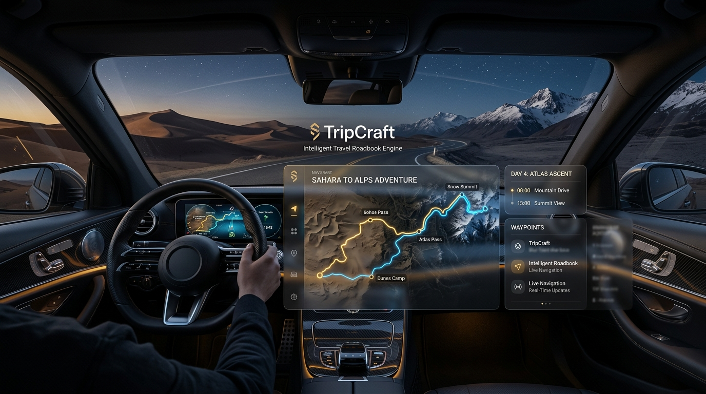
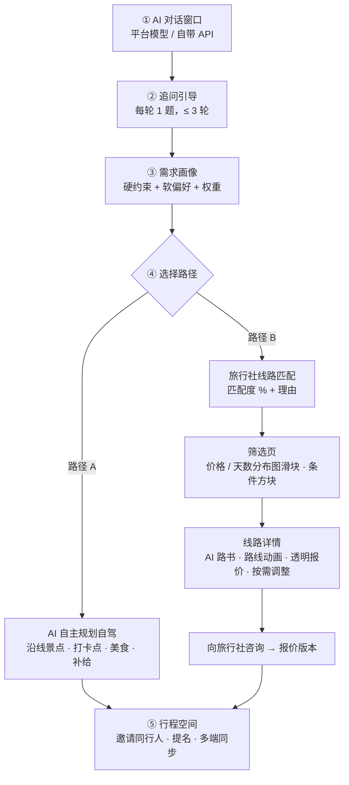
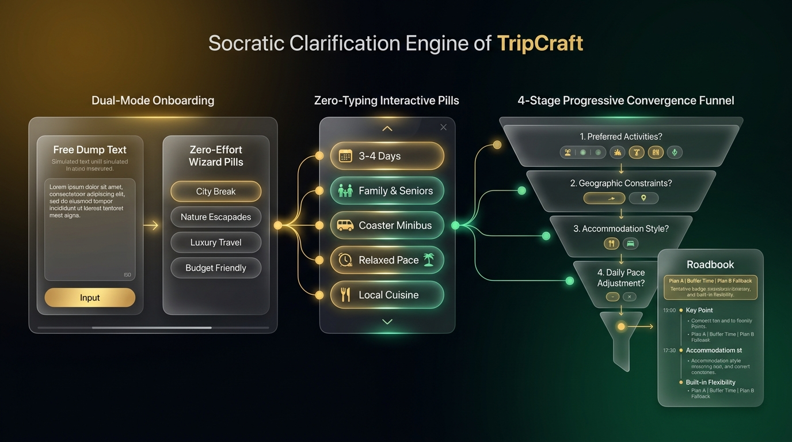
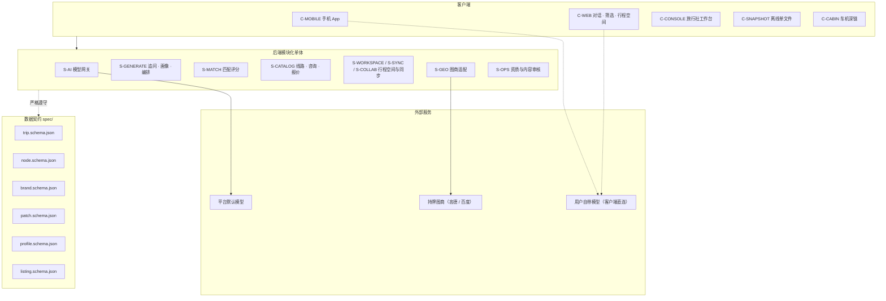
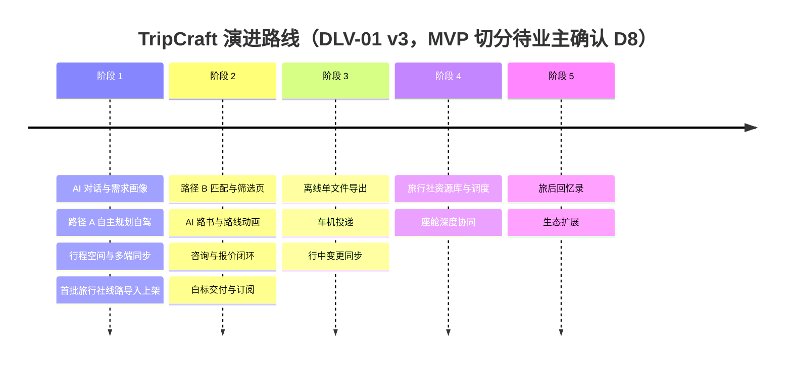

# TripCraft · 旅艺

<div align="center">

<h3>多端同步、多人共享的 AI 旅行规划 App</h3>
<p><b>用对话说清需求 · AI 规划自驾路线 · 匹配最合适的旅行社线路 · 全家一起看一起改</b></p>

[](LICENSE)
[-FE3C01.svg)](docs/product/PRD-01-vision-positioning.md)
[-lightgrey.svg)](docs/delivery/DLV-01-roadmap-mvp.md)
[](spec/)
[](tools/)
[](apps/showcase/)

<p align="center">
  <a href="https://johnmaxwell0123.github.io/TripCraft/"><b>🌐 演示站</b></a> •
  <a href="docs/product/PRD-01-vision-positioning.md"><b>📌 产品基线</b></a> •
  <a href="#-核心使用流程"><b>🧭 核心流程</b></a> •
  <a href="#-系统架构"><b>🏛️ 系统架构</b></a> •
  <a href="#-快速上手与门禁验证"><b>🚀 快速上手</b></a> •
  <a href="docs/README.md"><b>📚 执行全书</b></a> •
  <a href="spec/"><b>📦 数据契约</b></a>
</p>

<br/>



</div>

---

## 🌟 什么是 TripCraft

**TripCraft（旅艺）** 是一款面向自驾与深度游的 **AI 旅行规划 App**，同时为本地旅行社提供数字化的**线路工作室**。

- **对旅客**：像使用 ChatGPT / Claude 一样输入想法（平台默认模型，或换用自己喜欢的模型 API）。系统通过追问帮你把需求想清楚，提取成一份**需求画像**，再给出两种方案：
  - **路径 A · AI 自主规划自驾路线**：沿路线检索景点、打卡点、美食与补给，按家人的体力与作息排好每一天；
  - **路径 B · 匹配旅行社线路**：按匹配度排序展示持证旅行社的线路，在筛选页用**带价格分布图的滑块**和**条件方块**调节，像在找房平台上找房子一样。
- **对同行人**：方案进入**行程空间**，家人朋友通过链接加入、一起提意见；手机、平板、电脑实时同步，没信号时也能看。
- **对旅行社**：旅游仍然高度依赖本地资源，这些资源不在小红书攻略里。旅行社可以**上架线路被匹配**，用 **AI 生成交互路书与路线动画**，把**价格与包含项透明地列出来**，并让客户**按需调整线路与报价**——取代"发一份 PDF 文字行程"的传统沟通方式。

> 📌 **口径说明**：项目设计周期较长，文档经历过三次定位调整。**现行口径以 [产品基线 PRD-01 v3](docs/product/PRD-01-vision-positioning.md) 为准**；其中 [§8](docs/product/PRD-01-vision-positioning.md#8-本次基线变更2026-10-17被取代的旧口径) 列出了被取代的旧口径（例如"单文件离线快照是一等交付形态""不做旅行社比价撮合"）。

---

## 🧭 核心使用流程



| 环节 | 设计要点 | 专项设计 |
| :--- | :--- | :--- |
| **对话与追问** | 一个话不多的"老定制师"人设；用药丸选项代替写作文；回答"随便"就标待定，不反复逼问 | [第 8 章](docs/08-socratic-interaction-design.md) · [§16.2](docs/16-planning-paths-and-route-matching.md#162-对话入口与模型选择) |
| **自带模型 API** | Key 只存在你的设备上，平台不经手；无论用哪个模型，产出都走同一条校验管线 | [ADR-009](docs/architecture/adr/ADR-009-llm-provider-byok.md) |
| **需求画像** | 每个字段标注来源（你说的 / AI 推断的 / 默认的），推断项需要你确认 | [§16.3](docs/16-planning-paths-and-route-matching.md#163-需求画像特征点的提取) |
| **路径 A** | 模型只负责编排和写推荐理由；景点、店名、坐标、开放时间全部来自图商，查不到的标"待定" | [§16.5](docs/16-planning-paths-and-route-matching.md#165-路径-a--ai-自主规划自驾路线) · [ADR-008](docs/architecture/adr/ADR-008-ai-generation-guardrails.md) |
| **路径 B** | 先判资格（海拔、人数、日期等硬条件）再算匹配度；匹配度可展开分项；**付费不影响匹配度** | [§16.6](docs/16-planning-paths-and-route-matching.md#166-路径-b--旅行社线路匹配) · [ADR-010](docs/architecture/adr/ADR-010-route-matching-scoring.md) |
| **筛选页** | 价格滑块上方是真实的价格柱状分布（标出你的预算与市场中位）；方块显示选中后剩几条；无结果时告诉你放宽哪一项最有效 | [§16.7](docs/16-planning-paths-and-route-matching.md#167--筛选页设计) |
| **多人共享与同步** | 只收齐意见、不替你投票；长辈可用大字版或免安装的分享版 | [第 15 章](docs/15-multi-device-and-collaboration.md) |

<div align="center">



*图：追问漏斗与药丸点选交互*

</div>

---

## 🏢 面向旅行社：线路工作室

| 传统旅行社的问题 | 线路工作室的做法 | 设计依据 |
| :--- | :--- | :--- |
| 好线路被看见的机会少 | 上架后按需求画像匹配给合适的旅客；已有的 Word / PDF 行程单可直接导入 | [§17.3](docs/17-agency-route-studio.md#173-线路上架三种录入方式) |
| 信息不透明、旅客信赖度低 | 包含 / 不包含必填；价格展示档位（起价 / 区间 / 分项明细）由旅行社选择；实拍与示意分开标注；资质公示；司导名片 | [§17.5](docs/17-agency-route-studio.md#175-透明度设计) |
| 只能发 PDF，看不懂 | AI 生成交互路书与 30–60 秒路线动画 | [§17.6](docs/17-agency-route-studio.md#176-ai-路书与路线动画) |
| 按客户需求改线路、改价成本高 | 可调选项预先定价，客户自助看到预估价；报价按版本留痕并自动列出差异 | [§17.7](docs/17-agency-route-studio.md#177-按需调整与报价闭环) |
| 担心平台抢客户 | 平台不自营线路；咨询记录只对双方可见；成交后的白标路书不出现平台品牌与竞品 | [§17.8](docs/17-agency-route-studio.md#178-客户归属与旅行社的顾虑) |

**只有通过资质审核的持证旅行社可以上架和被匹配**（[§13.5.4 资质红线](docs/13-agency-partnership-design.md#1354--一个必须先回答的问题他有资质吗)）。商业模式见 [PRD-05](docs/product/PRD-05-business-model.md)：主要收入来自旅行社的工作室订阅与线索包，C 端基础功能免费。

---

## 🧩 支撑能力

这些能力保留原有设计，但不承担主叙事，排期在主线之后（[DLV-01](docs/delivery/DLV-01-roadmap-mvp.md)）：

| 能力 | 一句话 | 设计依据 |
| :--- | :--- | :--- |
| **离线可读与单文件导出** | 已同步的行程断网可读；可导出零依赖单文件 HTML 发给不装 App 的长辈 | [第 1 章](docs/01-resilience-and-failover.md) · [第 5 章](docs/05-compiler-pipeline.md) · [ADR-006](docs/architecture/adr/ADR-006-snapshot-delivery-format.md) |
| **车机投递** | 全天途经点一键交给车机导航（深链 + 手机投屏） | [第 2 章](docs/02-cockpit-protocol.md) |
| **白标交付** | 旅行社把成交后的路书以自有品牌交给客户 | [第 3 章](docs/03-b2b-agency-operations.md) |
| **旅后回忆录** | 照片与足迹整理成回忆 | [第 6 章](docs/06-memory-journal-engine.md) |

---

## 🛡️ 能力边界

1. 🚫 **不是旅行社**：平台不自营线路、不组团、不与旅客签旅游合同；阶段 1–2 不经手团款，合同与付款在旅行社与旅客之间完成。
2. 🚫 **只为持证旅行社引流**：未通过资质审核的主体不能上架、不会出现在匹配结果中；匹配引流的合规边界须律师出具意见（OI-021），意见出具前路径 B 不对公众开放。
3. 🚫 **模型不编造事实**：景点、店名、坐标、开放时间只能来自图商或旅行社确认；AI 生成的文字与画面显式标注。
4. 🚫 **不是导航软件，不控制车辆**：不触发或干预 NOA，不读取车辆 SOC；车机能力止于深链投递与手机投屏。
5. 🚫 **不自研地图**：调用持牌图商服务，严守 BR-025——产物中不内联算路几何。

> 📌 更多边界与事实更正见 [PRD-01 §5](docs/product/PRD-01-vision-positioning.md#5-能力边界规范-scope--boundaries) 与 [docs/ERRATA.md](docs/ERRATA.md)。

---

## 🏛️ 系统架构



完整设计见 [ARC-01 系统总体架构](docs/architecture/ARC-01-overview.md) 与 [ARC-09 架构决策索引](docs/architecture/ARC-09-adr-index.md)（ADR-001 ~ ADR-010）。

---

## 📊 实现状态与路线图

**当前仓库只有设计文档、数据契约、门禁工具与演示站，还没有产品代码。**

| 模块 / 组件 | 设计状态 | 实现状态 | 依据 |
| :--- | :--- | :--- | :--- |
| `spec/` 数据契约 | 已验证 | **已实现** | [spec/](spec/)、[第 4 章](docs/04-dsl-specification-v1.md) |
| `tools/` 门禁工具链 | 已验证 | **已实现** | [tools/](tools/) |
| `examples/` 标杆数据 | 已验证 | **已实现** | [trip.json](examples/dunhuang-silkroad-9d/trip.json) |
| `apps/showcase` 演示站 | 已评审 | **已上线**（叙事尚未覆盖路径 B 与线路工作室） | [apps/showcase/](apps/showcase/)、[演示站](https://johnmaxwell0123.github.io/TripCraft/) |
| 对话入口、需求画像、路径 A | 草案 | 未开始（阶段 1） | [第 16 章](docs/16-planning-paths-and-route-matching.md) |
| 多端同步与行程空间 | 草案 | 未开始（阶段 1） | [第 15 章](docs/15-multi-device-and-collaboration.md) |
| 旅行社线路导入与上架 | 草案 | 未开始（阶段 1） | [第 17 章](docs/17-agency-route-studio.md) |
| 路径 B 匹配与筛选页、AI 路书、报价闭环 | 草案 | 未开始（阶段 2） | [第 16 章](docs/16-planning-paths-and-route-matching.md)、[第 17 章](docs/17-agency-route-studio.md) |
| 单文件编译器、车机投递 | 已评审 | 未开始（阶段 3） | [第 5 章](docs/05-compiler-pipeline.md)、[第 2 章](docs/02-cockpit-protocol.md) |



---

## 📦 数据契约

系统的数据输入、输出与流转受 `spec/` 下的 JSON Schema（Draft 2020-12）约束：

| Schema | 职责 |
| :--- | :--- |
| [`spec/trip.schema.json`](spec/trip.schema.json) | **行程 DSL**：路径 A 草案、旅行社线路的逐日行程、成交后的白标路书都使用它 |
| [`spec/node.schema.json`](spec/node.schema.json) | 行程节点：坐标、停留时长、开放时间、事实与建议分离 |
| [`spec/brand.schema.json`](spec/brand.schema.json) | 旅行社白标品牌 |
| [`spec/patch.schema.json`](spec/patch.schema.json) | TripPatch 增量补丁 |
| [`spec/profile.schema.json`](spec/profile.schema.json) | **需求画像**：对话与规划之间唯一的接口；每个特征点标注来源 `stated` / `inferred` / `default`，区分硬约束与软偏好（[§16.3.1](docs/16-planning-paths-and-route-matching.md#1631-特征点清单)） |
| [`spec/listing.schema.json`](spec/listing.schema.json) | **上架线路**：行程 DSL + 上架信封（价格规则、可调选项、包含项、团期、人群适配、素材标注；不含成本价，[§17.4](docs/17-agency-route-studio.md#174-上架线路包含什么)） |

---

## 🚀 快速上手与门禁验证

### 1. 查看演示站
直接访问 [演示站](https://johnmaxwell0123.github.io/TripCraft/)，无需本地安装。

### 2. 安装门禁工具
```bash
git clone https://github.com/JohnMaxwell0123/TripCraft.git
```

```bash
npm install
```

### 3. 运行全部门禁
```bash
npm run check
```

```text
npm run check
├── 1. validate     校验 6 份 JSON Schema 契约与示例数据（含 listing → trip 跨文件校验）
├── 2. check-links  校验 README 与 docs/ 下全部 Markdown 跨文件链接与标题锚点
├── 3. check-br025  拦截违规内联的图商算路几何（含注入测试与阈值边界测试）
└── 4. check-trace  校验场景、功能、架构决策与假设的全链路追溯闭环
```

### 4. 本地运行演示站
```bash
npm run showcase:dev
```

```bash
npm run showcase:build
```

---

## 📚 文档导航

```text
docs/
├── product/        产品设计包 PRD-01 ~ PRD-05（★ PRD-01 = 产品基线，口径以它为准）
├── architecture/   系统架构包 ARC-01 ~ ARC-10、ADR-001 ~ ADR-010
├── delivery/       交付规划包 DLV-01 ~ DLV-03（路线图、风险、追溯矩阵）
├── 00 ~ 17         执行全书：专项设计与工程细节（章首注明与基线的关系）
│   ├── ★ 16        双路径规划与旅行社线路匹配（对话 · 画像 · 筛选页）
│   └── ★ 17        旅行社线路工作室（上架 · AI 路书 · 透明报价）
├── ASSUMPTIONS.md  商业与技术假设台账（A-01 ~ A-18）
├── ERRATA.md       事实核查与更正
└── WHITEPAPER.md   早期白皮书（历史背景）
```

入口：[执行全书总览](docs/README.md) ｜ [产品包](docs/product/README.md) ｜ [架构包](docs/architecture/README.md) ｜ [交付包](docs/delivery/README.md)

---

## 📂 仓库目录结构

```text
TripCraft/
├── apps/showcase/     演示站（Next.js 16 / React 19 / Tailwind），推送 main 后自动部署到 GitHub Pages
├── spec/              JSON Schema 数据契约
├── docs/              产品、架构、交付文档与执行全书
├── examples/          标杆样例数据（河西走廊 9 天）
├── tools/             门禁工具链
├── AGENTS.md          智能体协作指南
├── PROJECT_PROGRESS.md 项目进度与交接备忘
├── CHANGELOG.md       变更记录
└── LICENSE            MIT
```

---

## 🏷️ GitHub 仓库配置建议

- **Description**：`多端同步、多人共享的 AI 旅行规划 App —— 对话说需求，AI 规划自驾或匹配旅行社线路；为旅行社提供线路上架、AI 路书与透明报价（产品设计与系统架构全案）`
- **Website**：`https://johnmaxwell0123.github.io/TripCraft/`
- **Topics**：`travel` · `ai-agent` · `itinerary` · `local-first` · `route-matching` · `b2b2c` · `dsl` · `architecture` · `nextjs`

---

## 📄 开源许可证

本项目的数据契约、文档体系与门禁工具链遵循 [MIT License](LICENSE)。
