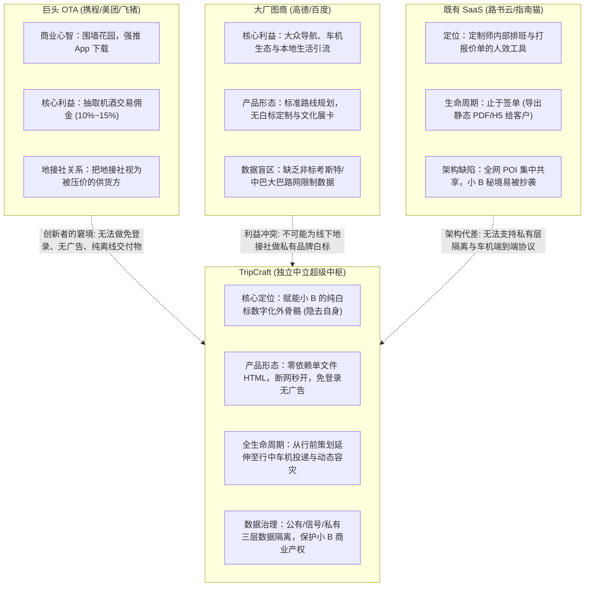

I will execute the **Delegation Routine** by invoking `DeepInvestigator` to conduct a rigorous Commercial Due Diligence (CDD) and business plan analysis.

Invoked subagent

I have delegated the Commercial Due Diligence analysis to the `DeepInvestigator` subagent and am waiting for the findings to be returned.

# TripCraft 商业可行性尽调（Commercial Due Diligence）与商业计划终审诊断报告

**出具方**：文旅科技与产业互联网早期投资基金 · 尽调投资委员会  
**评估对象**：TripCraft（旅艺 / 智程路书）商业计划与架构演进系统  
**基准工程与制度文件**：
- 规划与白皮书：[`PROJECT_PROGRESS.md`](file:///d:/Document/Project/TripCraft/PROJECT_PROGRESS.md)、[`docs/WHITEPAPER.md`](file:///d:/Document/Project/TripCraft/docs/WHITEPAPER.md)、[`docs/product/PRD-05-business-model.md`](file:///d:/Document/Project/TripCraft/docs/product/PRD-05-business-model.md)
- 商业与业务逻辑：[`docs/ASSUMPTIONS.md`](file:///d:/Document/Project/TripCraft/docs/ASSUMPTIONS.md)、[`docs/13-agency-partnership-design.md`](file:///d:/Document/Project/TripCraft/docs/13-agency-partnership-design.md)、[`docs/03-b2b-agency-operations.md`](file:///d:/Document/Project/TripCraft/docs/03-b2b-agency-operations.md)、[`docs/15-multi-device-and-collaboration.md`](file:///d:/Document/Project/TripCraft/docs/15-multi-device-and-collaboration.md)
- 协议、合规与技术防线：[`docs/02-cockpit-protocol.md`](file:///d:/Document/Project/TripCraft/docs/02-cockpit-protocol.md)、[`docs/07-legal-and-compliance.md`](file:///d:/Document/Project/TripCraft/docs/07-legal-and-compliance.md)、[`docs/architecture/adr/ADR-002-sync-conflict-model.md`](file:///d:/Document/Project/TripCraft/docs/architecture/adr/ADR-002-sync-conflict-model.md)、[`docs/architecture/adr/ADR-005-map-navigation-abstraction.md`](file:///d:/Document/Project/TripCraft/docs/architecture/adr/ADR-005-map-navigation-abstraction.md)、[`docs/architecture/adr/ADR-008-ai-generation-guardrails.md`](file:///d:/Document/Project/TripCraft/docs/architecture/adr/ADR-008-ai-generation-guardrails.md)、[`docs/architecture/ARC-08-nfr-deployment-cost.md`](file:///d:/Document/Project/TripCraft/docs/architecture/ARC-08-nfr-deployment-cost.md)、[`tools/check-br025.mjs`](file:///d:/Document/Project/TripCraft/tools/check-br025.mjs)  
**投资建议评级**：**谨慎推进 / 附前置合规与定价重构条件（Conditional Progress / Overhaul Required）**

---

### 执行摘要与核心裁决

TripCraft 在产品交互哲学与工程边界控制上展现了极罕见的成熟度（例如在 [`docs/ERRATA.md`](file:///d:/Document/Project/TripCraft/docs/ERRATA.md) 中果断砍掉虚假的 NOA 与车载 SOC 直连幻想、在 [`tools/check-br025.mjs`](file:///d:/Document/Project/TripCraft/tools/check-br025.mjs) 中以自动化门禁物理拦截图商密集 polyline 存储）。然而，从严苛的商业尽调视角来看，项目面临着**三大核心矛盾与一处重大合规红线**：

1. **破除合规误区（坚决否决“挂靠撮合”）**：
   行业内常有“撮合无资质车队挂靠有牌照地接社”的轻率建议。**这是触碰文旅执法的一票否决红线！** 根据我国《旅游法》第三十条及《旅行社条例》第三十四条，出租、出借旅行社业务经营许可证均属违法行为。[`docs/13 §13.5.4 L448`](file:///d:/Document/Project/TripCraft/docs/13-agency-partnership-design.md#L448) 与 [`docs/13 §13.10 G-26`](file:///d:/Document/Project/TripCraft/docs/13-agency-partnership-design.md#L853) 已立下铁律：*“不做资质挂靠撮合，任何帮你找一家社挂靠的设计是把客户和自己一起送进去”*。项目必须坚守此项合规防线。
2. **“群态（Group）”而非“平台态（Platform）”的技术自洽**：
   表面上看，[`docs/15-multi-device-and-collaboration.md`](file:///d:/Document/Project/TripCraft/docs/15-multi-device-and-collaboration.md) 的多人协同与 [`docs/13-agency-partnership-design.md`](file:///d:/Document/Project/TripCraft/docs/13-agency-partnership-design.md) 的“极度克制白标”存在张力。但代码与架构事实表明，[`docs/15 §15.9`](file:///d:/Document/Project/TripCraft/docs/15-multi-device-and-collaboration.md#159--与-b-端白标的关系这个形态反而加固了第-13-章) 将游客端定义为**“免全局账号、无发现广场、一次行程一个临时 Token”**的临时协同群，并未形成与地接社抢私域的公域平台。真正的裂痕在于早先 [`docs/WHITEPAPER.md §2.3`](file:///d:/Document/Project/TripCraft/docs/WHITEPAPER.md#23-破局路径二大厂插件-vs-universal-travel-harness万物皆可-plug-in) 中残留的“全网订单爬虫汇聚（A-01）与全网 CPS 自动分销（A-02）”这一历史空想，必须从商业计划书中彻底切除。
3. **图商商用年费“规模死亡谷”**：
   高德/百度企业商业授权年费起步约 5 万元。按早期 ¥199/月 的小额按月订阅，在付费客户不足 30 家时将面临严重倒挂，必须通过**“基础年费包销制”**重构定价策略。

---

## 一、痛点与价值主张深度评估

### 1. 战略定调：“数字化外骨骼”是唯一生路，C 端纯 AI 规划必死

在文旅产业互联网领域，面向 C 端的纯 AI 旅行规划产品在商业模式上已被判死刑：
- **低频消费与高 CAC 陷阱**：高净值长途自驾与深度游属于典型低频行为（一线中产年均 1~2 次）。C 端获客成本（CAC）在当前公域流量下高达 ¥50~¥100/人，用户返程后 App 留存断崖式下跌，全生命周期价值（LTV）无法覆盖获客成本。
- **OTA 巨头的垂类降维打击**：携程“携程问道”、飞猪集成 DeepSeek-R1 的“问一问”（[`docs/13-agency-partnership-design.md#L614-L619`](file:///d:/Document/Project/TripCraft/docs/13-agency-partnership-design.md#L614-L619)）背靠千万级动态房态、实时运力、动态门票与履约闭环。纯 C 端创业团队生成的行程无法实时锁房锁票，最终沦为无履约承接的玩具。
- **B 端刚需升维：从“省时间（防）”到“卖得贵（攻）”**：
  - 西部（甘青、川西、滇藏、南疆）数万家精品地接社、定制工作室与考斯特车队（[`docs/WHITEPAPER.md#L180-L184`](file:///d:/Document/Project/TripCraft/docs/WHITEPAPER.md#L180-L184)）全年处于接单、出单、改单状态，定制师日均耗费 4~8 小时手写排版粗糙的 Word 或微信长文本（[`docs/03-b2b-agency-operations.md#L28-L41`](file:///d:/Document/Project/TripCraft/docs/03-b2b-agency-operations.md#L28-L41)）。
  - [`docs/13-agency-partnership-design.md#L151-L177`](file:///d:/Document/Project/TripCraft/docs/13-agency-partnership-design.md#L151-L177) 洞察明确：旅行社老板对“节约定制师工时”兴致索然，但对“客单价提升”极度饥渴。**TripCraft 的核心不是卖排版效率，而是将地接社手里的真实考斯特车况、金牌老司机、独家秘境通过 Apple 级白标交互路书呈现，让同一条线路从 6,800 元/人的廉价团卖出 8,800 元/人的高定溢价。**

### 2. B2B2C 飞轮的自洽性推演与“表象撕裂”的技术化解

项目初期文档与后期规范曾存在表象冲突：

```
                    ┌──────────────────────────────────────────────┐
                    │            TripCraft 的商业形态解耦           │
                    └──────────────────────────────────────────────┘
                                           │
         ┌─────────────────────────────────┴─────────────────────────────────┐
         ▼                                                                   ▼
【B 端白标交付：极度克制】                                          【多端协同与行中交付：轻量群态】
依据：docs/13 §13.3.3 & docs/03 §3.2.2                               依据：docs/15 §15.9 & ARC-03
• “三条不越线”：不露品牌、不碰客户、不做撮合                         • 像“微信群”，不像“平台”
• 游客免登免装、无全局账号、离线单文件秒开                           • 一次行程一个临时凭证，行程结束销毁
• 承诺 A 社私有关系对 B 社绝对物理隔离                               • 无发现广场、无公域社区、不抢客户
• 保护小 B 私域信任底线                                             • 专注于行中路线变更与断网容灾
```

- **架构解耦事实**：[`docs/15-multi-device-and-collaboration.md#L676-L705`](file:///d:/Document/Project/TripCraft/docs/15-multi-device-and-collaboration.md#L676-L705) 已经完成清晰界定：**TripCraft 的协同层像“群”，不像“平台”**。游客在微信中打开路书或进入协同空间，凭借的是该次行程的专属签名 Token，不需要注册成为平台持久化用户，更不会在平台上看到其他竞争旅行社的产品推荐。
- **资产沉淀的真实逻辑**：在 [`docs/13-agency-partnership-design.md#L530-L543`](file:///d:/Document/Project/TripCraft/docs/13-agency-partnership-design.md#L530-L543) 中，团队明确提出：*“B 端不给我们客户，给我们弹药（真实行程、地面资源、车厂谈判规模）”*。平台的网络效应不建立在聚拢 C 端散客，而建立在**小 B 录入的地面通行数据（信号层）**上。
- **业务整改决议**：商业计划书必须从主叙事中**彻底剥离** [`docs/WHITEPAPER.md#L197-L200`](file:///d:/Document/Project/TripCraft/docs/WHITEPAPER.md#L197-L200) 与 [`docs/product/PRD-05-business-model.md#L23-L25`](file:///d:/Document/Project/TripCraft/docs/product/PRD-05-business-model.md#L23-L25) 中残留的“全网订单跨平台汇聚、全网 CPS 自动比价分销、C 端 VIP 门票”。**专注 Pure B2B2C 赋能，绝不在 C 端分润上动歪脑筋。**

---

## 二、商业脆弱点逐条穿透推演

逐条穿透 [`docs/ASSUMPTIONS.md`](file:///d:/Document/Project/TripCraft/docs/ASSUMPTIONS.md) 中的 12 项商业与技术假设：

| 假设 ID  | 核心假设陈述                                 | 商业与工程现实尽调穿透                                       |  风险评级  | 真实商业与工程破局解法                                       |
| :------- | :------------------------------------------- | :----------------------------------------------------------- | :--------: | :----------------------------------------------------------- |
| **A-01** | 可经用户授权汇聚多平台订单数据               | **【极度脆弱，几无可能】** 携程、美团、飞猪均为封闭围墙花园，绝无开放接口；自建爬虫在 [`docs/07-legal-and-compliance.md#L184-L195`](file:///d:/Document/Project/TripCraft/docs/07-legal-and-compliance.md#L184-L195) 已被确立为违法一票否决红线。依赖用户手动导入，流失率超 90%。 | 🔴 **致命** | 放弃“全网自动汇聚”定位；降级为“模板化手动快速填报卡片 + 结构化短信/剪贴板本地解析”，不向用户承诺 API 直连。 |
| **A-02** | CPS 佣金 3%~8% 可变现                        | **【模型失效，伤害信任】** 机票高铁分销佣金几乎为零（¥1~¥3/张），酒店门票实际净佣金不足 1.5%。且若在 B 端白标路书中植入平台 CPS 外链，旅行社会强烈怀疑平台试图抢夺其客户并赚取私利，破坏 B 端合作根基。 | 🔴 **致命** | 商业模型中直接剔除 CPS 收入预测；将第三方外链定义为“免责的便捷跳转工具”，不计入核心损益表。 |
| **A-03** | 地接社/车队愿为白标路书付费（¥199/月或按单） | **【季节性流失陷阱】** 川西、青甘、新疆地接社具有极强的“夏半年营业、冬半年歇业”特征（5-10月营业，11-4月休眠）。按月订阅将导致冬季退订流失率 >70%；且竞品“路书云”已深耕十年（[`docs/13-agency-partnership-design.md#L600-L610`](file:///d:/Document/Project/TripCraft/docs/13-agency-partnership-design.md#L600-L610)）。 | 🟠 **高危** | 改造计费模型为“**基础年费（锁定全年数据与资产托管）+ 团量出单点卡预充值**（如 ¥2,999 包含 60 团出单额度）”，消除冬季退订摩擦。 |
| **A-04** | 白标交付可提升客单价 ¥1000+ / 溢价 50%       | **【归因谬误，逻辑脆弱】** 行程报价能否卖到 8,800 元，核心取决于线下车况、酒店与餐饮标准。路书工具真正提升的是**“询单转化率（Lead-to-Deal Conversion）”与“减少改单耗时”**（[`docs/13-agency-partnership-design.md#L781-L795`](file:///d:/Document/Project/TripCraft/docs/13-agency-partnership-design.md#L781-L795)），强行承诺价格溢价无法说服精明的老板。 | 🟡 **中度** | 修正营销话术：主打“询单成交率提升 25%、改单耗时从 2 小时降至 5 分钟、现场事故客诉率降低 80%”，让地接社老板自己感知溢价空间。 |
| **A-05** | 手车互联可把手机端高德路线同步到车机         | **【车厂生态碎片化断层】** 车载前装高德/百度多为车企定制版，剥离了通用账号体系或禁用了云同步通道（[`docs/02-cockpit-protocol.md#L881`](file:///d:/Document/Project/TripCraft/docs/02-cockpit-protocol.md#L881) TV-09、TV-13 尚未实测闭环）。 | 🟠 **高危** | 恪守路径 A（通用 Scheme 深链投递）与路径 B（手机投屏镜像，CarPlay/HiCar/超级桌面），将端到端账号云同步定级为探索性增强特性。 |
| **A-06** | 深链可一次投递多个途经点到车机导航           | **【协议上限未经验证，存在静默截断风险】** 高德 `amapuri://route/plan/` 官方未公布途经点上限（[`docs/02-cockpit-protocol.md#L140`](file:///d:/Document/Project/TripCraft/docs/02-cockpit-protocol.md#L140)）。车机若静默丢弃多余途经点（TV-07d），会导致用户在无人区漏走重要打卡点甚至补给点。 | 🟠 **高危** | 执行 [`docs/02 §2.3.2 L894`](file:///d:/Document/Project/TripCraft/docs/02-cockpit-protocol.md#L894) 强制保守策略：单次投递严格限制在 ≤4 个途经点，结合 C-02 规则按上午/下午在服务区或用餐点自动分批拆段。 |
| **A-07** | 用户愿为 VIP 分层付费                        | **【脱离实际】** 普通自驾散客低频出游，且习惯了互联网免费工具，不可能为“液态玻璃换肤”或“AA记账导出”每月付 VIP 订阅费。 | 🔴 **致命** | 取消 C 端 VIP 会员收费计划；维持 C 端基础功能永久免费以作为漏斗和口碑来源。 |
| **A-08** | 所选同步模型在弱网场景下可满足协作体验       | **【状态分叉与并发冲突】** 团队在 [`docs/architecture/adr/ADR-002-sync-conflict-model.md#L13-L17`](file:///d:/Document/Project/TripCraft/docs/architecture/adr/ADR-002-sync-conflict-model.md#L13-L17) 中因 CRDT 体积过大无法塞入二维码（QR ≤ 2KB）而否决了纯 CRDT，选择了“中心化权威日志 + TripPatch”。但在长周期无网环境下，多人分叉合并仍需人工仲裁。 | 🟡 **中度** | 严格贯彻“领队单点裁决（Leader Authority）”原则：离线状态下成员提交的操作全部标记为 Suggestion，仅领队终端拥有将变更打包为权威 `patch.json` 并生成二维码的权限。 |
| **A-09** | 地图/路线服务商的商用条款与成本可承受        | **【固定成本高悬】** 高德企业级商用授权年费通常 5 万元起步（OI-007），且严禁服务器落库路线 polyline（[`tools/check-br025.mjs`](file:///d:/Document/Project/TripCraft/tools/check-br025.mjs)）。前期小规模租户无法摊薄此项固定开销。 | 🔴 **致命** | 详见第三章成本精算与重构定价方案。                           |
| **A-10** | 机构愿意提供资质与独家资源并接受审核         | **【供需断裂与合规死结】** 有资质的社视私有关系为生命线，担忧平台外泄；无资质的野领队/车队无法通过合规审核（[`docs/13-agency-partnership-design.md#L450-L460`](file:///d:/Document/Project/TripCraft/docs/13-agency-partnership-design.md#L450-L460)）。 | 🔴 **致命** | 依托“三层数据架构（私有层物理隔离）”打消大社顾虑；严禁挂靠撮合，以合规分社为主力客群（详见第五部分）。 |
| **A-11** | AI 生成行程的 POI 准确度达到可用标准         | **【高危幻觉与安全红线】** 西部荒漠与高原存在季节性限行、军事涉密禁区与生态保护红线。大模型极易幻觉出“封路期翻越雪山”或“穿越保护区”等致命错误。 | 🟠 **高危** | 贯彻 [`docs/architecture/adr/ADR-008-ai-generation-guardrails.md#L20-L23`](file:///d:/Document/Project/TripCraft/docs/architecture/adr/ADR-008-ai-generation-guardrails.md#L20-L23)：LLM 仅负责意图提取与初步排程，所有 POI 经纬度与通达性必须与图商官方 API 及涉密/生态黑名单硬比对，未通过者强制标为 `tentative`。 |
| **A-12** | 用户愿为账号与云同步迁移，而非只用快照       | **【快照悖论】** 零依赖单文件 HTML 快照体验越极致，用户和旅行社就越倾向于直接发微信，从而完全丧失下载 App 与注册账号的动力。 | 🟠 **高危** | 接受“快照即终态”的现实，将离线 HTML 快照作为核心品牌护城河与 B 端收费单元，不把 App 装机量作为核心 KPI。 |

---

## 三、成本与毛利精算模型

针对小 B 地接社订阅费用（基准设定：**¥199/月 = ¥2,388/年**），我们对其主要变动成本与固定成本进行精算推演：

### 1. 成本要素精算

#### (1) 合规持牌图商商用调用资费（高德 / 百度）
根据中国测绘地理信息法律法规及图商开发者服务条款：
- **企业商业授权门槛（固定成本）**：凡对外提供商用 SaaS、向客户收取软件服务费或提供企业白标的平台，必须取得图商官方企业商用授权。高德开放平台商业授权年费基准为 **¥50,000 / 年**（百度地图商用授权年费同样在 ¥50,000 左右区间）。
- **Web 服务 API 阶梯调用费（变动成本）**：
  - POI 关键字检索 / 周边搜索：约 ¥1.5 ~ ¥2.5 / 千次；
  - 驾车路径规划（Driving API）：约 ¥3.0 ~ ¥5.0 / 千次；
  - 静态地图与逆地理编码：约 ¥1.5 / 千次。
- **单份路书制作的图商消耗**：
  - 典型 7 天自驾行程包含约 35 个关键节点。
  - 定制师在苏格拉底澄清、点选修正、周边推荐与算路耗时预估中，平均触发 40 次 POI 检索与 30 次驾车规划。单份路书直接 API 成本约为：
    $$40 \times 0.002 + 30 \times 0.004 = 0.08 + 0.12 = \mathbf{¥0.20 \text{ / 份}}$$
  - 假设一家活跃地接社月均产出 40 份路书，单月变动 API 成本仅为 **¥8.00 / 月**。
- **核心风险点**：变动成本极低，但 **¥50,000 的固定授权底座是必须越过的刚性门槛**。

#### (2) 大模型（LLM）推理 Token 成本
依据 [`docs/architecture/adr/ADR-008-ai-generation-guardrails.md`](file:///d:/Document/Project/TripCraft/docs/architecture/adr/ADR-008-ai-generation-guardrails.md) 的生成流水线：
- **Prompt 与 DSL 体积**：TripCraft 采用规范严苛的 JSON Schema 契约（[`spec/trip.schema.json`](file:///d:/Document/Project/TripCraft/spec/trip.schema.json)）。一次完整的 7 天甘青自驾 DSL 产物（含节点、酒店、考斯特通行指南、安全提示）输出 Token 约在 10,000 ~ 15,000 Tokens。
- **多轮交互消耗**：苏格拉底澄清反问（≤3轮，[`PRD-05 §6 L134`](file:///d:/Document/Project/TripCraft/docs/product/PRD-05-business-model.md#L134)）+ 意图解析 + 结构化生成 + 校验失败重试（Repair）：
  - 整体单份有效路书消耗：Prompt Input 约 25,000 Tokens，Completion Output 约 18,000 Tokens。
- **模型选型与成本对照（单份路书）**：
  - *方案 A（采用顶配模型，如 Qwen-Max / Claude 3.5 Sonnet）*：输入 ¥0.02/k + 输出 ¥0.06/k $\rightarrow$ **单单成本约 ¥1.58**。若小 B 月均制作 40 份路书，月 Token 成本为 **¥63.20**（占 ¥199 订阅费的 **31.7%**，毛利侵蚀严重）。
  - *方案 B（采用性价比高阶模型，如 DeepSeek-V3 / Qwen-Plus）*：输入 ¥0.002/k + 输出 ¥0.008/k（结合 Prefix Caching 缓存命中更低） $\rightarrow$ **单单成本约 ¥0.19**。月均 40 份路书 Token 成本仅为 **¥7.60**（占订阅费 **3.8%**，高度健康）。

#### (3) 云服务器基础设施底座（模块化单体）
根据 [`docs/architecture/ARC-08-nfr-deployment-cost.md#L30-L65`](file:///d:/Document/Project/TripCraft/docs/architecture/ARC-08-nfr-deployment-cost.md#L30-L65)，生产环境采用云原生最小可行集群：
- 生产数据库（PostgreSQL 15 RDS 主从高可用 2c4g）：约 ¥260 / 月；
- 缓存节点（Redis 1GB HA 集群）：约 ¥110 / 月；
- 应用计算集群（2 台 ECS 2c4g，跑 Node.js 单体应用与异步编译 Worker）：约 ¥280 / 月；
- 对象存储（OSS/COS 存放路书快照）+ 边缘 CDN 带宽：约 ¥80 / 月；
- 短信网关（S-IDENTITY 验证码与应急通知，¥0.04/条）：约 ¥30 / 月；
- **固定云基建开销基准**：**¥760 / 月（约 ¥9,120 / 年）**。

---

### 2. 敏感性分析与“规模死亡谷”测算表

在不同付费机构（小 B）规模下，TripCraft 的综合毛利与盈亏平衡状态测算（假定采用 DeepSeek-V3 优化推理成本，变动成本按每机构 ¥18/月 计算）：

| 机构规模 (小 B 数量)  | 月度总营收 (¥199/月) | 年化总营收 (ARR) | 图商固定商用授权 (年) | 服务器基建底座 (年) | 动态变动总成本 (图商API+Token+存储) | 综合年度毛利  | 综合毛利率  |        财务健康评级        |
| :-------------------: | :------------------: | :--------------: | :-------------------: | :-----------------: | :---------------------------------: | :-----------: | :---------: | :------------------------: |
|  **5 家 (种子试点)**  |         ¥995         |     ¥11,940      |        ¥50,000        |       ¥9,120        |               ¥1,080                | **-¥48,260**  | **-404.2%** |   🔴 极度亏损（贴钱开发）   |
| **20 家 (初期落地)**  |        ¥3,980        |     ¥47,760      |        ¥50,000        |       ¥9,120        |               ¥4,320                | **-¥15,680**  | **-32.8%**  | 🔴 严重倒挂（无法覆盖图商） |
| **30 家 (临界平衡)**  |        ¥5,970        |     ¥71,640      |        ¥50,000        |       ¥9,120        |               ¥6,480                |  **+¥6,040**  |  **+8.4%**  |   🟡 勉强打平运营固定底座   |
| **50 家 (健康爬坡)**  |        ¥9,950        |     ¥119,400     |        ¥50,000        |       ¥9,120        |               ¥10,800               | **+¥49,480**  | **+41.4%**  |     🟢 步入良性正向毛利     |
| **100 家 (稳定成长)** |       ¥19,900        |     ¥238,800     |        ¥50,000        |       ¥9,120        |               ¥21,600               | **+¥158,080** | **+66.2%**  |  🟢 具备典型企业 SaaS 毛利  |
| **500 家 (区域成熟)** |       ¥99,500        |    ¥1,194,000    |  ¥80,000 (升级阶梯)   | ¥18,000 (集群扩容)  |              ¥108,000               | **+¥988,000** | **+82.7%**  |       🟢 强劲盈利能力       |

### 3. 破局结论与商业建议
- **“30 家机构死亡谷”的实质**：若付费客户数低于 30 家，高德/百度商业授权年费会将所有利润吞噬殆尽。
- **商业拆弹策略**：
  1. **种子期采用“非营利闭门内测”过渡**：在首批 3~5 家地接社共创期（Phase 1），明确定义为“联合研发测试期”，不向其收取公开 SaaS 软件订阅费，而是提供免费定向技术服务以换取数据与真实反馈，合法使用非商用开发者测试配额；
  2. **提价与重构计费包**：坚决废弃 ¥199/月的脆弱按月订阅，全面推行**“企业基础年费 ¥2,999/年（含 60 团基础配额与合规图商调用包）”**与**“专业旗舰版 ¥5,999/年（含 200 团配额）”**。在年付模型下，仅需 **17 家**机构即可彻底跨越 5 万元图商固定成本鸿沟！

---

## 四、竞争壁垒与防御性护城河

面对行业常见质问：*“如果携程、美团上线同款白标功能，或者高德把自驾路书做进高德地图，或者既有 SaaS（路书云、指南猫）跟进，TripCraft 凭什么不被碾死？”*，我们从竞争博弈论进行解构：



### 壁垒 1：巨头的“创新者窘境”（The Innovator's Dilemma）与组织惯性
- 携程或美团的商业根基是**交易佣金与流量变现**。巨头产品经理的 KPI 是“引导用户下载 App、增加端内时长、推销机酒交叉销售”。
- **巨头绝不可能允许其系统生成一份“没有任何携程 Logo、没有任何弹窗广告、不强制用户注册登录、支持离线在微信内秒开的单文件 HTML 路书”**。如果巨头这么做，就是在内部“自掘坟墓、流失流量”。
- TripCraft 的“零依赖、免登录、单文件、无平台品牌露脸”恰恰利用了巨头的组织包袱，形成不可被模仿的结构性防御。

### 壁垒 2：地接社对 OTA 的“背叛防御恐惧”（Defensive Trust）
- 地接社老板对 OTA 平台始终保持最高警惕：地接社在携程上开店是被压榨抽佣的供货方，双方存在天然零和博弈。旅行社老板绝不敢把自己十年来维系的“张掖老字号大包间留座关系、私家车队调度电话、特许通道细节”输入携程的系统，因为携程一旦获知细节，随时可以通过直采把地接社一脚踢开（[`docs/13-agency-partnership-design.md#L33-L36`](file:///d:/Document/Project/TripCraft/docs/13-agency-partnership-design.md#L33-L36)）。
- TripCraft 不做交易、不碰资金、承诺私有层数据绝对隔离（[`docs/13-agency-partnership-design.md#L471-L484`](file:///d:/Document/Project/TripCraft/docs/13-agency-partnership-design.md#L471-L484)），为小 B 提供了一个不受巨头盘剥的“中立安全岛”。

### 壁垒 3：针对既有 SaaS（路书云、指南猫）的“感受与周期代差”
- 依据 [`docs/13-agency-partnership-design.md#L600-L650`](file:///d:/Document/Project/TripCraft/docs/13-agency-partnership-design.md#L600-L650)，路书云与指南猫已成立十年，其产品核心 KPI 是**定制师的排单手速**（让一人月处理询单从 100 增至 200），交付物本质是给客户看的排版图文（文档），业务生命周期在**客户签单交钱的那一刻就结束了**。
- TripCraft 优化的是**客人的成交感受与行中体验**：
  - 产物贯穿行前（意境流派、长辈模式）、行中（车机深链多点投递、断网离线容灾、突发封路 TripPatch 动态补丁）、行后（AI 照片回忆录）；
  - 既有竞品的数据架构是全网共享中心化 POI 库，小 B 录入的秘境第二天就被同行抄走；TripCraft 的**“三层数据分层（公有/信号/私有）”**（[`docs/13 §13.6.2`](file:///d:/Document/Project/TripCraft/docs/13-agency-partnership-design.md#1362-三层数据)）实现了“保护小 B 商业秘密与发挥网络效应”的共存。

### 壁垒 4：极端离线环境的“生命线工程”
- 在西藏阿里、甘南扎尕那、青海柴达木等无人区，几无手机基站信号。高德在线路书与 OTA 页面必然全部白屏瘫痪。
- TripCraft 采用的自包含单文件静态离线技术（[`docs/architecture/ARC-08-nfr-deployment-cost.md#L18-L21`](file:///d:/Document/Project/TripCraft/docs/architecture/ARC-08-nfr-deployment-cost.md#L18-L21) 离线加载白屏率 0）与骨架降级机制，使其成为无人区现场唯一的可靠交付保障。

---

## 五、投资人灵魂五问与实操应对策略

在严苛的商业尽调（CDD）答辩会上，合伙人级投资人必然会抛出以下 5 个直击要害的尖锐问题：

### 灵魂一问【客群周期性与流失率死穴】
> **投资人质询**：*“你切入的川西、青甘精品小 B 地接社，业务具有极强的季节性（每年只做 5-10 月，冬天休眠）；而且文旅小 B 阵亡率极高，超过 40% 的小工作室活不过两年。如果他们冬天歇业就退订，你的月度流失率（Churn Rate）会极其难看，年化 LTV 根本算不过来，你怎么办？”*

- **应对策略（商业解法）**：
  1. **“候鸟型”产品跨区切线复用**：中国自驾定制具有典型的“冬南夏北”互补特征——做甘青线和川西线的精品地接社，冬季团队通常南下运作云南腾冲/西双版纳、海南环岛以及东北长白山粉雪专线。TripCraft 依靠五大液态玻璃主题（[`docs/WHITEPAPER.md#L391-L398`](file:///d:/Document/Project/TripCraft/docs/WHITEPAPER.md#L391-L398) 丝路大漠金、高原松石青、江南烟雨翠、极境极光银）天然支持全气候带跨区域切线，帮助地接社平滑过渡到冬季产品。
  2. **“预付点卡 + 永久资产托管”商业计费机制**：废弃脆弱的按月订阅，推行“预付出单点卡制（按有效出团出单量计费，例如 ¥2,999 包含 60 团出单额度，有效期 18 个月）”。淡季期间，地接社账号免费保留，所有的定制师模板、老司机路线资产与白标配置永久有效，避免退订流失，锁定年度现金流。

---

### 灵魂二问【大厂碾压与生态位挤压】
> **投资人质询**：*“携程有 10 万+ 旅行社供应商关系，高德有全国最准的算路。如果携程把‘AI 行程生成 + 旅行社白标’作为免费增值服务送给所有入驻商户，你作为一家毫无流量基础的独立初创软件，凭什么防止客户被免费服务吸走？”*

- **应对策略（商业解法）**：
  1. **打中“去中心化私域”的生存命脉**：精品地接社最优质的高净值客户来自熟客转介绍、小红书私域咨询与圈层团购。地接社在给这种客单价上万元的尊享客人交付时，**极其忌讳客人发现路书背后是由携程生成的**——因为这不仅会让客人产生“原来你只是携程二道贩子”的贬值感，甚至会让客人跳过地接社直接去携程比价。
  2. **坚持“不与民争利”的第三方中立软件定位**：TripCraft 销售的是“无痕技术设施”。正如 Shopify 面对 Amazon 的竞争一样——当中心化平台越强大、流量税越重，优质独立商家逃离平台、建立独立品牌资产的意愿就越强烈。TripCraft 坚守纯技术服务商身份，永远不向商户抽取流水佣金。

---

### 灵魂三问【合规红线与冷启动客户来源】
> **投资人质询**：*“你的规范写得极其清高：严禁向无资质主体开放旅行社物料生成（[`docs/13-agency-partnership-design.md#L450-L460`](file:///d:/Document/Project/TripCraft/docs/13-agency-partnership-design.md#L450-L460)）；但市场上最需要精美路书、最擅长在小红书引流的恰恰是大量无《旅行社业务经营许可证》的自由车队队长和独立领队。你对有流量的野领队关门，而拥有正规牌照的老牌大社决策慢、早被‘路书云’占领。你的冷启动前 50 家客户到底从哪来？”*

- **应对策略（商业解法）**：
  1. **严守法律底线，坚决不做挂靠撮合**：依据《旅游法》第三十条，出租、出借许可证属明确违法行为。TripCraft 恪守 [`docs/13 §13.10 G-26`](file:///d:/Document/Project/TripCraft/docs/13-agency-partnership-design.md#L853)，系统内绝不提供任何“帮你找社挂靠资质”的撮合流转功能，防范平台构成协同违法（OI-016）。
  2. **精准切入“拥有合法分社资质的自主工作室”**：文旅行业当下的核心供给并非老迈的国企总社，而是大量**“挂靠在大型旅行社名下但完全自负盈亏、拥有合法分社营业执照与旅游备案编号的年轻定制工作室”**。他们资质完全合规，能通过系统审核，却拥有极其迫切的独立品牌塑造需求，决策人即业务操盘手，能够实现 20 分钟快速签约。
  3. **针对无资质内容型领队实行“工具降级分离”**：对无证自驾领队，平台仅开放 C 端个人旅行回忆录（[`docs/06-memory-journal-engine.md`](file:///d:/Document/Project/TripCraft/docs/06-memory-journal-engine.md)）与个人行程日志工具，**物理锁定旅行社白标与招徕模板（G-24/G-25）**。若其希望从事商业带团，必须自行在工商业流程中完成正规分社设立或与地接社签署线下劳务聘用协议。

---

### 灵魂四问【成本剪刀差与单位经济学自愈】
> **投资人质询**：*“高德商业授权年费起步 5 万元。在前期只有 10~20 家客户时，若收 199 元/月，你每卖一份都在巨亏；如果你不买商业授权用免费 Key，图商法务函一旦寄到，你的系统就会被瞬间封死。你怎么跨过早期的规模死亡谷？”*

- **应对策略（商业解法）**：
  1. **商业模式由月付切换为年付包销**：取消 ¥199/月 散卖，推出“企业年度起步包 ¥2,999/年（含 60 团出单额度与基础图商配额）”。年付模式下，仅需 17 家签约小 B 即可完全打平 5 万元图商固定底座。
  2. **工程级极简调用控制（BR-025 守则）**：严格执行 [`tools/check-br025.mjs`](file:///d:/Document/Project/TripCraft/tools/check-br025.mjs) 自动化门禁——服务端绝不存储和计算密集算路 polyline，行中导航 100% 委托给客户端原生系统深链（`amapuri://`、`iosamap://`），服务端仅消耗极其廉价的 POI 结构化检索 API（每千次仅需 ¥1.5~2.5）。
  3. **生态孵化合作**：对接阿里云文旅创新扶持计划及腾讯云数字文旅孵化器，申请初创企业 API 与算力抵扣券，最大限度压降早期的现金资本支出。

---

### 灵魂五问【离线快照的‘自毁’倾向与网络效应】
> **投资人质询**：*“你们引以为豪的‘单文件零依赖离线 HTML’体验越好，客户就越不需要你的 App；游客扫码就看，完全不需要注册账号。如果终端客户永远沉淀不下来，平台无法建立网络效应，你最终不就沦为一个极其平庸的单机排版工具吗？”*

- **应对策略（商业解法）**：
  1. **明确网络效应的承载主体是“供给端情报”，而非“C 端社交流量”**：
     - TripCraft 的核心护城河是**“地面通行数据与老司机情报的众包沉淀”**（[`docs/13 §13.6.4`](file:///d:/Document/Project/TripCraft/docs/13-agency-partnership-design.md#1364-飞轮)）。每家地接社使用系统，都会在“信号层”贡献脱敏的通行记录（如“近 90 天有 12 个团走过该垭口”），使得后来的地接社排出的路书更准、防灾能力更强。
  2. **离线单文件是“守门员”，协同与回忆录是“前锋”**：
     - 离线单文件保障了无人区断网秒开的抗灾底线；
     - 但行中的动态多车协同（车距超限报警）、突发降雪一键下发路线变更补丁（TripPatch）、以及旅后多成员照片通过 GPS Exif 自动拼合生成的高清回忆录（[`docs/06-memory-journal-engine.md`](file:///d:/Document/Project/TripCraft/docs/06-memory-journal-engine.md)），必须通过联网协同层才能完整激活。
  3. **“群态体验”驱动的自然裂变**：游客在享受了免装路书体验后，在旅途结束时看到“一键保存我的旅行足迹与 AI 回忆大片”，会以高转化率主动转化为平台注册组织者，完成从“被动受众”向“下一次自驾发起人”的平滑跃迁。

---

## 六、剩余问题与调查盲区 (Remaining Questions & Gaps)

尽调团队向总架构师与后续推进团队交接以下尚未完全闭合的技术、法务与商务盲区：

1. **OI-016 & OI-017（P0 级法务阻塞项）尚未获得执业律师书面意见**：
   - 协作层（[`docs/15-multi-device-and-collaboration.md`](file:///d:/Document/Project/TripCraft/docs/15-multi-device-and-collaboration.md)）引入了多人在群内推荐“野景点”并共同排程的产品形态。文旅执法对“为非法活动提供引流、客源对接便利”监管极为严格。虽然系统已设立 R1–R4 红线（不收款、不设领队特权），但其法理隔离有效性必须由文旅专业执业律师出具正式法律意见书。
2. **OI-010 & OI-018（P1 级数据契约阻塞项）尚未完成 Schema 升版**：
   - [`docs/15 §15.8.3 R4`](file:///d:/Document/Project/TripCraft/docs/15-multi-device-and-collaboration.md#1583--必须先立住的四条红线) 要求“同行者提议”与“事实”、“系统建议”在视觉上严格区分；但当前 [`spec/node.schema.json`](file:///d:/Document/Project/TripCraft/spec/node.schema.json) 的 `advice.generatedBy` 只有 `llm | human | hybrid | crowdsourced`。`crowdsourced` 传达的是伪共识权威，无法表达“单人未核验提议”。契约未改动前，工程代码无法开工。
3. **座舱深链途经点静默丢弃（TV-07d）与真机上限（TV-07b）未完成真车拉偏实测**：
   - `amapuri://route/plan/` 在车机 Android 大屏上若遇到超过 4 个途经点，是否存在“界面显示成功、导航路线却悄悄截断多余点”的最坏 Bug 尚未在主流智能座舱上逐点清点验证。
4. **高德官方商业授权阶梯资费书面函缺失（OI-007）**：
   - 目前 5 万元年费基于公开行业标准测算，高德开放平台针对“单文件编译型 SaaS 软件”的针对性政策尚未取得官方商务盖章确认函。
5. **地接社现场实测成单意愿证据不足（A-03 / A-10 / OI-014）**：
   - 仓库内尚无携带“两份路书并排对比（Word vs TripCraft）”前往西宁/成都地接社实地访谈的录音与意向签约记录。

### 推进路线建议：
- **第一步**：约谈文旅合规律师，闭合 OI-016 与 OI-017；
- **第二步**：修订 [`spec/node.schema.json`](file:///d:/Document/Project/TripCraft/spec/node.schema.json) 修复 OI-018 枚举语义缺陷；
- **第三步**：商务对接高德开放平台，明确企业商用授权起步阶梯；
- **第四步**：携带丝路 9 天样例路书，完成首批 3 家川西/青甘合规定制工作室实地拜访。