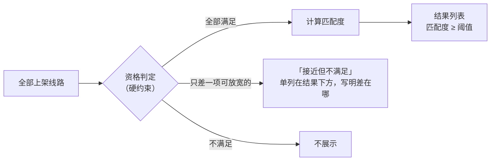

# 第 16 章 · 双路径规划与旅行社线路匹配

> **文档地位**：本章是 [产品基线 PRD-01 v3](product/PRD-01-vision-positioning.md) 中"支柱 1 AI 对话入口"与"支柱 2 双路径规划"的专项设计。属于**设计轨**，适用 [硬规则 B](README.md#两条硬规则)：每条设计决策写明「决策 → 为什么 → 不这样做会怎样」。
>
> **前置阅读**：[第 8 章 · 苏格拉底交互引擎](08-socratic-interaction-design.md)（追问方式与收敛判定）、[第 15 章 · 多端形态与协作层](15-multi-device-and-collaboration.md)（方案进入行程空间之后的事）。
>
> **配套决策**：[ADR-009 模型接入与自带 API](architecture/adr/ADR-009-llm-provider-byok.md) · [ADR-010 线路匹配评分](architecture/adr/ADR-010-route-matching-scoring.md) ｜ **B 端供给侧**：[第 17 章 · 旅行社线路工作室](17-agency-route-studio.md)

---

## 16.1 设计立场：为什么是两条路径

用户打开 TripCraft 时，心里的问题通常是下面两种之一：

| 用户的问题 | 适合的路径 | 产出 |
| :--- | :--- | :--- |
| 「我们自己开车去，路上该停哪、吃什么？」 | **路径 A · AI 自主规划自驾** | 一份 AI 编排、事实经图商核验的自驾行程草案 |
| 「有没有靠谱的旅行社线路适合我们家？」 | **路径 B · 旅行社线路匹配** | 一组按匹配度排序、可筛选、可调整的持证旅行社线路 |

| 决策 | 为什么 | 不这样做会怎样 |
| :--- | :--- | :--- |
| **两条路径共用同一段对话和同一份需求画像**，用户在画像形成后再选路径，且可以两条都看 | 用户在对话开始时往往还不知道自己要哪种；需求画像对两条路径都有用 | 若先让用户选"自驾 / 找旅行社"，选错的人要从头再说一遍需求，流失在第一步 |
| **两条路径的产出都写成同一种行程 DSL**（[`trip.schema.json`](../spec/trip.schema.json)） | 共享、同步、离线、导出能力只需要做一遍 | 两套数据模型 → 两套共享与同步逻辑，工作量翻倍且长期不一致 |
| **路径 B 只展示持证旅行社的线路** | 本地资源在旅行社手里；同时这是合规前提（[§13.5.4](13-agency-partnership-design.md#1354--一个必须先回答的问题他有资质吗)） | 为无资质主体引流，平台可能被认定为"提供便利"（OI-016 / OI-021） |

---

## 16.2 对话入口与模型选择

### 16.2.1 界面形态

对话入口沿用用户熟悉的大模型聊天界面：一个输入框，输入框左侧是模型选择器，右侧是附件与发送。

```text
┌──────────────────────────────────────────────────────────────────────┐
│  TripCraft                                         [行程空间] [我的] │
├──────────────────────────────────────────────────────────────────────┤
│                                                                      │
│   🧭  说说你想怎么玩？                                               │
│       可以很随意，比如「暑假带爸妈和孩子去西北，别太累」             │
│                                                                      │
│   [ 带长辈 ]  [ 自驾 ]  [ 想找旅行社 ]  [ 只有 5 天 ]  [ 预算有限 ]  │  ← 零输入药丸（§8.3.2）
│                                                                      │
├──────────────────────────────────────────────────────────────────────┤
│ [平台模型 ▾ 剩余 18/20] │ 暑假带爸妈和孩子去河西走廊，8 天左右…  📎 ➤ │
└──────────────────────────────────────────────────────────────────────┘
        │
        └─ 下拉：平台模型（默认） / 我的 Claude / 我的 DeepSeek / ＋ 添加自己的 API
```

- **📎 附件**：可以贴小红书截图、旅行社发来的 PDF、聊天记录——对应 [§8.3.3 素材投喂](08-socratic-interaction-design.md#833--模式-c--素材投喂readme-未覆盖)。
- **零输入药丸**：不想打字的用户点药丸即可进入 [§8.3.2 零输入向导](08-socratic-interaction-design.md#832-模式-b--零输入向导)。

### 16.2.2 自带模型 API（BYOK）

| 决策 | 为什么 | 不这样做会怎样 |
| :--- | :--- | :--- |
| 支持用户添加自己的模型 API（OpenAI 兼容接口、Anthropic 接口） | 业主要求；部分用户已有偏好的模型或已付费订阅 | 这部分用户会回到通用聊天工具，TripCraft 失去入口 |
| **用户的 Key 只保存在用户设备上**（加密本地存储），自带模型的调用由客户端直接发往模型服务商 | 平台不经手 Key，泄露面最小；与[铁律 4 数据主权](00-overview-and-glossary.md#铁律-4--数据主权本地化-local-data-sovereignty)一致 | Key 存在平台服务器 → 平台成为高价值攻击目标，一次泄露波及全部用户 |
| **无论用哪个模型，输出都走同一条校验管线**（结构校验 + 图商核验 + 合规词表） | 模型可换，质量底线不能随模型变 | 换一个模型就换一套幻觉风险；平台无法对产出负责 |
| 添加 Key 时做**能力检测**（是否支持结构化输出 / 工具调用、响应时延） | 追问与规划依赖结构化输出 | 用户选了一个不支持结构化输出的模型，规划过程中途失败且原因不明 |

**添加流程**：设置 → 模型 → 添加 → 选择接口类型 → 粘贴 Key 与（可选）自定义端点 → 能力检测（约 5 秒） → 显示检测结果与"数据将直接发送给该服务商"的告知 → 设为默认（可选）。

**隐私处理**：发送给任何模型（含平台模型）之前，客户端把姓名、证件号、手机号替换为占位符（"一位长辈""成员 A"）。自带模型的服务商在境外时，额外提示数据出境含义。合规口径见 OI-022。

**失败状态**：

| 情况 | 用户看到的 | 系统行为 |
| :--- | :--- | :--- |
| Key 无效 / 余额不足 | 「你的 DeepSeek 返回 401：Key 无效」+「改用平台模型继续」按钮 | 不静默切换（[铁律 8](00-overview-and-glossary.md#铁律-8--拒绝静默失败-never-fail-silently)），由用户选择 |
| 模型不支持结构化输出 | 添加时即提示「此模型可以聊天，但无法用于生成行程」 | 允许保存，但规划步骤自动使用平台模型并标注 |
| 平台模型免费额度用完 | 「今日额度已用完：可订阅，或添加自己的 API」 | 已形成的需求画像与行程不受影响 |

---

## 16.3 需求画像：特征点的提取

追问的产物是一份**需求画像（Requirement Profile）**。它是对话与规划之间唯一的接口：路径 A 的规划器与路径 B 的匹配器都只读画像，不读对话原文。

| 决策 | 为什么 | 不这样做会怎样 |
| :--- | :--- | :--- |
| 规划与匹配只读结构化画像，不读对话原文 | 结构化画像可校验、可回显、可复现；换模型不影响匹配结果 | 匹配结果取决于模型如何"理解"一段聊天，同样的需求两次得到不同结果，且无法解释 |
| 画像中每个字段标注来源：`stated`（用户明说）/ `inferred`（模型推断）/ `default`（行业默认） | [§8.5 回显确认](08-socratic-interaction-design.md#85--回显确认整个设计里最重要的一个动作)要求用户确认推断项 | 模型推断"预算 5000"被当成用户原话，匹配结果被一个用户从没说过的数字决定 |
| 画像区分**硬约束**与**软偏好** | 硬约束决定"能不能"，软偏好决定"有多合适" | 全部当软偏好 → 给 70 岁膝盖不好的长辈推荐 4000 米垭口线路，只是分数低一点 |

### 16.3.1 特征点清单

| 特征点 | 字段 | 硬/软 | 主要来源问题 | 路径 A 用途 | 路径 B 用途 |
| :--- | :--- | :---: | :--- | :--- | :--- |
| 出发地 | `origin` | 硬 | 「从哪出发？」 | 路线起点 | 是否含接送 / 集合地距离 |
| 目的地 / 区域 | `regions`、`mustVisit` | 必去为硬，其余软 | 「想去哪？有非去不可的吗？」 | 骨架与必经点 | 目的地覆盖度 |
| 回避项 | `avoid` | 硬 | 「有什么一定不要的？」 | 过滤 | 资格筛除 |
| 日期 | `dates`（最早/最晚/弹性天数） | 硬（弹性内为软） | 「什么时候走？能前后挪吗？」 | 开放时间校验 | 团期可用性 |
| 天数 | `days`（最少/最多） | 软 | 「玩几天？」 | 骨架长度 | 天数贴合度 |
| 同行人员 | `party`（成人/长者/儿童/婴幼儿） | 硬 | 「几个人？有老人小孩吗？」 | 体力与午休约束 | 人群适配、总价计算、容量 |
| 身体约束 | `hard[]`（海拔上限、台阶、晕车） | 硬 | §8.6 第二层问题树 | 过滤 POI 与路线 | 资格筛除 |
| 预算 | `budget`（人均/总价、区间、币种） | 软（用户说"最多"时为硬） | 「人均大概多少？」 | 住宿档次建议 | 预算贴合度、价格滑块初值 |
| 出行方式 | `travelMode`（自驾/包车/私家团/拼小团/跟团） | 软 | 「自己开还是有人开？」 | 判定是否走路径 A | 出行方式筛选 |
| 节奏 | `pace`、`maxDailyDriveHours` | 日车程上限为硬，其余软 | 「每天最多开几小时？」 | 每日编排 | 节奏贴合度 |
| 主题偏好 | `themes` | 软 | 「更想看什么？」 | POI 排序 | 主题重合度 |
| 住宿 | `accommodation` | 软 | 「住宿要求？」 | 过夜点选择 | 住宿档次 |
| 权重 | `weights` | — | 「这些里面最在意哪个？」（可跳过） | POI 排序权重 | 匹配度维度权重 |

> ⚠️ 需求画像目前**没有对应的数据契约**。它的一部分（`party`、`constraints.hard/soft`）可以复用 [`trip.schema.json`](../spec/trip.schema.json) 的定义，其余字段需要新契约，登记为 **OI-024**（与线路上架契约同批处理）。

### 16.3.2 只在需要时追问

[§8.6.2 动态跳题](08-socratic-interaction-design.md#862--关键机制动态跳题)同样适用于这里：

- **预算、出行方式**只在用户表现出路径 B 意向（提到旅行社、跟团、包车、"省心"）或进入路径 B 时才问；纯自驾用户不被追问预算。
- 追问轮次上限仍是 **3 轮**（[§8.9 收敛判定](08-socratic-interaction-design.md#89-收敛判定什么时候停止提问)）。3 轮后仍缺的字段写 `default` 并标待定，不阻塞出结果。

### 16.3.3 画像回显卡

收敛后，对话中出现一张可编辑的画像卡——它同时是 [§8.5 回显确认](08-socratic-interaction-design.md#85--回显确认整个设计里最重要的一个动作)的载体：

```text
┌─ 你的出行需求 ───────────────────────────────────────── [编辑] ┐
│ 👨‍👩‍👧‍👦 5 人：2 成人 · 2 长者(70+) · 1 儿童(4岁)                 │
│ 📍 兰州出发 · 河西走廊 · 必去：莫高窟、张掖丹霞               │
│ 📅 7 月中旬 · 8–10 天 · 日期可前后挪 3 天                     │
│ 🚗 每天车程 ≤ 4 小时 · 节奏轻松                                │
│ 💰 人均 ¥5,000–7,000   (推断 · 请确认)  ← inferred 字段带标记 │
│ ⛰ 海拔 ≤ 3,000 米（长辈膝盖手术）                             │
├───────────────────────────────────────────────────────────────┤
│  [ 🤖 AI 帮我规划自驾 ]        [ 🏢 看旅行社线路 · 23 条匹配 ] │
└───────────────────────────────────────────────────────────────┘
```

---

## 16.4 路径选择

| 决策 | 为什么 | 不这样做会怎样 |
| :--- | :--- | :--- |
| 画像卡底部**同时给出两个入口**，路径 B 的按钮上直接显示匹配数量 | 数量本身是信息（"有 23 条现成线路"），帮助用户判断 | 只给一个默认路径，另一条路径的价值用户永远不知道 |
| 根据画像**高亮推荐**其中一个，但不隐藏另一个 | 减少犹豫 | — |
| 匹配数为 0 时，路径 B 按钮显示「暂无匹配线路 · 告诉我们你想要什么」，并把需求记入供给缺口统计 | 冷启动期供给不足是常态；缺口数据可以指导去签哪些旅行社 | 显示一个永远是空的列表，用户以为功能坏了 |

**推荐规则**（可配置）：

| 画像特征 | 优先推荐 |
| :--- | :--- |
| 提到"自驾""自己开""有车" | 路径 A |
| 提到"旅行社""跟团""包车""省心""不想操心"；或 `travelMode` 不含自驾 | 路径 B |
| 有长者/婴幼儿且日车程上限 ≤ 3 小时，且未明确要自驾 | 路径 B |
| 以上都不命中 | 路径 A（无需等待供给），路径 B 显示数量 |

---

## 16.5 路径 A · AI 自主规划自驾路线

### 16.5.1 输入 → 算法 → 输出 → 失败态

> 本节是设计轨里的工程段落，按[硬规则 A](README.md#两条硬规则) 的四段式写。

**输入**：需求画像；可选的同行者愿望池（[§15.5](15-multi-device-and-collaboration.md#155--协作层的设计原则只负责收齐不负责裁决)）。

**算法**（智能体循环；模型负责编排与文字，**所有事实来自工具**）：

| 步骤 | 做什么 | 使用的工具 | 模型的角色 |
| :--- | :--- | :--- | :--- |
| A1 骨架 | 生成 2–3 个候选骨架（过夜城镇序列），逐段测算车程；剔除超过日车程上限的段；选必去点覆盖最全、日车程最均衡的骨架 | `S-GEO.SearchPOI`、`S-GEO.EstimateDriveTime` | 提出候选城镇序列 |
| A2 走廊检索 | 沿每段路线取采样点，在绕行 ≤ 30 分钟（可配置）的走廊内检索：景区、观景/打卡点、餐饮、服务区/加油/充电、过夜点附近住宿 | `S-GEO.SearchAlongRoute` | 无 |
| A3 过滤 | 按出行日期校验开放时间；按身体约束过滤（海拔、台阶标签）；信息缺失的标 `tentative` | `S-GEO`、规则引擎 | 无 |
| A4 选择 | 每个候选打分 = 偏好匹配 × 质量（评分、评价数）− 绕行成本；在每日时间预算内选择（车程 + 游览时长 + 餐点窗口 + 儿童午休） | 规则引擎 | 无 |
| A5 组装与校验 | 输出行程 DSL；契约校验、BR 规则校验、BR-025 校验 | `dsl-core`、`check-br025` 规则 | 撰写推荐理由与文化贴士（写入 `advice`，不写入 `fact`） |
| A6 回显 | 展示草案；每个节点保留 2–3 个备选，用户可「换一个」 | — | — |

**输出**：一份行程 DSL 草案，事实字段（坐标、开放时间、评分）均可追溯到图商；模型写的文字全部落在 `advice`（[铁律 7](00-overview-and-glossary.md#铁律-7--事实与建议分离-fact-vs-advice)）。

| 决策 | 为什么 | 不这样做会怎样 |
| :--- | :--- | :--- |
| 美食只从图商餐饮 POI 中选；模型可以写"当地特色是驴肉黄面"，但**不能写店名** | 店名是事实，模型给出的店名不可核验 | 推荐一家不存在或已关门的店——用户对整份行程的信任从这里崩塌 |
| 算路几何只在运行时使用，不写入 DSL | [BR-025](07-legal-and-compliance.md#781--br-025地图数据不得落库oi-003-收敛后的新增规则) | 违反图商条款；`check-br025` 门禁会拦截 |
| 每个节点保留备选 | 用户最常见的修改是"换一个"，而不是"重新生成" | 每次不满意都重新生成整份行程，已满意的部分也被换掉 |

**失败态**：

| 情况 | 用户看到的 | 系统行为 |
| :--- | :--- | :--- |
| 约束下无可行骨架 | 「每天最多开 4 小时，兰州到敦煌单程至少要 3 天，10 天内往返会很赶。可以：① 放宽到每天 5 小时 ② 敦煌飞回 ③ 去掉敦煌」 | 指出是哪条约束卡住，给出放宽选项，不输出一份违反约束的行程 |
| 某段沿线可停留点很少 | 当天卡片标注「这一段沿线可停留点较少，建议在服务区休息」 | 不为凑数降低质量门槛 |
| 图商额度耗尽 / 不可用 | 「地点核验暂时不可用，已生成骨架，具体景点稍后补全」 | 只输出骨架，节点全部 `tentative`，恢复后补全 |
| 模型不可用 | 「AI 暂时不可用」+ 按区域的经典骨架模板 | 模板骨架同样经过 A2–A5 |

### 16.5.2 与旅行社线路的交叉提示

路径 A 的结果页底部显示：「有 **5 条**旅行社线路与这份方案相似，最高匹配 88% →」。点击进入路径 B 的筛选页，且预先套用当前画像。

---

## 16.6 路径 B · 旅行社线路匹配

评分机制的技术决策见 [ADR-010](architecture/adr/ADR-010-route-matching-scoring.md)；本节写产品语义。

### 16.6.1 两段式：先判资格，再算匹配度



**资格判定**（不满足即不展示）：旅行社资质有效、线路在售；不含用户的回避项；满足身体约束（如海拔上限）；容量 ≥ 同行人数；团期落在日期窗口内（或线路为随时出发）。

**可放宽项**（只差一项时进入"接近但不满足"）：价格超出预算上限 ≤ 15%；天数超出范围 ±1 天；团期在弹性窗口外 ≤ 7 天。

| 决策 | 为什么 | 不这样做会怎样 |
| :--- | :--- | :--- |
| 设立"接近但不满足"分区 | 用户说的预算和天数往往是估计值；一条超出 8% 但其他方面完美的线路值得看到 | 硬过滤直接隐藏 → 用户错过最合适的线路；只用软评分 → 违反身体约束的线路也能混进列表 |

### 16.6.2 匹配度的构成

| 维度 | 默认权重 | 计算口径（摘要） |
| :--- | ---: | :--- |
| 目的地覆盖 | 25% | 必去点覆盖率为主，愿望地点重合度为辅 |
| 预算贴合 | 20% | 在预算区间内为满分；超出部分按比例扣分；低于预算不扣分 |
| 天数与日期 | 15% | 与期望天数的差距；团期与日期窗口的重合程度 |
| 节奏与体力 | 15% | 日均车程与上限的关系；最高海拔、步行强度与身体约束的余量 |
| 人群适配 | 10% | 线路的适老 / 亲子标签与同行人员构成是否吻合 |
| 主题偏好 | 10% | 线路主题标签与用户偏好的重合度 |
| 住宿与服务 | 5% | 住宿档次、出行方式与偏好是否一致 |

- **权重可调**：对话中用户说"预算最重要"时，预算权重上调；筛选页提供「我更看重…」（最多选 2 项，各 +10%，其余等比缩减）。
- **展示**：`匹配度 = round(score × 100)`，上限 99%（不显示 100%，避免"完美"暗示）；默认只展示 ≥ 60% 的线路。
- **解释**：每张结果卡展示 3 条最强匹配理由与 1 条最大差距，例如「✓ 覆盖必去 2/2 · ✓ 日均车程 3.2 小时 · ✓ 标注适合长辈 · △ 比期望多 1 天」。点开可看各维度分项。

| 决策 | 为什么 | 不这样做会怎样 |
| :--- | :--- | :--- |
| **旅行社评分不计入匹配度**，作为独立指标显示与排序 | 匹配度回答"适不适合你"，评分回答"这家社好不好"，混在一起后数字无法解释 | 一条不适合你但评分高的线路排到前面；用户无法理解 85% 是怎么来的 |
| **付费推广不影响匹配度**；推广位单独标注"广告"，与自然结果视觉区分 | 匹配度是产品信任的核心；《电子商务法》第 40 条要求竞价排名显著标明"广告"（适用性待律师核验，OI-021） | 一旦用户发现分数可以买，所有分数都失去意义 |
| 同一画像、同一线路集合，计算结果确定（可复现） | 旅行社与用户的申诉需要能复算；便于审计 | 结果随机波动，无法回答"为什么我的线路排第 12" |
| 提供不基于个人画像的排序方式（价格、天数、最新上架） | 《互联网信息服务算法推荐管理规定》要求提供不针对个人特征的选项（适用性待律师核验，OI-021） | 合规风险；部分用户只想按价格看 |

---

## 16.7 ★ 筛选页设计

这是路径 B 的主界面，交互参照房产平台的找房页：**上方是带分布图的范围滑块，下方是条件方块，右侧是实时更新的结果。**

### 16.7.1 页面布局（桌面）

```text
┌──────────────────────────────────────────────────────────────────────────────────────┐
│ ← 返回对话   5 人 · 2 长者 1 儿童 · 7 月中 · 8–10 天 · 河西走廊   [编辑需求] [💬 问 AI] │
├───────────────────────────────┬──────────────────────────────────────────────────────┤
│ 价格  ◉人均  ○全家总价         │ 23 条线路符合 · 共 68 条       排序：[匹配度 ▾]        │
│        ▂▃▅▇█▇▅▃▂▁   ▁         │ ┌──────────────────────────────────────────────────┐ │
│      ▁▃▅▆████████▆▅▃▂▁▁ ▁ ▁    │ │ [路线缩略图] 河西走廊 9 日 · 长辈友好私家团   ◯ 91% │ │
│   ───●══════════════●───────   │ │ 敦煌某国际旅行社 ✔已认证 ★4.8                     │ │
│   ¥4,800          ¥7,400       │ │ ✓必去 2/2 ✓日均车程 3.1h ✓适合长辈 △多 1 天       │ │
│   ▲你的预算        ┆市场中位 ¥6,200│ │ 人均 ¥6,280 起 · 全家 ¥29,860   🎬 路线动画  [对比]│ │
│                               │ └──────────────────────────────────────────────────┘ │
│ 天数                           │ ┌──────────────────────────────────────────────────┐ │
│   ▁ ▃ ▅ █ █ ▆ ▃ ▂ ▁            │ │ ...                                         ◯ 86% │ │
│   5 6 7 8 9 10 11 12 13+       │ └──────────────────────────────────────────────────┘ │
│        ●═════●                 │                                                      │
│                               │ ── 接近但不满足（3 条）──────────────────────────────  │
│ 出发日期 [7/10 – 7/25] 弹性±3天│ │ 河西+青海湖 10 日  ◯ 89%   △ 比预算高 8%          │ │
│ 匹配度 ≥ [60%]  ▁▂▃▅▇█▅▂       │                                                      │
│                               │                                                      │
│ 出行方式                       │                                                      │
│ [自驾·社里订房][包车带司机✓]   │                                                      │
│ [私家团✓][拼小团][常规跟团]    │                                                      │
│ 人群适配                       │                                                      │
│ [适合长辈 14 ✓★][适合儿童 11✓★]│   ★ = 来自你的需求                                   │
│ [无障碍 2][可带宠物 0]         │                                                      │
│ 节奏  [轻松✓][适中][紧凑]       │                                                      │
│ 住宿  [经济][舒适✓][高档][民宿] │                                                      │
│        ⌄ 更多条件（6 组）       │                                                      │
│ [清除筛选]                     │                                                      │
└───────────────────────────────┴──────────────────────────────────────────────────────┘
```

### 16.7.2 带分布图的范围滑块

**价格滑块**

| 要素 | 规格 |
| :--- | :--- |
| 数据 | 通过**其他所有筛选条件**的线路价格（分面计数：价格图不受价格滑块本身影响，否则拖动时分布图会"缩水"） |
| 口径切换 | `人均` / `全家总价`；全家总价按旅行社的价格规则与同行人员构成（成人 / 长者 / 儿童价）计算 |
| 分箱 | 20–30 个箱，箱宽取整到 ¥200 / ¥500 / ¥1,000；第 95 百分位以上合并为末箱「¥X+」，避免长尾把主体压扁 |
| 着色 | 选中范围内的柱为强调色，范围外的柱为浅灰 |
| 参考线 | 「你的预算」标记（来自画像）与「市场中位」虚线 |
| 初始范围 | 画像预算区间；用户只给了一个数时取 ±20%；没有预算时取全范围 |
| 交互 | 双把手拖动；把手下方有可直接输入的数字框；拖动时分布图着色即时更新，结果列表与计数防抖 150 ms 后更新 |

| 决策 | 为什么 | 不这样做会怎样 |
| :--- | :--- | :--- |
| 画**真实分布的柱状图**，不拟合正态曲线 | 旅游线路价格通常是偏态甚至双峰的（拼团一峰、私家团一峰）；拟合出的钟形会误导用户对"行情"的判断 | 用户看到一个平滑的钟形，以为 ¥5,000 是主流，实际那里是两峰之间的低谷 |
| 显示市场中位与用户预算的相对位置 | 帮用户在拖动前就理解"我的预算在这个市场里是什么水平" | 用户只能靠反复拖动来摸索行情 |

**天数滑块**：每个整数天一根柱，把手吸附到整数；末柱「13+」。

**出发日期**：日期范围选择 + 弹性药丸（`准确日期` / `±3 天` / `±7 天`）；固定团期线路与随时出发线路都参与判断。

**匹配度阈值**：单把手滑块「只看匹配度 ≥ X%」，上方是当前结果的匹配度分布小图，默认 60%。

### 16.7.3 条件方块

方块是多选按钮，每个方块显示**选中后的结果数**；结果数为 0 的方块置灰并提示「当前条件下没有此类线路」。

| 组 | 方块 | 说明 |
| :--- | :--- | :--- |
| **同行人员**（步进器，不是方块） | 成人 · 长者 65+ · 儿童 2–12 · 婴幼儿 < 2 | 来自画像，可改；影响全家总价、人群适配与容量判断 |
| **出行方式** | 自驾（旅行社代订住宿与门票）· 包车带司机 · 私家团（司导）· 拼小团（≤ 8 人）· 常规跟团 | 自驾用户也可能需要旅行社代订 |
| **车型**（出行方式含车时出现） | 5 座 SUV · 7 座 MPV · 9–19 座中巴 · 越野车 | 人数超过车型座位时自动置灰 |
| **住宿档次** | 经济 · 舒适 · 高档 · 特色民宿 | |
| **行程节奏** | 轻松（日均车程 ≤ 3 小时）· 适中（3–5 小时）· 紧凑（> 5 小时） | 口径与 OI-011「日强度」一并收敛 |
| **人群适配** | 适合长辈 · 适合儿童 · 无障碍 · 可带宠物 | 旅行社自标需附说明（[第 17 章](17-agency-route-studio.md)） |
| **海拔上限** | ≤ 2,500 米 · ≤ 3,500 米 · 不限 | 只在区域涉及高原时出现 |
| **主题** | 自然风光 · 人文历史 · 摄影 · 美食 · 徒步户外 · 民俗节庆 | |
| **费用包含** | 含住宿 · 含门票 · 含餐 · 含导游讲解 · 含接送站 | |
| **旅行社** | 评分 ≥ 4.5 · 支持按需调整 · 可开发票 · 本地地接社 | 资质认证不是选项——未认证的线路根本不会出现 |
| **退改** | 可免费取消 · 可改期 | |

**组合规则**：同一组内为"或"，不同组之间为"且"。默认展开前 5 组，其余收在「更多条件」里。

| 决策 | 为什么 | 不这样做会怎样 |
| :--- | :--- | :--- |
| 由画像推导出的方块**默认选中并带 ★ 标记**（如有长者 → 「适合长辈」） | 用户已经在对话里说过一遍，不应再操作一遍；★ 让用户知道它为什么被选中 | 用户不理解为什么结果这么少，也找不到是哪个条件造成的 |
| **筛选是硬过滤，画像是软评分**：滑块和方块决定"显示哪些"，画像决定"排序和分数" | 两种操作的语义清楚分开 | 拖动价格滑块时匹配度跟着变，用户无法分辨是线路变了还是分数口径变了 |
| 方块上显示选中后的结果数 | 用户在点之前就知道代价 | 点了之后才发现结果为 0，再点回来 |

### 16.7.4 与对话的双向联动

- 筛选页右上角的「💬 问 AI」打开对话抽屉。用户说「预算可以到 8000」，价格把手以动画移动到 ¥8,000，并提示「已按你的话调整：人均 ≤ ¥8,000（撤销）」。
- 用户在筛选页的改动**不会改写画像**，但会在页顶提示「筛选条件与需求不同：天数 7–12（需求 8–10）· [以此更新需求]」。

| 决策 | 为什么 | 不这样做会怎样 |
| :--- | :--- | :--- |
| 筛选改动默认不回写画像 | 用户经常只是"看看放宽后有什么"，不代表需求变了 | 一次随手拖动永久改变了匹配度的计算基准 |

### 16.7.5 结果为空时

对每个当前生效的条件，计算"单独放宽它"能多出多少条结果，展示收益最大的两条：

```text
没有完全符合的线路。可以试试：
  [ 价格上限放宽到 ¥8,500 → 多 6 条 ]   [ 取消「含餐」 → 多 4 条 ]
或者：[ 🤖 让 AI 按你的需求规划自驾路线 ]
```

| 决策 | 为什么 | 不这样做会怎样 |
| :--- | :--- | :--- |
| 给出具体的放宽建议和收益数字 | 用户不知道是哪个条件卡住了 | 用户逐个取消条件试错，或直接离开 |
| 空结果时提供路径 A 入口 | 冷启动期供给不足时，用户仍能拿到一份方案 | 用户带着"这个 App 没东西"的印象离开 |

### 16.7.6 结果卡、排序与对比

- **结果卡**：线路名 · 旅行社名与认证标识 · 评分 · 匹配度环形图 · 3 条匹配理由 + 1 条差距 · 人均起价与全家总价 · 天数与团期 · 路线缩略图 · 「🎬 路线动画」「AI 路书」标识（若旅行社已生成）。
- **排序**：匹配度（默认）· 价格从低到高 · 天数 · 旅行社评分 · 最新上架。
- **对比**：勾选最多 3 条线路，并排比较：每日安排、价格分项、日均车程、住宿档次、包含项、匹配度分项。

### 16.7.7 移动端

筛选面板收进底部抽屉；滑块与分布图占满宽度；方块自动换行；抽屉底部固定按钮「查看 23 条线路」，数字实时更新。

### 16.7.8 无障碍

- 滑块把手使用 `role="slider"`，提供 `aria-valuemin` / `aria-valuemax` / `aria-valuenow` 与可读文本（"人均最低 4,800 元"）；键盘左右键步进，Shift 加大步长。
- 分布图提供文字摘要（"价格集中在 5,000 到 7,000 元，共 41 条"），供读屏软件读出。
- 方块的选中状态不只靠颜色表达（加对勾），满足长辈模式与色弱用户（[§9.7](09-visual-design-system.md)）。

---

## 16.8 线路详情与"按需调整"

线路详情页由旅行社在 [第 17 章 · 线路工作室](17-agency-route-studio.md)中生成，包括：AI 路书（逐日安排、地图、景点卡片）、路线动画、透明报价（包含 / 不包含、分项价格）、司导名片、退改规则、匹配度分项。

用户可以在详情页直接调整线路的可调选项（升级住宿、加一天、换车型、调整人数），立即看到**预估价**，然后「向旅行社咨询」。咨询、报价版本与成交流程见 [§17.7](17-agency-route-studio.md#177-按需调整与报价闭环)。

| 决策 | 为什么 | 不这样做会怎样 |
| :--- | :--- | :--- |
| 发起咨询时，**由用户确认**把哪些画像信息发给该旅行社（默认：人员构成、日期、预算、身体约束；不含姓名与联系方式，直到用户同意） | 向第三方提供个人信息需要告知并取得单独同意（《个人信息保护法》第 23 条，适用性待律师核验） | 用户的家庭信息在不知情的情况下被分发给多家旅行社 |

---

## 16.9 两条路径的互通

| 方向 | 入口 | 行为 |
| :--- | :--- | :--- |
| A → B | 路径 A 结果页「有 N 条相似旅行社线路」 | 带画像进入筛选页 |
| B → A | 线路详情页「以这条线路为骨架，自己开」 | 复制线路的日程骨架（不含旅行社私有资源）到路径 A，进入自驾编排 |
| A → 旅行社（远期） | 「把我的方案发给旅行社报价」 | 🟡 **阶段 3 后评估**：把一份自驾方案同时发给多家旅行社报价，更接近"撮合"，合规与旅行社接受度都需要先验证（OI-021、A-14） |

> ⚠️ B → A 只复制公开的日程骨架。旅行社的特许资源（[§13.6 私有层](13-agency-partnership-design.md#136--网络效应什么该共享什么该私有)）不随复制带走。

---

## 16.10 失败态汇总

| 情况 | 用户看到的 | 系统行为 |
| :--- | :--- | :--- |
| 匹配服务不可用 | 路径 B 按钮显示「线路匹配暂时不可用」 | 路径 A 正常可用；对话与画像不受影响 |
| 线路信息缺少某维度（如未标注适老） | 该维度在分项中显示「旅行社未提供」，不计满分也不计零分，按其余维度归一 | 不猜测；旅行社工作台提示补全（[第 17 章](17-agency-route-studio.md)） |
| 价格规则无法计算全家总价（缺儿童价） | 显示人均价，全家总价处显示「需咨询」 | 不按成人价估算后当作事实展示 |
| 线路在用户浏览期间下架 | 卡片置灰「已下架」，保留在对比栏中可查看快照 | 不静默消失 |
| 画像变更 | 结果页顶提示「需求已更新，匹配度已重算」 | 重算并保留用户的筛选条件 |

---

## 16.11 指标与验收

| 指标 | 定义 | 用途 |
| :--- | :--- | :--- |
| 画像完成率 | 开始对话的会话中，形成并确认画像的比例 | 检验追问是否劝退用户 |
| 路径 A 采纳率 | 生成的草案被保存进行程空间的比例 | 检验规划质量 |
| 路径 B 咨询率 | 进入筛选页的会话中，至少发起一次咨询的比例 | 检验匹配与筛选是否有用 |
| 空结果率 | 筛选后结果为 0 的会话比例，按区域拆分 | 指导旅行社签约优先级 |
| 匹配度校准 | 匹配度分段（60–70 / 70–80 / 80–90 / 90+）与咨询率的关系是否单调 | 检验匹配度是否"说得准"（A-15） |

---

## 16.12 本章设计清单

| # | 设计决策 | 状态 |
| :--- | :--- | :--- |
| 16-1 | 一段对话、一份画像、两条路径，用户可两条都看 | Proposed |
| 16-2 | 自带 API 的 Key 只存设备；所有模型输出走同一校验管线 | Proposed（ADR-009） |
| 16-3 | 规划与匹配只读结构化画像；字段标注 stated / inferred / default | Proposed（契约待定 OI-024） |
| 16-4 | 路径 A：模型只编排与写建议，事实全部来自图商工具 | Proposed（沿用 ADR-008） |
| 16-5 | 路径 B：先资格后评分；"接近但不满足"单列 | Proposed（ADR-010） |
| 16-6 | 评分不计入匹配度；付费不影响匹配度；结果可复现 | Proposed（ADR-010） |
| 16-7 | 分布图画真实柱状分布，分面计数，带市场中位与预算参考线 | Proposed |
| 16-8 | 筛选为硬过滤、画像为软评分；筛选改动默认不回写画像 | Proposed |
| 16-9 | 空结果给出单项放宽建议与收益数字，并提供路径 A 入口 | Proposed |
| 16-10 | 发起咨询时由用户确认发送给旅行社的信息 | Proposed（待律师核验 OI-021） |
