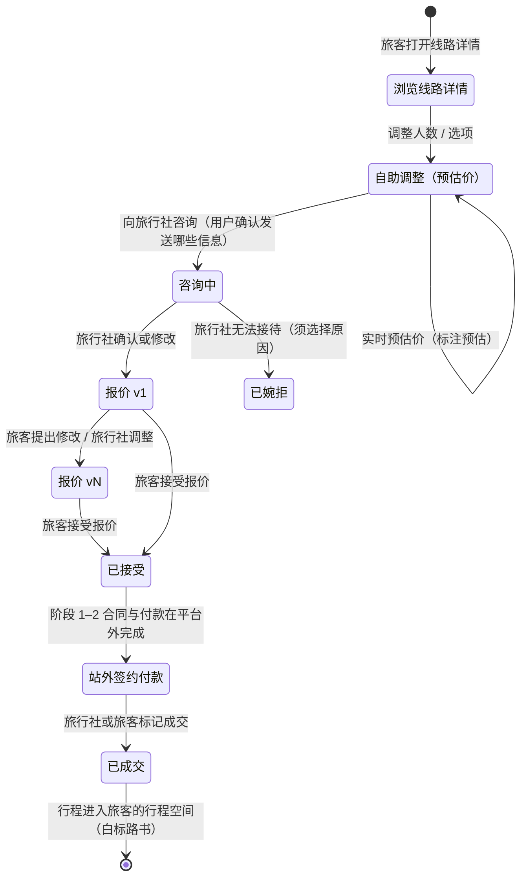

# 第 17 章 · 旅行社线路工作室：上架、AI 路书与透明报价

> **文档地位**：本章是 [产品基线 PRD-01 v3](product/PRD-01-vision-positioning.md) 中"B 端线"的专项设计，属于**商业轨 + 设计轨**，适用 [硬规则 B](README.md#两条硬规则)。
>
> **与既有章节的关系**：[第 3 章](03-b2b-agency-operations.md)（白标、权限、结算）与 [第 13 章](13-agency-partnership-design.md)（价值主张、资质红线、资源数字化）仍然有效。本章新增的是：**线路上架并被匹配、AI 生成路书与路线动画、透明报价与按需调整**。第 13 章中与本章冲突的旧口径（不做比价撮合、不接触终端游客）已被 PRD-01 v3 §8 取代。
>
> **需求侧**：[第 16 章 · 双路径规划与旅行社线路匹配](16-planning-paths-and-route-matching.md)

---

## 17.1 要解决的问题

业主对传统旅行社沟通方式的判断：

> 旅游仍然很依赖本地资源，这不是小红书等社区攻略可以覆盖的。但传统旅行社的缺点在于信息不透明、旅客信赖度低；沟通只能发给客户 PDF 文字旅游计划，很难根据客户需求调整路线或价位。

把它拆成三个可设计的问题：

| # | 问题 | 现状 | 本章的解法 |
| :---: | :--- | :--- | :--- |
| 1 | **好线路被看见的机会少** | 靠朋友圈、熟客转介绍、OTA 渠道（抽佣高、同质化） | 上架后按需求画像匹配给合适的旅客（§17.3–§17.4） |
| 2 | **信息不透明 → 信任度低** | 一份 PDF：价格一个总数，包含什么说不清，图片来源不明 | 包含 / 不包含必填；价格展示粒度可选；实拍与示意区分；司导名片；资质公示（§17.5） |
| 3 | **调整成本高** | 客户想换酒店、加一天，要在微信里来回问，定制师重新改 Word | 可调选项预先定价，客户自助看到预估价；报价按版本留痕（§17.7） |

另外，**AI 路书与路线动画**（§17.6）同时服务问题 1 和 2：它让线路在详情页里"看得懂、看得见"，而不是一页文字。

---

## 17.2 入驻前提

| 决策 | 为什么 | 不这样做会怎样 |
| :--- | :--- | :--- |
| **只有通过资质审核的旅行社可以上架线路**（[F-M13-01 资质审核](product/PRD-04-functional-architecture.md)） | 匹配 = 引流。为无证主体引流，平台可能被认定为"提供便利"（[§13.5.4](13-agency-partnership-design.md#1354--一个必须先回答的问题他有资质吗)、OI-016、OI-021） | 平台承担连带责任；一次处罚足以终结项目 |
| 资质信息（许可证编号、主体名称）在线路详情页公示 | 透明本身就是价值主张；也是在线旅游平台经营者的公示义务（待律师核验） | 用户无法自行核实，信任只能建立在平台口头担保上 |
| 无资质的车队、领队可以使用路书工具服务**自有客户**，但不能上架、不能被匹配 | 沿用 [§13.5.4](13-agency-partnership-design.md#1354--一个必须先回答的问题他有资质吗)「拒绝用法，不拒绝人」 | — |

---

## 17.3 线路上架：三种录入方式

沿用 [§13.4.2「先录已经写过的，不要求新写」](13-agency-partnership-design.md#1342--设计原则先录已经写过的不要求新写)：

| 方式 | 适用 | 流程 |
| :--- | :--- | :--- |
| **① 导入现有行程单** | 已有 PDF / Word / Excel 行程 | 上传 → AI 抽取为行程 DSL 草稿 → 逐字段显示置信度，低置信度字段高亮 → 定制师逐项确认 → 地点经图商核验 |
| **② 从已有路书复制** | 已在 TripCraft 里为客户做过的路书 | 选择路书 → 去除客户信息 → 补充价格规则与可调选项 |
| **③ 手工编辑** | 新线路 | 在工作台按天编辑（复用 [F-M02-02](product/PRD-04-functional-architecture.md) 的节点编辑） |

| 决策 | 为什么 | 不这样做会怎样 |
| :--- | :--- | :--- |
| AI 抽取结果**逐字段确认**，不允许"一键全部接受" | 价格、包含项是对客承诺，抽错就是虚假宣传 | 抽取把"含早"识别成"含三餐"，旅行社承担后果却不知道是哪一步出的错 |
| 导入时保留原文件，与抽取结果并排显示 | 定制师核对时需要对照原文 | 定制师只能凭记忆判断抽取是否正确 |

---

## 17.4 上架线路包含什么

一条上架线路 = **行程 DSL**（逐日安排，复用 [`trip.schema.json`](../spec/trip.schema.json)）+ **上架信封**（价格、团期、选项等商业信息）。

| 区块 | 字段 | 必填 | 用于匹配的维度（[§16.6.2](16-planning-paths-and-route-matching.md#1662-匹配度的构成)） |
| :--- | :--- | :---: | :--- |
| 基本信息 | 线路名、区域、天数、出发 / 结束城市、出行方式（自驾代订 / 包车 / 私家团 / 拼小团 / 跟团）、车型 | ✔ | 目的地覆盖、天数、住宿与服务 |
| 逐日行程 | 行程 DSL | ✔ | 目的地覆盖、节奏与体力 |
| 价格规则 | 成人 / 长者 / 儿童 / 婴幼儿基础价；淡旺季日历；按成团人数的阶梯价；单房差 | ✔（至少成人价） | 预算贴合 |
| 可调选项 | 选项名、价格变化（每人 / 每晚 / 每单）、互斥与依赖关系，例如「升级高档酒店 +¥380/人/晚」「增加 1 天 +¥900/人」「换 7 座 MPV +¥600/天」 | — | 详情页预估价（§17.7） |
| 包含 / 不包含 | 住宿、交通、门票、餐、导游讲解、保险、接送站等逐项勾选 | ✔ | 费用包含筛选 |
| 团期与容量 | 固定团期列表或"随时出发"；最少成团人数；最大接待人数 | ✔ | 日期、容量资格判定 |
| 人群适配 | 适合长辈 / 儿童 / 无障碍 / 可带宠物；**每个标签附一句说明**（如「全程无超过 50 级的台阶，最高海拔 1,800 米」） | — | 人群适配 |
| 主题标签 | 自然风光、人文历史、摄影、美食等 | — | 主题偏好 |
| 素材 | 图片与视频，每项标注「实拍」或「示意」 | — | — |
| 司导名片 | 沿用 [§13.3.4](13-agency-partnership-design.md#1334--白标的第二层定制师个人名片) | — | — |
| 退改规则 | 免费取消期限、改期政策 | ✔ | 退改筛选 |

| 决策 | 为什么 | 不这样做会怎样 |
| :--- | :--- | :--- |
| 人群适配标签必须附说明 | "适合长辈"是一句营销话，说明才是可核验的事实 | 所有线路都标"适合长辈"，筛选失效，长辈在现场遇到 300 级台阶 |
| 未填写的维度在匹配中计为"未提供"，不计满分也不计零分 | 不惩罚信息少的线路，也不奖励它 | 信息越少分数越高（因为没有可扣分的地方），旅行社学会少填 |
| 工作台显示线路**完整度**，并提示"补全某项后可以出现在哪些筛选里" | 用"被看见"激励补全，比强制必填更有效 | 必填项过多 → 上架流程劝退；必填过少 → 匹配无据可依 |

> 📦 **数据契约**：[`spec/listing.schema.json`](../spec/listing.schema.json)（OI-024，2026-10-17 落地）。逐日行程在 `itinerary` 中内联行程 DSL 快照（`trip`，`$ref` [`trip.schema.json`](../spec/trip.schema.json)）或按 revision 引用（`tripRef`）；契约在结构上强制：至少有成人价、包含 / 不包含七项全部勾选、「起价」档必须带条件、人群适配标签必须附说明、素材必须标注实拍 / 示意 / AI 生成、固定团期至少一个日期；**全契约不存在成本价字段**（`additionalProperties: false`）。示例：[`examples/dunhuang-silkroad-9d/listing.json`](../examples/dunhuang-silkroad-9d/listing.json)。

---

## 17.5 透明度设计

### 17.5.1 价格展示粒度由旅行社选择

[§13.3.3](13-agency-partnership-design.md#1333-三条不越线) 曾担心：一旦平台展示和比较价格，旅行社会隐藏真实价格。本基线选择做匹配和价格筛选，因此用**分级透明**来回应这个担心：

| 档位 | 旅客看到的 | 适合 |
| :--- | :--- | :--- |
| **起价** | 「人均 ¥6,280 起」+ 起价条件（如「6 人成团、舒适型住宿、7 月平日」） | 价格波动大、高度定制的线路 |
| **区间** | 「人均 ¥6,280 – ¥8,900」+ 区间的决定因素 | 大多数线路 |
| **分项明细** | 交通 / 住宿 / 门票 / 餐 / 导游服务费 / 其他，逐项列出 | 希望以透明度作为卖点的旅行社 |

**平台的最低要求**（任何档位都必须满足）：包含 / 不包含清单完整；「起价」必须写明条件；**旅行社的成本价永远不展示，也不向其他旅行社提供。**

| 决策 | 为什么 | 不这样做会怎样 |
| :--- | :--- | :--- |
| 粒度由旅行社选，平台只定最低线 | 强制分项明细 → 旅行社不上架；完全不管 → 信息不透明的问题没有解决 | 两头失败 |
| 在详情页标注该线路选择的档位（「本线路提供分项明细」） | 让透明度本身成为可被看见的差异 | 愿意透明的旅行社得不到回报 |

### 17.5.2 其他透明度要素

- **资质公示**：许可证编号与主体名称（§17.2）。
- **素材标注**：每张图标「实拍」或「示意」；AI 生成的内容另有标识（§17.6.3）。
- **报价版本历史**：旅客能看到每一版报价改了什么（§17.7）。
- **成交后评价**：只有通过平台咨询并确认出行的旅客可以评价（防刷）；旅行社可公开回复。

---

## 17.6 AI 路书与路线动画

### 17.6.1 产出物

| 产出 | 内容 | 用在哪 |
| :--- | :--- | :--- |
| **交互路书** | 逐日安排、地图、景点卡片、文化贴士、司导名片；复用 [第 10 章 · 路书阅读设计](10-roadbook-reading-design.md) | 线路详情页；成交后作为白标路书交付 |
| **路线动画** | 30–60 秒：地图沿路线推进，逐日标记过夜点，在关键景点停顿并显示实拍图与一句介绍 | 线路详情页头部；旅行社可下载用于自有渠道 |
| **分享卡片** | 一张图：线路名、天数、亮点、价格档位、二维码 | 朋友圈、微信群 |

### 17.6.2 路线动画：输入 → 算法 → 输出 → 失败态

- **输入**：线路的行程 DSL、旅行社品牌包（[`brand.schema.json`](../spec/brand.schema.json)）、旅行社上传的实拍素材。
- **算法**：① 按节点顺序请求图商算路，得到运行时路线几何（**不写入 DSL，不缓存**——[BR-025](07-legal-and-compliance.md#781--br-025地图数据不得落库oi-003-收敛后的新增规则)）；② 生成镜头脚本（复用 [§6.8 关键帧脚本](06-memory-journal-engine.md#68-视频生成三级能力级联)的结构）：逐段推进、过夜点标记、景点停顿；③ 在客户端渲染帧并编码为视频；④ 模型只撰写每个停顿点的一句介绍，写入 `advice` 并标注 AI 生成。
- **输出**：视频文件 + 镜头脚本（脚本可重新渲染，便于线路修改后更新）。
- **失败态**：

| 情况 | 行为 |
| :--- | :--- |
| 图商底图不可用或授权不允许录制 | 降级为风格化矢量路线动画（[骨架地图](01-resilience-and-failover.md)，不含图商底图） |
| 旅行社没有实拍素材 | 只用地图与文字；**不使用 AI 生成的景点图片冒充实拍** |
| 设备不支持本地视频编码 | 降级为可交互的网页动画（不导出视频文件） |

> ⚠️ **待核验**：把图商底图录制为视频并对外传播，是否在图商商用授权范围内，需与 OI-007（高德商业授权）一并确认。确认前，路线动画默认使用矢量路线降级版本。

### 17.6.3 AI 生成内容的标识

| 决策 | 为什么 | 不这样做会怎样 |
| :--- | :--- | :--- |
| AI 撰写的文字与 AI 生成的画面，在界面上显式标注，并在导出文件中写入隐式标识 | 《人工智能生成合成内容标识办法》对生成合成内容的标识有要求（适用性待律师核验，OI-023）；也是[铁律 7](00-overview-and-glossary.md#铁律-7--事实与建议分离-fact-vs-advice)的延伸 | 合规风险；旅客把 AI 写的"建议"当成旅行社的承诺 |
| 不提供"AI 生成景点照片"功能 | 旅游线路的图片会被理解为"你会看到这个"，生成图片构成误导 | 用 AI 美化的景色吸引客户，到现场落差巨大，投诉与信任损失由旅行社和平台共同承担 |

---

## 17.7 按需调整与报价闭环

| 决策 | 为什么 | 不这样做会怎样 |
| :--- | :--- | :--- |
| 自助调整的价格**一律标注"预估"**，以旅行社确认的报价为准 | 预估由规则计算，可能遗漏现实约束（某酒店当天满房） | 旅客把预估价当成交价，产生价格争议；明码标价方面的合规风险（《明码标价和禁止价格欺诈规定》，适用性待律师核验） |
| **报价版本不可修改，只能新增**；每个新版本自动列出与上一版的差异（项目与金额） | [铁律 9 一切可存证](00-overview-and-glossary.md#铁律-9--一切可存证-everything-attestable)；解决"报价改了不知道改在哪" | 争议发生时无据可查 |
| 旅行社婉拒须选择原因（团期已满 / 无法满足某要求 / 其他） | 原因数据可以反馈给匹配（例如团期数据过时） | 旅客反复咨询到同一类无法接待的线路 |
| 阶段 1–2 合同与付款在平台外完成 | 平台不经手团款（[§3.7.1](03-b2b-agency-operations.md#371--首要合规约束平台不经手游客资金)、PRD-01 D6） | — |
| 显示旅行社的平均响应时长 | 响应速度是旅客信任的一部分，也约束旅行社 | 咨询石沉大海，旅客把失望算在平台头上 |

**成交后**：成交的线路以旅行社的白标路书形式进入旅客的行程空间，旅客可以邀请家人共享（[第 15 章](15-multi-device-and-collaboration.md)）。白标路书遵循 [§13.3.3](13-agency-partnership-design.md#1333-三条不越线) 第 1 条：路书上不出现 TripCraft 品牌。

---

## 17.8 客户归属与旅行社的顾虑

做匹配意味着平台站在旅客与旅行社之间。[§13.3.3](13-agency-partnership-design.md#1333-三条不越线) 与 [§13.7](13-agency-partnership-design.md#137-与-c-端的关系) 担心的"平台随时可以把旅行社一脚踢开"是真实的顾虑。本基线用以下规则回应：

| # | 规则 | 回应的顾虑 |
| :---: | :--- | :--- |
| 1 | **平台不自营线路**，永远不成为旅行社的竞争者 | "你知道谁在买，就会自己做" |
| 2 | 咨询发起后，该旅客与该旅行社的沟通记录只对双方可见 | "我的客户会被平台转给别人" |
| 3 | 线路详情页与成交后的白标路书中，**不出现其他旅行社的推荐或广告** | "客户在我的页面上被截流" |
| 4 | 不向任何旅行社提供其他旅行社的价格数据、咨询数据 | "平台把我的报价卖给竞争对手" |
| 5 | 匹配排序规则公开，付费不影响匹配度（[§16.6.2](16-planning-paths-and-route-matching.md#1662-匹配度的构成)） | "排序是黑箱，谁给钱谁靠前" |
| 6 | 成交后的客户关系属于旅行社；平台不对该旅客推送该旅行社竞品的营销 | "复购被平台拿走" |

> 📌 **与旧口径相比放弃了什么、保留了什么**：放弃了"不接触终端游客""不做比价"——这是产品基线的要求。保留了"不经手资金""白标路书不出现平台品牌""私有资源不共享"。规则 1–6 是新增的承诺，需要写进旅行社入驻协议。旅行社是否接受，是 A-14 要验证的事。

---

## 17.9 旅行社工作台

| 视图 | 内容 |
| :--- | :--- |
| **线路列表** | 状态（草稿 / 审核中 / 在售 / 已下架）、完整度、近 30 天曝光与咨询数 |
| **线路编辑** | 行程 DSL 编辑、上架信封、价格规则与可调选项、素材管理、AI 路书与动画生成 |
| **咨询收件箱** | 每条咨询附旅客授权发送的需求摘要与调整项；一键生成报价版本 |
| **报价管理** | 版本历史、差异对比、成交标记 |
| **数据** | 曝光 → 详情浏览 → 咨询 → 报价 → 成交漏斗；"未被匹配的原因"（例如缺少适老说明、团期过期） |

---

## 17.10 合规要点（全部待执业律师核验）

| 领域 | 可能适用的规定 | 本章的设计对应 | 登记 |
| :--- | :--- | :--- | :--- |
| 平台角色 | 《在线旅游经营服务管理暂行规定》中在线旅游平台经营者的资质审核、信息公示等义务 | 只上架持证旅行社；资质公示 | OI-021 |
| 引流与无证经营 | 文旅部门对"为无证经营提供引流、客源对接便利"的查处口径 | 只为持证旅行社引流 | OI-016 / OI-021 |
| 广告标识 | 《电子商务法》第 40 条（竞价排名显著标明"广告"） | 付费推广单独标注，不影响匹配度 | OI-021 |
| 算法推荐 | 《互联网信息服务算法推荐管理规定》（不针对个人特征的选项等） | 提供非个性化排序 | OI-021 |
| 个人信息提供 | 《个人信息保护法》第 23 条（向其他处理者提供个人信息） | 咨询时由用户确认发送范围 | OI-021 |
| 价格展示 | 《明码标价和禁止价格欺诈规定》 | 预估价标注、起价条件必填 | OI-021 |
| AI 生成内容 | 《人工智能生成合成内容标识办法》 | 显式 + 隐式标识；不生成景点照片 | OI-023 |

> ⚠️ 本表只列出**可能**适用的规定，用于向律师提问，不构成合规结论。体例与 [§7.11 引注核验表](07-legal-and-compliance.md#711--引注核验表强制)一致。

---

## 17.11 本章设计清单

| # | 设计决策 | 状态 |
| :--- | :--- | :--- |
| 17-1 | 只有通过资质审核的旅行社可以上架、被匹配 | Proposed |
| 17-2 | 导入现有行程单，AI 抽取后逐字段确认 | Proposed |
| 17-3 | 上架线路 = 行程 DSL + 上架信封；人群适配标签必须附说明 | Proposed（契约：[`listing.schema.json`](../spec/listing.schema.json)） |
| 17-4 | 价格展示三档粒度由旅行社选择，平台设最低透明线，成本价永不展示 | Proposed（A-14 待验证） |
| 17-5 | 路线动画不落库算路几何；无授权时降级为矢量路线 | Proposed（待 OI-007） |
| 17-6 | AI 生成内容显式与隐式标识；不生成景点照片 | Proposed（待 OI-023） |
| 17-7 | 自助调整价标"预估"；报价版本只增不改并自动列出差异 | Proposed |
| 17-8 | 阶段 1–2 合同与付款在平台外完成 | Proposed（D6） |
| 17-9 | 客户归属六条规则写入旅行社入驻协议 | Proposed（A-14 待验证） |
