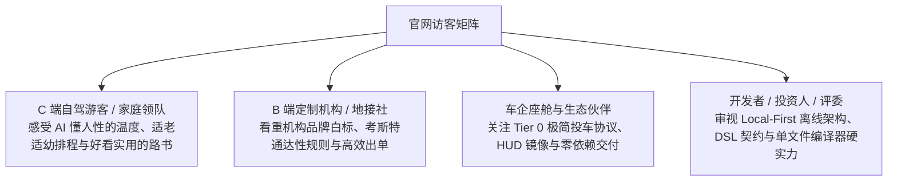
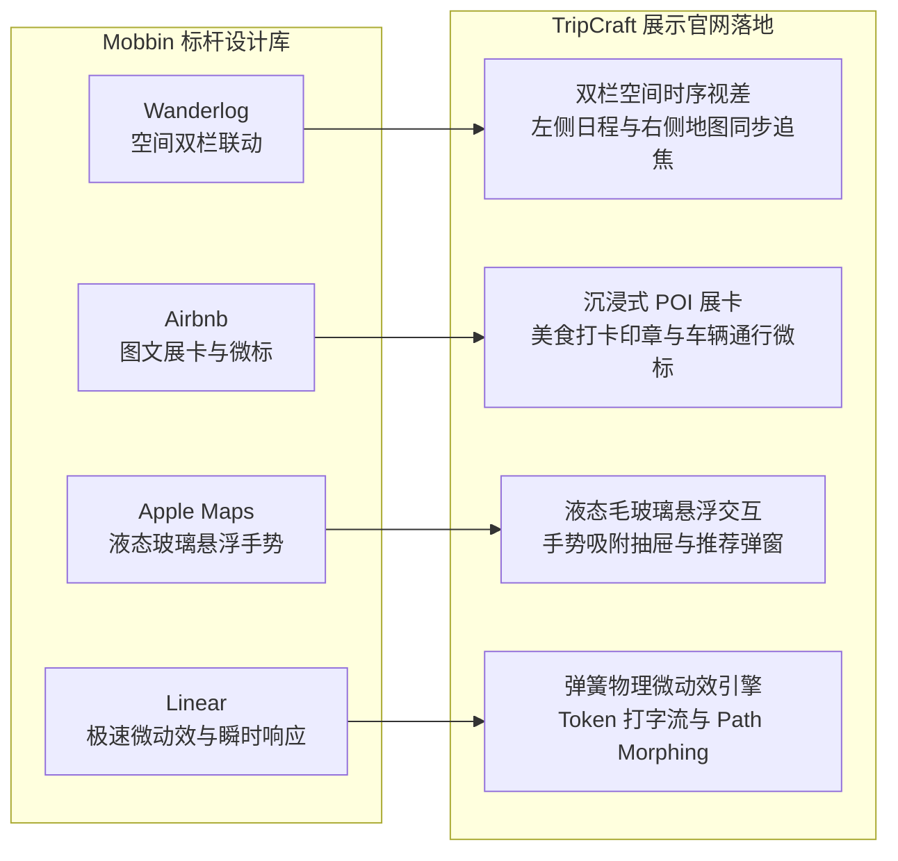
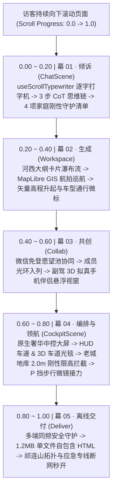
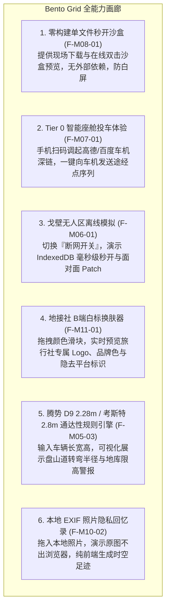
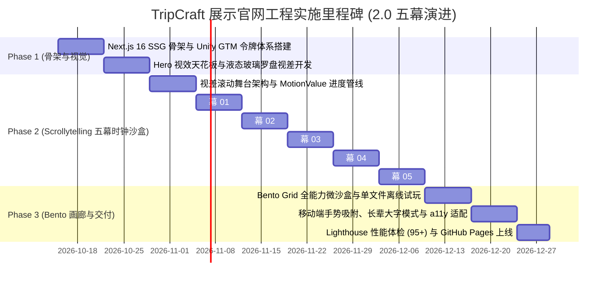

# TripCraft · 项目展示与交互演示官网技术开发设计规范 (SHOWCASE-web-design.md)

> **文档定位**：TripCraft 官方展示与交互演示官网（Showcase & Demonstration Landing Platform）的前端架构、视觉系统与交互动效技术实施规范。  
> **设计目标**：指导后续前端工程开发一个面向全球访客（自驾游客、家庭定制用户、旅行社地接机构、车企伙伴与开发者）的**高质感项目展示官网**。通过**故事流视差滚动动画 (Apple Scrollytelling)** 与沉浸式微沙盒，生动展现 TripCraft 的全量功能、技术硬实力与产品哲学。  
> **关联业务架构**：[`ARC-10 Web端系统开发设计`](architecture/ARC-10-web-system-design.md) · [`PRD-01 愿景与定位`](product/PRD-01-vision-positioning.md) · [`09 视觉设计系统`](09-visual-design-system.md)

---

## 1. 官网定位、目标受众与核心使命

### 1.1 官网定位界定
本项目**不是**繁重的企业级后台管理系统或单纯的业务操作端，而是 **TripCraft 品牌与能力的超级展示窗口（Interactive Showcase & Living Exhibition）**。其视觉与交互标准对标 Apple 产品发布页、Linear.app 与 Stripe Press，兼具学术严谨性与消费级美学。

### 1.2 四大目标受众与诉求匹配


### 1.3 核心设计铁律
1. **无需登录，开箱即秀**：全站所有功能展示与动画演示 100% 免登开放，访客只需滑动滚轮即可体验全部核心价值。
2. **滚动即叙事 (Scrollytelling First)**：将抽象的“输入-AI推演-排程-协作-算路”复杂业务流，转化为一气呵成的视差滚动电影级长镜头。
3. **真实感与可信度**：演示中的路书、地图经纬度、高程起伏与考斯特车型限制，全部基于真实的甘青大环线 9 天（Dunhuang Silk Road 9D）工程数据。

---

## 2. 视觉设计系统与 Mobbin 标杆范式沉淀

### 2.1 视觉设计系统在展示官网的落地 (Unify GTM Design System)
展示官网全面采用 **Unify GTM 设计系统规范**，将瑞士理性工程美学与东方自然风物、苹果液态玻璃深度交融：
- **Unify GTM 温暖纸质质感色板 (Palette)**：
  - 画布暖纸白（Canvas Warm Paper）：`#FFFFF9`（温润护眼，如精装艺术纸册底色）
  - 模块浅卡其（Surface Card）：`#F4F4EE`（模块与卡片基底）
  - 暖炭黑主文本（Warm Charcoal）：`#241E20`（高对比可读性，绝不使用死板纯黑）
  - 火焰跃动红/橙（Flame Accent / Headline Aura Glow）：`#FE3C01`（为“活路书”与主操作注入高能生命力）
  - 极细分割发丝线（Hairline Border）：`#E2E2D8`（高精度工程边界）
- **严格几何圆角阶梯 (Radius Hierarchy)**：
  - 交互按钮严格 `rounded-[5px]`（拒绝低幼圆角膨胀，还原工业精密手感）；
  - 状态药丸与胶囊徽标严格 `rounded-full`（100px）；
  - 内容卡片与模块 `rounded-[12px]`；
  - 主展示视窗与输入容器 `rounded-[16px]`；
- **社论级西文衬线 (Editorial Serif) 与 1200px 网格**：主副标题采用高雅西文衬线字体，搭配 `-0.035em` 紧凑字间距，统一规范在 `max-w-[1200px]` 瑞士工程网格中自适应呈现；
- **苹果液态玻璃质感 (Liquid Glass)**：
  - 核心展示卡片与悬浮面板统一应用 `backdrop-filter: blur(20px) saturate(180%)`；
  - 边缘带有微高光反射线：`border: 1px solid rgba(255, 255, 255, 0.65)`；
  - 悬浮阴影：`box-shadow: 0 20px 50px rgba(36, 30, 32, 0.08)`。

### 2.2 Mobbin 顶尖产品交互范式融合


---

## 3. 网站整体信息架构与版块布局 (Page Structure)

整个展示官网设计为**单页流式滚动架构 (Single-Page Seamless Experience)**，包含 5 大核心版块：

```text
TripCraft 展示官网 (apps/showcase)
├── [Section 1] Hero 视觉天花板 (Hero & Value Proposition)
│   ├── 品牌主张、3D 拟物液态玻璃罗盘 / 3D 高程地球仪视差、Unify GTM 温暖纸质质感
│   └── CTA 操作群：「体验路书诞生 ↓」·「下载离线单文件路书样例」
├── [Section 2] ★ 核心视差滚动动画演示区 (Scrollytelling Demo Stage) —— 2.0 五幕长镜头演进
│   ├── 幕 01: 倾诉 (ChatScene.tsx) —— useScrollTypewriter 流式打字机、3 步 CoT 结构化推演树、4 项刚性家庭出行守护清单
│   ├── 幕 02: 生成 (Workspace.tsx) —— 9日河西走廊大纲卡片瀑布流、矢量高程剖面升起、高清 GIS 拓扑沙盘巡航
│   ├── 幕 03: 共创 (Collab.tsx) —— 微信扫码免登愿望池协同、副驾 3D 拟真手机伴侣悬浮视窗
│   ├── 幕 04: 编排与领航 (CockpitScene.tsx) —— 原生奢华中控大屏、分屏 HUD 车速、3D 车道光毯、老城地库 2.0m 限高拦截 (腾势 D9 2.28m MPV)、P 挡步行微镜接力
│   └── 幕 05: 离线交付 (Deliver.tsx) —— 多端同频与无网离线安全守护、1.2MB 单文件自包含 HTML（零外部运行时依赖，三级降级防白屏）
├── [Section 3] 全能力全景矩阵画廊 (Bento Grid Feature Matrix)
│   ├── 零构建单文件 HTML 秒开沙盒演示 (F-M08-01)
│   ├── Tier 0 智能座舱极简投车扫码体验 (F-M07-01)
│   ├── 戈壁无人区离线断网模拟开关 (F-M06-01, F-M06-03)
│   ├── 地接社 B 端品牌白标换肤滑块 (F-M11-01)
│   └── 腾势 D9 2.28m / 考斯特 2.8m 通达性规则引擎可视化 (F-M05-03)
├── [Section 4] 十大设计铁律与架构哲学 (Architecture & 10 Iron Rules)
│   └── 零构建交付、降级不可耻、数据主权、DSL 真相源等交互展示卡
└── [Section 5] 行动号召与开源页脚 (Conversion & Footer)
    ├── GitHub 开源仓库、示例路书下载、长辈大字模式切换、商务合作
```

---

## 4. 核心视差滚动动画演示区规格 (Apple Scrollytelling Stage · 2.0 五幕演进)

> 本版块是展示官网的灵魂所在。访客不需要做繁琐的操作，只需向下滚动滚轮，固钉在屏幕正中的主舞台（Sticky Viewport）将随滚动进度 (`scrollProgress: 0.0 ~ 1.0`) 呈现连续、流畅、无缝变形的五幕电影级叙事长镜头（采用 MotionValue 驱动，0 React 重渲染调度）。



### 4.1 幕 01：倾诉 (`ChatScene.tsx`, `scrollProgress: 0.00 ~ 0.20`)
*对应业务能力：F-M03-01 对话规划、F-M03-02 反问追问、F-M12-03 模型分级与家庭规则提取*

```text
[ 用户输入框 ] ──(useScrollTypewriter 逐字敲入)──> [ 3 步 CoT 思维链展开 ] ──(刚性实体芯片)──> [ 4 项家庭守护清单对齐 ]
```

1. **`0.00 ~ 0.06` 滚动区间：输入框聚焦与逐字流式打字叙事**
   - 固钉舞台中央浮现 Unify GTM 质感对话框；
   - 文本通过 `useScrollTypewriter` 逐字流式敲入（字符递增 ➔ 光标拟真呼吸 ➔ 模拟提交点击）：
     > “我们全家5口去甘肃，爷爷70岁膝盖做过手术不能爬长楼梯，孩子4岁，开腾势D9带车顶箱（总高2.28m），想去莫高窟和鸣沙山看日落，千万别太赶。”
   - 随后输入框平滑缩小，沉入思维链推演区。
2. **`0.06 ~ 0.13` 滚动区间：老定制师 3 步 CoT 结构化推演树**
   - 顶部调度 DeepSeek / Claude 老定制师推理模型；
   - 展开 3 步层级思维链（CoT）推演树：
     - Step 1: 【客群意图解析】三代同堂、长幼兼顾、节奏放缓；
     - Step 2: 【时空刚性断言】腾势 D9 总高 2.28m 触发地库限高警报、老人关节规避爬高；
     - Step 3: 【拓扑路径收敛】锁定无障碍大窟专车 + 鸣沙山 19:30 日落摄影黄金窗口。
3. **`0.13 ~ 0.20` 滚动区间：右侧「家庭出行守护清单」4 项刚性规则严格对齐**
   - 右侧弹簧升起 4 项刚性规则卡片并依次点亮通过：
     - `[👴 70岁长辈 · 膝关节规避高长楼梯]`（氧化金辉光）
     - `[👶 4岁幼儿 · 预留午休防中暑防脱水]`（暖橙辉光）
     - `[🚗 腾势 D9 (2.28m) · 老城地库限高刚性拦截]`（青蓝辉光 · 严守 BR-025）
     - `[🌅 鸣沙山 · 锁定 19:30 黄金日落窗口]`（夕阳粉辉光）
   - 底部苏格拉底反问芯片自动高亮锁定方案 A：无障碍特种接驳慢游。

---

### 4.2 幕 02：生成 (`Workspace.tsx`, `scrollProgress: 0.20 ~ 0.40`)
*对应业务能力：F-M02-02 时序日程展卡、F-M02-05 路线沙盘、F-M05-02 路线规划耗时、F-M09-01 敦煌金主题*

```text
[ 对话面板左收 ] ──(双栏裂变)──> [ 9日河西大纲卡片瀑布流 ] ──(全景俯冲)──> [ MapLibre 航拍巡航 ] ──(高程升起)──> [ 车辆通行微标 ]
```

1. **`0.20 ~ 0.26` 滚动区间：共享布局平滑裂变 (Shared Layout Transition)**
   - 对话面板向左平滑收窄为辅助状态栏；
   - 中央与右侧画布展开为双栏高保真路书工作区。
2. **`0.26 ~ 0.32` 滚动区间：9 日河西走廊大纲卡片手风琴瀑布流**
   - D0（兰州集结）至 D8（敦煌返程）共 9 天日程卡片，以阶梯瀑布流弹性滑入；
   - 卡片顶部依次点亮，呈现大字地名、游玩时长与 Plan B 弹性缓冲时间。
3. **`0.32 ~ 0.37` 滚动区间：电影级地图全景 FlyTo 航拍运镜**
   - MapLibre 矢量地图相机从中国全境视角俯冲至河西走廊（Zoom 8，倾角 Pitch 42°）；
   - 沿途 18 个核心 POI 图钉顺序点亮，落地时释放双层同心圆涟漪波纹。
4. **`0.37 ~ 0.40` 滚动区间：高程起伏剖面升起与车型通达性微标**
   - 底端升起透明矢量高程剖面图（Elevation Profile），海拔曲线动态升起绘制（乌鞘岭 3000m、祁连山前沿 2800m）；
   - 节点旁跳出车型通达性胶囊徽标：`[ ✓ 腾势 D9 高速路网畅通 ]` / `[ ⚠️ 莫高窟换乘专车 ]`。

---

### 4.3 幕 03：共创 (`Collab.tsx`, `scrollProgress: 0.40 ~ 0.60`)
*对应业务能力：F-M04-01 邀请与空间共享、F-M04-02 结构化提名收集、F-M06-04 实时成员信标*

```text
[ 顶部分享展开 ] ──(免登二维码)──> [ 好友微信扫码加入 ] ──(副驾手机悬浮探出)──> [ 愿望池美食提名 ] ──(98%顺路度重算)
```

1. **`0.40 ~ 0.46` 滚动区间：免登分享面板弹出与微信扫码一键加入**
   - 顶部滑出分享面板，展示免登微信二维码与口令短链；
   - 手机端模拟视图中，好友「阿杰」微信扫码一键加入行程空间（免密免登）。
2. **`0.46 ~ 0.52` 滚动区间：成员头像栏光环入列与副驾 3D 拟真手机伴侣悬浮视窗**
   - 右上角成员头像栏展开，阿杰头像伴随绿色光晕入列；
   - 右侧滑出**副驾 3D 拟真手机伴侣悬浮探出视窗**，边缘无缝融合（无生硬裁剪）。
3. **`0.52 ~ 0.60` 滚动区间：协同愿望池提名与纯前端 98% 顺路度拓扑重算**
   - 模拟在副驾手机端提名兰州经典小吃：**「正宁路夜市·牛奶鸡蛋醪糟」**；
   - 提名卡片飞入主时间线愿望池；
   - 纯前端 Web Worker 毫秒级重算：距离酒店仅 650m，步行 8 分钟，顺路度高达 **98%**，行程距离 +0km，一键采纳自动重排时间线。

---

### 4.4 幕 04：编排与领航 (`CockpitScene.tsx`, `scrollProgress: 0.60 ~ 0.80`)
*对应业务能力：F-M07-01 座舱协议、BR-025 物理限高断言、F-M05-03 沿途补给与露天停车推荐*

```text
[ 奢华中控大屏入场 ] ──(HUD 车速 & 车道光毯)──> [ 2.0m 地库限高刚性拦截 ] ──(就近露天停车场)──> [ P 挡步行微镜接力 ]
```

1. **`0.60 ~ 0.67` 滚动区间：原生奢华座舱中控大屏与 HUD 车道光毯**
   - 屏幕中央无缝变形为原生高保真车机中控大屏，呈现奢华暖黑深色界面；
   - 分屏实时显示 HUD 车速（85 km/h）、续航状态、3D 车道级行进光毯与下一节点变道指引。
2. **`0.67 ~ 0.74` 滚动区间：老城地库 2.0m 限高刚性拦截预警**
   - 车辆接近目的地地下车库入口，系统触发车辆物理规格校验：
     - *当前车辆*：腾势 D9 顶置旅行箱总高 **2.28m**；
     - *前方入口*：老城地下停车场标定限高 **2.00m**；
   - **刚性拦截视觉预警弹窗**触发（严守 BR-025 物理断言，严防削顶事故），自动推荐就近安全停靠点：“建议停靠皇冠假日酒店东侧地面露天停车场（限高 3.5m）”。
3. **`0.74 ~ 0.80` 滚动区间：P 挡泊车与步行微镜接力**
   - 车辆安全泊入地面车位，挂入 P 挡；
   - 车机自动向副驾与手机推送「步行微镜接力」通知，无缝接管最后 500 米古街步行寻路。

---

### 4.5 幕 05：离线交付 (`Deliver.tsx`, `scrollProgress: 0.80 ~ 1.00`)
*对应业务能力：F-M08-01 零构建单文件交付、F-M06-01 无人区离线容灾、TripPatch 差分补丁*

```text
[ 多端同频全景展开 ] ──(1.2MB 单文件自包含编译)──> [ 三级容灾降级演示 ] ──(祁连山无人区秒开)
```

1. **`0.80 ~ 0.88` 滚动区间：多端同频安全守护全景展开**
   - 呈现手机随身打卡、平板沙盘、桌面 Web 与座舱多端同频态势；
   - 突发展示「模拟无人区断网」场景：外网完全切断，界面毫秒级保持可交互，绝无白屏。
2. **`0.88 ~ 1.00` 滚动区间：1.2MB 单文件零构建自包含产物与离线抗灾**
   - 演示单文件 HTML 架构：1.2MB 体积自包含甘肃河西走廊、祁连山脉、巴丹吉林/库姆塔格沙漠地形拓扑、应急救援电话与完整行程 DSL；
   - 三级容灾降级全流程：一级 MapLibre 矢量瓦片 ➔ 二级高对比静态矢量 SVG ➔ 三级节点时空卡片；
   - 微信点开即看，AirDrop 隔空秒投，五幕宏大叙事完美闭环。

---

## 5. 全能力全景矩阵画廊 (Bento Grid Feature Matrix)

在核心演示区下方，通过现代 Bento Grid 网格卡片全面呈现 TripCraft 的全量核心能力与独家黑科技：



---

## 6. 展示官网前端技术栈与开发架构

### 6.1 前端技术栈选型
1. **应用框架**：`Next.js 16+`（App Router，Webpack 静态打包，纯静态生成 SSG `output: 'export'`，部署在 GitHub Pages）。
2. **UI 库与运行时**：`React 19` + `TypeScript 5`。
3. **样式引擎**：`Tailwind CSS v3.4+` + 原生 CSS 变量注入（Unify GTM 设计系统令牌）。
4. **滚动视差引擎**：
   - `Framer Motion v12+`：全舞台采用纯 `MotionValue` 驱动，0 React 重渲染调度，消除了卡顿与动画抢播；
   - 复杂矢量路径与高程剖面采用 SVG 动态插值。
5. **轻量地图与 GIS 渲染**：
   - `MapLibre GL JS`（搭配开源 Vector Tiles），保证 60fps 硬件加速渲染，不依赖任何第三方收费商用 Token。

### 6.2 关键 Scrollytelling 五幕时钟沙盒架构骨架
```typescript
// apps/showcase/src/components/stage/ScrollyStage.tsx
'use client';

import React, { useRef } from 'react';
import { useScroll } from 'framer-motion';
import { ChatScene } from './ChatScene';       // 幕 01: 倾诉 (流式打字与 3 步 CoT)
import { Workspace } from './Workspace';       // 幕 02: 生成 (9日河西大纲与沙盘)
import { Collab } from './Collab';             // 幕 03: 共创 (微信愿望池与副驾伴侣)
import { CockpitScene } from './CockpitScene'; // 幕 04: 编排与领航 (车机大屏与限高拦截)
import { Deliver } from './Deliver';           // 幕 05: 离线交付 (1.2MB 自包含产物)

export function ScrollyStage() {
  const containerRef = useRef<HTMLDivElement>(null);
  const { scrollYProgress } = useScroll({
    target: containerRef,
    offset: ['start start', 'end end'],
  });

  return (
    <div ref={containerRef} className="relative h-[500vh] bg-canvas-warm">
      <div className="sticky top-0 h-screen w-full overflow-hidden flex items-center justify-center p-4 md:p-8">
        {/* 幕 01: 倾诉 (0.00 ~ 0.20) */}
        <ChatScene progress={scrollYProgress} />

        {/* 幕 02: 生成 (0.20 ~ 0.40) */}
        <Workspace progress={scrollYProgress} />

        {/* 幕 03: 共创 (0.40 ~ 0.60) */}
        <Collab progress={scrollYProgress} />

        {/* 幕 04: 编排与领航 (0.60 ~ 0.80) */}
        <CockpitScene progress={scrollYProgress} />

        {/* 幕 05: 离线交付 (0.80 ~ 1.00) */}
        <Deliver progress={scrollYProgress} />
      </div>
    </div>
  );
}
```
```

### 6.3 无障碍与多端性能兜底策略
1. **减弱动态效果媒体查询 (`prefers-reduced-motion: reduce`)**：
   - 自动关闭视差滚动中的平移和旋转变形，改为根据滚动进度淡入对应卡片，防止视动眩晕。
2. **移动端纵向优化 (Mobile Fallback)**：
   - 在屏幕宽度 `< 768px` 时，将双栏左右联动优雅降级为垂直堆叠手风琴，地图固定在屏幕上半部（高 38vh），时间线在下半部滑动。
3. **老旧设备与弱 GPU 降级**：
   - 检测 FPS 低于 45 时，自动剥离毛玻璃多层高斯模糊（`backdrop-filter`），回退至高对比度半透明实色，确保任意设备秒开 60fps。

---

## 7. 开发实施阶段与里程碑计划 (Showcase Roadmap)



### 展示官网验收标准 (Definition of Done)
1. **动画流畅度**：在主流移动端与桌面端主流浏览器（Chrome/Safari/Edge）实现稳定的 **60fps** 滚动视差动效，0 React 重渲染调度。
2. **零白屏与秒开**：首屏最大内容绘制时间 (LCP) ≤ 1.2s，静态构建后支持脱机离线预览。
3. **全要素闭环**：2.0 五幕视差长镜头完整演绎“01 倾诉（流式打字与思维链） ➔ 02 生成（河西走廊大纲沙盘） ➔ 03 共创（微信免登愿望池） ➔ 04 编排与领航（奢华车机与限高拦截） ➔ 05 离线交付（1.2MB 自包含产物）”。
