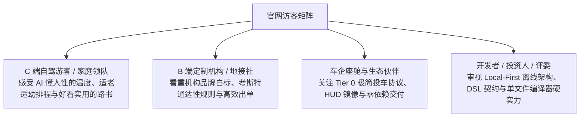
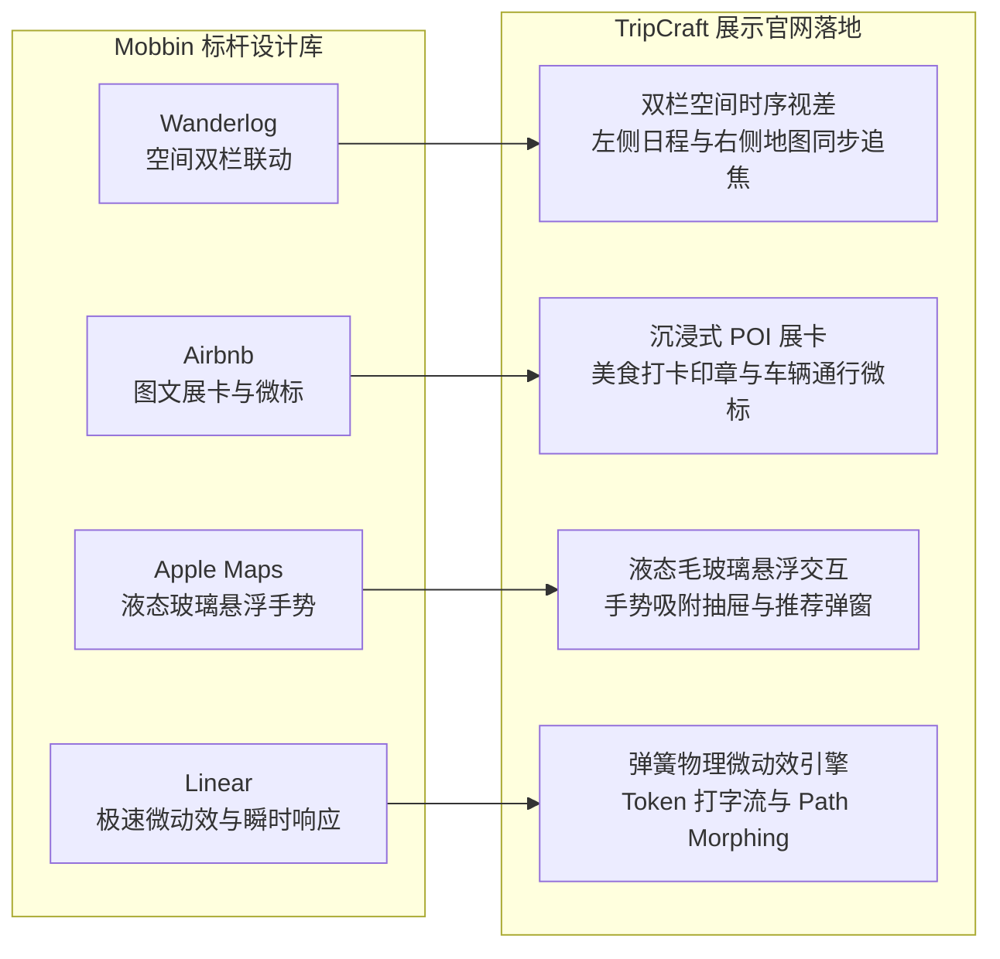
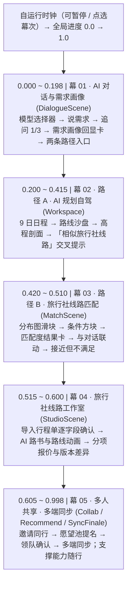
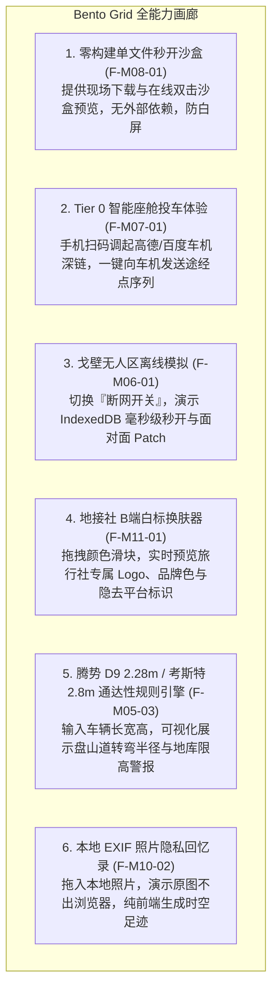
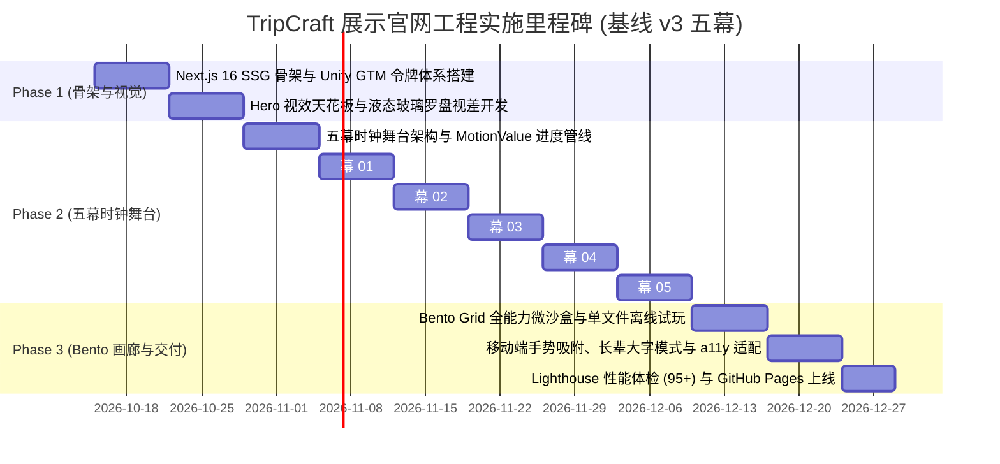

# TripCraft · 项目展示与交互演示官网技术开发设计规范 (SHOWCASE-web-design.md)

> **与产品基线 v3 的关系（2026-10-18 更新）**：演示区（§4）已按 [PRD-01 v3](product/PRD-01-vision-positioning.md) 的核心流程改为五幕——AI 对话与需求画像 → 路径 A 自驾规划 → 路径 B 旅行社线路匹配 → 旅行社线路工作室 → 多人共享 · 多端同步；车机投递与离线交付降为支撑能力，收在第 5 幕末尾。首屏、Bento 画廊与导航栏的文案尚未调整（见 §5 说明）。视觉继续使用 Unify GTM（产品 UI 视觉体系 D10 未定，Unify GTM 只约束演示站）。

> **文档定位**：TripCraft 官方展示与交互演示官网（Showcase & Demonstration Landing Platform）的前端架构、视觉系统与交互动效技术实施规范。  
> **设计目标**：指导后续前端工程开发一个面向全球访客（自驾游客、家庭定制用户、旅行社地接机构、车企伙伴与开发者）的**高质感项目展示官网**。通过**故事流视差滚动动画 (Apple Scrollytelling)** 与沉浸式微沙盒，生动展现 TripCraft 的全量功能、技术硬实力与产品哲学。  
> **关联业务架构**：[`ARC-10 Web端系统开发设计`](architecture/ARC-10-web-system-design.md) · [`PRD-01 愿景与定位`](product/PRD-01-vision-positioning.md) · [`09 视觉设计系统`](09-visual-design-system.md)

---

## 1. 官网定位、目标受众与核心使命

### 1.1 官网定位界定
本项目**不是**繁重的企业级后台管理系统或单纯的业务操作端，而是 **TripCraft 品牌与能力的超级展示窗口（Interactive Showcase & Living Exhibition）**。其视觉与交互标准对标 Apple 产品发布页、Linear.app 与 Stripe Press，兼具学术严谨性与消费级美学。

### 1.2 四大目标受众与诉求匹配


### 1.3 核心设计铁律
1. **无需登录，开箱即秀**：全站所有功能展示与动画演示 100% 免登开放，访客只需滑动滚轮即可体验全部核心价值。
2. **滚动即叙事 (Scrollytelling First)**：将抽象的“输入-AI推演-排程-协作-算路”复杂业务流，转化为一气呵成的视差滚动电影级长镜头。
3. **真实感与可信度**：演示中的路书、地图经纬度、高程起伏与考斯特车型限制，全部基于真实的甘青大环线 9 天（Dunhuang Silk Road 9D）工程数据。

---

## 2. 视觉设计系统与 Mobbin 标杆范式沉淀

### 2.1 视觉设计系统在展示官网的落地 (Unify GTM Design System)
展示官网全面采用 **Unify GTM 设计系统规范**，将瑞士理性工程美学与东方自然风物、苹果液态玻璃深度交融：
- **Unify GTM 温暖纸质质感色板 (Palette)**：
  - 画布暖纸白（Canvas Warm Paper）：`#FFFFF9`（温润护眼，如精装艺术纸册底色）
  - 模块浅卡其（Surface Card）：`#F4F4EE`（模块与卡片基底）
  - 暖炭黑主文本（Warm Charcoal）：`#241E20`（高对比可读性，绝不使用死板纯黑）
  - 火焰跃动红/橙（Flame Accent / Headline Aura Glow）：`#FE3C01`（为“活路书”与主操作注入高能生命力）
  - 极细分割发丝线（Hairline Border）：`#E2E2D8`（高精度工程边界）
- **严格几何圆角阶梯 (Radius Hierarchy)**：
  - 交互按钮严格 `rounded-[5px]`（拒绝低幼圆角膨胀，还原工业精密手感）；
  - 状态药丸与胶囊徽标严格 `rounded-full`（100px）；
  - 内容卡片与模块 `rounded-[12px]`；
  - 主展示视窗与输入容器 `rounded-[16px]`；
- **社论级西文衬线 (Editorial Serif) 与 1200px 网格**：主副标题采用高雅西文衬线字体，搭配 `-0.035em` 紧凑字间距，统一规范在 `max-w-[1200px]` 瑞士工程网格中自适应呈现；
- **苹果液态玻璃质感 (Liquid Glass)**：
  - 核心展示卡片与悬浮面板统一应用 `backdrop-filter: blur(20px) saturate(180%)`；
  - 边缘带有微高光反射线：`border: 1px solid rgba(255, 255, 255, 0.65)`；
  - 悬浮阴影：`box-shadow: 0 20px 50px rgba(36, 30, 32, 0.08)`。

### 2.2 Mobbin 顶尖产品交互范式融合


---

## 3. 网站整体信息架构与版块布局 (Page Structure)

整个展示官网设计为**单页流式滚动架构 (Single-Page Seamless Experience)**，包含 5 大核心版块：

```text
TripCraft 展示官网 (apps/showcase)
├── [Section 1] Hero 视觉天花板 (Hero & Value Proposition)
│   ├── 品牌主张、3D 拟物液态玻璃罗盘 / 3D 高程地球仪视差、Unify GTM 温暖纸质质感
│   └── CTA 操作群：「体验路书诞生 ↓」·「下载离线单文件路书样例」
├── [Section 2] ★ 核心演示区 (Product Story Stage) —— 产品基线 v3 五幕
│   ├── 幕 01: AI 对话与需求画像 (DialogueScene.tsx) —— 模型选择器（平台模型 / 自带 API）、每轮一个追问、需求画像回显卡（明说 / 推断分开标注）、两条路径入口
│   ├── 幕 02: 路径 A · AI 规划自驾 (Workspace.tsx) —— 9 日河西走廊日程、路线沙盘与高程剖面；结果页底部「相似旅行社线路」交叉提示 (PathCrossHint)
│   ├── 幕 03: 路径 B · 旅行社线路匹配 (MatchScene.tsx) —— 带真实分布图的价格 / 天数滑块、条件方块（结果数、★ 来自需求）、匹配度环形图与理由、「接近但不满足」
│   ├── 幕 04: 旅行社线路工作室 (StudioScene.tsx) —— 导入行程单逐字段确认、AI 路书与矢量路线动画、分项报价与报价版本差异
│   └── 幕 05: 多人共享 · 多端同步 (Collab.tsx · Recommend.tsx · SyncFinale.tsx) —— 邀请同行、愿望池提名、顺路度推荐与领队确认、手机 / 平板 / 电脑同步；离线可读 · 单文件导出 · 车机投递作为支撑能力
├── [Section 3] 全能力全景矩阵画廊 (Bento Grid Feature Matrix)
│   ├── 零构建单文件 HTML 秒开沙盒演示 (F-M08-01)
│   ├── Tier 0 智能座舱极简投车扫码体验 (F-M07-01)
│   ├── 戈壁无人区离线断网模拟开关 (F-M06-01, F-M06-03)
│   ├── 地接社 B 端品牌白标换肤滑块 (F-M11-01)
│   └── 腾势 D9 2.28m / 考斯特 2.8m 通达性规则引擎可视化 (F-M05-03)
├── [Section 4] 十大设计铁律与架构哲学 (Architecture & 10 Iron Rules)
│   └── 零构建交付、降级不可耻、数据主权、DSL 真相源等交互展示卡
└── [Section 5] 行动号召与开源页脚 (Conversion & Footer)
    ├── GitHub 开源仓库、示例路书下载、长辈大字模式切换、商务合作
```

---

## 4. 核心演示区规格 (Product Story Stage · 产品基线 v3 五幕)

> 本版块是展示官网的灵魂所在。左侧是五个步进 Tab（标题、说明与进度条），右侧是一扇应用视窗。舞台由一只自运行时钟驱动：每幕按设定时长（12–18 秒）自动播放，可暂停，也可以点选任一幕或「上一幕 / 下一幕」跳转；视窗离开视口时时钟挂起。五幕共享同一个全局进度 MotionValue（0 → 1），关键帧集中在 [`timeline.ts`](../apps/showcase/src/components/stage/timeline.ts)，播放过程 0 React 重渲染。幕次顺序即 [PRD-01 §2](product/PRD-01-vision-positioning.md#2-核心使用流程) 的核心流程。



**文案口径**：涉及匹配与报价的界面文字遵守 [docs/00 §0.3](00-overview-and-glossary.md#03-三条责任边界线tripcraft-不是清单) 末尾的正确表述——匹配度为信息参考、预估价以旅行社正式报价为准、合同与付款由旅客与旅行社直接签订；平台不自称旅行社，也不出现「立即预订」「平台担保」一类表述。

### 4.1 幕 01：AI 对话与需求画像 (`DialogueScene.tsx`, `0.000 ~ 0.198`)
*设计依据：[docs/16 §16.2 对话入口与模型选择](16-planning-paths-and-route-matching.md#162-对话入口与模型选择)、§16.3 需求画像、§16.4 路径选择*

```text
[ 模型选择器 ] ──> [ 逐字输入需求并发送 ] ──> [ 追问 1/3 ] ──> [ 需求画像回显卡 ] ──> [ 路径 A | 路径 B · 23 条匹配 ]
```

1. **模型选择器**：输入框左侧「平台模型 ▾」展开：平台模型（默认 · 今日剩余 18/20）/ 我的 Claude（自带 API）/ 我的 DeepSeek（自带 API）/ ＋ 添加自己的 API；底注「自带 Key 只存在本机，请求直连服务商」。
2. **说需求**：逐字输入后点击发送：
   > “全家 5 口国庆前后去河西走廊，玩 9 天左右。带 70 岁的爷爷和 4 岁的女儿，爷爷膝盖做过手术不能爬高台阶，孩子每天要午休。想看莫高窟和鸣沙山日落，别太赶。自己开车或者找旅行社都行。”
3. **追问（每轮一个问题，显示「追问 1 / 3」）**：“自驾的话开什么车？车高大概多少？”，附快捷回答药丸；用户补充「租腾势 D9，加了车顶箱，总高 2.28 米」。
4. **需求画像回显卡**：桌面在右侧面板随对话逐项填入，手机在收敛后以底部抽屉弹出。7 个特征点：同行、目的地（必去）、日期、身体、方式、车辆、预算；每项标「硬约束 / 偏好」，模型推断的预算标「推断 · 请确认」。
5. **两条路径入口**：「AI 帮我规划自驾」与「看旅行社线路 · 23 条匹配」同时给出，注明两条可以都看；演示光标点选路径 A。

### 4.2 幕 02：路径 A · AI 规划自驾 (`Workspace.tsx`, `0.200 ~ 0.415`)
*设计依据：[docs/16 §16.5](16-planning-paths-and-route-matching.md#165-路径-a--ai-自主规划自驾路线)*

1. 对话面板淡出，路书工作区展开：D0–D8 日程卡片依次滑入，河西走廊路线沙盘航拍推进，海拔剖面升起，节点旁出现通行标签（沿用 2.0 实现）。
2. 结果页底部出现交叉提示（§16.5.2）：「有 5 条旅行社线路与这份方案相似，最高匹配 91% →」，光标点击进入路径 B。

### 4.3 幕 03：路径 B · 旅行社线路匹配 (`MatchScene.tsx`, `0.420 ~ 0.510`)
*设计依据：[docs/16 §16.6 两段式匹配](16-planning-paths-and-route-matching.md#166-路径-b--旅行社线路匹配)、[§16.7 筛选页](16-planning-paths-and-route-matching.md#167--筛选页设计)*

1. **页顶**回显需求摘要（5 人 · 1 长者 1 儿童 · 国庆前后 · 8–10 天 · 河西走廊）与「编辑需求」「问 AI」。
2. **价格滑块**：上方画真实柱状分布，不拟合曲线（44 条线路，箱宽 ¥500，末箱合并为「12k+」，可见拼团与私家团两个峰）；范围内的柱着色，标出「市场中位 ¥5,800」虚线与「你的预算 ¥5,000–7,000（画像推断）」；「人均 / 全家总价」切换。
3. **天数滑块**：每个整数天一根柱，选中 8–10 天。
4. **条件方块**：人群适配、行程节奏、出行方式；每个方块显示结果数，结果为 0 的置灰；由画像推导的「适合长辈」「适合儿童」「轻松」默认选中并带 ★。
5. **结果卡**：匹配度环形图（上限 99%）、旅行社名与「已认证」、评分（不计入匹配度）、3 条理由 + 1 条差距、人均起价与全家预估；宽屏另显示「路线动画 · AI 路书」标识。
6. **与对话联动**（§16.7.4）：提示「你对 AI 说：『预算可以到 8000』→ 已按你的话调整：人均 ≤ ¥8,000（撤销）」，价格把手移到 ¥8,000，结果数 23 → 27，并说明「筛选只决定显示哪些线路，匹配度不随滑块变化」。
7. **接近但不满足**（§16.6.1）：河西 + 青海湖 10 日 · 89% · △ 比价格上限高 8%。
8. **手机端**（§16.7.7）：筛选面板收进底部抽屉，底部固定按钮「查看 N 条线路」，点按后收起抽屉显示结果。
9. **结果区底部常驻**：「以下线路由持证旅行社提供；匹配度为信息参考，具体以旅行社报价与合同为准。」

### 4.4 幕 04：旅行社线路工作室 (`StudioScene.tsx`, `0.515 ~ 0.600`)
*设计依据：[docs/17](17-agency-route-studio.md) §17.3 线路录入、§17.5 透明度、§17.6 AI 路书与路线动画、§17.7 报价闭环*

工作室是旅行社端的另一款界面，整窗接管（深色顶栏「线路工作室 · 敦煌某国际旅行社 · 资质已认证并公示」），顶部三步步进器：

1. **导入行程单**：原文 PDF 与 AI 抽取结果并排；逐字段显示置信度，低置信度字段（原文「含早」→ 抽取为「含早餐」，62%）高亮并对照原文，由定制师点「确认」——不提供「全部接受」；地点经图商核验；人群适配标签须附说明。
2. **AI 路书 · 路线动画**：矢量路线动画沿路线推进、逐日标出过夜点，标注「矢量版 · 未含图商底图」（OI-007 确认前的默认做法，§17.6.2）；停顿处的一句介绍标「AI 撰写」；交互路书逐日卡片的图片逐张标「实拍 / 示意」，不生成景点照片。
3. **透明报价 · 版本**：报价 v1 分项明细（交通 / 住宿 / 门票 / 讲解 / 保险，人均 ¥6,280）与包含 / 不包含；旅客经本人同意发送的咨询摘要附自助调整的预估价；报价 v2 自动列出与 v1 的差异（敦煌 2 晚升级高档酒店 +¥760/人、增加 1 天 +¥900/人，v1 ¥6,280 → v2 ¥7,940），版本只增不改。
4. **底部常驻**：「旅客自助调整的价格一律标注『预估』，以旅行社正式报价为准；旅游合同与付款由旅客与旅行社直接签订，平台不经手团款。」

### 4.5 幕 05：多人共享 · 多端同步 (`Collab.tsx` · `Recommend.tsx` · `SyncFinale.tsx`, `0.605 ~ 0.998`)
*设计依据：[docs/15 多端形态与协作层](15-multi-device-and-collaboration.md)、PRD-01 支柱 3*

方案进入行程空间（舞台回到路书工作区），沿用 2.0 的协作编舞：

1. **邀请同行**：分享面板展示二维码与短链，同行人手机扫码加入，头像依次入列。
2. **愿望池提名**：阿杰在手机端提名「正宁路夜市 · 鸡蛋醪糟」，卡片飞入愿望池。
3. **顺路度推荐与领队确认**：计算顺路度（98%）与代价并弹出推荐，领队一键确认，D0 晚间插入新节点、版本升至 v1.1，步行微镜标出酒店到夜市 950 米。
4. **收束**：「v1.1 已同步到全团 3 人的设备」与手机 / 平板 / 电脑三个设备标记；同一条上以虚线药丸列出支撑能力——离线可读 · 单文件导出 · 车机投递。

> 车机座舱（`CockpitScene.tsx`）与离线交付（`Deliver.tsx`）两幕已从主舞台移除，组件文件暂未删除（不再挂载）。`timeline.ts` 中仍被 Workspace 与 PhoneMock 引用的座舱键放在 `OFFSTAGE` 之后，全局进度不会到达。

---

## 5. 全能力全景矩阵画廊 (Bento Grid Feature Matrix)

> ⚠️ 首屏（Hero）、Bento 画廊与导航栏的文案仍沿用基线 v3 之前的叙事（倾诉、车道级领航、离线容灾等），尚待按 PRD-01 v3 调整；下图描述的是当前实现。

在核心演示区下方，通过现代 Bento Grid 网格卡片全面呈现 TripCraft 的全量核心能力与独家黑科技：



---

## 6. 展示官网前端技术栈与开发架构

### 6.1 前端技术栈选型
1. **应用框架**：`Next.js 16+`（App Router，Webpack 静态打包，纯静态生成 SSG `output: 'export'`，部署在 GitHub Pages）。
2. **UI 库与运行时**：`React 19` + `TypeScript 5`。
3. **样式引擎**：`Tailwind CSS v3.4+` + 原生 CSS 变量注入（Unify GTM 设计系统令牌）。
4. **滚动视差引擎**：
   - `Framer Motion v12+`：全舞台采用纯 `MotionValue` 驱动，0 React 重渲染调度，消除了卡顿与动画抢播；
   - 复杂矢量路径与高程剖面采用 SVG 动态插值。
5. **轻量地图与 GIS 渲染**：
   - `MapLibre GL JS`（搭配开源 Vector Tiles），保证 60fps 硬件加速渲染，不依赖任何第三方收费商用 Token。

### 6.2 五幕时钟舞台架构骨架

```typescript
// apps/showcase/src/components/stage/timeline.ts —— 五幕在全局进度上的区间
export const ACTS = {
  dialogue: [0, 0.198], // 01 AI 对话与需求画像
  drive: [0.2, 0.415], // 02 路径 A · AI 规划自驾
  match: [0.42, 0.51], // 03 路径 B · 旅行社线路匹配
  studio: [0.515, 0.6], // 04 旅行社线路工作室
  share: [0.605, 0.998], // 05 多人共享 · 多端同步
} as const;
```

```tsx
// apps/showcase/src/components/stage/ScrollyStage.tsx（节选）
const TAB_RANGES = TABS.map((tab) => ACTS[tab.act]);

// rAF 时钟：当前幕的局部进度 → 全局进度，写入 MotionValue（0 React 重渲染）
virtualProgress.set(rangeStart + tabProgress * (rangeEnd - rangeStart));

<ProgressContext.Provider value={virtualProgress}>
  <div className="macos-window">
    <Topbar />
    <div className="relative flex-1">
      <DialogueScene /> {/* 01 */}
      <Workspace /> {/* 02，也是 05 的母体 */}
      <PathCrossHint /> {/* 02 → 03 交叉提示 */}
      <MatchScene /> {/* 03 */}
      <CollabDrawer /> <ShareSheet /> <Backdrop /> <RecommendModal /> <StageToasts />
      <SyncFinale /> {/* 05 收束 */}
    </div>
    <InAppStatusBar />
    <StudioScene /> {/* 04：旅行社端界面，整窗接管 */}
  </div>
  <PhoneMock />
</ProgressContext.Provider>
```

- 关键帧一律以全局进度存放在 `T`；新幕次用 `actAt(act, t)` 按幕内比例书写，调整某幕节奏只改 `ACTS` 与对应的 `T` 键。
- 视觉巡检：浏览器控制台执行 `window.__setStageProgress(v)` 可跳到任意全局进度并暂停。

### 6.3 无障碍与多端性能兜底策略
1. **减弱动态效果媒体查询 (`prefers-reduced-motion: reduce`)**：
   - 自动关闭视差滚动中的平移和旋转变形，改为根据滚动进度淡入对应卡片，防止视动眩晕。
2. **移动端纵向优化 (Mobile Fallback)**：
   - 在屏幕宽度 `< 768px` 时，将双栏左右联动优雅降级为垂直堆叠手风琴，地图固定在屏幕上半部（高 38vh），时间线在下半部滑动。
3. **老旧设备与弱 GPU 降级**：
   - 检测 FPS 低于 45 时，自动剥离毛玻璃多层高斯模糊（`backdrop-filter`），回退至高对比度半透明实色，确保任意设备秒开 60fps。

---

## 7. 开发实施阶段与里程碑计划 (Showcase Roadmap)



### 展示官网验收标准 (Definition of Done)
1. **动画流畅度**：在主流移动端与桌面端主流浏览器（Chrome/Safari/Edge）实现稳定的 **60fps** 滚动视差动效，0 React 重渲染调度。
2. **零白屏与秒开**：首屏最大内容绘制时间 (LCP) ≤ 1.2s，静态构建后支持脱机离线预览。
3. **全要素闭环**：五幕完整演绎「01 AI 对话与需求画像 ➔ 02 路径 A · AI 规划自驾 ➔ 03 路径 B · 旅行社线路匹配 ➔ 04 旅行社线路工作室 ➔ 05 多人共享 · 多端同步」，桌面与手机宽度逐幕可读、无控制台报错；匹配与报价相关文案符合 docs/00 §0.3 的正确表述。
