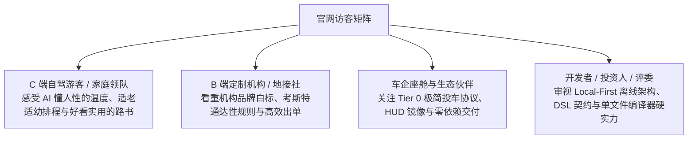
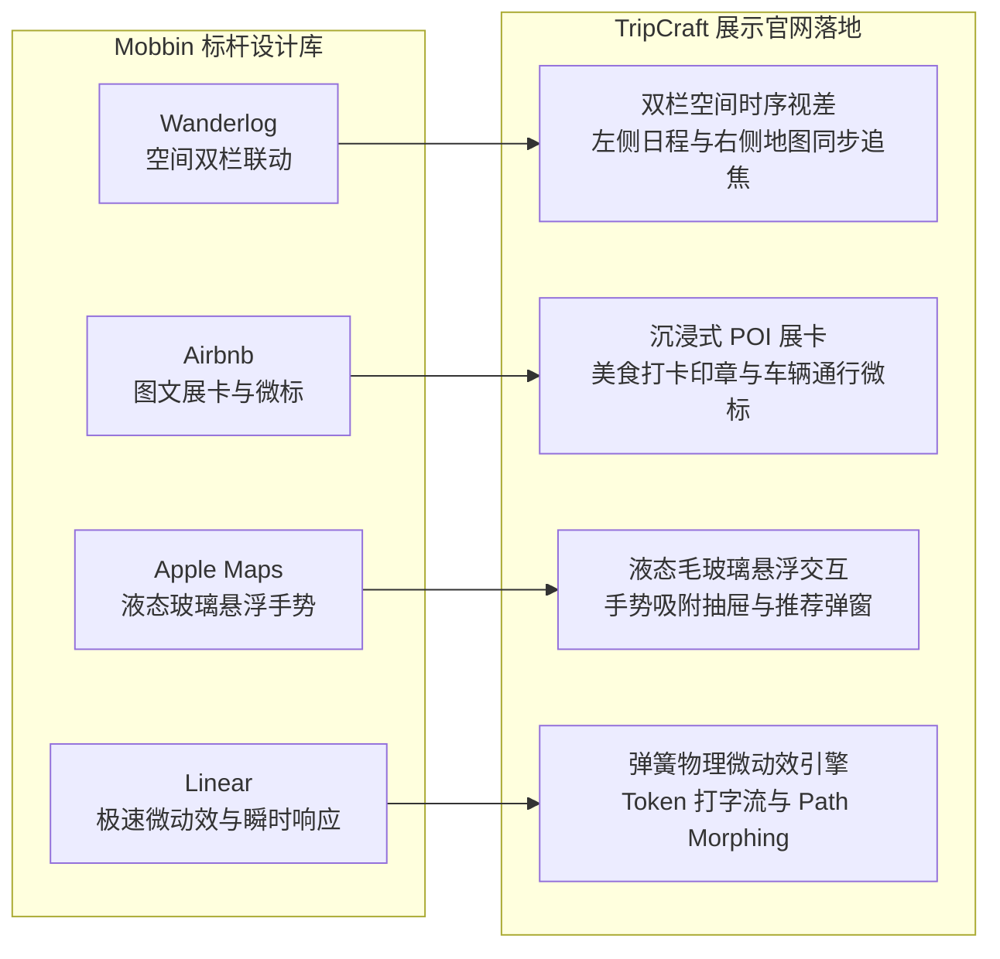
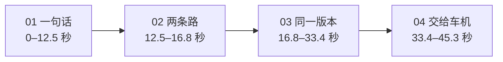
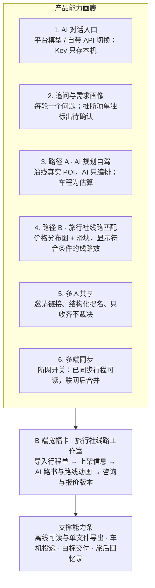
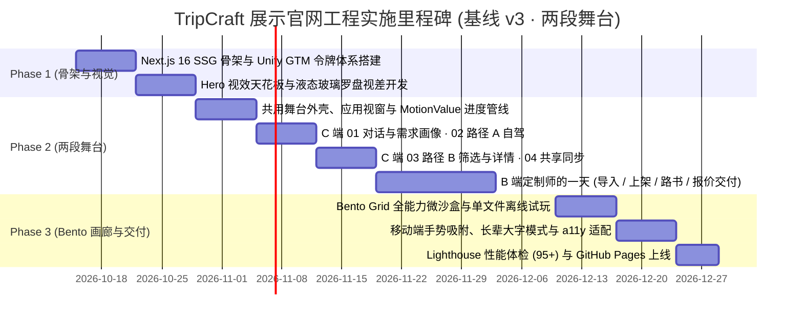

# TripCraft · 项目展示与交互演示官网技术开发设计规范 (SHOWCASE-web-design.md)

> **2026-10-29 更新（导演版 · 04 幕「全家的每一块屏幕」）**：第 4 幕的「共享与同步」从三行同步列表改成全片最有说服力的一刻（§4.2 幕 04 第 3–5 步，`Constellation.tsx`）：家人加入之后镜头拉远，看了五十秒的视窗缩成「我的电脑」，旁边是领队的手机、阿杰的手机、小雨的平板，还有一个空着的车机位置；阿杰在自己的手机上提名夜市 → 领队的手机收到、AI 只算代价 → 领队点「加入 D0 晚上」→ 涟漪从这部手机扩散，波前到哪块屏、哪块屏插入 20:00 并翻到 v1.1 → 时间卡「9 月 24 日 · 出发当天」→ 车机屏亮起 → 领队再点「投递到车机导航」→ 车机导航自己的界面接手今天的路线，终点是黄河边酒店的地面停车场入口（01 幕「总高 2.28 米」的伏笔落地）→ 全景停住 → 镜头回到电脑，接分享路书。**放在第 4 幕、不新增一幕**：这一幕本来就讲「确认 → 同步到每台设备」；车机投递是支撑能力（PRD-01 §3、AGENTS.md §0），作为「全家每一块屏」里的最后一块出现，不单独成幕。车机只演示「路线投递到车机导航，由车机导航引导」：屏上只有车机导航的界面与路线，没有车速、电量、档位与领航辅助；投递是领队再点一下（[docs/02](02-cockpit-protocol.md) Tier 0 深链），不是自动同步。C 端这一支走到了出发当天的自驾，B 端结尾不动：两段舞台是同一份咨询的两种结局（§4.0）。邀请只留链接（二维码面板删了），两人加入合成一条提示；04 幕时间轴 20 → 21.5 秒，C 端约 61 秒；减弱动态效果时 04 幕停在五块屏的全景。
>
> **2026-10-29 更新（导演版 · 01–03 幕）**：目标从「把功能讲清楚」升到「让人愿意看完」——第一次来的访客不读界面小字也能看懂（§4.1「镜头、字幕与飞行」、§4.2）。① **虚拟摄影机**：视窗边框不动，里面的整屏内容随镜头推近拉远，每一拍只推近此刻唯一要看的地方（`camera.ts`，镜头对准界面里带 `data-cam` 的元素）；手机布局已经是特写，不推近；减弱动态效果时始终是全景。② **字幕**：视窗下方一行大白话，说这一拍发生了什么（`Captions.tsx`，演示站排版，不进视窗）。③ **飞行**：跨区域的因果用一个小信物交代（`flight.tsx`）——对话里被读懂的短语画上下划线、飞进需求画像；保存的路线缩成封面飞进侧栏；91% 的匹配度环从交叉提示飞落成筛选页第一张结果卡的环；发出的咨询飞向「行程空间」。④ **02 幕地图跟拍**：像导航 App 一样推近、跟着线头走，画完拉远露出全线；途经点旁亮起说明它怎样照顾画像的小签。⑤ **删掉的**：开场的模型下拉菜单（输入框里仍有「平台模型」胶囊，自带 API 在能力画廊讲）、规划转圈、筛选页的静止。时间轴 13 / 14 / 21 → 10.8 / 11 / 11.8 秒，C 端约 76 → 约 60 秒（04 幕本次未动），播放速率仍是 0.9。
>
> **2026-10-23 更新**：C 端 04 幕收尾补「做成可分享的路书」镜头（[PRD-03 S-C10](product/PRD-03-scenarios.md#s-c10-用-ai-做一份可分享的个性化路书传播与获客)，§4.2 幕 04 第 5–6 步）：全家同步到 v1.1 后，领队点「做成可分享的路书」，分享卡片从 App 的默认外观换上 AI 按路线自动生成的行程皮肤（河西走廊 → 敦煌金，免费），封面用这趟行程的路线形状生成并标「示意」，页脚是「用 TripCraft 制作」角标与「AI 生成」标识；分享到家庭群后，亲友在自己的手机上打开只读分享页，点「我也做一份」回到 AI 对话的入口——和 01 幕的开场是同一个画面。皮肤只作用于卡片里的行程内容（`.trip-surface`，§4.1「行程皮肤令牌」），视窗外壳仍是统一外观。04 幕时间轴 18 → 20 秒，C 端约 76 秒；宽视窗的提名卡处理完收成一行，同步列表不再被裁掉。
>
> **2026-10-22 更新**：**D10 已定**（[PRD-01 §9](product/PRD-01-vision-positioning.md#9-待业主确认的决策)）——产品 App 采用 §4.1「视窗界面规范」的统一外观（暖白 · 品牌橙，玻璃只用于叠在地图上的浮层），不再只是提案。docs/09 的五主题 × 版式改为「行程皮肤」（[docs/09 §9.0](09-visual-design-system.md#90-两层app-外观与行程皮肤)：AI 自动生成的一套免费，深度定制属会员）。演示站视窗只在 04 幕收尾的分享卡片与分享页上演示 AI 自动生成的那一套皮肤（敦煌金，2026-10-23 补的镜头），视窗外壳仍是统一外观。
>
> **2026-10-21 更新**：① **视窗里的产品界面重新设计**（§4.1「视窗界面规范」）：业主在两套样张（暖白 · 品牌橙 / 冷灰 · 液态玻璃）中选定「暖白 · 品牌橙为主，叠在地图上的浮层用玻璃」。视觉语言与示例线路无关——配色、图标、地图样式、插画都不取材于某条线路的地貌，换成任何目的地都成立；界面里也出现了其他目的地的行程。少用成段文字，多用视觉编码：地图优先的示意矢量底图与类别图钉、用路线形状生成的行程封面、带交通段的日程时间轴、图形化的需求画像、匹配度环、堆叠色条报价、底部抽屉。这是产品 UI 视觉体系（D10，[PRD-01 §9](product/PRD-01-vision-positioning.md#9-待业主确认的决策)）的提案，D10 本身仍待决。② **整体降速到 0.9 倍**：C 端约 73 秒、B 端约 68 秒（`StageShell` 的 `PLAYBACK_RATE`，关键帧不动）。③ **对话输入框随文字长高**：从一行起逐行向上长高，最多 6 行，之后在框内滚动、最新一行可见；发送后收回一行。④ **iPad**：需求画像空状态的残影（透明度为 0 的元素同时隐藏）；横屏 1024–1279px 时左栏只有 300px，「上一章 / 下一章」改为图标按钮，播放控制不再折行。
>
> **2026-10-20 更新**：① **幕间因果衔接**：两段动画的每一幕都以一次点击结束、下一幕开头就是它的结果；一家人、一份需求画像、一条旅行社线路、一组价格贯穿 C 端四幕与 B 端四章（§4.0）。② **换章不再跳页**：章节说明改为同时收放、手机说明固定高度，消除了滚动锚定造成的整页跳动（§4.1）。③ **页面美学按 Unify GTM 实测复核**：重写 [`.agents/rules/unify-gtm-design-system.md`](../.agents/rules/unify-gtm-design-system.md)（含对照表），并据此重做首屏、两段舞台外围、能力画廊、设计场景（原「客户故事」，虚构评价已删除）、技术底座与页脚（§2.1、§3、§5）。
>
> **与产品基线 v3 的关系（2026-10-19 更新）**：演示区（§4）拆成两段独立的场景动画——**C 端旅客流程四幕**（AI 对话与需求画像 → 路径 A · AI 规划自驾 → 路径 B · 线路筛选与详情 → 行程空间 · 共享与同步），以及挂在其后的**B 端「定制师的一天」四章**（导入行程单 → 填写上架信息 → 生成路书与路线动画 → 咨询、报价与交付），均对齐 [PRD-01 v3](product/PRD-01-vision-positioning.md)。两段动画里的应用视窗改为克制的产品界面模拟（§4.1）。车机投递与离线交付是支撑能力，只以一句状态说明出现。导航栏已为两段演示各设入口；首屏（§3 Section 1）、能力画廊（§5）与页面 metadata 也已按 v3 改写：主叙事是对话 → 两条规划路径 → 多人共享与多端同步，旅行社线路工作室作为 B 端线，离线可读、单文件导出、车机投递、白标交付、旅后回忆录收在画廊末尾的「支撑能力」条，车机只写「把全天途经点交给车机导航」。视觉继续使用 Unify GTM（产品 UI 视觉体系 D10 未定，Unify GTM 只约束演示站）。

> **文档定位**：TripCraft 官方展示与交互演示官网（Showcase & Demonstration Landing Platform）的前端架构、视觉系统与交互动效技术实施规范。  
> **设计目标**：指导后续前端工程开发一个面向全球访客（自驾游客、家庭定制用户、旅行社地接机构、车企伙伴与开发者）的**高质感项目展示官网**。通过**故事流视差滚动动画 (Apple Scrollytelling)** 与沉浸式微沙盒，生动展现 TripCraft 的全量功能、技术硬实力与产品哲学。  
> **关联业务架构**：[`ARC-10 Web端系统开发设计`](architecture/ARC-10-web-system-design.md) · [`PRD-01 愿景与定位`](product/PRD-01-vision-positioning.md) · [`09 视觉设计系统`](09-visual-design-system.md)

---

## 1. 官网定位、目标受众与核心使命

### 1.1 官网定位界定
本项目**不是**繁重的企业级后台管理系统或单纯的业务操作端，而是 **TripCraft 品牌与能力的超级展示窗口（Interactive Showcase & Living Exhibition）**。其视觉与交互标准对标 Apple 产品发布页、Linear.app 与 Stripe Press，兼具学术严谨性与消费级美学。

### 1.2 四大目标受众与诉求匹配


### 1.3 核心设计铁律
1. **无需登录，开箱即秀**：全站所有功能展示与动画演示 100% 免登开放，访客只需滑动滚轮即可体验全部核心价值。
2. **滚动即叙事 (Scrollytelling First)**：将抽象的“输入-AI推演-排程-协作-算路”复杂业务流，转化为一气呵成的视差滚动电影级长镜头。
3. **真实感与可信度**：演示中的路书、地图经纬度、高程起伏与考斯特车型限制，全部基于真实的甘青大环线 9 天（Dunhuang Silk Road 9D）工程数据。

---

## 2. 视觉设计系统与 Mobbin 标杆范式沉淀

### 2.1 视觉设计系统在展示官网的落地 (Unify GTM Design System)

演示站的视觉规范是 [`.agents/rules/unify-gtm-design-system.md`](../.agents/rules/unify-gtm-design-system.md)：2026-10-20 在 1440 与 375 两种宽度下实测 unifygtm.com 首页、产品页、客户页与定价页的计算样式后重写，附录里有「Unify 的做法 / 我们改前的现状 / 是否要改」对照表，以及上一版规则与实测不符的地方。要点：

| 项 | 规范 |
| :--- | :--- |
| 网格与留白 | 外框 1320px + 40px 内边距（内容宽 1240px），手机两侧 20px；分区上下 96–128px，同底色分区之间不画分隔线 |
| 色彩 | 画布 `#FFFFF9`、平铺块 `#F8F7F3`、炭黑 `#241E20`；烈焰橙 `#FE3C01` 只用于标题关键词、1px 竖线与进度条、需要注意的信号、首屏关键词投影；12–13px 橙字用 `#C43200` |
| 字体 | 衬线 Noto Serif SC（`FontLoader` 非阻塞加载）用于各级标题与大数字；界面与正文用 Plus Jakarta Sans + 系统中文无衬线 |
| 字号 | 首屏 72 / 56 / 40px，分区 H2 44 / 40 / 32px，导语 18–20px，正文 15–16px，按钮与导航 15px，眉题 13px 炭黑；辅助字 ≥ 13px，视窗内 ≥ 12px |
| 圆角 | 按钮 5px · 胶囊全圆 · 平铺块 4px · 卡片 8px · 产品窗口 18px · 页脚纸面 10px · 纸面压氛围带的收边 28px |
| 边框阴影 | 卡片 20% 灰发丝边 + `0 2px 5px`；窗口 `#D7D7CF` 边 + 内高光 + 大而软的投影；卡片悬停不上浮 |
| 首屏光晕 | 关键词仍是炭黑，加 `text-shadow: 1px 0 2px rgba(254,60,1,.65)`（`.u-aura`）；不改成橙色、不铺模糊光斑 |
| 分区过渡 | 纸面与氛围带交替：C 端舞台的纸面以圆角压在 B 端的黄昏带上，能力画廊再以圆角纸面盖回；技术底座之后是夜色带 + 页脚纸面。氛围带（`.atmo-day / -dusk / -night`）用渐变加模糊画出，不引入图片 |
| 动效 | 只有进度条、下划线展开、0.3s 的深浅变化与 0.3s 的说明收放；换章版面高度不变；尊重 `prefers-reduced-motion` |

常用类名（`globals.css`）：`.u-eyebrow`、`.u-aura`、`.u-btn` + `.u-btn-primary / -secondary / -light`、`.u-pill`、`.u-card`、`.u-tile`、`.u-link`、`.atmo-*`。

### 2.2 Mobbin 顶尖产品交互范式融合


---

## 3. 网站整体信息架构与版块布局 (Page Structure)

整个展示官网设计为**单页流式滚动架构 (Single-Page Seamless Experience)**，包含以下核心版块：

```text
TripCraft 展示官网 (apps/showcase)
├── 公告条 + 导航 (Navbar.tsx) —— 公告条单行、随页面滚走；导航条实色纸面吸顶
│   └── 品牌 · 旅客流程 · 线路工作室 · 产品能力 · 设计场景 · 技术底座 ｜ GitHub · 设计文档 · 看演示
├── [Section 1] 首屏 (Hero.tsx) —— 眉题「多端同步、多人共享的 AI 旅行规划 App」
│   ├── 左对齐衬线标题「说出想去哪里，全家一起把行程定下来」（「定下来」用贴边橙色投影）
│   ├── 导语：对话追问 → 两条路径 → 共享与同步；入口「看旅客完整流程」→ #demo ·「旅行社线路工作室」→ #agency
│   └── 白昼氛围面板上的对话输入框：轮换的推荐说法（含一条「想找旅行社」）、模型来源、自带 Key 只存本机
├── [Section 2] ★ C 端演示片 (FilmStage, #demo) —— 纸面；标题在上，16:9 宽银幕（手机上是 9:16 竖屏、通栏）与一条播放条；底边圆角压在下一段的黄昏带上
│   ├── 01 一句话 (film/opening/Opening.tsx) —— 说一句话；被读懂的六处化成需求画像；AI 只追问一句「车有多高？」→ 总高 2.28 米
│   ├── 02 两条路 —— 同一份画像分岔：23 条持证旅行社线路（三张匹配卡）与 AI 规划的 9 天自驾路线；自驾这一支走进领队的手机
│   ├── 03 同一版本 (film/sync/SyncScene.tsx) —— 家人加入、阿杰提名、AI 只算代价；领队一点，一根线穿过全家每一块屏，都是 v1.1
│   └── 04 交给车机 —— 夜里熄屏，硬切到出发当天；领队把今天的路线投递到车机导航，由车机导航带路；片尾「全家一起把行程定下来」
├── [Section 2b] ★ B 端演示舞台 (AgencyStage, #agency) —— 黄昏氛围带，文字反白；定制师林舟的一天
│   ├── 09:30 导入行程单 (StudioImport.tsx)
│   ├── 10:40 填写上架信息 (StudioListing.tsx)
│   ├── 14:00 生成路书与路线动画 (StudioRoadbook.tsx) —— 发布后线路开始参与匹配
│   └── 16:20 咨询、报价与交付 (StudioInbox.tsx) —— 收到的正是 C 端那一家人的咨询
├── [Section 3] 产品能力画廊 (BentoGrid.tsx, #bento) —— 以圆角纸面盖回黄昏带
│   ├── 六张能力卡（8px 发丝边卡片，演示区在浅石灰平铺块上）：AI 对话入口 · 追问与需求画像 · 路径 A · 路径 B（价格分布图滑块）· 多人共享 · 多端同步（离线可读开关）
│   ├── B 端宽幅卡：旅行社线路工作室，四个时间点用 1px 烈焰橙竖线列出（→ #agency）
│   └── 支撑能力条（纯文字栏）：离线可读与单文件导出（样例下载）· 车机投递 · 白标交付 · 旅后回忆录
├── [Section 4] 设计场景 (CustomerStories.tsx, #stories) —— PRD-03 的四个典型场景，写明「不是用户评价」
│   └── 指标方块：追问不超过 3 轮 · 23 条线路，1 份咨询 · 5 个人，1 个版本 · 报价 v1 → v2
├── [Section 5] 技术底座 (TechFoundation.tsx, #foundation) —— 纸面底边圆角压在夜色带上
│   ├── 数字卡：6 份 JSON Schema 契约 · 4 道 CI 门禁 · 10 份 ADR · 21 个场景 / 79 项功能双向追溯
│   └── 四条工程主张（左侧选项卡 + 右侧代码窗口，代码为仓库文件节选）：需求画像 · 上架契约 · 匹配评分（ADR-010）· 增量补丁
└── [Section 6] 收尾行动区与页脚 (Footer.tsx) —— 夜色氛围带 + 纸色圆角页脚
    ├── 「从一句话需求，到全家同步的行程」；入口：看旅客完整流程 · GitHub 仓库
    └── 四列链接（演示 · 设计文档 · 数据契约 · 项目）；docs/00 §0.3 三条责任边界；© 2026 · MIT 许可证
```

---

## 4. 核心演示区规格（两段独立的场景动画）

> 本版块是展示官网的灵魂所在。演示区由两段**互相独立**的舞台组成：C 端演示片（`FilmStage`，锚点 `#demo`）只讲旅客这一侧——说一句话、全家同一个版本、出发当天交给车机导航，中间不插入旅行社端内容；B 端舞台（`AgencyStage`，锚点 `#agency`，挂在演示片之后）以旅行社定制师的视角讲同一天。两段各有自己的章节导航、进度与节奏，但讲的是**同一家人、同一条线路**。2026-10-30 起 C 端从「应用视窗里的四幕」改为一部约 45 秒的演示片（发布会级重拍，§4.2）；B 端不变。

### 4.0 幕间衔接与数据贯穿（2026-10-20）

**规则**：B 端每一章以一次演示光标的点击结束，下一章开头就是这次点击的结果；切换通过点击视窗里真实的按钮或导航完成，不硬切。C 端演示片（2026-10-30）用「一根线」交代因果：线从那句话出发，长出需求画像、分岔成两条路、走进领队的手机、穿过全家每一块屏、最后落进车机屏，下一拍总从线头所在的地方开始；全片只有两处硬切——夜里到出发当天、车机到片尾。

| 衔接 | 上一幕最后一下 | 下一幕开头 |
| :--- | :--- | :--- |
| C 一句话 → 画像 | 发送：句子进入气泡，被读懂的六处依次画上品牌橙下划线 | 一根线从气泡出发往下走，一站一站长出需求画像：项名在线左边，原话在线右边 |
| C 画像 → 追问 | 六站填满（日期 · 同行 · 身体 · 身体 · 必去 · 方式） | 前六站退成浅灰；第七站「车辆」：AI 只追问一句「车有多高？」，回答落成「总高 2.28 米」 |
| C 追问 → 两条路 | 「总高 2.28 米」停住 | 线在画像下面分岔：一支落到「也匹配到 23 条持证旅行社线路」的三张匹配卡；另一支（自驾 · AI 规划 · 9 天 · 1,980 km）走过兰州、张掖、嘉峪关、敦煌 |
| C 两条路 → 领队的手机 | 自驾这一支走进领队的手机 | 手机亮起：行程「西行计划」的 D0；阿杰、小雨通过链接加入，阿杰的提名卡升起，AI 依次算出三条代价 |
| C 点下 → 全家 | 其余变暗，画面里只剩「加入 D0 晚上」与一根手指；领队点下 | 20:00 正宁路夜市这一行长出来；线从这部手机出发，依次穿过我的电脑、小雨的平板、阿杰的手机，每块屏插入同一行，屏下标签翻到 ✓ v1.1 |
| C 全景 → 出发当天 | 全景停住「每一块屏，同一个版本。」；夜里全家的屏熄灭 | 硬切：「9 月 24 日 · 出发当天」，领队的手机亮起（14:36，中川机场刚取完车），「今天的路线」升起 |
| C 投递 → 车机 | 领队点「投递到车机导航」，按钮变为「已投递 · 由车机导航带路」 | 橙线从手机底边落进车机屏，交给车机导航自己的蓝色路线（「前往 黄河边酒店 · 地面停车场入口 · 导航中」）；然后硬切到片尾 |
| B 09:30 → 10:40 | 低置信度字段逐项确认后点「下一步」 | 新建线路向导第 2 步「上架信息」 |
| B 10:40 → 14:00 | 完整度到 100% 后点「下一步」 | 第 3 步「路书与路线动画」 |
| B 14:00 → 16:20 | 「发布到线路详情」→ 提示「已发布 · 线路开始参与匹配」 | 仍是刚发布的路书页；16:20 新咨询通知到达、侧栏「咨询」出现角标 → 光标点「咨询」打开收件箱 |

**一条数据线**：

| 数据 | C 端 | B 端 |
| :--- | :--- | :--- |
| 一家人 | 全家 5 口：3 成人 · 70 岁爷爷 · 4 岁女儿（那句话里说出；阿杰、小雨通过链接加入行程） | 咨询摘要「5 人（3 成人 · 1 长者 70+ · 1 儿童 4 岁）」 |
| 需求画像 | 国庆前后 · 9 天左右；不能爬高台阶 · 孩子每天要午休；必去莫高窟和鸣沙山日落；自驾或旅行社都行；车高 2.28 m（唯一的追问）。预算不在片子里 | 同行、日期与身体情况相同；预算「人均 ¥5,000–7,000，可到 ¥8,000」只在 B 端出现（旅客在咨询里写的）；报价 v2 注明「仍在旅客说的人均 ¥8,000 以内」 |
| 线路 | 分岔时的第一张匹配卡：91%「河西走廊 9 日 · 长辈友好私家团」· 敦煌某国际旅行社（封面标「示意」）；详情页不在片子里 | 09:30 导入的就是这条线路；14:00 生成的 45 秒路线动画发布到它的详情页 |
| 价格 | 匹配卡上只有人均起价（¥6,280 / ¥5,460 / ¥5,180）；预估价与报价不在片子里 | 上架价格规则（成人 ¥6,280 · 长者 ¥5,980 · 儿童 ¥4,680；敦煌升级 +¥380/人/晚）；报价 v1 ¥7,040 · ¥33,300 → v2 ¥7,940 · ¥37,800 |
| 加一天 | 不在片子里 | 16:41 旅客：「全家商量了一下，能再加一天去阳关和玉门关吗？」 |
| 提名 | 阿杰提名「正宁路夜市 · 赵记醪糟」（D0 晚上）；AI 只算代价：步行 950 m、不增加车程、夜市地库限高 2.0 m → 车停酒店地面车位；领队加入后全家都是 v1.1 | 不出现 |
| 交付 | 自驾路线存为领队手机里的行程「西行计划」（河西走廊 · 9/24–10/2 · 5 人） | 白标路书「已发送到旅客的行程空间「西行计划」，同行的家人都能看到」 |
| 分享 | 不在片子里（2026-10-30 重拍删掉了分享路书的结尾，见 §4.2「删掉了什么」） | 白标路书以旅行社品牌包为准，不加「用 TripCraft 制作」角标与「我也做一份」入口（[docs/09 §9.0.3](09-visual-design-system.md#903-免费与会员)） |
| 时间 | 提名在出发之前的某个晚上（状态栏 21:06）；出发当天 9 月 24 日 14:30 中川机场取车，14:36 投递到车机导航 | 16:20 收到 → 16:32 报价 v1 → 16:41 旅客提问 → 16:45 报价 v2 → 16:58 接受 → 17:06 交付；视窗标题栏的时钟随之推进 |

**两段舞台的结局**（2026-10-29；2026-10-30 随重拍改写）：C 端演示片在分岔处走自驾这一支，一直演到出发当天（9/24 14:30 中川机场取车，把今天的路线投递到车机导航）；另一支「23 条持证旅行社线路」只露出三张匹配卡。B 端讲的是另一种走法：这一家人向 91% 那条线路的旅行社发出咨询之后，旅行社那一侧的同一天，走到成交与白标交付。两段是同一家人的两种走法，不是同一条时间线；上表的同行、画像与线路照旧一致。

### 4.1 共用外壳与应用视窗

> 2026-10-30 起 `StageShell` 与 `AppWindow` 只用于 B 端舞台；C 端演示片的部件见本节「演示片」表。本节后半的「视窗界面规范」是产品 App 的外观（D10），两段都遵守：演示片里每块屏上的界面同样只用产品界面令牌。

| 组件 | 职责 |
| :--- | :--- |
| `StageShell.tsx` | 左侧眉题、衬线标题、导语、章节导航（桌面竖排，进度条在文字左侧留白里；平板与手机改为紧贴视窗上方的横排进度条 + 当前章说明）与播放控制（播放 / 暂停按钮 + 章号 + 「上一章 / 下一章」40px 图标按钮，整行不折行）；右侧放应用视窗。`tone="band"` 时整段放在深色黄昏氛围带上、文字反白；`edge="sheet"` 时纸面底边圆角压在下一段氛围带上 |
| `AppWindow.tsx` | 应用视窗外壳（18px 圆角、`#D7D7CF` 边、内高光）：宽视窗是标题栏 + 侧栏导航 + 内嵌内容面板 + 底部状态栏，≥ 800px 时侧栏还显示附加区（C 端是「我的行程」列表），手机宽度是铺满的内容 + 底部标签栏；根节点 `data-ui` 是产品界面令牌的作用域；侧栏高亮、状态栏文字与标题栏时钟由 `sections` 按进度切换；导航项可带角标（`badge`）与演示光标（`tap`），用于幕间衔接 |
| `acts.ts` | 按时长比例把章节首尾相接铺满全局进度 0 → 1 |
| `ui.tsx` · `primitives.tsx` | 视窗内的界面零件（按钮、页面标题、徽标、开关、勾选框、分段控件、步骤条、进度环 `Ring`、类别圆标 `CatMark` / 方标 `CatTile`、胶囊 `Chip`）与动效原语（`Scene` 交叉淡入、`TapCursor` 演示光标、`Grow` 会话流、`Reveal`、`Pop`、`Toast`、`Avatar`）；演示片的屏幕复用其中的 `Avatar`、`Ring`、`Badge`、`CatMark` / `CatTile` |
| `MapCanvas.tsx` · `data/basemap.ts` | 地图：示意矢量底图（水系、保护地、城镇、高速与道路，近似经纬度手绘，非图商数据）+ 白色描边的路线（按弧长描绘）+ 类别图钉 + 12px HTML 地名；可选缩放 / 定位按钮、比例尺与「示意底图 · 非图商数据」标注；`frame` 指定路线必须落进的区域（例如留出手机底部抽屉） |
| `RouteGlyph.tsx` | 行程与线路封面：用这趟行程自己的路线形状画成（渐变底 + 经纬点阵 + 白色路线），配色取自一组与目的地无关的渐变；大封面右上角标「示意」；`colors` 可改用行程皮肤的颜色（旧 04 幕的分享卡片）；演示片的匹配卡封面也用它 |

**时钟**（`StageShell`；2026-10-30 起只有 B 端舞台用，C 端演示片的时钟见「演示片」表）：每个舞台一只 rAF 时钟驱动一条全局进度 MotionValue，场景经 `ProgressContext` 读取，播放过程 0 React 重渲染。

- **播放速率**：时间轴按「时间轴秒」书写（`ACT_ORDER` / `AGENCY_ORDER` 的时长与关键帧），时钟每帧推进 `dt × PLAYBACK_RATE`。2026-10-21 起 `PLAYBACK_RATE = 0.9`：C 端 55.1 → 约 61 秒（2026-10-29 导演版把 01–03 幕由 48 秒压到 33.6 秒、04 幕由 20 秒加到 21.5 秒，原为 68 → 约 76 秒），B 端 61 → 约 68 秒；调整整体节奏只改这一个常量。
- 章节区间按时长比例首尾相接（前一章的终点就是后一章的起点），自动播放跨章时进度连续，没有空档或跳帧；「一秒」在任何一章都对应同样的进度跨度。
- **只播放一遍**：最后一章结束后停在终帧，按钮变为「重新播放」。
- 视窗露出不足 35% 时挂起；时钟累加每帧耗时（单帧最多计 64ms），切走标签页或掉帧回来不会跳章。两段舞台同在一页，只有可见的那段在跑。
- 手动点选章节时落在该章画面已完全淡入的时刻（`enter`），不会闪过上一章的画面。
- 暂停时跳帧（点选章节、静帧、调试钩子）之后再轻推两帧进度（差 1e-9）：由几个派生值合成的样式（镜头、地图跟拍）在同一帧里可能先于某个输入算完，播放时下一帧就会更正，暂停时却会停在旧值上。

**演示片**（2026-10-30，C 端发布会级重拍；B 端不用）：

| 部件 | 规则 |
| :--- | :--- |
| 播放器（`film/FilmStage.tsx`） | 标题与导语在上；下面是版心宽的 16:9 画面（画框宽度 < 640px 时换成 9:16 竖屏，手机上通栏）与一条播放条：播放 / 暂停 / 重播、四个章节按钮（各带一道品牌橙进度，← → 键切换）、声音开关。画框露出 ≥ 50% 才开始播，离开就停；访客自己按的暂停不被打断；播完停在片尾，按钮变为「重播」。画面对读屏软件是一张图（`role="img"`），播放器下面另有一份 `sr-only` 的文字版，写明片子里发生了什么 |
| 时钟（`film/clock.tsx`） | `FilmClock` 是一条以秒计的 MotionValue，rAF 推进（单帧最多计 64ms，切走标签页回来不跳），播放过程 0 React 重渲染；`useFilmControl` 播放 / 暂停 / 跳到；`TimeShift` 给一段戏自己的零点——开场按全片时间写（`opening/Opening.tsx` 的 `O`），高潮按自己的 0 秒写（`sync/SyncScene.tsx` 的 `T`），放在 `CLIMAX_AT = 22.7` 秒之后；`TimeGate` 让一段戏只在它看得见的时段里跟着时钟走（开场、高潮、每台屏、屏幕外的叠层各一道），之外停在边界上，几百个插值不再每帧重算 |
| 摄影机（`clock.tsx` 的 `Shot` / `shotCam` / `useCamera`） | 全片是世界坐标里的一整幅画面，镜头是一串「画框」（世界坐标里的矩形，等比放进画面），画框之间按对数插值缩放；跟拍按线头的位置每 0.1 秒取一次画框再做滑动平均；画框补足画幅时上沿不动、往下补（`topAnchored`），上沿落在两行字之间，不切字。镜头移动时界面不另起动画，界面动的时候镜头停住 |
| 线（`film/line.tsx`） | 全片唯一的运动主体：一根品牌橙的折线（拐角是四分之一圆），线头按 `HeadMotion`（起跑时刻、速度、起步加速）前进，站点是白芯橙圈的点；线用世界坐标里的实心条与四分之一圆环拼成，镜头移动时只做合成、不重画 |
| 设备（`film/devices.tsx`） | 手机、电脑、平板、车机的外壳；`Placed` 按世界坐标摆放，入场之前与淡出之后用 `content-visibility: hidden` 跳过渲染；`Dim` 压暗、`Sleep` 熄屏，都是单独的实色层，只改透明度 |
| 屏幕（`film/screens.tsx`） | 屏上只放真实的产品界面，只用产品界面令牌：行程「西行计划」的标题与 D0 日程、成员头像与加入提示、提名卡与 AI 评估、插入的一行、版本号、同步列表、「今天的路线」与投递按钮；车机导航用它自己的中性界面与交通蓝路线。屏上的字按原大写（≥ 12px），镜头拉远时它们是画面的一部分，要读的那一处总在推近的镜头里 |
| 说明字与片名（`SyncOverlays`、`EndCard`） | 屏幕外是电影语言：屏下「谁的 · ✓ v1.1」标签、两张片名（「每一块屏，同一个版本。」「9 月 24 日 · 出发当天」）与片尾；在屏幕坐标里排，不随镜头缩放，字号按画面宽度算，不低于 13px |
| 声音（`film/sound.ts`） | 默认关闭；在播放条上打开后用 WebAudio 现场合成提示音，不加载音频文件；跳转时不补放已经错过的音 |
| 光栅（Chrome 合成器） | 镜头移动时世界层带 `will-change: transform`，光栅比例固定、只做合成；镜头每次停稳，让需要看清的那几块暂时去掉 `transform` 提示（`useRaster` 的 `fresh` 时段），按新的比例重新光栅，字不糊；`will-change` 始终带 `opacity`，图层不会被拆并。演示片里的玻璃（`.ui-glass`）退回实色（`[data-film]`）：在缩放的图层上做背景模糊太贵。会动的片名与片尾的橙线各自一层（`will-change`）：淡入、上移时不重画整个画面 |

**节奏**：全片一条强度曲线——开场安静（空输入框、逐字打出那句话）→ 画像一站站长出来 → 「总高 2.28 米」→ 分岔 → 线走进手机 → 家人加入与提名 → **静**（其余变暗，只剩按钮与手指，约 0.9 秒无声）→ 点下 → 高潮（线穿过全家每一块屏，约 29.5 秒）→ 全景停住 → 夜里熄屏 → 出发当天 → 车机带路 → 片尾。同一时刻只有一处在动。

> 2026-10-29 导演版的镜头、字幕与飞行（`stage/camera.ts`、`Captions.tsx`、`flight.tsx`、`Constellation.tsx`、`MapCanvas` 的跟拍）随旧的 C 端舞台一起退役，文件暂未删除；演示片只复用 `camera.ts` 的 `layoutRect`（量取屏里元素的位置），`MapCanvas` 只用它的示意底图（小雨平板上的行程地图），不用跟拍。

**换章时版面不动**（2026-10-20 修复）：旧版换章时当前章说明直接卸载、新章说明从 0 高度展开，垂直居中的左栏先缩短约 35px 再长回来；浏览器的滚动锚定随之替访客滚动页面，实测每次换章整页上移约 37px，到第 4 幕视窗顶部已滑到导航条下面。现在左栏顶端对齐，所有章的说明都渲染、用 `grid-template-rows: 0fr ↔ 1fr` 同时收放（0.3s `cubic-bezier(0.2,0.8,0.2,1)`）；手机上当前章说明占固定高度（最多 3 行）。实时播放复测：换章前后页面滚动位置、左栏位置与高度均不变。2026-10-24 补：iPad 横屏（lg 档，左栏 300px）时最长的章节说明折成 4 行，左栏比视窗高出 4px、舞台高度随之在 916 / 920px 之间变；播放控制上方的间距在 lg 档改为 24px（xl 档仍是 32px），左栏不再超过视窗。2026-10-30 起 C 端演示片的画框是固定比例，播放、跳章与播完都不改版面高度。

**视窗界面规范**（2026-10-21 重写；视窗里是待开发 App 的界面模拟。2026-10-22 业主定下 D10：本规范就是产品 App 的外观，所有人相同、不随目的地变化；行程皮肤只作用于行程页与产出物，见 [docs/09 §9.0](09-visual-design-system.md#90-两层app-外观与行程皮肤)；Unify GTM 只约束视窗以外的营销页面）：

*定位与来源*：旅客端学 Airbnb、Apple 地图 / 日历、Google 地图与 Google Travel、携程 / Booking 的信息层级与视觉编码，线路工作室学 Linear、Notion、Stripe Dashboard 的克制与数据表达；只学原则，不搬素材。2026-10-21 业主在两套样张中选定「暖白 · 品牌橙」为主、叠在地图上的浮层用玻璃（另一套「冷灰 · 液态玻璃」样张没有采用）。

1. **视觉语言与示例线路无关**：配色、图标、地图样式、插画都不取材于某条线路的地貌（不用沙漠、山地、丹霞一类的暖沙色），换成任何目的地都成立。颜色只来自三处——中性的界面底色；品牌橙（路线、发送键、需要注意的信号）；内容自带的颜色（地点类别、地图要素、行程封面）。唯一按路线变化的是 04 幕收尾分享卡片里的行程皮肤（见第 2 条的「行程皮肤令牌」），它只作用于卡片里的行程内容。侧栏「我的行程」里同时放着其他目的地的行程（川西 · 稻城亚丁、京都 · 赏枫），开场建议的示例说法也不指向示例线路。
2. **令牌**（`globals.css`「产品界面令牌」，`tailwind.config.ts` 的 `ui-*`，组件不写死色值）：

   | 令牌 | 值 | 用途 |
   | :--- | :--- | :--- |
   | 外壳 / 面板 / 下沉 | `#F3F2EE` / `#FFFFFF` / `#F6F5F1` | 标题栏与侧栏 / 内容面板与卡片 / 胶囊、输入框、次级块 |
   | 文字 | `#241E20` · `#5A5557` · `#757072` | 三级文字；最浅一级在白底上对比度 4.8:1 |
   | 发丝线 | `#E9E7E1`（强 `#D5D2CA`） | 分隔与描边 |
   | 品牌橙 | `#FE3C01`（12–13px 橙字用 `#C43200`） | 路线、发送键、推断项、角标、关键数值 |
   | 主按钮 | 炭黑 `#241E20` | 每屏一个主操作 |
   | 成功 | `#0E7A5A` | 已确认、已同步、已发送 |
   | 地点类别 | 景点 `#6D5BD0` · 自然 `#279656` · 餐饮 `#E26C0A` · 住宿 `#BE3E86` · 交通 `#3A78D2` · 服务区 `#0D8C87` | 地图图钉、地点卡片、日程、报价分项色条（沿用地图 App 的通行约定） |
   | 地图 | 陆地 `#F1F0EC` · 城镇 `#E5E3DD` · 水系 `#ACCDEA` · 保护地 `#D0E5C8` · 道路白 · 高速浅黄 `#FFEAA8` | 通用的地图 App 配色 |
   | 圆角 | 面板 14 · 卡片 12 · 控件与按钮 8 · 胶囊全圆 · 视窗 18 | — |

   **行程皮肤令牌**（2026-10-23；`globals.css`「行程皮肤令牌」，`tailwind.config.ts` 的 `trip-*`，即 [ARC-10 §5.1](architecture/ARC-10-web-system-design.md#51-两层设计令牌app-外观与行程皮肤) 的两层令牌）：只挂在行程内容的根节点 `.trip-surface` 上，没有 `data-trip-theme` 时回落到上表的产品界面令牌。演示站只在 04 幕收尾的分享卡片与分享页用 `data-trip-theme="dunhuang-gold"`（[docs/09 §9.2.2](09-visual-design-system.md#922-敦煌金-dunhuang-gold)）：沙 `#F2E8D5` 底、暖褐黑 `#3A2E1F` 字、青金石蓝 `#1F4E79` 日期标、赭石红 `#8C3A2B` 眉题，封面从氧化金 `#B8863B` 渐变到赭石红；标题用衬线体，数字不用等宽。沙底上的对比度：文字 10.9:1、青金石蓝 7.1:1、赭石红 6.3:1、78% 的文字 5.8:1；氧化金只有 2.7:1，只画线条，不用于文字。成功、警告、地点类别、合规提示与「AI 生成」标识锁定为产品界面令牌，不随皮肤变化。

3. **材质**：卡片 `.ui-card`（白底 + 发丝边 + 极轻投影）；弹出层与抽屉 `.ui-float`（实色）；**叠在地图上的浮层用玻璃** `.ui-glass`（白 72% + 20px 模糊 + 内高光）——全程概要胶囊、缩放 / 定位按钮、「示意底图」标注、手机上的日程抽屉、路线封面与播放器上的浮标。不支持 `backdrop-filter`（`@supports not`）或系统要求减少透明度（`prefers-reduced-transparency: reduce`）时退回实色（docs/09 §9.4.3：玻璃是渐进增强）。
4. **少用成段文字，多用视觉编码**：
   - *地图优先*：示意矢量底图（水系、保护地、城镇、高速与普通道路；近似经纬度手绘，不是图商数据，右下角标「示意底图 · 非图商数据」）；路线是白色描边 + 品牌橙的粗线，按天推进；景点、自然、服务区画成类别图钉，路线画到时落下；地名用 HTML 叠加，固定 12px。
   - *行程封面*：用行程自己的路线形状生成（`RouteGlyph`），每条线路的封面各不相同；大封面标「示意」。
   - *带交通段的日程时间轴*：宽视窗横排日程卡片，卡片之间是交通段（开车时长与里程，或「市内」）；手机是底部抽屉里的竖排时间轴；当天随路线线头高亮并滚到视野里。每天用图形标签写它怎样照顾到画像（地面车位、车上过垭口、日落时刻、午休、无障碍接驳、不夜行）。
   - *图形化的需求画像*：同行人剪影（成人 / 长者 / 儿童）、必去地点的类别标、带图形的身体条件、车高胶囊、日期条（9/24–10/3，国庆点位，可延长的两天渐隐）、推断的预算区间（虚线框）；空位先画出来，聊到一项填一项，完成度用进度环表示。
   - *匹配度环、分布图、堆叠色条、预算对照*：筛选页的价格 / 天数柱状分布；报价分项用一条按占比堆叠的色条；报价 v2 用一条进度对照旅客说的人均上限 ¥8,000；上架完整度、画像完成度、设备同步都用环或计数。
   - *头像与状态*：同行人头像依次入列；设备同步逐行变为 v1.1；咨询的成交进度用五个点表示（咨询 → 报价 → 接受 → 成交 → 交付）。
5. **图片**：仓库里没有授权照片，也不引入外部图片。插画与封面都用 SVG / 渐变绘制并标「示意」；B 端路书里旅行社上传「实拍」的位置用中性的图片占位表示，「示意」位用类别图形，不用 AI 生成的景点照片冒充实拍（[docs/17 §17.6.3](17-agency-route-studio.md#1763-ai-生成内容的标识)）。
6. **字号与网格**：正文 13px，页面标题 15px，辅助文字不小于 12px（`text-xs`），任何文字不低于 12px；数字用等宽数字（`tabular-nums`）。控件高 32px（主操作 40px），间距取 4 / 8 / 12 / 16 / 24px。
7. **动效只说明当前这一步**：演示光标移到控件上按下 → 结果出现；同一时刻不让多个元素同时闪动；透明度为 0 的元素同时 `visibility: hidden`（`useFadeVisibility` / `useFadeStyle`），iPad Safari 才不会留下上一帧的残影；显示时写 `inherit` 而不是 `visible`，否则会盖掉祖先的 `hidden`，已经隐藏的一屏里仍留着可见的文字（2026-10-24 修复）。演示片（2026-10-30）里整块设备（手机、电脑、平板、车机）入场之前与淡出之后用 `content-visibility: hidden` 跳过渲染，不切 `visibility`：在上千个节点的子树上切换会继承的 `visibility`，每次要 80–100ms 的样式重算（CPU 降速 2 倍时），播放时掉帧；屏下标签、片名与片尾这些文字叠层仍按透明度同时 `visibility: hidden`（`useShown`）。
8. **状态栏**只写对这一步有意义的信息（数据来源、合规口径、同步状态）。

**按视窗自身宽度排版**（B 端视窗）：桌面双栏时视窗只占右侧一栏，堆叠时又占满整行，视口断点反映不了视窗的真实宽度。视窗根节点声明 `container-name: win`，子元素用 Tailwind 插件注册的 `cq-sm`（≥ 560px：标题栏、图标侧栏、状态栏）、`cq-md`（≥ 680px：上下文面板、左右分栏）、`cq-lg`（≥ 800px：侧栏文字与附加区）变体排版（见 `tailwind.config.ts`）。桌面左栏 300–340px，视窗约 840px（`cq-lg`）；iPad 横屏 1180 / 1194px 时视窗约 760px（`cq-md`），1024px 时约 600px（`cq-sm`）。手机宽度（375px）下视窗是一款手机 App：底部标签栏，上下文面板改为底部抽屉。

**文案口径**：涉及匹配与报价的界面文字遵守 [docs/00 §0.3](00-overview-and-glossary.md#03-三条责任边界线tripcraft-不是清单) 末尾的正确表述——匹配度为信息参考、预估价以旅行社正式报价为准、合同与付款由旅客与旅行社直接签订；平台不自称旅行社，也不出现「立即预订」「平台担保」一类表述。

**视觉巡检**：浏览器控制台执行 `window.__setStageProgress(v)`（C 端演示片，v 为全片进度 0–1；也可用 `window.__film.seek(秒)`）或 `window.__setAgencyProgress(v)`（B 端），可跳到任意进度并暂停。

### 4.2 C 端演示片：一根线（`FilmStage` · [`TravelerFilm.tsx`](../apps/showcase/src/components/film/TravelerFilm.tsx)）

*设计依据：[PRD-01 §2](product/PRD-01-vision-positioning.md#2-核心使用流程)、[docs/16](16-planning-paths-and-route-matching.md)、[docs/15](15-multi-device-and-collaboration.md)、[docs/02](02-cockpit-protocol.md)*



2026-10-30 发布会级重拍（方向 A「一根线」，业主选定），取代 2026-10-29 的导演版四幕。全片约 45 秒（`FILM_DURATION = 45.25`）；四章是播放条上的四个跳转点，不是四段各自独立的场景。

**静音、不读字也要记住的三件事**：① 说一句话，AI 就读懂了这一家人；② 全家每一块屏，同一个版本；③ 出发当天，路线交给车机导航。片子里的一切都为这三件事服务；别的能力（筛选页、报价、分享路书、离线导出）留给能力画廊与 B 端舞台。

**一根线**：全片是一个连续的世界、一台摄影机、一根品牌橙的线。线从那句话出发，长出需求画像、分岔成两条路、走进领队的手机、穿过全家每一块屏、最后落进车机屏；观众只需要跟着线头。屏上只放真实的产品界面（产品界面令牌，§4.1「视窗界面规范」），屏外是电影语言：线、站点、屏下标签、两张片名与片尾。不用粒子、光晕、无意义的 3D 旋转、故障效果、手持晃动、回弹与满屏渐变。

**画幅**：桌面与平板是 16:9 的横屏片；画框宽度 < 640px 时换成 9:16 的竖屏片，手机上通栏——同一套时刻，另一套构图（横屏从左往右读，竖屏从上往下读），不是把横屏缩小。

**分镜**（时刻是全片的秒数）：

| 秒 | 画面 | 镜头 |
| :--- | :--- | :--- |
| 0–3.3 | 空着的输入框（「说说这趟旅行：谁去、去哪、在意什么…」、「平台模型」胶囊、发送键），那句话逐字打出来：「全家 5 口国庆前后去河西走廊，玩 9 天左右。带 70 岁的爷爷和 4 岁的女儿，爷爷膝盖做过手术不能爬高台阶，孩子每天要午休。想看莫高窟和鸣沙山日落，别太赶。自己开车或者找旅行社都行。」 | 贴近输入框，极慢地推近；竖屏像一块空着的聊天屏，输入框在画面下部 |
| 3.5–5.5 | 发送：句子进入气泡，被读懂的六处依次画上品牌橙下划线 | 退到气泡，停住 |
| 5.6–10 | 一根线从气泡出发往下走，一站一站长出需求画像：线左边是项名（日期、同行、身体、身体、必去、方式），右边是原话 | 随画像一起长，装下整张画像后停住 |
| 10.05–12.5 | 前六站退成浅灰；第七站「车辆」：AI 只追问一句「车有多高？」，回答落成「总高 2.28 米」，下注「AI 只追问了这一句 · 腾势 D9，加了车顶箱」 | 不动 |
| 12.5–14.5 | 线在画像下面分岔，一支落到三张旅行社线路的匹配卡（91% / 86% / 82%，封面标「示意」）：「也匹配到 23 条持证旅行社线路」「匹配度为信息参考，以旅行社报价与合同为准」 | 拉到分岔；画面上沿落在两行字之间 |
| 14.6–17.1 | 另一支（「自驾 · AI 规划 · 9 天 · 1,980 km」）走过兰州 D0、张掖 D1、嘉峪关 D2、敦煌 D3–D5，走进领队的手机；匹配卡退成浅灰——另一条路还在，只是注意力移开了 | 分岔的画面停住；线头过了张掖，一次摇到后面的城与手机 |
| 16.75–18 | 领队的手机亮起：「西行计划 · 河西走廊 · 9/24–10/2 · 5 人 · 领队：我」与 D0 日程（14:30 中川机场取车 · 腾势 D9，19:15 入住黄河边酒店 · 地面车位） | 推到整部手机 |
| 18.3–20.6 | 阿杰、小雨的头像入列，提示「阿杰、小雨 通过链接加入了行程」；阿杰的提名卡升起：「正宁路夜市 · 赵记醪糟 · 兰州 · 小吃 · D0 晚上」，「AI 评估 · 只算代价，不替大家决定」，三条依次出现：离 D0 酒店步行 950 m ✓、不增加车程 ✓、夜市地库限高 2.0 m → 车停酒店地面车位（注意） | 不动 |
| 20.9–25.6 | 推到提名卡；其余变暗，画面里只剩「加入 D0 晚上」与一根手指；**静**：约 0.9 秒，无声 | 推近，停住 |
| 25.6–29.5 | 点下：提名卡收起，20:00 正宁路夜市这一行在日程里长出来；线从这部手机出发，依次穿过我的电脑、小雨的平板、阿杰的手机，每块屏插入同一行，屏下标签翻到「✓ v1.1」 | 跟着线拉远，取景始终装下这部手机和线头前方的下一块屏 |
| 29.5–33.4 | **高潮**：全景停住，一根线串起全家的四块屏；片名「每一块屏，同一个版本。」 | 不动 |
| 33.35–35 | 夜里全家的屏熄灭；硬切到出发当天：纸面转成白天的冷白，领队的手机亮起（状态栏 14:36，中川机场刚取完车）；片名「9 月 24 日 · 出发当天 · 今天的路线交给车机导航」 | 硬切 |
| 35.2–36.9 | 「今天的路线 · 9/24 · D0」升起：中川机场 · 取车 → 黄河边酒店 · 地面停车场入口，旁注「车高 2.28 m（画像）· 不进 2.0 m 地库」；车机导航进画面（「未设置目的地」）；领队点「投递到车机导航」，按钮变为「已投递 · 由车机导航带路」 | 不动 |
| 36.85–40.75 | 橙线从手机底边落进车机屏，在屏的上沿交给车机导航自己的蓝色路线：「前往 黄河边酒店 · 地面停车场入口 · 导航中」，角上「来自 TripCraft · 西行计划」，地图标「示意」；屏下「车机导航 · 腾势 D9 ✓ 收到今天的路线，由车机导航带路」 | 跟着线往下摇到车机，停住 |
| 40.75–45.25 | 片尾：硬切到纸面，「TripCraft · 旅艺」与「全家一起把行程定下来。」，线最后落成「定下来」下面的一道橙线 | 硬切 |

**竖屏**：画像是一根竖直的主干（项名在左、原话在右）；分岔后匹配卡在主干右侧，四座城沿主干往下排到领队手机的顶边；高潮里全家的设备上下分三层（领队与阿杰的手机 / 我的电脑 / 小雨的平板），线从上往下穿过；车机在领队手机的正下方。画面宽度 < 700px 时屏下标签用短名（领队、阿杰）。

**产品真实**：

- 只用示例数据；匹配卡封面与车机地图标「示意」；匹配卡下写「匹配度为信息参考，以旅行社报价与合同为准」；「自驾 · AI 规划」「AI 评估 · 只算代价，不替大家决定」标明 AI 做的部分（[docs/15 §15.5](15-multi-device-and-collaboration.md#155--协作层的设计原则只负责收齐不负责裁决)）。预算这一推断项不在片子里，所以不出现「推断」标注；地图出现在两处：小雨平板上的行程地图（示意矢量底图，标「示意底图 · 非图商数据」）与车机导航屏（标「示意」）。
- 车机屏上只有车机导航自己的界面与路线（中性底色、交通蓝、角上「来自 TripCraft · 西行计划」）：没有车速、电量、档位与领航辅助（PRD-01 §5、docs/02 §2.1）；投递是领队再点一下（docs/02 Tier 0 深链），不是自动同步；车高标明来自画像。
- 出发当天的时间与日程一致：14:30 中川机场取车，14:36 投递。2026-10-30 写这一节时发现状态栏原来是 07:42——那时车还没取，已改。

**声音**（可选，默认关闭）：打字是极轻的键入声；画像六站一站一个音（五声音阶往上走）；「2.28 米」是一声低音（伏笔）；线走进手机是一个三和弦；静的那一刻完全无声；线到全家每一块屏各一个音，凑成一个和弦；夜里一声很低的长音；投递是一声按下，线进车机屏的一刻低音落定；片尾一个和弦收住。

**删掉了什么**（与 2026-10-29 导演版相比）：

- 01 幕的需求画像面板（七个空位与进度环）→ 改成线上的七站；推断的预算不再出现。
- 02 幕的地图跟拍、日程时间轴、「保存到行程空间」与封面飞进侧栏 → 改成线走过四座城、走进领队的手机。
- 03 幕的筛选页（分布图滑块、「问 AI」调预算）、线路详情、可调选项与预估价、发送咨询的确认面板 → 只留分岔时的三张匹配卡；筛选页与分布图滑块由能力画廊的「路径 B」卡讲，咨询与报价由 B 端舞台讲。
- 04 幕的邀请面板、同步列表与涟漪 → 改成线穿过每一块屏。
- 收尾的「做成可分享的路书」→「我也做一份」（[PRD-03 S-C10](product/PRD-03-scenarios.md#s-c10-用-ai-做一份可分享的个性化路书传播与获客)）→ 删掉；演示站暂时没有这一场景的画面，是否在能力画廊补一张卡待业主决定。
- 视窗下方的字幕 → 删掉：静音、不读字也要看懂，靠线与真界面讲；读屏软件读播放器下面的文字版。

### 4.3 B 端舞台：定制师的一天（`AgencyStage` · [`agencyTimeline.ts`](../apps/showcase/src/components/stage/agencyTimeline.ts)）

*设计依据：[docs/17 旅行社线路工作室](17-agency-route-studio.md)*


时长是实际播放的秒数（时间轴 13 / 15 / 12 / 21 秒 ÷ 播放速率 0.9），整段约 68 秒。

整段放在深色黄昏氛围带上。视窗是「TripCraft 线路工作室」：侧栏「线路 · 咨询 · 报价 · 数据」，账号区是同一位定制师「林舟 · 定制师 / 敦煌某国际旅行社」；标题栏右侧的时钟随章节与关键动作推进（09:30 → 10:40 → 14:00 → 14:12 → 16:20 → 16:32 → 16:41 → 16:45 → 16:58 → 17:06）；新建线路的三步（导入 → 上架信息 → 路书）在页面标题右侧用步骤条标出。

#### 09:30 · 导入已有的行程单（`StudioImport.tsx`，§17.3）

1. 拖入「河西走廊9日私家团.docx」，上传后 AI 把行程单抽取为逐日行程；左侧是原文（一页文档的样子，扫描线读过），与抽取结果并排。
2. 抽取结果一天一行：标题 + 带图形的字段（里程、住宿、餐食）；置信度低的字段用虚线框标出置信度：D2「含早餐 62%」、D4「383 km 74%」。
3. 逐项点开核对：浮层对照「原文」与「AI 抽取」并画出置信度条，左侧原文对应的句子同时高亮，定制师点「确认」；没有「全部接受」。全部确认后显示「21 个地点已经图商核验」，点「下一步」。

#### 10:40 · 填写上架信息（`StudioListing.tsx`，§17.4–§17.5）

左侧小节导航逐节打勾、顶上的完整度环 40 → 100，右侧实时预览旅客在路径 B 里看到的结果卡（带路线封面），底部也显示完整度：

1. **价格规则**：成人 ¥6,280 · 长者 ¥5,980 · 儿童 ¥4,680 · 单房差 ¥1,200（每行带人物剪影或图形）；4 人起订。
2. **可调选项**：敦煌升级高档酒店 +¥380/人/晚、增加 1 天阳关玉门关 +¥900/人、兰州机场接机 +¥300/单——旅客在详情页自助调整时据此算预估价。
3. **包含 / 不包含**：住宿、交通、门票、餐、导游讲解、保险、接送站七项逐一标「含 / 不含」。
4. **价格展示档位**：起价 / 区间 / 分项明细由旅行社自选，每档配一张小样（「¥6,280 起」「¥5,980–7,040」、分项色条）；光标选「分项明细」，预览随之显示「本线路提供分项明细」；「起价」档必须写明条件。
5. **人群适配**：「适合长辈」「适合儿童」必须附一句可核验的说明（「全程没有连续 50 级以上的台阶；最高海拔 2,980 米（乌鞘岭，车上通过）」）；预览提示补全后可出现在对应筛选中。填完点「下一步」。

#### 14:00 · 生成路书与路线动画（`StudioRoadbook.tsx`，§17.6）

1. 输入清单（逐日行程、品牌包的主色、12 张实拍素材）→ 一键「生成交互路书与路线动画」→ 三步完成（算路与镜头脚本、AI 撰写停顿介绍、渲染路线动画）。
2. 左侧播放器：地图上路线沿线推进，00:00 → 00:45，带进度条；左上角是旅行社的玻璃浮标，每个停顿点的一句介绍在底部浮层里标「AI 撰写」；标注「矢量版 · 不含图商底图」（OI-007 确认前的默认做法）。
3. 右侧交互路书逐日卡片，配图逐张标「实拍」或「示意」：实拍位放旅行社上传的照片（演示里用中性的图片占位），示意位用类别图形；不生成景点照片。点「发布到线路详情」，提示「已发布 · 线路开始参与匹配，详情页显示路线动画与 AI 路书」——C 端幕 03 的线路详情页展示的就是这里生成的内容。

#### 16:20 · 咨询、报价与交付（`StudioInbox.tsx`，§17.7–§17.9）

1. 仍在刚发布的路书页上：视窗顶部弹出「16:20 新咨询 · 5 人 · 国庆前后 · 河西走廊 9 日 · 长辈友好私家团」，侧栏「咨询」出现角标；光标点「咨询」，收件箱打开，新咨询在最上面。会话标题右侧用五个点表示成交进度（咨询 → 报价 → 接受 → 成交 → 交付）。
2. 打开后只看到**旅客授权发送的信息**——即 C 端幕 03 那一家人发出的摘要（见 §4.0 数据线），与旅客那一侧的需求画像同一种表达（同行人剪影、图形标签）；联系方式显示「旅客同意后可见」（锁形图标）。
3. 「生成报价」→ 报价 v1 分项明细（交通、住宿、敦煌升级、门票、讲解、保险），上方一条按占比堆叠的色条，成人 ¥7,040 · 全家 ¥33,300，发送给旅客（16:32）。
4. 16:41 旅客：「全家商量了一下，能再加一天去阳关和玉门关吗？」→ 基于 v1 新建 v2，自动列出差异（+ 增加 1 天 +¥900/人，成人 ¥7,040 → ¥7,940，全家 ¥33,300 → ¥37,800），一条进度对照旅客说的人均上限，注明「仍在旅客说的人均 ¥8,000 以内」与「版本只增不改，旅客可逐版对比」。
5. 旅客接受 v2（16:58）→「请与旅客签订旅游合同并收款：合同与付款在平台外完成，平台不经手团款」→ 标记已成交 →「交付白标路书」：以旅行社品牌呈现、不出现 TripCraft 标识，「已发送到旅客的行程空间「西行计划」，同行的家人都能看到」。

### 4.4 减弱动态效果与降级

- `prefers-reduced-motion: reduce`：两段舞台都**不自动播放**。C 端演示片停在第一章的静帧，播放条的四个章节按钮切换四张静帧——一句话（9.6 秒：需求画像六站填满）、两条路（横屏 15.45 秒、竖屏 15.78 秒：分岔、匹配卡与自驾路线同框）、同一版本（横屏 31.0 秒、竖屏 32.6 秒：全家四块屏都是 v1.1，片名在上）、交给车机（39.1 秒：车机导航带路）；访客仍可以按播放看完整的片子（2026-10-30）。B 端每章停在一张能说明结果的静帧，访客点选章节或「上一章 / 下一章」切换，也可以手动播放；位移类动画降级为纯淡入，CSS 循环动画关闭。
- 地图是示意矢量底图（近似经纬度手绘，标「示意底图 · 非图商数据」），不依赖外部地图服务；视窗内全部为本地组件，没有运行时拉取的素材。演示片同样全是本地组件：没有视频、图片或音频文件，提示音由 WebAudio 现场合成。
- 地图浮层的玻璃材质在不支持 `backdrop-filter` 或系统要求减少透明度时退回实色。
- 只靠透明度隐藏的元素在透明度为 0 时同时 `visibility: hidden`，避免 iPad Safari 留下上一帧的残影（2026-10-21：需求画像空状态曾出现「少山日落」「8–10 天」的残影）。演示片里整块设备改用 `content-visibility: hidden`（§4.1 视窗界面规范第 7 条）。

> 车机座舱（`CockpitScene.tsx`）、离线交付（`Deliver.tsx`）与旧版倾诉幕（`ChatScene.tsx`）已不挂载，文件暂未删除；`timeline.ts` 为它们保留的键落在全局进度 2 以后，进度到不了。2026-10-30 起旧的 C 端舞台（`ScrollyStage.tsx`、`timeline.ts` 与只属于它的场景文件）也不再挂载，文件暂未删除，是否删除待业主决定；`ui.tsx`、`primitives.tsx`、`RouteGlyph.tsx`、`MapCanvas.tsx`（小雨平板上的行程地图）、`camera.ts` 的 `layoutRect` 与 `data/trip.ts` 仍被演示片或 B 端使用。

---

## 5. 全能力全景矩阵画廊 (Bento Grid Feature Matrix)

> 2026-10-20 版式按复核后的 Unify 规范重做：左对齐的分区标题（炭黑眉题 + 衬线 H2）；六张能力卡是 8px 发丝边卡片，卡片里的小演示放在 `#F8F7F3` 平铺块上，标签改为 32px 胶囊；B 端宽幅卡用 1px 烈焰橙竖线列出定制师一天的四个时间点；支撑能力条改为纯文字栏。本段以圆角纸面盖回上方 B 端舞台的黄昏氛围带。
>
> 2026-10-19 按 [PRD-01 v3](product/PRD-01-vision-positioning.md) §3 改写：六张卡讲三大支柱，一张宽幅卡讲 B 端线，支撑能力收成一行，不再作为主卖点。旧版第 4 张卡「车机双向车道级领航协同」（车道级导引、「已提前执行右车道驶出」）越过 [docs/00 §0.3](00-overview-and-glossary.md#03-三条责任边界线tripcraft-不是清单) 边界线 1 与 PRD-01 §5「不触发或干预 NOA」，已删除；车机只写「把全天途经点交给车机导航」。



### 5.1 设计场景（原「客户故事」，`CustomerStories.tsx`，`#stories`）

产品还在设计与原型阶段，没有真实用户。旧版三条「车主与领队真实见证」是虚构的，内容也停在旧定位（断网单文件保活、车机自动避障、全员投票），已删除。现在放 PRD-03 的四个典型场景，标题下写明「不是用户评价」，数字是设计目标或演示数据；版式学 Unify 的指标方块（浅石灰 4px 平铺块：场景编号 · 衬线大字 · 说明 · 角色）：

| 场景 | 大字 | 说明 |
| :--- | :--- | :--- |
| S-C01 · S-C08 | 追问不超过 3 轮 | 三代同堂的五口之家说清同行人、身体情况与车高，推断的预算单独标出，确认后再规划自驾 |
| S-C09 | 23 条线路，1 份咨询 | 同一份画像筛出 23 条持证旅行社线路，升级住宿看预估价，只把勾选的信息发给一家旅行社 |
| S-C02 | 5 个人，1 个版本 | 链接加入、提名，AI 只评估顺不顺路，领队确认后同步到每台设备 |
| S-B06 · S-B08 | 报价 v1 → v2 | 定制师上架 Word 行程单、生成路书；客户加一天，新报价自动列出差异，版本只增不改 |

### 5.2 技术底座（`TechFoundation.tsx`，`#foundation`）

旧版把「全要素自包含容灾编译器与座舱互联」列为四大支柱之一，指标条写「≤ 1.8 MB 出游容灾舱」「Tier 0 座舱协议」「25 道物理规则防御墙」，代码窗口里是仓库中并不存在的文件并标注「与核心架构契约 100% 一致」。按基线 v3 与「不虚构代码」重写：

- **数字卡**（均可在仓库核对）：6 份 JSON Schema 契约（`spec/`）· 4 道 CI 门禁（契约 · 链接 · BR-025 · 追溯）· 10 份 ADR · 21 个场景 / 79 项功能双向追溯（PRD-03 · PRD-04 · DLV-03）。
- **四条工程主张**（左侧选项卡 + 右侧炭黑代码窗口，窗口里是仓库文件节选并标注「节选」）：需求画像是两条路径的共同输入（`spec/profile.schema.json`）· 价格与素材透明写进上架契约（`spec/listing.schema.json`）· 匹配度可复现、付费不进分数（ADR-010 摘录）· 版本只增不改、冲突交给人（`spec/patch.schema.json`）。

---

## 6. 展示官网前端技术栈与开发架构

### 6.1 前端技术栈选型
1. **应用框架**：`Next.js 16+`（App Router，Webpack 静态打包，纯静态生成 SSG `output: 'export'`，部署在 GitHub Pages）。
2. **UI 库与运行时**：`React 19` + `TypeScript 5`。
3. **样式引擎**：`Tailwind CSS v3.4+` + 原生 CSS 变量注入（Unify GTM 设计系统令牌）。
4. **滚动视差引擎**：
   - `Framer Motion v12+`：全舞台采用纯 `MotionValue` 驱动，0 React 重渲染调度，消除了卡顿与动画抢播；
   - 复杂矢量路径与高程剖面采用 SVG 动态插值。
5. **地图**：
   - 演示站不接地图引擎与瓦片服务：视窗里的地图是 `MapCanvas` 用 SVG 画的示意矢量底图（`data/basemap.ts`，近似经纬度手绘），路线按弧长描绘、地名用 HTML 叠加，标「示意底图 · 非图商数据」。产品里的真实底图与算路走持牌图商（PRD-01 §5、BR-025），不在演示站范围。

### 6.2 两段舞台的架构骨架

```typescript
// C 端演示片 —— apps/showcase/src/components/film/
// opening/Opening.tsx：01–02 按全片时间（秒）书写
export const CLIMAX_AT = 22.7; // 高潮从这里起按自己的 0 秒书写
export const O = { type: [0.4, 3.3], send: 3.5, marks: [4.45, 0.2], toList: [5.6, 7.3], ask: [10.05, 10.4], answer: 11.0, toFork: [12.5, 13.6], toPhone: [16.75, 17.95], toSheet: [20.9, 22.6] };
// sync/SyncScene.tsx：03–04 是高潮的局部时间（秒）
export const T = { dim: [0.35, 1.2], still: 2.0, tap: 2.9, open: 3.79, launch: 4.15, night: [10.65, 11.2], dawnCam: [11.35, 11.351], wake: [11.75, 12.15], dispatch: 14.05, drop: [14.15, 14.55], route: [14.55, 15.8] };
// TravelerFilm.tsx
export const END_AT = CLIMAX_AT + 18.05; // 片尾卡硬切的时刻（约 40.8 秒）
export const FILM_DURATION = END_AT + 4.5; // 全片约 45.3 秒

// B 端舞台 —— apps/showcase/src/components/stage/
// acts.ts：章节按时长首尾相接铺满全局进度 0 → 1
export function buildActs(order) { /* → acts: Record<id, [start, end]>、actAt(id, t)、sec(秒) */ }
// agencyTimeline.ts
export const AGENCY_ORDER = [
  ['import', 13000], // 09:30 导入行程单
  ['listing', 15000], // 10:40 填写上架信息
  ['roadbook', 12000], // 14:00 生成路书与路线动画
  ['inbox', 21000], // 16:20 咨询、报价与交付（开头是新咨询通知与点侧栏「咨询」）
] as const;
// StageShell.tsx —— 时长与关键帧都按「时间轴秒」书写，时钟统一乘播放速率（2026-10-21 起 0.9，B 端约 68 秒）
export const PLAYBACK_RATE = 0.9;
```

```tsx
// app/page.tsx
<FilmStage /> {/* C 端：#demo */}
<AgencyStage /> {/* B 端：#agency */}

// FilmStage.tsx（节选）
<FilmClock duration={FILM_DURATION}> {/* 画框露出 ≥ 50% 才播，离开就停 */}
  <TravelerFilm layout={portrait ? 'port' : 'land'} view={view} sound={...} /> {/* 16:9 或 9:16 */}
  <TransportBar /> {/* 播放 / 暂停 / 重播 · 四个章节 · 声音 */}
</FilmClock>

// TravelerFilm.tsx（节选）：一个世界、一台镜头、一根线
<div data-film>
  <motion.div style={{ transform: camera }}>
    <OpeningWorld /> {/* 那句话、需求画像、分岔、匹配卡、四座城 */}
    <TimeShift by={CLIMAX_AT}><SyncWorld /></TimeShift> {/* 全家的设备、线、车机 */}
  </motion.div>
  <TimeShift by={CLIMAX_AT}><SyncOverlays /></TimeShift> {/* 屏下标签与片名（屏幕坐标） */}
  <EndCard />
</div>

// AgencyStage.tsx（节选）
<StageShell id="agency" chapters={CHAPTERS} debugHook="__setAgencyProgress" tone="band">
  <AppWindow title="TripCraft 线路工作室" nav={NAV} sections={SECTIONS} account={...}>
    <StudioImport /> <StudioListing /> <StudioRoadbook /> <StudioInbox /> <InquiryNotice />
  </AppWindow>
</StageShell>
```

- **演示片**：时刻都写在 `O`（全片秒）与 `T`（高潮的局部秒）里，`TimeShift` 把高潮放到 `CLIMAX_AT` 之后；调整高潮的节奏不影响开场，整片长度跟着 `END_AT` 走。镜头脚本由这些时刻与世界坐标算出来（`openingShots`、`SyncModel` 的 `camFn`），横屏与竖屏各一套构图、同一套时刻；世界里的位置（例如提名卡上的按钮、插入行）在挂载后从 DOM 量取（`measureSync`），字体加载或画幅变化时重新量。
- **B 端**：关键帧一律以全局进度存放在 `agencyTimeline.ts` 的 `AT`，按章内比例书写（`actAt(id, t)`），时长用 `sec(秒)`；调整某章节奏只改该章时长与对应关键帧。每一屏用 `Scene` 包裹：按进度淡入、叠在上一屏之上，完全盖住后上一屏再隐藏，交接时不露空白；幕间衔接靠「点击 → 结果」（§4.0）。
- **视觉巡检**：`window.__setStageProgress(v)`（演示片，v 为全片进度 0–1）/ `window.__setAgencyProgress(v)` 跳到任意进度并暂停；演示片另有 `window.__film.seek(秒)` 与 `play()`，逐帧录制时用它对齐。

### 6.3 无障碍与多端性能兜底策略
1. **减弱动态效果媒体查询 (`prefers-reduced-motion: reduce`)**：
   - 两段舞台都不自动播放：C 端演示片由四个章节按钮切换四张静帧（§4.4）；B 端每章停在一张能说明结果的静帧，由访客点选章节或手动播放，位移与缩放在 JS 层降级为纯淡入（`useRange` 的 `rest`），CSS 循环动画关闭。
2. **移动端纵向优化 (Mobile Fallback)**：
   - B 端：屏幕宽度 `< 1024px` 时舞台上下堆叠，章节导航改为紧贴视窗上方的横排进度条与当前章说明；视窗按自身宽度切换为手机 App 布局（底部标签栏，上下文面板改为底部抽屉）。
   - C 端演示片：画框宽度 `< 640px` 时换成 9:16 的竖屏片（同一套时刻、另一套构图：竖直的主干、设备上下分层），手机上通栏；播放条在手机上只留章名。
3. **老旧设备与弱 GPU 降级**：
   - 检测 FPS 低于 45 时，自动剥离毛玻璃多层高斯模糊（`backdrop-filter`），回退至高对比度半透明实色，确保任意设备秒开 60fps。
4. **网络字体不阻塞渲染**：
   - Google Fonts 样式表不再写在 `<head>` 里（连不上时整页白屏到请求超时），改由 `FontLoader` 挂载后插入；先用系统字体渲染，加载失败只记一条警告。
5. **换章不触发滚动锚定**：
   - 舞台换章时版面高度保持不变（§4.1），浏览器的滚动锚定不会替访客滚动页面；演示片的画框是固定比例，播放与跳转都不改版面高度。
6. **iPad 与 WebKit**：
   - 只靠透明度隐藏的元素，透明度为 0 时同时 `visibility: hidden`（`useFadeVisibility` / `useFadeStyle`），iPad Safari 不会留下上一帧的残影；
   - 横屏 1024–1279px 时左栏 300px，播放控制用图标按钮，整行不折行；巡检加入 1024 / 1180 / 1194 三种宽度。
   - 演示片里整块设备入场之前与淡出之后用 `content-visibility: hidden`；文字叠层仍按透明度同时 `visibility: hidden`。
7. **地图浮层的玻璃**：不支持 `backdrop-filter` 或 `prefers-reduced-transparency: reduce` 时退回实色。
8. **演示片的性能**（2026-10-30）：镜头移动时只做合成（世界层固定光栅，线是实心条），停稳后让需要看清的几块重新光栅；入场之前的设备不渲染；屏里的动画（提名卡、手指、插入行、熄屏）与屏幕外会动的片名各自一层，只改 `transform` / `opacity`；演示片里的玻璃退回实色；看不见的那几段不跟着时钟重算（`TimeGate`）。实测数字与测法见 CHANGELOG 2026-10-30；真机 Safari 与中端 GPU 未验证。

---

## 7. 开发实施阶段与里程碑计划 (Showcase Roadmap)



### 展示官网验收标准 (Definition of Done)
1. **动画流畅度**：在主流移动端与桌面端主流浏览器（Chrome/Safari/Edge）实现稳定的 **60fps** 滚动视差动效，0 React 重渲染调度。
2. **零白屏与秒开**：首屏最大内容绘制时间 (LCP) ≤ 1.2s，静态构建后支持脱机离线预览。
3. **全要素闭环**：C 端演示片四章「一句话 ➔ 两条路 ➔ 同一版本 ➔ 交给车机」（静音、不读字也能记住三件事，§4.2）与 B 端四章「导入行程单 ➔ 填写上架信息 ➔ 生成路书与路线动画 ➔ 咨询、报价与交付」完整演绎，幕间按 §4.0 因果衔接、数据贯穿；换章时页面不跳动；桌面、iPad 横屏（1024 / 1180 / 1194）与手机宽度逐幕可读、无重叠与截断、无控制台报错；视窗内文字不小于 12px；视窗的视觉语言与示例线路无关（§4.1；唯一按路线变化的是 04 幕收尾分享卡片里的行程皮肤，只作用于卡片内容）；匹配与报价相关文案符合 docs/00 §0.3 的正确表述。
