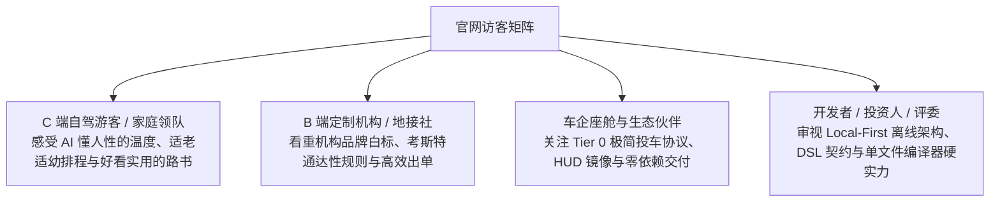
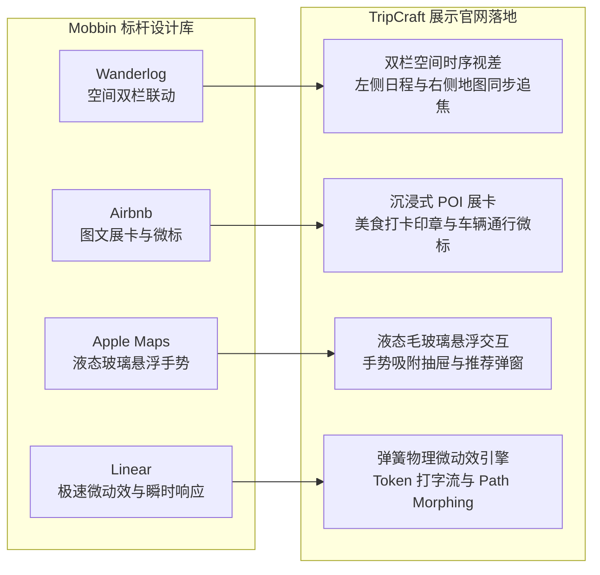
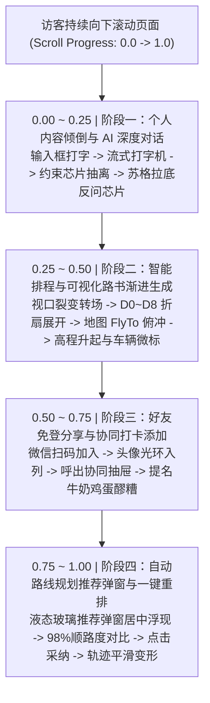
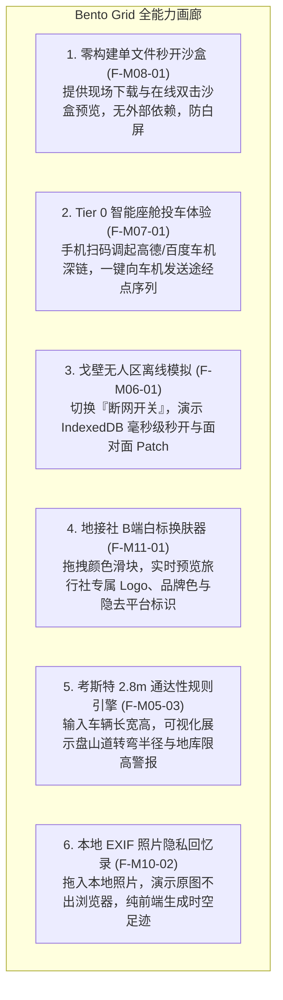
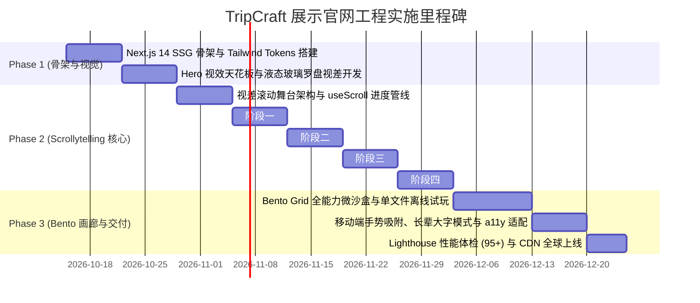

# TripCraft · 项目展示与交互演示官网技术开发设计规范 (SHOWCASE-web-design.md)

> **文档定位**：TripCraft 官方展示与交互演示官网（Showcase & Demonstration Landing Platform）的前端架构、视觉系统与交互动效技术实施规范。  
> **设计目标**：指导后续前端工程开发一个面向全球访客（自驾游客、家庭定制用户、旅行社地接机构、车企伙伴与开发者）的**高质感项目展示官网**。通过**故事流视差滚动动画 (Apple Scrollytelling)** 与沉浸式微沙盒，生动展现 TripCraft 的全量功能、技术硬实力与产品哲学。  
> **关联业务架构**：[`ARC-10 Web端系统开发设计`](architecture/ARC-10-web-system-design.md) · [`PRD-01 愿景与定位`](product/PRD-01-vision-positioning.md) · [`09 视觉设计系统`](09-visual-design-system.md)

---

## 1. 官网定位、目标受众与核心使命

### 1.1 官网定位界定
本项目**不是**繁重的企业级后台管理系统或单纯的业务操作端，而是 **TripCraft 品牌与能力的超级展示窗口（Interactive Showcase & Living Exhibition）**。其视觉与交互标准对标 Apple 产品发布页、Linear.app 与 Stripe Press，兼具学术严谨性与消费级美学。

### 1.2 四大目标受众与诉求匹配


### 1.3 核心设计铁律
1. **无需登录，开箱即秀**：全站所有功能展示与动画演示 100% 免登开放，访客只需滑动滚轮即可体验全部核心价值。
2. **滚动即叙事 (Scrollytelling First)**：将抽象的“输入-AI推演-排程-协作-算路”复杂业务流，转化为一气呵成的视差滚动电影级长镜头。
3. **真实感与可信度**：演示中的路书、地图经纬度、高程起伏与考斯特车型限制，全部基于真实的甘青大环线 9 天（Dunhuang Silk Road 9D）工程数据。

---

## 2. 视觉设计系统与 Mobbin 标杆范式沉淀

### 2.1 视觉设计系统在展示官网的落地
完全继承并升华 [docs/09 视觉设计系统](09-visual-design-system.md) 的东方自然风物与现代工程美学：
- **基调主题色**：**敦煌金 (Dunhuang Gold)**
  - 氧化金箔主色：`#B8863B`（沉稳厚重，杜绝廉价亮金）
  - 青金石深蓝：`#1F4E79`（夜空与深邃戈壁）
  - 沙色暖白背景：`#F2E8D5`（温润羊皮纸触感）
- **液态玻璃质感 (Liquid Glass)**：
  - 核心展示卡片与悬浮面板统一应用 `backdrop-filter: blur(20px) saturate(180%)`；
  - 边缘带有微高光反射线：`border: 1px solid rgba(255, 255, 255, 0.65)`；
  - 悬浮阴影：`box-shadow: 0 20px 50px rgba(58, 46, 31, 0.12)`。

### 2.2 Mobbin 顶尖产品交互范式融合


---

## 3. 网站整体信息架构与版块布局 (Page Structure)

整个展示官网设计为**单页流式滚动架构 (Single-Page Seamless Experience)**，包含 5 大核心版块：

```text
TripCraft 展示官网 (apps/showcase)
├── [Section 1] Hero 视觉天花板 (Hero & Value Proposition)
│   ├── 品牌主张、3D 拟物液态玻璃罗盘 / 3D 高程地球仪视差
│   └── CTA 操作群：「体验路书诞生 ↓」·「下载离线单文件路书样例」
├── [Section 2] ★ 核心视差滚动动画演示区 (Scrollytelling Demo Stage)
│   ├── Stage 1: 用户个人诉求倾倒与老定制师 AI 深度多轮对话 (DeepSeek-v4.1-flash / VIP / BYOK)
│   ├── Stage 2: 渐进生成可视化路书 (手风琴卡片 + 地图 FlyTo + 高程剖面 + 考斯特通行性)
│   ├── Stage 3: 好友免登加入与协同提名美食打卡 (正宁路夜市·牛奶鸡蛋醪糟)
│   └── Stage 4: 自动路线重算推荐弹窗与一键重排 (苹果液态玻璃弹窗 + 路线平滑变形)
├── [Section 3] 全能力全景矩阵画廊 (Bento Grid Feature Matrix)
│   ├── 零构建单文件 HTML 秒开沙盒演示 (F-M08-01)
│   ├── Tier 0 智能座舱极简投车扫码体验 (F-M07-01)
│   ├── 戈壁无人区离线断网模拟开关 (F-M06-01, F-M06-03)
│   ├── 地接社 B 端品牌白标换肤滑块 (F-M11-01)
│   └── 考斯特 2.8m 通达性规则引擎可视化 (F-M05-03)
├── [Section 4] 十大设计铁律与架构哲学 (Architecture & 10 Iron Rules)
│   └── 零构建交付、降级不可耻、数据主权、DSL 真相源等交互展示卡
└── [Section 5] 行动号召与开源页脚 (Conversion & Footer)
    ├── GitHub 开源仓库、示例路书下载、长辈大字模式切换、商务合作
```

---

## 4. 核心视差滚动动画演示区规格 (Apple Scrollytelling Stage)

> 本版块是展示官网的灵魂所在。访客不需要做繁琐的操作，只需向下滚动滚轮，固钉在屏幕正中的主舞台（Sticky Viewport）将随滚动进度 (`scrollProgress: 0.0 ~ 1.0`) 呈现连续、流畅、无缝变形的电影级叙事长镜头。



### 4.1 阶段一：个人内容倾倒与 AI 深度对话 (`scrollProgress: 0.00 ~ 0.25`)
*对应业务能力：F-M03-01 对话规划、F-M03-02 反问追问、F-M12-03 模型分级与 BYOK*

```text
[ 用户输入框 ] ──(自动打字输入)──> [ 流式脉冲光波 ] ──(Token 渐显)──> [ 提取约束微标 ] ──(弹簧上浮)──> [ 老定制师反问卡片 ]
```

1. **`0.00 ~ 0.06` 滚动区间：输入框聚焦与自动打字叙事**
   - 固钉舞台中央浮现半透明液态玻璃对话工作台；
   - 输入框文字以动态打字机效果逐字显现：
     > “我们全家5口去甘肃，爷爷70岁膝盖做过手术不能爬长楼梯，孩子4岁，租了一辆考斯特中巴，想去莫高窟和鸣沙山看日落，千万别太赶。”
   - 随后输入框轻微下沉收缩，化作对话气泡上浮入列。
2. **`0.06 ~ 0.12` 滚动区间：AI 模型调度与多级算力展示**
   - 顶部模型指示器点亮默认模型标识：**`[⚡ DeepSeek-v4.1-flash]`**，并配以说明气泡：*“默认高吞吐基座模型 · 秒级响应”*；
   - 旁边悬浮微标展示可无缝切换的高级会员专属模型 **`[🧠 DeepSeek-R1 / Claude 3.5 Sonnet / GPT-4o]`** 以及支持用户自带 Key 的 **`[🔑 BYOK 个人 API 本地加密存储]`** 提示。
3. **`0.12 ~ 0.18` 滚动区间：实时流式输出与约束芯片抽离**
   - 对话流中实时涌现老定制师的分析文本；
   - 右侧约束栏伴随清脆的弹簧动效依次弹跳出 4 颗带光晕的结构化实体芯片：
     - `[👴 70岁老人 · 规避高长台阶]`（氧化金辉光）
     - `[👶 4岁幼儿 · 预留午休防中暑]`（暖橙辉光）
     - `[🚌 考斯特中巴 · 检查限高与窄道]`（青蓝辉光）
     - `[🌅 鸣沙山 · 锁定 19:30 日落窗口]`（夕阳粉辉光）
4. **`0.18 ~ 0.25` 滚动区间：老定制师苏格拉底反问卡片上浮**
   - 底部以物理弹簧（Spring 阻尼 0.8）升起老定制师决策卡片：
     > “莫高窟传统常规窟需攀爬 8 处险峻悬空栈道，考斯特中巴无法进入保护区深处。老定制师为您设计：特种无障碍接驳车 + 4 处平层开阔大窟慢游。”
   - 展开 3 颗交互药丸：`[ 🟢 方案 A：采纳无障碍慢游方案 (推荐) ]`、`[ 🟡 方案 B：保持原窟人工陪护 ]`、`[ ⚪ 手动调整 ]`；
   - 方案 A 自动高亮并泛起金色涟漪，锁定排程策略。

---

### 4.2 阶段二：智能排程与可视化路书渐进生成 (`scrollProgress: 0.25 ~ 0.50`)
*对应业务能力：F-M02-02 时序日程展卡、F-M02-05 路线沙盘、F-M05-02 路线规划耗时、F-M09-01 敦煌金主题*

```text
[ 对话面板左收 ] ──(折扇展开)──> [ D0~D8 时间线卡片群 ] ──(全景俯冲)──> [ 地图 FlyTo 巡航 ] ──(曲线升起)──> [ 高程与考斯特通过性 ]
```

1. **`0.25 ~ 0.32` 滚动区间：共享布局平滑裂变 (Shared Layout Transition)**
   - 对话面板向左平滑收窄为辅助侧栏；
   - 中央与右侧画布由小到大平滑拉伸，展开为高保真双栏路书工作区。
2. **`0.32 ~ 0.38` 滚动区间：日程卡片群手风琴瀑布流**
   - D0（兰州集结）至 D8（敦煌返程）共 9 天日程卡片，以 `staggerChildren (0.07s)` 阶梯瀑布流自上而下弹性滑入；
   - 卡片顶部氧化金箔渐变底色依次点亮，呈现大字地名与建议游玩时长。
3. **`0.38 ~ 0.44` 滚动区间：电影级地图全景 FlyTo 运镜**
   - 右侧高德/MapLibre 矢量地图相机从中国全境视角（Zoom 4）启动俯冲，贴地巡航至甘肃河西走廊（Zoom 8，倾角 Pitch 42°）；
   - 沿途 18 个核心 POI 图钉顺序点亮，每个图钉落地时释放双层同心圆声波涟漪波纹。
4. **`0.44 ~ 0.50` 滚动区间：高程起伏升起与考斯特通过性微标**
   - 画布底端升起透明 SVG 高程剖面图（Elevation Profile），海拔曲线从 0 轴如山脉升起插值绘制（乌鞘岭 3000m、祁连山前沿 2800m）；
   - 路线节点旁跳跃弹出考斯特通行性胶囊徽标：
     - `D1~D3：[ ✓ 考斯特路网畅通 · 全程高速 ]`（翡翠绿微光微动）
     - `D4 丹霞：[ ⚠️ 景区大门换乘环保大巴 · 考斯特停 1 号车位 ]`（琥珀黄微光晃动）

---

### 4.3 阶段三：好友免登分享与协同打卡添加 (`scrollProgress: 0.50 ~ 0.75`)
*对应业务能力：F-M04-01 邀请与空间共享、F-M04-02 结构化提名收集、F-M06-04 实时成员信标*

```text
[ 顶部分享展开 ] ──(液态玻璃二维码)──> [ 好友微信扫码加入 ] ──(头像涟漪入列)──> [ 协同抽屉添加美食 ] ──(卡片飞入愿望池)
```

1. **`0.50 ~ 0.56` 滚动区间：免登分享面板弹出与好友微信扫码**
   - 顶部滑出 Apple 液态玻璃分享面板，展示动态生成的免登微信二维码与口令短链；
   - 手机端模拟视图中，好友「阿杰」微信扫码一键加入行程空间（免注册免密码）。
2. **`0.56 ~ 0.62` 滚动区间：成员头像栏光环入列与广播**
   - 右上角团队成员头像栏（Avatar Stack）平滑展开腾出空位，阿杰的头像伴随翡翠绿色呼吸光晕弹跳入列（WebSocket `MEMBER_JOIN` 广播）；
   - 界面弹出气泡提示：“好友「阿杰」已进入协作空间”。
3. **`0.62 ~ 0.68` 滚动区间：呼出协同愿望池抽屉**
   - 屏幕右侧滑出**液态玻璃协同提名抽屉 (Liquid Glass Collab Drawer)**；
   - 模拟阿杰在 POI 联想框中搜索并选定著名小吃：**「兰州正宁路夜市·赵记牛奶鸡蛋醪糟（正宗老店）」**。
4. **`0.68 ~ 0.75` 滚动区间：填写打卡理由与卡片飞入愿望池**
   - 阿杰填写核心推荐理由：“上过《舌尖上的中国》，离咱们第一晚住的酒店仅 600m，晚上必须打卡喝一碗！”；
   - 点击提交后，该点位化为一张带有阿杰微型头像微标与美食小火苗图标的提名卡片，以抛物线轨迹飞入左侧主时间线旁的「待决愿望浮动池」。

---

### 4.4 阶段四：自动路线规划推荐弹窗与一键重排 (`scrollProgress: 0.75 ~ 1.00`)
*对应业务能力：F-M05-02 路线规划耗时、F-M05-03 沿途补给推荐、F-M04-05 领队决策合并*

```text
[ 后台拓扑重算 ] ──(居中震撼浮现)──> [ 液态玻璃推荐弹窗 ] ──(方案对比与考斯特贴士)──> [ 一键采纳点击 ] ──(轨迹平滑变形)
```

1. **`0.75 ~ 0.82` 滚动区间：后台纯前端 Web Worker 拓扑重算**
   - 系统自动比对 D1 兰州全天日程（16:30 落地机场 ➔ 19:15 入住兰州皇冠假日酒店 ➔ 20:00 自由活动）；
   - 瞬时计算：夜市距离酒店仅 650 米，处于步行 8 分钟极佳生活圈，顺路度评分高达 **98%**，且完全不影响次日 08:30 出发。
2. **`0.82 ~ 0.90` 滚动区间：苹果液态玻璃推荐弹窗震撼入场**
   - 屏幕正中升起高质感**路线优化推荐弹窗 (Route Optimization Recommendation Modal)**：
     - 入场动效：`scale(0.92) -> scale(1.0)`，`backdrop-filter: blur(28px)`，表面掠过一道 45 度微光扫掠高光（Shimmer Sweep）；
     - **智能决策微标**：`[ 🍜 顺路美食打卡建议 · 顺路度 98% · 增加车程 0km ]`；
     - **前后对比条形图 (Diff Bar)**：
       - *原行程*：19:15 办理入住 ➔ 自由活动（全天活动结束）；
       - *优化后*：19:15 办理入住 ➔ **20:00 漫步正宁路夜市（打卡牛奶鸡蛋醪糟与烤肉）** ➔ 21:30 回酒店休息；
       - *代价说明*：行程距离 +0km（夜市在步行圈），游玩时间 +1.5h，次日出发保持 08:30 不变；
     - **考斯特地面交通安全贴士**：
       - `[ 🚌 考斯特泊车建议 ]`：“正宁路夜市为纯步行街区，中巴大车夜间严禁驶入！考斯特请统一停泊于皇冠假日酒店地下车库，全团步行前往。”
     - **高对比操作按钮**：`[ ✨ 一键采纳并重排路线 (Auto-Apply) ]` 呈现氧化金箔高光微动。
3. **`0.90 ~ 1.00` 滚动区间：一键采纳与路线平滑变形 (Path Morphing)**
   - 滚动触发点击采纳，弹窗化作流光粒子束平滑吸入 D1 晚间时间线插槽；
   - D1 时间线卡片弹性向下撑开让位，正宁路夜市美食展卡自左向右展开，点亮金色美食图章；
   - 右侧地图上原先终止于皇冠假日酒店的路线轨迹，平滑延伸出一段点状散步轨迹虚线（Path Morphing），并在夜市图钉处绽放金色涟漪；
   - 路书版本号从 `v1.0` 跃迁为 `v1.1`，顶部弹出绿色全团同步徽标，四阶段演示完美闭环。

---

## 5. 全能力全景矩阵画廊 (Bento Grid Feature Matrix)

在核心演示区下方，通过现代 Bento Grid 网格卡片全面呈现 TripCraft 的全量核心能力与独家黑科技：



---

## 6. 展示官网前端技术栈与开发架构

### 6.1 前端技术栈选型
1. **应用框架**：`Next.js 14+`（App Router，配置为纯静态生成 SSG `output: 'export'`，便于部署在 Vercel / Cloudflare Pages / GitHub Pages）。
2. **样式引擎**：`Tailwind CSS v3.4+` + `@tripcraft/design-tokens`（原生 CSS 变量注入）。
3. **滚动视差引擎**：
   - `Framer Motion v11+`：使用 `useScroll()` 监听目标容器，结合 `useTransform()` 将 `scrollYProgress` 映射为位置、缩放、透明度与贝塞尔插值；
   - 复杂矢量路径变形采用 `flubber` 库实现 SVG `<path d="...">` 平滑变形（Path Morphing）。
4. **轻量地图渲染**：
   - `MapLibre GL JS`（搭配开源 Vector Tiles），保证 60fps 硬件加速渲染，不依赖任何第三方收费商用 Token。

### 6.2 关键 Scrollytelling 核心代码骨架
```typescript
// apps/showcase/src/components/scrollytelling/demo-stage.tsx
'use client';

import React, { useRef } from 'react';
import { motion, useScroll, useTransform } from 'framer-motion';

export function ScrollytellingDemoStage() {
  const containerRef = useRef<HTMLDivElement>(null);
  const { scrollYProgress } = useScroll({
    target: containerRef,
    offset: ['start start', 'end end']
  });

  // 阶段 1: AI 对话面板进出场 (0.00 ~ 0.25)
  const chatOpacity = useTransform(scrollYProgress, [0.0, 0.05, 0.22, 0.28], [0, 1, 1, 0]);
  const chatScale = useTransform(scrollYProgress, [0.0, 0.05, 0.25], [0.95, 1, 0.9]);

  // 阶段 2: 路书工作台裂变展开 (0.25 ~ 0.50)
  const roadbookOpacity = useTransform(scrollYProgress, [0.25, 0.32, 0.95], [0, 1, 1]);
  const timelineStagger = useTransform(scrollYProgress, [0.28, 0.42], [40, 0]);

  // 阶段 3: 协同抽屉滑出 (0.50 ~ 0.75)
  const collabDrawerX = useTransform(scrollYProgress, [0.55, 0.65, 0.72, 0.78], ['100%', '0%', '0%', '100%']);

  // 阶段 4: 推荐弹窗居中浮现与采纳 (0.75 ~ 1.00)
  const modalScale = useTransform(scrollYProgress, [0.78, 0.85, 0.92, 0.98], [0.85, 1, 1, 0]);
  const modalOpacity = useTransform(scrollYProgress, [0.78, 0.83, 0.92, 0.98], [0, 1, 1, 0]);

  return (
    <div ref={containerRef} className="relative h-[400vh] bg-canvas">
      {/* 屏幕固钉置顶视口 */}
      <div className="sticky top-0 h-screen w-full overflow-hidden flex items-center justify-center p-8">
        {/* Stage 1: AI 对话层 */}
        <motion.div style={{ opacity: chatOpacity, scale: chatScale }} className="absolute ...">
          {/* 流式打字、约束微标与苏格拉底反问卡片 */}
        </motion.div>

        {/* Stage 2 & 4: 主路书工作区与地图 */}
        <motion.div style={{ opacity: roadbookOpacity }} className="grid grid-cols-12 gap-6 w-full h-full ...">
          {/* 左侧日程时间线 + 右侧交互地图 */}
        </motion.div>

        {/* Stage 3: 好友协同抽屉 */}
        <motion.div style={{ x: collabDrawerX }} className="absolute right-0 top-0 h-full w-[380px] bg-glass ...">
          {/* 提名美食卡片 */}
        </motion.div>

        {/* Stage 4: 苹果液态玻璃推荐弹窗 */}
        <motion.div style={{ scale: modalScale, opacity: modalOpacity }} className="absolute z-50 p-6 rounded-3xl bg-glass-pop ...">
          {/* 顺路度 98% 对比条形图与考斯特停靠建议 */}
        </motion.div>
      </div>
    </div>
  );
}
```

### 6.3 无障碍与多端性能兜底策略
1. **减弱动态效果媒体查询 (`prefers-reduced-motion: reduce`)**：
   - 自动关闭视差滚动中的平移和旋转变形，改为根据滚动进度淡入对应卡片，防止视动眩晕。
2. **移动端纵向优化 (Mobile Fallback)**：
   - 在屏幕宽度 `< 768px` 时，将双栏左右联动优雅降级为垂直堆叠手风琴，地图固定在屏幕上半部（高 38vh），时间线在下半部滑动。
3. **老旧设备与弱 GPU 降级**：
   - 检测 FPS 低于 45 时，自动剥离毛玻璃多层高斯模糊（`backdrop-filter`），回退至高对比度半透明实色，确保任意设备秒开 60fps。

---

## 7. 开发实施阶段与里程碑计划 (Showcase Roadmap)



### 展示官网验收标准 (Definition of Done)
1. **动画流畅度**：在主流移动端与桌面端主流浏览器（Chrome/Safari/Edge）实现稳定的 **60fps** 滚动视差动效。
2. **零白屏与秒开**：首屏最大内容绘制时间 (LCP) ≤ 1.2s，静态构建后支持脱机离线预览。
3. **全要素闭环**：4 阶段视差长镜头完整演绎“用户诉求 ➔ AI对谈 ➔ 路书生成 ➔ 好友协同美食打卡 ➔ 自动算路推荐弹窗”。
