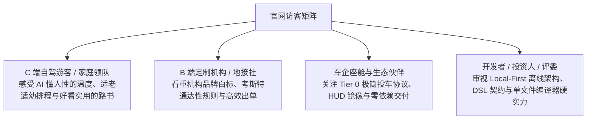
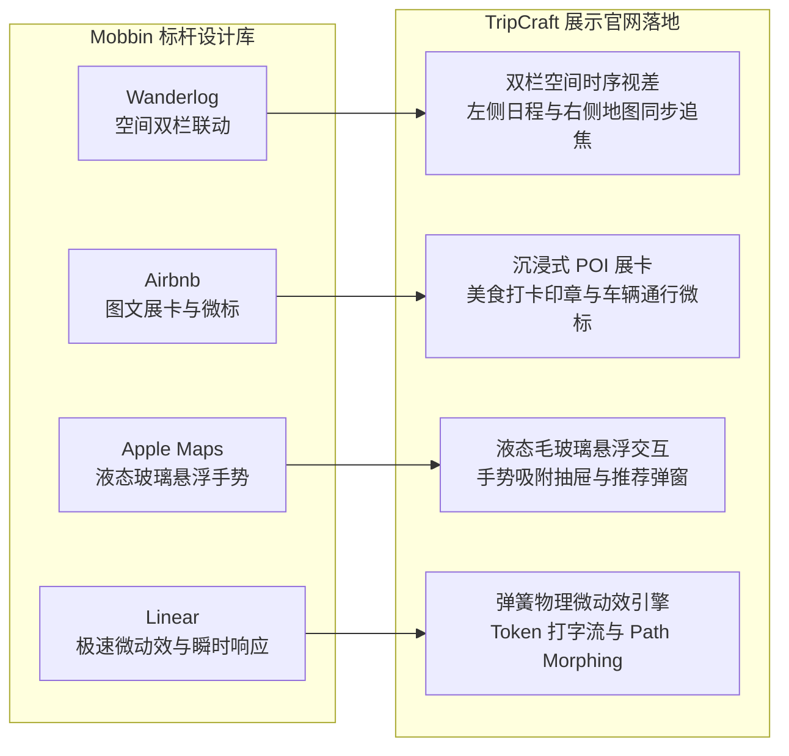
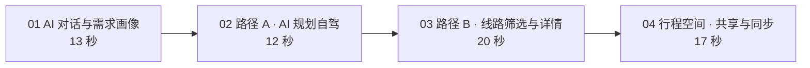
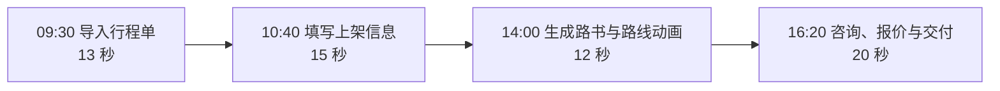
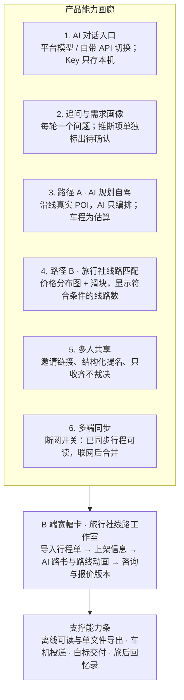
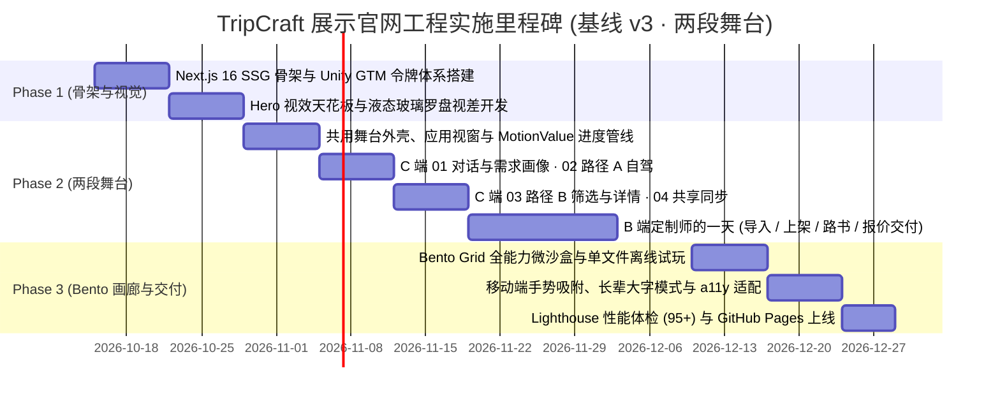

# TripCraft · 项目展示与交互演示官网技术开发设计规范 (SHOWCASE-web-design.md)

> **与产品基线 v3 的关系（2026-10-19 更新）**：演示区（§4）拆成两段独立的场景动画——**C 端旅客流程四幕**（AI 对话与需求画像 → 路径 A · AI 规划自驾 → 路径 B · 线路筛选与详情 → 行程空间 · 共享与同步），以及挂在其后的**B 端「定制师的一天」四章**（导入行程单 → 填写上架信息 → 生成路书与路线动画 → 咨询、报价与交付），均对齐 [PRD-01 v3](product/PRD-01-vision-positioning.md)。两段动画里的应用视窗改为克制的产品界面模拟（§4.1）。车机投递与离线交付是支撑能力，只以一句状态说明出现。导航栏已为两段演示各设入口；首屏（§3 Section 1）、能力画廊（§5）与页面 metadata 也已按 v3 改写：主叙事是对话 → 两条规划路径 → 多人共享与多端同步，旅行社线路工作室作为 B 端线，离线可读、单文件导出、车机投递、白标交付、旅后回忆录收在画廊末尾的「支撑能力」条，车机只写「把全天途经点交给车机导航」。视觉继续使用 Unify GTM（产品 UI 视觉体系 D10 未定，Unify GTM 只约束演示站）。

> **文档定位**：TripCraft 官方展示与交互演示官网（Showcase & Demonstration Landing Platform）的前端架构、视觉系统与交互动效技术实施规范。  
> **设计目标**：指导后续前端工程开发一个面向全球访客（自驾游客、家庭定制用户、旅行社地接机构、车企伙伴与开发者）的**高质感项目展示官网**。通过**故事流视差滚动动画 (Apple Scrollytelling)** 与沉浸式微沙盒，生动展现 TripCraft 的全量功能、技术硬实力与产品哲学。  
> **关联业务架构**：[`ARC-10 Web端系统开发设计`](architecture/ARC-10-web-system-design.md) · [`PRD-01 愿景与定位`](product/PRD-01-vision-positioning.md) · [`09 视觉设计系统`](09-visual-design-system.md)

---

## 1. 官网定位、目标受众与核心使命

### 1.1 官网定位界定
本项目**不是**繁重的企业级后台管理系统或单纯的业务操作端，而是 **TripCraft 品牌与能力的超级展示窗口（Interactive Showcase & Living Exhibition）**。其视觉与交互标准对标 Apple 产品发布页、Linear.app 与 Stripe Press，兼具学术严谨性与消费级美学。

### 1.2 四大目标受众与诉求匹配


### 1.3 核心设计铁律
1. **无需登录，开箱即秀**：全站所有功能展示与动画演示 100% 免登开放，访客只需滑动滚轮即可体验全部核心价值。
2. **滚动即叙事 (Scrollytelling First)**：将抽象的“输入-AI推演-排程-协作-算路”复杂业务流，转化为一气呵成的视差滚动电影级长镜头。
3. **真实感与可信度**：演示中的路书、地图经纬度、高程起伏与考斯特车型限制，全部基于真实的甘青大环线 9 天（Dunhuang Silk Road 9D）工程数据。

---

## 2. 视觉设计系统与 Mobbin 标杆范式沉淀

### 2.1 视觉设计系统在展示官网的落地 (Unify GTM Design System)
展示官网全面采用 **Unify GTM 设计系统规范**，将瑞士理性工程美学与东方自然风物、苹果液态玻璃深度交融：
- **Unify GTM 温暖纸质质感色板 (Palette)**：
  - 画布暖纸白（Canvas Warm Paper）：`#FFFFF9`（温润护眼，如精装艺术纸册底色）
  - 模块浅卡其（Surface Card）：`#F4F4EE`（模块与卡片基底）
  - 暖炭黑主文本（Warm Charcoal）：`#241E20`（高对比可读性，绝不使用死板纯黑）
  - 火焰跃动红/橙（Flame Accent / Headline Aura Glow）：`#FE3C01`（为“活路书”与主操作注入高能生命力）
  - 极细分割发丝线（Hairline Border）：`#E2E2D8`（高精度工程边界）
- **严格几何圆角阶梯 (Radius Hierarchy)**：
  - 交互按钮严格 `rounded-[5px]`（拒绝低幼圆角膨胀，还原工业精密手感）；
  - 状态药丸与胶囊徽标严格 `rounded-full`（100px）；
  - 内容卡片与模块 `rounded-[12px]`；
  - 主展示视窗与输入容器 `rounded-[16px]`；
- **社论级西文衬线 (Editorial Serif) 与 1200px 网格**：主副标题采用高雅西文衬线字体，搭配 `-0.035em` 紧凑字间距，统一规范在 `max-w-[1200px]` 瑞士工程网格中自适应呈现；
- **苹果液态玻璃质感 (Liquid Glass)**：
  - 核心展示卡片与悬浮面板统一应用 `backdrop-filter: blur(20px) saturate(180%)`；
  - 边缘带有微高光反射线：`border: 1px solid rgba(255, 255, 255, 0.65)`；
  - 悬浮阴影：`box-shadow: 0 20px 50px rgba(36, 30, 32, 0.08)`。

### 2.2 Mobbin 顶尖产品交互范式融合


---

## 3. 网站整体信息架构与版块布局 (Page Structure)

整个展示官网设计为**单页流式滚动架构 (Single-Page Seamless Experience)**，包含以下核心版块：

```text
TripCraft 展示官网 (apps/showcase)
├── [Section 1] 首屏 (Hero.tsx) —— 一句话定位「多端同步、多人共享的 AI 旅行规划 App」
│   ├── 标题「说出想去哪里，全家一起把行程定下来」；副标题讲对话追问 → 两条路径 → 共享与同步
│   ├── 对话输入框 + 三条推荐说法（含一条「想找旅行社」）；注明默认平台模型、可换用自带 API
│   ├── 产品预览三视图：对话与需求画像 ·两条规划路径（路径 B 附 §0.3 匹配与预估价正确表述）· 行程空间（提名、领队确认、多端同步）
│   └── 底部入口：「看旅客完整流程」→ #demo ·「旅行社线路工作室」→ #agency
├── [Section 2] ★ C 端演示舞台 (ScrollyStage, #demo) —— 旅客的完整使用流，四幕
│   ├── 幕 01: AI 对话与需求画像 (DialogueScene.tsx) —— 模型选择器（平台模型 / 自带 API）、每轮一个追问、需求画像（硬约束 / 偏好分组，推断项单独标出）、两条路径入口
│   ├── 幕 02: 路径 A · AI 规划自驾 (Workspace.tsx) —— 路线按天推进、日程同步高亮；结果页底部「相似旅行社线路」交叉提示
│   ├── 幕 03: 路径 B · 线路筛选与详情 (MatchScene.tsx · RouteDetail.tsx) —— 分布图滑块与条件方块、匹配度结果卡；线路详情调整选项看预估价，发送前确认授权信息
│   └── 幕 04: 行程空间 · 共享与同步 (Collab.tsx · Recommend.tsx · SyncFinale.tsx) —— 链接邀请、提名与 AI 评估、领队确认、逐台设备同步
├── [Section 2b] ★ B 端演示舞台 (AgencyStage, #agency) —— 旅行社定制师的一天，四章
│   ├── 09:30 导入行程单 (StudioImport.tsx) —— AI 抽取逐日行程，低置信度字段与原文并排、逐项确认
│   ├── 10:40 填写上架信息 (StudioListing.tsx) —— 价格规则、可调选项、包含 / 不包含、价格展示档位、人群适配说明
│   ├── 14:00 生成路书与路线动画 (StudioRoadbook.tsx) —— AI 内容显式标注、图片标注实拍 / 示意、不生成景点照片
│   └── 16:20 咨询、报价与交付 (StudioInbox.tsx) —— 授权摘要 → 报价 v1 → v2 自动列差异 → 站外签约 → 白标路书
├── [Section 3] 产品能力画廊 (BentoGrid.tsx, #bento)
│   ├── 六张能力卡：AI 对话入口（平台模型 / 自带 API）· 追问与需求画像 · 路径 A · 路径 B（价格分布图滑块）· 多人共享 · 多端同步（离线可读开关）
│   ├── B 端宽幅卡：旅行社线路工作室（→ #agency）
│   └── 支撑能力条：离线可读与单文件导出（样例下载）· 车机投递 · 白标交付 · 旅后回忆录
├── [Section 4] 十大设计铁律与架构哲学 (Architecture & 10 Iron Rules)
│   └── 零构建交付、降级不可耻、数据主权、DSL 真相源等交互展示卡
└── [Section 5] 行动号召与开源页脚 (Conversion & Footer)
    ├── GitHub 开源仓库、示例路书下载、长辈大字模式切换、商务合作
```

---

## 4. 核心演示区规格（两段独立的场景动画）

> 本版块是展示官网的灵魂所在。演示区由两段**互相独立**的舞台组成：C 端舞台（`ScrollyStage`，锚点 `#demo`）只讲旅客从对话到全家同步的完整使用流，中间不插入旅行社端内容；B 端舞台（`AgencyStage`，锚点 `#agency`，挂在 C 端舞台之后）以旅行社定制师的视角讲一个工作日。两段各有自己的章节导航、进度与节奏。

### 4.1 共用外壳与应用视窗

| 组件 | 职责 |
| :--- | :--- |
| `StageShell.tsx` | 左侧眉题、标题、章节导航（桌面竖排；平板与手机改为紧贴视窗上方的横排进度条 + 当前章说明）与播放控制；右侧放应用视窗 |
| `AppWindow.tsx` | 应用视窗外壳：宽视窗是标题栏 + 侧栏导航 + 内嵌内容面板 + 底部状态栏，手机宽度是铺满的内容 + 底部标签栏；侧栏高亮与状态栏文字随章节切换 |
| `acts.ts` | 按时长比例把章节首尾相接铺满全局进度 0 → 1 |
| `ui.tsx` · `primitives.tsx` | 视窗内的界面零件（按钮、页面标题、徽标、开关、勾选框、分段控件、步骤条）与动效原语（`Scene` 交叉淡入、`TapCursor` 演示光标、`Grow` 会话流、`Reveal`、`Pop`、`Toast`） |

**时钟**：每个舞台一只 rAF 时钟驱动一条全局进度 MotionValue，场景经 `ProgressContext` 读取，播放过程 0 React 重渲染。

- 章节区间按时长比例首尾相接（前一章的终点就是后一章的起点），自动播放跨章时进度连续，没有空档或跳帧；「一秒」在任何一章都对应同样的进度跨度。
- **只播放一遍**：最后一章结束后停在终帧，按钮变为「重新播放」。
- 视窗露出不足 35% 时挂起；时钟累加每帧耗时（单帧最多计 64ms），切走标签页或掉帧回来不会跳章。两段舞台同在一页，只有可见的那段在跑。
- 手动点选章节时落在该章画面已完全淡入的时刻（`enter`），不会闪过上一章的画面。

**视窗界面规范**（参照 Linear、Stripe Dashboard、Notion 的克制程度）：

1. 一个视窗一个主任务：每一屏有侧栏、页面标题、主内容区，必要时一个上下文面板；只保留讲清这一步所必需的元素。
2. 正文 13px，辅助文字不小于 12px（`text-xs`），且都有实际含义；不放装饰性小字、伪遥测数字和堆砌的徽标。地图地名用 HTML 叠加，字号固定 12px，不随 SVG 缩放变小。
3. 8pt 网格：控件高 32px，间距取 4 / 8 / 12 / 16 / 24px；按钮 5px 圆角、卡片 12px、视窗 16px（Unify GTM 圆角阶梯）。
4. 烈焰橙只用于需要注意的信号（推断项、低置信度字段、路线描绘、关键数值）；12px 的橙色文字用加深的 `#C43200`，保证在白底上的对比度。
5. 动效只说明当前这一步：演示光标移到控件上按下 → 结果出现；同一时刻不让多个元素同时闪动。
6. 状态栏只写对这一步有意义的信息（数据来源、合规口径、同步状态）。

**按视窗自身宽度排版**：桌面双栏时视窗只占 8/12 列，堆叠时又占满整行，视口断点反映不了视窗的真实宽度。视窗根节点声明 `container-name: win`，子元素用 Tailwind 插件注册的 `cq-sm`（≥ 560px：标题栏、图标侧栏、状态栏）、`cq-md`（≥ 680px：上下文面板、左右分栏）、`cq-lg`（≥ 800px：侧栏文字）变体排版（见 `tailwind.config.ts`）。手机宽度（375px）下视窗是一款手机 App：底部标签栏，上下文面板改为底部抽屉。

**文案口径**：涉及匹配与报价的界面文字遵守 [docs/00 §0.3](00-overview-and-glossary.md#03-三条责任边界线tripcraft-不是清单) 末尾的正确表述——匹配度为信息参考、预估价以旅行社正式报价为准、合同与付款由旅客与旅行社直接签订；平台不自称旅行社，也不出现「立即预订」「平台担保」一类表述。

**视觉巡检**：浏览器控制台执行 `window.__setStageProgress(v)`（C 端）或 `window.__setAgencyProgress(v)`（B 端），可跳到任意全局进度并暂停。

### 4.2 C 端舞台：旅客的完整使用流（`ScrollyStage` · [`timeline.ts`](../apps/showcase/src/components/stage/timeline.ts)）

*设计依据：[PRD-01 §2](product/PRD-01-vision-positioning.md#2-核心使用流程)、[docs/16](16-planning-paths-and-route-matching.md)、[docs/15](15-multi-device-and-collaboration.md)*



视窗是 TripCraft 旅客端：侧栏「对话 · 行程空间 · 旅行社线路」随章节高亮。

#### 幕 01 · AI 对话与需求画像（`DialogueScene.tsx`）

1. 输入框左侧的模型选择器展开：平台模型（默认 · 今日剩余 18 / 20 次）/ 我的 Claude（自带 API）/ 我的 DeepSeek（自带 API）/ ＋ 添加自己的 API；底注「自带 Key 只存在本机，请求直连服务商」。
2. 用户逐字输入需求并发送；AI 每轮只问一个问题（「追问 1 / 3：自驾的话开什么车？车高大概多少？」），用户补充「租腾势 D9，加了车顶箱，总高 2.28 米」。
3. 右侧「需求画像」面板逐项填入，按**硬约束**（同行、必去、身体、车辆）与**偏好**（日期、方式、预算）分组；模型推断的预算标「推断 · 请确认」。手机上画像收敛后以底部抽屉弹出。
4. 面板底部同时给出「AI 规划自驾路线」与「看旅行社线路 · 23 条匹配」，演示光标点选路径 A。

#### 幕 02 · 路径 A · AI 规划自驾（`Workspace.tsx` · `RouteMap.tsx`）

1. 页面标题「河西走廊 9 日 · 自驾草案」，副标题写明「地点与开放时间经图商核验，推荐理由由 AI 撰写」。
2. 上方风格化矢量地图上路线按天推进（D0 停在兰州，敦煌停留两天时线头不动），下方九天日程同步高亮当天；每天一行写清它怎样照顾到画像（午休、台阶、车高、日落）与当天车程。
3. 结果页底部出现「有 5 条旅行社线路与这份方案相似，最高匹配 91%」，光标点击「查看线路」进入路径 B。

#### 幕 03 · 路径 B · 线路筛选与详情（`MatchScene.tsx` · `RouteDetail.tsx`）

1. **筛选页**：页顶回显需求摘要与「编辑需求」「问 AI」；左侧价格滑块上方是真实柱状分布（标出市场中位与「你的预算 · 画像推断」）、天数滑块、带结果数的条件方块（来自画像的「长辈」「儿童」「轻松」默认选中并带 ★）；右侧结果卡（匹配度环、旅行社与认证、评分、3 条理由 + 1 条差距、人均起价与全家预估）与「接近但不满足」；结果区底部常驻「以下线路由持证旅行社提供；匹配度为信息参考，具体以旅行社报价与合同为准。」手机上筛选面板收进底部抽屉。
2. **与对话联动**：点「问 AI」说「预算可以到 8000」，价格把手移到 ¥8,000，结果数 23 → 27，并说明「筛选只决定显示哪些线路，匹配度不随滑块变化」。
3. **线路详情**：路线动画封面与逐日安排；价格卡标明「本线路提供分项明细」，打开「敦煌 2 晚升级高档酒店 +¥760/人」后成人预估 ¥6,280 → ¥7,040、全家 ¥29,500 → ¥33,300，注明「预估价，以旅行社正式报价为准」与「合同与付款由你与旅行社直接签订」。
4. **向旅行社咨询**：发送前的确认面板逐项列出要发出的信息（同行人员、日期、预算、身体情况、已选调整），联系方式默认不发；确认后提示「已发送 · 通常 2 小时内回复」。

#### 幕 04 · 行程空间 · 共享与同步（`Collab.tsx` · `Recommend.tsx` · `SyncFinale.tsx`）

1. 「西行计划 v1.0」：领队点「邀请」，面板给出二维码与链接，写明「加入者可以查看行程、提名地点，改动由你确认后生效」。
2. 阿杰、小雨通过链接加入（头像依次入列，轻提示各一次）。
3. 阿杰提名「正宁路夜市 · 赵记醪糟」并写下理由；AI 只评估代价——步行 950 m、不增加车程、夜市地库限高 2.0 m 所以车停酒店地面车位——不替大家做决定（[docs/15 §15.5](15-multi-device-and-collaboration.md#155--协作层的设计原则只负责收齐不负责裁决)）。
4. 领队点「加入 D0 晚上」，D0 插入 20:00 新安排，版本 v1.0 → v1.1；「同步」列表逐台变为 v1.1（我的电脑、阿杰的手机、小雨的平板），状态栏写「离线可读」。车机投递、单文件导出等支撑能力不再单独成幕。

### 4.3 B 端舞台：定制师的一天（`AgencyStage` · [`agencyTimeline.ts`](../apps/showcase/src/components/stage/agencyTimeline.ts)）

*设计依据：[docs/17 旅行社线路工作室](17-agency-route-studio.md)*



视窗是「TripCraft 线路工作室」：侧栏「线路 · 咨询 · 报价 · 数据」，账号区显示「敦煌某国际旅行社 · 资质已认证」；新建线路的三步（导入 → 上架信息 → 路书）在页面标题右侧用步骤条标出。

#### 09:30 · 导入已有的行程单（`StudioImport.tsx`，§17.3）

1. 拖入「河西走廊9日私家团.docx」，上传后 AI 把行程单抽取为逐日行程；左侧保留原文，与抽取结果并排。
2. 抽取结果一天一行（标题 · 里程 · 住宿 · 餐食），置信度低的字段高亮并标出置信度：D2「含早餐 62%」、D4「383 km 74%」。
3. 逐项点开核对：浮层对照「原文」与「AI 抽取」，左侧原文对应的句子同时高亮，定制师点「确认」；没有「全部接受」。全部确认后显示「21 个地点已经图商核验」，进入下一步。

#### 10:40 · 填写上架信息（`StudioListing.tsx`，§17.4–§17.5）

左侧小节导航逐节打勾，右侧实时预览旅客在路径 B 里看到的结果卡，底部显示完整度（40% → 100%）：

1. **价格规则**：成人 ¥6,280 · 长者 ¥5,980 · 儿童 ¥4,680 · 单房差 ¥1,200；4 人起订。
2. **可调选项**：敦煌升级高档酒店 +¥380/人/晚、增加 1 天阳关玉门关 +¥900/人、兰州机场接机 +¥300/单——旅客在详情页自助调整时据此算预估价。
3. **包含 / 不包含**：住宿、交通、门票、餐、导游讲解、保险、接送站七项逐一标「含 / 不含」。
4. **价格展示档位**：起价 / 区间 / 分项明细由旅行社自选，光标选「分项明细」，预览随之显示「本线路提供分项明细」；「起价」档必须写明条件。
5. **人群适配**：「适合长辈」「适合儿童」必须附一句可核验的说明（「全程没有连续 50 级以上的台阶；最高海拔 2,980 米（乌鞘岭，车上通过）」）；预览提示补全后可出现在对应筛选中。

#### 14:00 · 生成路书与路线动画（`StudioRoadbook.tsx`，§17.6）

1. 输入清单（逐日行程、品牌包、实拍素材）→ 一键「生成交互路书与路线动画」→ 三步完成（算路与镜头脚本、AI 撰写停顿介绍、渲染路线动画）。
2. 左侧路线动画沿线路推进，00:00 → 00:45；每个停顿点的一句介绍标「AI 撰写」；标注「矢量版 · 不含图商底图」（OI-007 确认前的默认做法）。
3. 右侧交互路书逐日卡片，图片逐张标「实拍」或「示意」；不生成景点照片，没有实拍的地方只用地图与文字。点「发布到线路详情」——C 端幕 03 的线路详情页展示的就是这里生成的路线动画与 AI 路书。

#### 16:20 · 咨询、报价与交付（`StudioInbox.tsx`，§17.7–§17.9）

1. 咨询收件箱进来一条新咨询（侧栏「咨询」出现角标），打开后只看到**旅客授权发送的信息**——即 C 端幕 03 那一家人发出的摘要；联系方式显示「旅客同意后可见」。
2. 「生成报价」→ 报价 v1 分项明细（交通、住宿、敦煌升级、门票、讲解、保险），成人 ¥7,040 · 全家 ¥33,300，发送给旅客。
3. 旅客问「能再加一天去阳关和玉门关吗？」→ 基于 v1 新建 v2，自动列出差异（+ 增加 1 天 +¥900/人，成人 ¥7,040 → ¥7,940，全家 ¥33,300 → ¥37,800），「版本只增不改，旅客可逐版对比」。
4. 旅客接受 v2 →「请与旅客签订旅游合同并收款：合同与付款在平台外完成，平台不经手团款」→ 标记已成交 →「交付白标路书」：以旅行社品牌呈现、不出现 TripCraft 标识，发送到旅客的行程空间。

### 4.4 减弱动态效果与降级

- `prefers-reduced-motion: reduce`：两段舞台都**不自动播放**，每章停在一张能说明结果的静帧，访客点选章节或「上一章 / 下一章」切换，也可以手动播放；位移类动画降级为纯淡入，CSS 循环动画关闭。
- 地图是风格化矢量底图，不依赖外部地图服务；视窗内全部为本地组件，没有运行时拉取的素材。

> 车机座舱（`CockpitScene.tsx`）、离线交付（`Deliver.tsx`）与旧版倾诉幕（`ChatScene.tsx`）已不挂载，文件暂未删除；`timeline.ts` 为它们保留的键落在全局进度 2 以后，进度到不了。

---

## 5. 全能力全景矩阵画廊 (Bento Grid Feature Matrix)

> 2026-10-19 按 [PRD-01 v3](product/PRD-01-vision-positioning.md) §3 改写：六张卡讲三大支柱，一张宽幅卡讲 B 端线，支撑能力收成一行，不再作为主卖点。旧版第 4 张卡「车机双向车道级领航协同」（车道级导引、「已提前执行右车道驶出」）越过 [docs/00 §0.3](00-overview-and-glossary.md#03-三条责任边界线tripcraft-不是清单) 边界线 1 与 PRD-01 §5「不触发或干预 NOA」，已删除；车机只写「把全天途经点交给车机导航」。



---

## 6. 展示官网前端技术栈与开发架构

### 6.1 前端技术栈选型
1. **应用框架**：`Next.js 16+`（App Router，Webpack 静态打包，纯静态生成 SSG `output: 'export'`，部署在 GitHub Pages）。
2. **UI 库与运行时**：`React 19` + `TypeScript 5`。
3. **样式引擎**：`Tailwind CSS v3.4+` + 原生 CSS 变量注入（Unify GTM 设计系统令牌）。
4. **滚动视差引擎**：
   - `Framer Motion v12+`：全舞台采用纯 `MotionValue` 驱动，0 React 重渲染调度，消除了卡顿与动画抢播；
   - 复杂矢量路径与高程剖面采用 SVG 动态插值。
5. **轻量地图与 GIS 渲染**：
   - `MapLibre GL JS`（搭配开源 Vector Tiles），保证 60fps 硬件加速渲染，不依赖任何第三方收费商用 Token。

### 6.2 两段舞台的架构骨架

```typescript
// apps/showcase/src/components/stage/acts.ts —— 章节按时长首尾相接铺满全局进度 0 → 1
export function buildActs(order) { /* → acts: Record<id, [start, end]>、actAt(id, t)、sec(秒) */ }

// timeline.ts（C 端）
export const ACT_ORDER = [
  ['dialogue', 13000], // 01 AI 对话与需求画像
  ['drive', 12000], // 02 路径 A · AI 规划自驾
  ['match', 20000], // 03 路径 B · 线路筛选与详情
  ['share', 17000], // 04 行程空间 · 共享与同步
] as const;

// agencyTimeline.ts（B 端）
export const AGENCY_ORDER = [
  ['import', 13000], // 09:30 导入行程单
  ['listing', 15000], // 10:40 填写上架信息
  ['roadbook', 12000], // 14:00 生成路书与路线动画
  ['inbox', 20000], // 16:20 咨询、报价与交付
] as const;
```

```tsx
// app/page.tsx
<ScrollyStage /> {/* C 端：#demo */}
<AgencyStage /> {/* B 端：#agency */}

// ScrollyStage.tsx（节选）
<StageShell id="demo" chapters={CHAPTERS} debugHook="__setStageProgress">
  <AppWindow title="TripCraft" nav={NAV} sections={SECTIONS} account={...}>
    <DialogueScene /> <Workspace /> <MatchScene /> <RouteDetail /> <TripSpaceScene />
  </AppWindow>
</StageShell>

// AgencyStage.tsx（节选）
<StageShell id="agency" chapters={CHAPTERS} debugHook="__setAgencyProgress" tone="module">
  <AppWindow title="TripCraft 线路工作室" nav={NAV} sections={SECTIONS} account={...}>
    <StudioImport /> <StudioListing /> <StudioRoadbook /> <StudioInbox />
  </AppWindow>
</StageShell>
```

- 关键帧一律以全局进度存放在各自时间轴的 `T`（C 端）/ `AT`（B 端），按章内比例书写（`actAt(id, t)`），时长用 `sec(秒)`；调整某章节奏只改该章时长与对应关键帧。
- 每一屏用 `Scene` 包裹：按进度淡入、叠在上一屏之上，完全盖住后上一屏再隐藏，交接时不露空白。
- 视觉巡检：`window.__setStageProgress(v)` / `window.__setAgencyProgress(v)` 跳到任意全局进度并暂停。

### 6.3 无障碍与多端性能兜底策略
1. **减弱动态效果媒体查询 (`prefers-reduced-motion: reduce`)**：
   - 两段舞台都不自动播放，每章停在一张能说明结果的静帧，由访客点选章节或手动播放；位移与缩放在 JS 层降级为纯淡入（`useRange` 的 `rest`），CSS 循环动画关闭。
2. **移动端纵向优化 (Mobile Fallback)**：
   - 屏幕宽度 `< 1024px` 时舞台上下堆叠，章节导航改为紧贴视窗上方的横排进度条与当前章说明；视窗按自身宽度切换为手机 App 布局（底部标签栏，上下文面板改为底部抽屉）。
3. **老旧设备与弱 GPU 降级**：
   - 检测 FPS 低于 45 时，自动剥离毛玻璃多层高斯模糊（`backdrop-filter`），回退至高对比度半透明实色，确保任意设备秒开 60fps。

---

## 7. 开发实施阶段与里程碑计划 (Showcase Roadmap)



### 展示官网验收标准 (Definition of Done)
1. **动画流畅度**：在主流移动端与桌面端主流浏览器（Chrome/Safari/Edge）实现稳定的 **60fps** 滚动视差动效，0 React 重渲染调度。
2. **零白屏与秒开**：首屏最大内容绘制时间 (LCP) ≤ 1.2s，静态构建后支持脱机离线预览。
3. **全要素闭环**：C 端四幕「01 AI 对话与需求画像 ➔ 02 路径 A · AI 规划自驾 ➔ 03 路径 B · 线路筛选与详情 ➔ 04 行程空间 · 共享与同步」与 B 端四章「导入行程单 ➔ 填写上架信息 ➔ 生成路书与路线动画 ➔ 咨询、报价与交付」完整演绎；桌面与手机宽度逐幕可读、无重叠与截断、无控制台报错；视窗内正文不小于 12px；匹配与报价相关文案符合 docs/00 §0.3 的正确表述。
