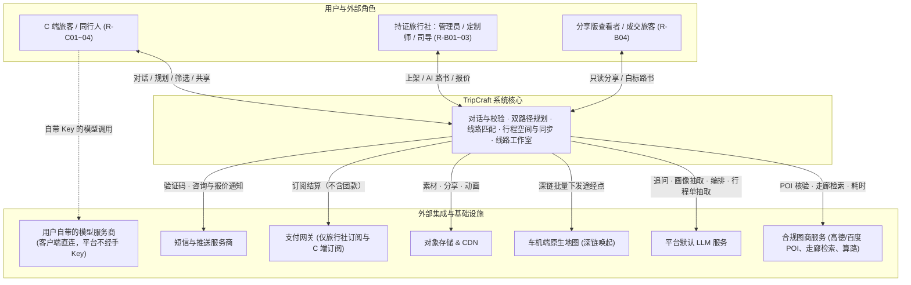
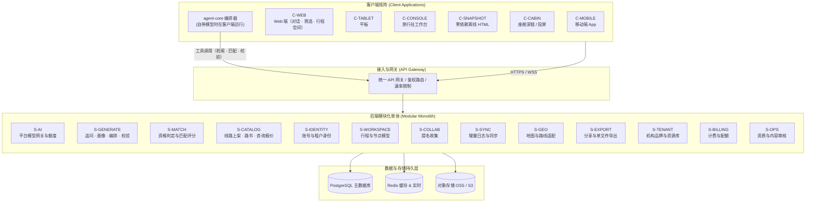

# ARC-01 · 系统总体架构

## 1. 系统上下文全景 (System Context)

TripCraft 是一个连接旅客与持证旅行社的多端 AI 旅行规划系统：



---

## 2. 容器架构图 (Container Architecture)



---

## 3. 白皮书 L1–L5 模型与本架构映射关系

历史 [白皮书 §6.0](../WHITEPAPER.md#60-系统分层全景架构-system-architecture) 提出的五层模型描述的是"一份路书"的结构；本架构在此基础上补齐对话、匹配与协作：

| 白皮书原始层级 | 原始定义与职责 | 对应现代系统架构组件 (ARC-01) | 映射说明与演进决策 |
| :--- | :--- | :--- | :--- |
| **L1 数据源层** | POI 图资、路况、特许资源、AI 生成 | `S-GEO`, `S-AI`, `S-CATALOG`, 外部地图/模型服务 | 新增两类数据源：用户自带模型、旅行社上架线路 |
| **L2 契约层** | DSL Schema 规范（trip, brand, node, patch, profile, listing） | `spec/*.json`, `S-WORKSPACE` | DSL 仍是唯一真相源；需求画像与上架信封契约已落地（OI-024） |
| **L3 编译器与同步层** | 云端同步、冲突仲裁、单文件打包器 | `S-SYNC`, `S-COLLAB`, `S-EXPORT` | 同步提升为阶段 1 能力；单文件导出为支撑能力 |
| **L4 运行时层** | 零依赖容灾运行时、离线沙盒 | `C-SNAPSHOT`, 客户端本地存储 | 离线可读仍是红线（铁律 3），但不再承担主叙事 |
| **L5 多端接入层** | 手机、iPad、车机座舱、桌面工作台 | `C-MOBILE`, `C-WEB`, `C-TABLET`, `C-CONSOLE`, `C-CABIN` | 主入口为对话界面与筛选页；车机以深链与投屏为主 |

---

## 4. 核心架构原则 (Architecture Principles)

1. **离线可读 (Local-First)**：已同步到设备的行程断网可读；同步失败显式提示，不静默覆盖。
2. **DSL 是唯一真相源**：路径 A 与路径 B 的产出、成交后的白标路书，都是同一种行程 DSL。
3. **模型无关的质量底线**：无论平台模型还是自带模型，写入前都经服务端校验（契约、图商核验、词表、BR-025）（[ADR-009](adr/ADR-009-llm-provider-byok.md)）。
4. **匹配可解释、可复现、不可购买**：匹配评分是纯函数，结果随规则版本保存，付费不进入评分（[ADR-010](adr/ADR-010-route-matching-scoring.md)）。
5. **降级不可耻，白屏才是罪**：模型、图商、匹配服务任一不可用时，其余主线功能继续可用。
6. **能力边界诚实**：不控制车辆、不读取 SOC、不替代导航；平台不是旅行社，阶段 1–2 不经手团款。
7. **模块化单体先行 (Proposed)**：初期采用模块化单体（[ADR-003](adr/ADR-003-backend-topology.md)）。
8. **严格租户隔离**：旅行社的私有资源、成本价、咨询记录按租户隔离（[ADR-007](adr/ADR-007-multitenancy-isolation.md)）。
9. **地图服务可替换**：通过 `S-GEO` 隔离图商（[ADR-005](adr/ADR-005-map-navigation-abstraction.md)）。

---

## 5. 统一命名表 (Unified Naming Conventions)

### 角色 ID 与名称
- `R-C01` 组织者 / 领队 ｜ `R-C02` 同行成员 ｜ `R-C03` 长辈/低数字素养成员 ｜ `R-C04` 独行自驾者
- `R-B01` 机构管理员 ｜ `R-B02` 计调 / 定制师 ｜ `R-B03` 导游 / 随团司机 ｜ `R-B04` 成交旅客 / 机构客户
- `R-P01` 平台运营与合规 ｜ `R-O01` 车厂 / 生态伙伴

### 功能模块 (M) 与后端逻辑模块 (S)
- `M15` AI 对话与模型接入 (`S-AI`) ｜ `M16` 路径 A 自主规划 (`S-GENERATE` + `S-GEO`)
- `M17` 路径 B 线路匹配与筛选 (`S-MATCH`) ｜ `M18` 旅行社线路工作室 (`S-CATALOG`)
- `M01` 账号与身份 (`S-IDENTITY`) ｜ `M02` 行程工作区 (`S-WORKSPACE`)
- `M03` 智能澄清与生成 (`S-GENERATE`) ｜ `M04` 协作 (`S-COLLAB`)
- `M05` 地图与路线 (`S-GEO`) ｜ `M06` 同步与实时 (`S-SYNC`)
- `M07` 座舱交付 (`C-CABIN` 客户端) ｜ `M08` 离线快照与导出 (`S-EXPORT`)
- `M09` 内容与主题 (`S-CONTENT`) ｜ `M10` 回忆录与资产 (`S-MEDIA`)
- `M11` B 端工作台 (`S-TENANT`) ｜ `M12` 商业化与计费 (`S-BILLING`)
- `M13` 平台运营与合规 (`S-OPS`) ｜ `M14` 通知与消息 (`S-NOTIFY`)

### 客户端载体 (C)
- `C-MOBILE` 手机 App ｜ `C-WEB` Web 端 ｜ `C-TABLET` 平板
- `C-CONSOLE` 旅行社工作台 ｜ `C-SNAPSHOT` 离线快照运行时 ｜ `C-CABIN` 车机深链与投屏

---

## 6. 规划中代码仓库组织 (Proposed Monorepo Layout)

> 标注：以下代码结构为**规划中**形态。当前仓库包含 `spec/`、`tools/`、`examples/` 与演示站 `apps/showcase/`，尚无产品代码。

```text
TripCraft/
├── apps/
│   ├── showcase/               ← 演示站（营销用，已存在）
│   ├── mobile/                 ← C-MOBILE / C-TABLET (React Native)
│   ├── web/                    ← C-WEB 对话 · 筛选 · 行程空间 / C-CONSOLE 旅行社工作台 (Next.js)
│   └── snapshot-runtime/       ← C-SNAPSHOT 离线自包含运行时模版
├── packages/
│   ├── spec/                   ← 数据契约 (JSON Schema Draft 2020-12) [已实现，当前位于根目录 spec/]
│   ├── dsl-core/               ← DSL 校验、补丁与解析核心库
│   ├── agent-core/             ← 对话追问与规划编排器（客户端与服务端共用，ADR-009）
│   ├── match-core/             ← 匹配评分纯函数（ADR-010，服务端与测试共用）
│   ├── compiler/               ← S-EXPORT 单文件 HTML 编译器
│   └── design-system/          ← 视觉设计 Token 与组件
├── services/                   ← 后端模块化单体
│   ├── s-ai/                   ← 平台模型网关与额度
│   ├── s-generate/             ← 追问、画像、编排与校验
│   ├── s-match/                ← 资格判定、匹配评分、分面统计
│   ├── s-catalog/              ← 线路上架、AI 路书、咨询与报价
│   ├── s-identity/  s-workspace/  s-collab/  s-sync/  s-geo/  s-tenant/  s-ops/
└── tools/                      ← 门禁校验工具链 [已实现]
```

---

## 7. 系统组件设计与实现状态

严格区分设计状态与工程落地状态：

| 组件 / 模块 | 所属层级 | 设计状态 | 实现状态 | 落地依据 / 说明 |
| :--- | :--- | :--- | :--- | :--- |
| **`spec/` 数据契约** | L2 契约层 | 已验证 | **已实现** | 4 份 JSON Schema 与 Dunhuang 样例通过门禁校验 |
| **`tools/` 门禁工具链** | 工程基础设施 | 已验证 | **已实现** | `validate-schemas.js`, `check-links.mjs`, `check-br025.mjs`, `check-trace.mjs` |
| **`apps/showcase` 演示站** | 营销 | 已评审 | **已实现** | 演示动画，不含产品逻辑；叙事尚未覆盖路径 B 与线路工作室 |
| **`S-AI` / `agent-core`** | 后端 / 共享包 | 草案（ADR-009） | 无 | 阶段 1（自带模型阶段 2） |
| **`S-GENERATE` 追问与编排** | 后端服务 | 草案 | 无 | 阶段 1（结合 docs/08、docs/16） |
| **`S-MATCH` 匹配评分** | 后端服务 | 草案（ADR-010） | 无 | 阶段 2 |
| **`S-CATALOG` 线路工作室** | 后端服务 | 草案（docs/17） | 无 | 阶段 1（导入与上架）/ 阶段 2（路书、报价） |
| **`S-IDENTITY` / `S-WORKSPACE` / `S-SYNC` / `S-COLLAB` / `S-GEO`** | 后端服务 | 草案 | 无 | 阶段 1 |
| **`S-TENANT` / `S-BILLING`** | 后端服务 | 草案 | 无 | 阶段 2 |
| **`S-EXPORT` 单文件编译器** | L3 编译器 | 已评审（docs/05） | 无 | 阶段 3；仓库中没有编译器原型代码 |
| **`C-SNAPSHOT` 离线运行时** | L4 运行时 | 已评审 | 无 | 阶段 3；演示站不是该运行时的实现 |
| **`C-CABIN` 座舱深链** | 客户端 | 已评审（docs/02） | 无 | 阶段 3；深链参数格式已核查，数量上限未实测（OI-001） |
