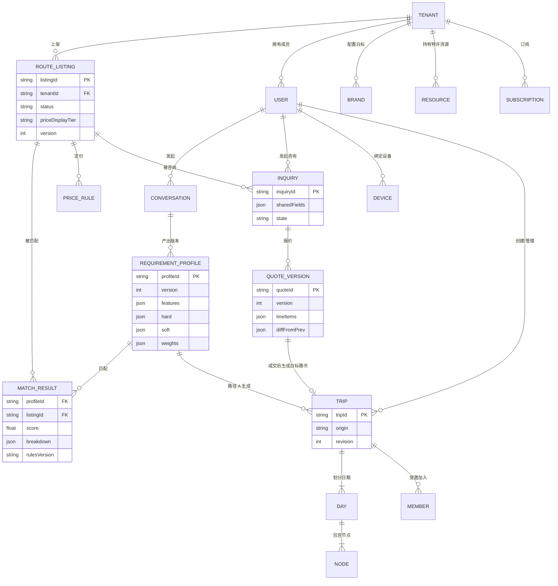
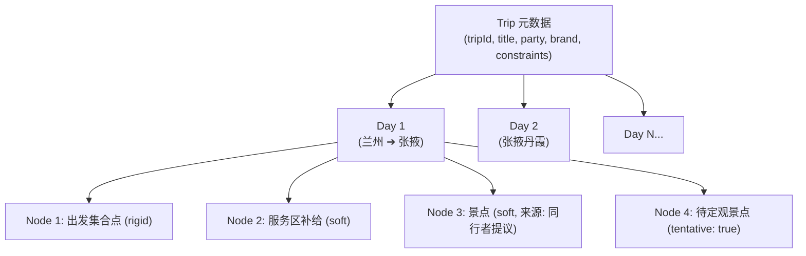
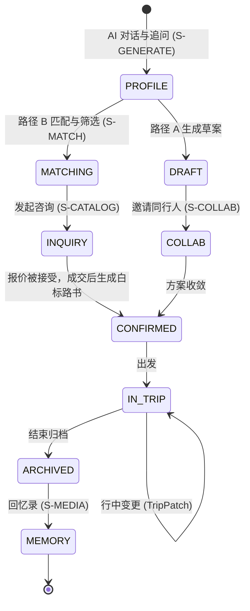

# ARC-02 · 领域模型与数据架构

## 1. 核心实体清单 (Core Entities)

v3 在原 17 个实体基础上新增 8 个，覆盖对话、需求画像、旅行社线路与匹配咨询：

| 实体名称 | 所属模块 | 一句话业务定义 | 存储与生命周期特征 |
| :--- | :--- | :--- | :--- |
| **Conversation** ★ | S-GENERATE | 一次与 AI 的对话会话（消息、附件、所用模型） | 消息在发送模型前已脱敏；用户可删除 |
| **RequirementProfile** ★ | S-GENERATE | 需求画像：特征点、硬约束、软偏好、权重，每个字段带来源标注 | 版本化；规划与匹配只读画像（[docs/16 §16.3](../16-planning-paths-and-route-matching.md#163-需求画像特征点的提取)） |
| **RouteListing** ★ | S-CATALOG | 旅行社上架的线路 = 行程 DSL + 上架信封 | 状态：草稿 / 审核中 / 在售 / 下架；归属租户 |
| **PriceRule / ListingOption** ★ | S-CATALOG | 价格规则（人群价、季节、阶梯、单房差）与可调选项（价格变化、互斥依赖） | 随线路版本化；成本价不存储 |
| **MatchResult** ★ | S-MATCH | 一次匹配的结果：线路、匹配度、维度分项、规则版本号 | 可由（画像版本、线路版本、规则版本）复算 |
| **Inquiry** ★ | S-CATALOG | 旅客对某条线路发起的咨询，含旅客授权发送的画像字段与调整项 | 仅旅客与该旅行社可见 |
| **QuoteVersion** ★ | S-CATALOG | 旅行社给出的一版报价（分项、总价、有效期） | 只增不改；自动记录与上一版的差异 |
| **UsageQuota** ★ | S-AI | 平台模型的额度与用量 | 按用户计；自带模型调用不计入 |
| **User** | S-IDENTITY | 平台注册用户（旅客、定制师或司导） | 持久存储，支持多设备绑定 |
| **Device** | S-IDENTITY | 用户的物理终端凭证 | 记录会话 Token 与本地缓存指纹 |
| **Tenant (Org)** | S-TENANT | 旅行社 / 车队租户 | 含资质审核状态与席位数 |
| **Role** | S-IDENTITY | 租户内的业务角色 | RBAC 权限 |
| **Workspace / Trip** | S-WORKSPACE | 行程空间与行程真相源 | 全局唯一 `tripId`；路径 A 方案、成交白标路书都落在这里 |
| **Day** | S-WORKSPACE | 行程内的日程单元 | 包含节点序列 |
| **Node** | S-WORKSPACE | 景点、餐饮、住宿、途经点等离散节点 | 坐标与时间窗口；事实与建议分字段 |
| **Member** | S-COLLAB | 行程空间成员 | 行程内昵称与偏好 |
| **Brand** | S-TENANT | 旅行社白标品牌配置 | 用于成交后的白标路书 |
| **Template / Theme** | S-TENANT / S-CONTENT | 可复用模板或视觉主题 | |
| **Resource** | S-TENANT | 旅行社私有特许资源 | 严格租户隔离，不随"以线路为骨架自己开"复制 |
| **Media** | S-MEDIA | 照片、素材与动画文件元数据 | 素材标注实拍 / 示意 / AI 生成 |
| **Memory** | S-MEDIA | 旅后回忆录 | |
| **Subscription** | S-BILLING | 旅行社工作室订阅与 C 端订阅 | |
| **Order** | S-BILLING | 订阅与增值购买订单（不含团款） | |
| **Notification** | S-NOTIFY | 提醒、变更通知、咨询与报价通知 | |
| **Audit** | S-OPS | 资质审核、线路审核、下架、匹配申诉复算的审计日志 | 不可篡改 |

> 📌 **不是实体的东西**：用户自带模型的 API Key 只存在于用户设备的加密存储中，服务端没有对应的表或字段（[ADR-009](adr/ADR-009-llm-provider-byok.md)）。

---

## 2. 领域实体关系图 (Domain ER Diagram)

---

## 3. 行程文档模型 (Trip Document Tree)

TripCraft 将行程文档抽象为层次化树状结构：`Trip` ➔ `Day` ➔ `Node`。路径 A 的草案、旅行社线路的逐日行程、成交后的白标路书，都使用这一结构。

### 节点类型与状态机制
1. **节点类型 (`type`)**：以 [`spec/node.schema.json`](../../spec/node.schema.json) 为准。
2. **待定标记 (`tentative`)**：信息未核验或用户未决定的节点标 `tentative: true` 并附原因；不阻塞整单生成。
3. **来源区分**：事实（图商）、系统建议（模型撰写）、同行者提议三方可区分（[docs/00 铁律 7](../00-overview-and-glossary.md#铁律-7--事实与建议分离-fact-vs-advice)；契约缺口见 OI-018）。

---

## 4. DSL 在模型中的定位与 Schema 对照

| 领域实体 / 聚合根 | 对应 `spec/` Schema 规范 | 映射职责与用途 |
| :--- | :--- | :--- |
| `Trip`, `Day`, `Member` | [`spec/trip.schema.json`](../../spec/trip.schema.json) | 行程完整真相源 |
| `Brand` | [`spec/brand.schema.json`](../../spec/brand.schema.json) | 旅行社白标品牌契约 |
| `Node`, `Resource` | [`spec/node.schema.json`](../../spec/node.schema.json) | 离散节点契约 |
| 增量变更指令集 | [`spec/patch.schema.json`](../../spec/patch.schema.json) | TripPatch 增量补丁契约 |
| `RequirementProfile` | ⏳ **待定**（OI-024） | 部分字段可复用 `trip.schema.json` 的 `party` 与 `constraints` |
| `RouteListing` 上架信封、`PriceRule`、`ListingOption` | ⏳ **待定**（OI-024） | 逐日行程复用 `trip.schema.json`；商业字段需新契约 |
| `Inquiry`、`QuoteVersion`、`MatchResult` | 服务端内部模型 | 不作为跨层交换格式，不进入 `spec/` |

---

## 5. 数据生命周期与状态机 (Data Lifecycle)

**旅客侧**：

**旅行社线路侧**：`DRAFT`（导入或编辑）→ `REVIEW`（平台审核）→ `ON_SALE`（参与匹配）→ `OFF_SALE`（下架，保留历史版本供已发生的咨询与报价引用）。

---

## 6. 数据主权与归属划分 (Data Ownership)

严格落实 [docs/00 铁律 4 数据主权本地化](../00-overview-and-glossary.md#铁律-4--数据主权本地化-local-data-sovereignty)：

| 数据类型 | 归属主体 | 存储位置 | 访问控制与生命周期 |
| :--- | :--- | :--- | :--- |
| **自带模型 API Key** | 用户个人 | **仅用户设备**（加密存储） | 不同步、不上传；换设备需重新添加 |
| **对话与需求画像** | 用户个人 | 平台主数据库 | 仅本人可见；发起咨询时由用户确认发送的字段才对该旅行社可见 |
| **用户核心身份** | 用户个人 | 平台中心库（加密） | 注销时物理删除 |
| **旅行社上架线路** | 旅行社 | 租户空间 | 公开部分对旅客可见；成本价不存储 |
| **咨询与报价记录** | 旅客与该旅行社 | 租户空间 | 仅双方可见；平台仅在审计与纠纷处理时访问并留痕 |
| **旅行社私有特许资源** | 旅行社 | 租户隔离存储 | 不纳入任何公共模型训练 |
| **行程协作提名与理由** | 行程空间成员 | 协作服务 | 行程归档后按期清理 |
| **个人原始照片与打卡轨迹** | 旅客 | 本地设备 | 仅在用户主动授权时本地处理 |
| **脱敏分享版与单文件快照** | 旅客与公众 | 静态 CDN / 本地 | 自包含静态产物 |
