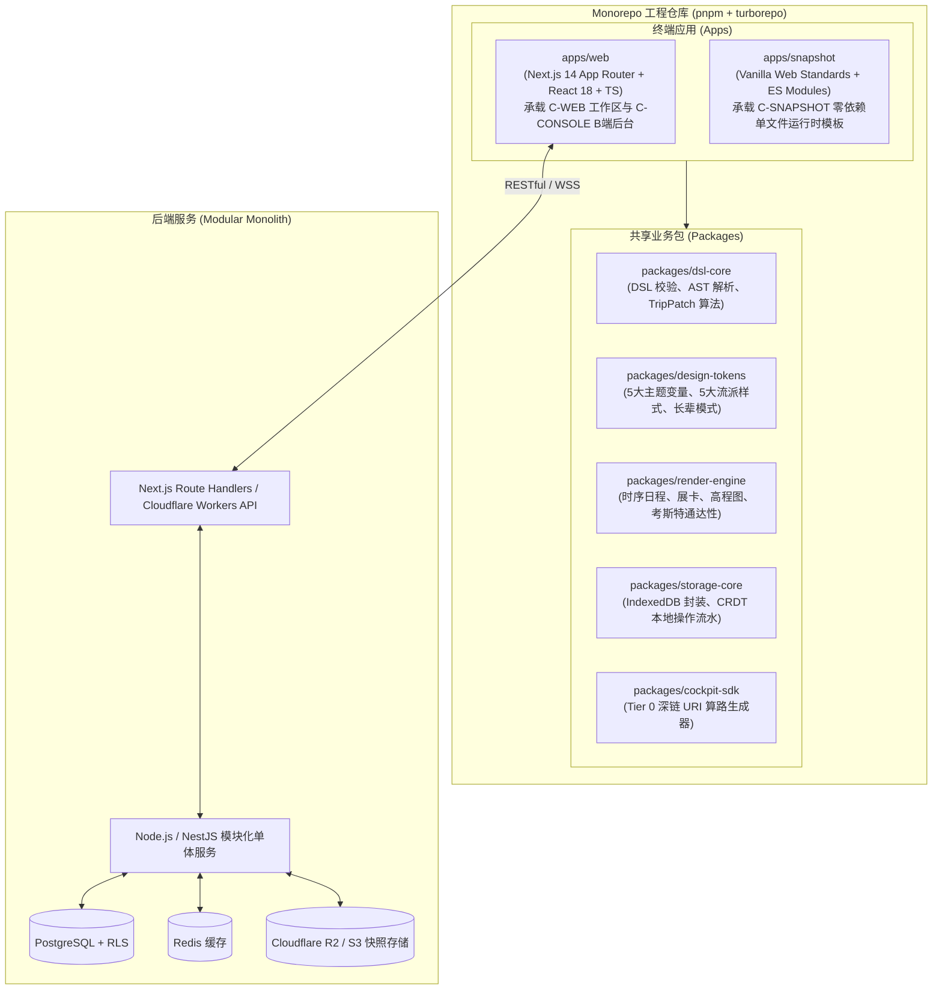
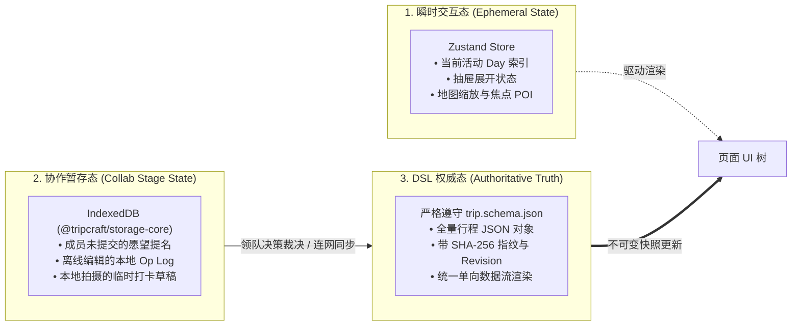
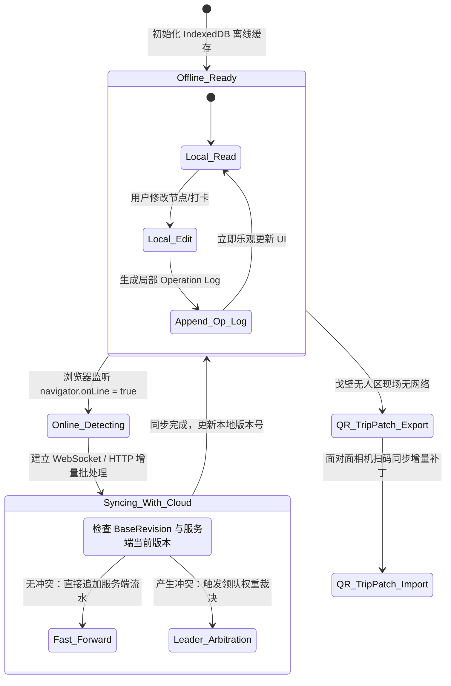
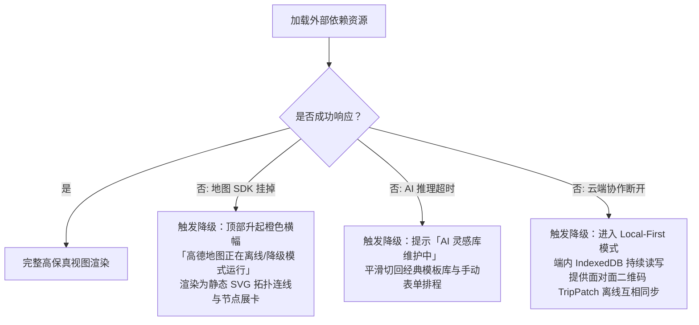
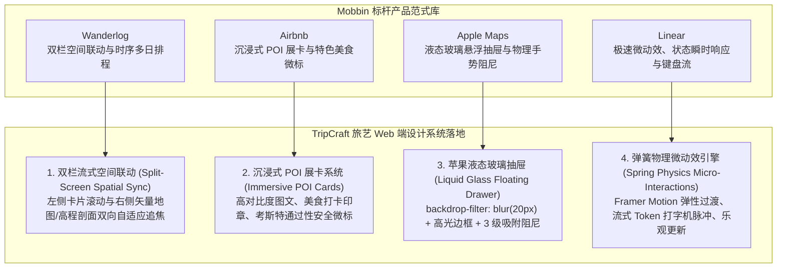
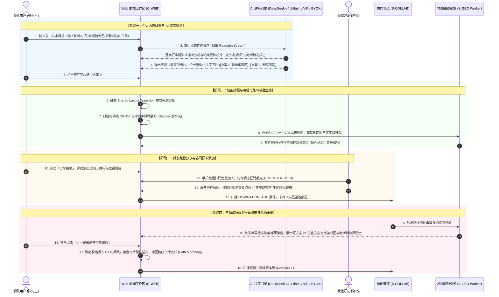
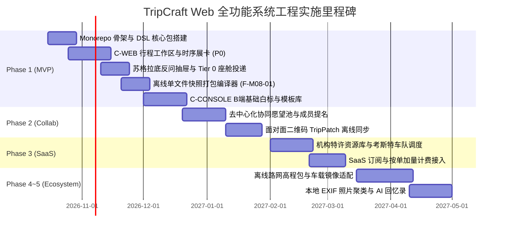

# ARC-10 · Web 全功能系统架构与技术开发设计文档

> ⚠️ **v3 对齐说明（2026-10-17）**：本文写于产品基线 v3 之前，覆盖 M01–M14 共 51 项功能。按 [PRD-01 v3](../product/PRD-01-vision-positioning.md) 需补充：
> - **新增模块 M15–M18（25 项功能）**：对话入口与模型选择、路径 A 自主规划、路径 B 匹配与筛选页、旅行社线路工作室。功能规格以 [PRD-04](../product/PRD-04-functional-architecture.md) 为准，交互设计见 [docs/16](../16-planning-paths-and-route-matching.md) 与 [docs/17](../17-agency-route-studio.md)。
> - **新增路由**：`/`（对话首页）、`/plan/:profileId`、`/match/:profileId`（筛选页）、`/routes/:listingId`、`/inquiries`、`/settings/models`；工作台新增 `/listings`、`/inquiries`。路由清单以 [ARC-04 §3](ARC-04-clients-channels.md#3-各端信息架构-information-architecture) 为准。
> - **阶段调整**：§10 里程碑以 [DLV-01 v3](../delivery/DLV-01-roadmap-mvp.md) 为准；单文件导出与车机投递移至阶段 3。
>
> 本文其余工程规格（状态管理、Local-First、设计令牌、性能预算）继续有效。

> **文档性质**：系统设计与工程开发规格书（面向前端/全栈工程师开发施工）。  
> **回答的问题**：如何以现代化 Web 网站的形式承载高质量的旅行路书展示，同时在 Web 端完整实现项目的全部 51 项功能与 14 大核心业务场景？具体的技术选型、工程架构、路由拓扑、状态机与接口契约是什么？  
> **硬规则约束**：严格遵循工程轨硬规则 A（输入 ➔ 算法 ➔ 输出 ➔ 失败状态）与设计轨硬规则 B（决策 ➔ 为什么 ➔ 不这样做会怎样）。  
> **对外展示官网指引**：若需查阅面向外部访客、体验者与投资人的官方展示与视差动画演示官网设计规范（含 Apple Scrollytelling 视差滚动故事流与 Bento Grid 画廊），请参阅独立规范：[`docs/SHOWCASE-web-design.md`](../SHOWCASE-web-design.md)。

---

## 1. 系统定位与开发总目标

### 1.1 为什么需要 Web 端全功能系统
TripCraft 的核心交付物虽然包含免安装单文件离线 HTML（`C-SNAPSHOT`），但项目不是一个纯静态网页生成器，而是贯穿行前去中心化协作、行中多端动态同步、座舱联动与 B 端旅行社 SaaS 白标的**完整智能旅行中枢**（见 [docs/15 §15.1](../15-multi-device-and-collaboration.md#151-核心定调为什么-tripcraft-最终形态必须是多端同步-app)）。

Web 端（统称 `Web Platform`，包含面向 C 端旅客与组织者的 `C-WEB`，面向 B 端地接社与定制师的 `C-CONSOLE`，以及离线自包含运行时 `C-SNAPSHOT`）承担着双重使命：
1. **用网站的形式来展示**：以工业级 Web 前端标准，提供极高质感的自驾路书呈现。支持五大液态玻璃主题、高对比地理沙盘、时序节点流、高程剖面图及长辈大字自适应模式。
2. **实现项目的全部功能**：Web 端不仅是“查看器”，更是**全生命周期生产力工作台**。支持从零倾倒意图、老定制师苏格拉底反问对齐、多人协作愿望提名池、考斯特大巴 2.8m 通达性规则校验、智能座舱 Tier 0 批量深链投递、面对面离线二维码 TripPatch 生成与合流、纯前端 EXIF 本地照片聚类回忆录、到旅行社企业白标配置与按单加量计费结算。

### 1.2 十条设计铁律在 Web 端的落地映射
Web 端的全部代码编写必须受 [docs/00 §0.2 十条铁律](../00-overview-and-glossary.md#02-十条设计铁律-the-ten-ironclad-rules) 的绝对约束：

| 铁律编号 | 铁律原则 | Web 端落地工程判据 | 违背判据的红线惩罚 |
| :--- | :--- | :--- | :--- |
| **铁律 1** | 零构建交付 | Web 导出的路书产物必须为纯自包含单文件 HTML，用户双击秒开，严禁依赖 Node 环境。 | 构建失败直接阻断导出流水线。 |
| **铁律 2** | 单文件优先，渐进增强 | 导出的快照脱网在本地打开时，必须 100% 具备完整行程、海拔图、预案。严禁异步 fetch 外部 json。 | 禁止在快照模板中使用远程动态数据拉取。 |
| **铁律 3** | 降级不可耻，白屏才是罪 | 第三方图商（高德/百度）SDK 加载超时（>3s）必须优雅降级为静态 SVG / 节点卡片列表。 | 严禁未捕获的 SDK 异常导致整页白屏。 |
| **铁律 4** | 数据主权本地化 | 游客身份证号、真实轨迹、相册照片原图默认存储在端内 IndexedDB，照片聚类在 Web Worker 执行。 | 禁止非脱敏身份与原图上传服务端。 |
| **铁律 5** | 无后端可运行 | C 端核心路书阅览不依赖任何服务端存活；即使云端崩溃，已分发路书永久可用。 | 核心只读视图严禁耦合鉴权接口。 |
| **铁律 6** | DSL 是唯一真相源 | Web 端所有表单编辑均实时序列化为符合 `trip.schema.json` 的 AST，严禁直接拼装 HTML。 | 出入库强制通过 AJV 2020-12 校验。 |
| **铁律 7** | 事实与建议分离 | UI 上客观事实（坐标、开放时间）与主观建议（推荐餐厅、日落机位）必须用独立视觉组件隔离。 | 禁止混淆展示或由 AI 伪造事实数据。 |
| **铁律 8** | 拒绝静默失败 | 所有前端 try/catch 必须上报错误边界（ErrorBoundary）并提供错误快照导出机制。 | 严禁空的 catch 块。 |
| **铁律 9** | 一切可存证 | 编译导出的 HTML 头部自动注入 SHA-256 内容哈希与机构签名指纹，支持防伪溯源。 | 指纹不匹配时提示文件已被篡改。 |
| **铁律 10** | 代码不是护城河，资产才是 | 业务前端代码全面遵循模块化开源规范，将护城河构建在地面实测数据、特许资源与 B 端工作流习惯中。 | 杜绝无意义的代码混淆拖慢运行效率。 |

---

## 2. 总体技术架构与 Monorepo 代码工程拓扑

### 2.1 技术栈选型决策（对齐 [ADR-001](adr/ADR-001-client-framework.md) 与 [ADR-003](adr/ADR-003-backend-topology.md)）



### 2.2 前端基础库选型标准
1. **主应用框架**：`Next.js 14+`（App Router 架构）。
   - *决策理由*：天然支持 React Server Components (RSC) 与静态生成 (SSG/ISR)，B 端工作台与公开路书分享页首屏秒开；支持 SEO 与 OpenGraph 动态卡片生成。
2. **状态管理**：
   - *UI 瞬时态*：`Zustand`（轻量、低心智负担，无 Context 嵌套地狱）。
   - *异步服务端缓存*：`@tanstack/react-query`（内置重试、弱网去重与乐观更新）。
   - *本地离线持久化*：`idb`（IndexedDB 极薄 Promise 封装）+ `@tripcraft/storage-core`。
3. **样式与视觉引擎**：
   - `Tailwind CSS v3.4+` + 原生 CSS Custom Properties（CSS 变量）。
   - 彻底贯彻 [docs/09 视觉设计系统](../09-visual-design-system.md) 的 5 大主题与 5 大流派动态类名注入。
4. **地理与地图可视化**：
   - 统一抽象层隔离高德地图 JS API v2.0 / 百度地图 Web API（[ADR-005](adr/ADR-005-map-navigation-abstraction.md)）。
   - 离线/降级模式下采用原生 HTML5 Canvas / SVG 绘制海拔高程起伏与拓扑连线。
5. **契约校验**：
   - `ajv@8` + `ajv-formats`（开发期与运行时统一保障 Schema 规范合规）。

---

## 3. 网站信息架构、路由系统与多角色权限 (RBAC)

### 3.1 站点地图与 App Router 路由树规范

```text
apps/web/src/app/
├── (marketing)/                        ← 公开展示与门户域
│   ├── page.tsx                        ← 官网首页：产品愿景、标杆体验、开源生态
│   └── explore/page.tsx                ← 标杆路书发现广场（西行计划、川西环线等公开只读案例）
├── (auth)/                             ← 统一认证域 (M01: F-M01-01, F-M01-02)
│   ├── login/page.tsx                  ← 手机短信/微信扫码快捷登录
│   └── join/page.tsx                   ← 临时成员免登通道（根据 ?token= 绑定昵称代号入群）
├── (workspace)/trip/[tripId]/          ← C 端全功能路书协同工作区 (C-WEB)
│   ├── layout.tsx                      ← 行程上下文包裹器、导航栏、离线状态同步器
│   ├── itinerary/page.tsx              ← 【核心】每日日程时序视图、三段式熔断控制器 (F-M02-02)
│   ├── chat/page.tsx                   ← 【AI 对话主页面】老定制师多轮对话工作台、模型切换与 BYOK 设置 (F-M03-01~02)
│   ├── sandbox/page.tsx                ← 全景地图、多方案对比推演与高程剖面 (F-M02-05, F-M05-02)
│   ├── collab/page.tsx                 ← 去中心化愿望池、提名卡片与沉默表达 (F-M04-01~05)
│   ├── cockpit/page.tsx                ← 智能座舱交付中心：Tier 0 深链推车机、HUD 镜像 (F-M07-01~03)
│   ├── journal/page.tsx                ← 旅途 GPS 打卡、本地 EXIF 照片匹配与回忆录 (F-M10-01~03)
│   └── export/page.tsx                 ← 零构建单文件 HTML 打包器、只读短链与海报导出 (F-M08-01~03)
├── user/settings/ai/page.tsx           ← 个人 AI 模型偏好与个人 API Key (BYOK) 管理 (F-M03-01, F-M12-03)
├── (console)/console/                  ← B 端地接社与定制师 SaaS 工作台 (C-CONSOLE)
│   ├── layout.tsx                      ← 机构工作台左侧导航、租户品牌上下文 (F-M11-01)
│   ├── dashboard/page.tsx              ← 机构运营大盘：出单量、履约中行程、SaaS 配额 (F-M12-01)
│   ├── editor/[tripId]/page.tsx        ← 专业定制师双栏排版工作区 (F-M02-02, F-M05-03)
│   ├── templates/page.tsx              ← 金牌线路模板库管理与一键克隆 (F-M11-02)
│   ├── resources/page.tsx              ← 私域特许秘境、特窟通道与特种车辆通达性标注 (F-M11-04)
│   ├── brand/page.tsx                  ← 机构白标资产配置：Logo、铭牌、独立域名 (F-M11-01)
│   ├── fleet/page.tsx                  ← 考斯特车队调度甘特图与随团司导排班 (F-M11-05)
│   └── billing/page.tsx                ← SaaS 阶梯订阅、按单加量包与财务结算 (F-M12-01~02)
├── s/[shareToken]/page.tsx             ← 轻量只读只看快照页（长辈大字自适应、极速离线）(F-M08-02, F-M09-03)
└── admin/                              ← 平台管理后台 (R-P01 平台运营) (F-M13-01~03)
    ├── verification/page.tsx           ← 旅行社入驻资质审查与经营许可证存证
    └── risk/page.tsx                   ← 敏感词过滤库配置、违规路书紧急下线熔断
```

### 3.2 角色权限矩阵与端内拦截策略 (RBAC)

基于 [docs/03 §3.2](../03-b2b-agency-operations.md#32-角色模型与权限矩阵) 与 [PRD-02](../product/PRD-02-personas-segments.md) 的九大角色模型：

| 页面与路由路径 | 组织者/领队 (R-C01) | 受邀同行人 (R-C02~04) | 机构管理员 (R-B01) | 计调定制师 (R-B02) | 随团司导 (R-B03) | 免登游客 (R-B04) |
| :--- | :---: | :---: | :---: | :---: | :---: | :---: |
| `/trip/:id/itinerary` | **读 / 写 / 决策** | **读 / 提议** | 仅查看 | 读 / 写 | **读 / 履约打卡** | 仅读（快照） |
| `/trip/:id/collab` | **决策合并** | **提名愿望 / 表态**| 无权 | 观察 | 查看乘客诉求 | 仅读 |
| `/trip/:id/cockpit` | **批量下发** | 查看状态 | 无权 | 模拟测试 | **主驾扫码推车** | 无权 |
| `/console/editor/:id` | 无权 | 无权 | 读 / 写 | **主编辑排版** | 仅读任务清单 | 无权 |
| `/console/brand` | 无权 | 无权 | **全局配置** | 仅读生效配置 | 无权 | 无权 |
| `/console/billing` | 无权 | 无权 | **充值 / 结算**| 无权 | 无权 | 无权 |
| `/s/:shareToken` | 免登自适应 | 免登自适应 | 预览 | 预览 | 预览 | **主阅览入口** |

---

## 4. 前端状态管理与 Local-First 本地优先引擎架构

### 4.1 前端状态三层模型



### 4.2 Local-First 本地优先状态机设计（[ADR-002](adr/ADR-002-sync-conflict-model.md)）



#### 增量补丁算法 (TripPatch AST Engine)
- **输入**：`BaseDSL` (当前版本 $v_n$), `ModifiedDSL` (修改后版本 $v_{n+1}$)。
- **算法**：
  1. 使用 RFC 6902 JSON Patch 标准计算 Diff 数组；
  2. 剥离长文本描述中未改动的冗余字段，仅保留 `path`, `op`, `value`；
  3. 使用 LZ-String 对补丁进行极致压缩，并附带领队私钥签名（`ed25519` 或 `HMAC-SHA256`）；
  4. 产物大小控制在 500 字节以内，可直接渲染为标准黑白 QR 码。
- **输出**：符合 `spec/patch.schema.json` 契约的标准化补丁对象。
- **失败状态**：若补丁目标 `targetTripId` 不匹配或版本跳跃过大（>5 版本未合并），UI 弹出警告：“行程基底版本过旧，请先扫码获取全量快照”。

---

## 5. UI/UX 视觉设计系统在 Web 端的落地规范

### 5.1 CSS 变量与设计令牌工程化实现
依据 [docs/09 视觉设计系统](../09-visual-design-system.md)，所有样式通过 `@tripcraft/design-tokens` 注入根节点：

```css
/* apps/web/src/styles/tokens.css 核心变量规范 */
:root {
  /* 基础尺寸与触控靶区 */
  --touch-target-min: 44px;
  --radius-liquid: 20px;
  --glass-blur-default: 20px;
  
  /* 默认主题：敦煌金 (dunhuang-gold) */
  --color-primary: #B8863B;           /* 氧化金箔 */
  --color-secondary: #1F4E79;         /* 青金石蓝 */
  --color-canvas: #F2E8D5;            /* 沙色暖白底 */
  --color-surface-glass: rgba(255, 255, 255, 0.72);
  --color-text-main: #3A2E1F;         /* 暖褐黑 (严禁纯黑 #000) */
  --color-text-muted: #72624F;
  --color-accent-alert: #8C3A2B;      /* 赭石红 */
  --border-specular: rgba(255, 255, 255, 0.65);
}

/* 动态主题类：经纬度地理逆编码或用户覆盖触发 */
[data-theme="cyber-blue"] {
  --color-primary: #00A3FF;
  --color-secondary: #FF2D78;
  --color-canvas: #0A1628;            /* 深蓝黑 (防脏光) */
  --color-surface-glass: rgba(16, 33, 58, 0.75);
  --color-text-main: #E8F1FF;
  --color-text-muted: #8AA8D1;
  --color-accent-alert: #00E5C0;
}

[data-theme="plateau-cyan"] {
  --color-primary: #1E6F8C;
  --color-secondary: #C9A227;         /* 藏黄 */
  --color-canvas: #EFF6F8;            /* 稀薄空气青白 */
  --color-surface-glass: rgba(255, 255, 255, 0.82);
  --color-text-main: #1A2E38;
}
```

### 5.2 五大流派样式引擎与兼容性拦截策略
用户选择流派时，系统在 `<html>` 标签注入 `data-genre="apple-glass | material-you | retro-journal | swiss-minimal | cyber-hud"`。

```typescript
// packages/design-tokens/src/compatibility.ts
export const GENRE_COMPATIBILITY_RULES: Record<string, string[]> = {
  'apple-glass': ['dunhuang-gold', 'cyber-blue', 'plateau-cyan', 'jiangnan-emerald', 'glacier-silver'],
  'material-you': ['dunhuang-gold', 'cyber-blue', 'plateau-cyan', 'jiangnan-emerald', 'glacier-silver'],
  'retro-journal': ['dunhuang-gold', 'jiangnan-emerald'], // 拟物物质感与冷光霓虹冲突
  'swiss-minimal': ['dunhuang-gold', 'cyber-blue', 'plateau-cyan', 'jiangnan-emerald', 'glacier-silver'],
  'cyber-hud': ['cyber-blue', 'glacier-silver'] // 暗底发光与高亮暖底冲突
};

export function validateThemeGenreCombination(theme: string, genre: string): { valid: boolean; reason?: string } {
  const allowed = GENRE_COMPATIBILITY_RULES[genre] || [];
  if (!allowed.includes(theme)) {
    return {
      valid: false,
      reason: `流派「${genre}」与地域主题「${theme}」在物理光学性格上冲突（见第9章 §9.1.3）。建议切换为瑞士极简或Apple液态玻璃。`
    };
  }
  return { valid: true };
}
```

### 5.3 长辈关怀大字模式 (Senior Mode) 渲染规格
根据 [docs/11 §11.2](../11-audience-adaptive-rendering.md#112-五个视角)，当检测到同行有长辈或开启大字版时，Web 端强制执行以下规则：
1. **触控靶区**：所有按钮、药丸、节点卡片最小尺寸由 44px 提升为 `min-height: 48px; min-width: 48px;`。
2. **文本字号**：正文基准字号由 15px 缩放至 `19px`，标题 `26px~32px`，严禁使用 14px 以下微小文字。
3. **对比度**：严格遵循 WCAG 2.1 AAA 级标准（对比度 ≥ 7:1）。
4. **信息降维**：折叠复杂的经纬度数据、海拔渐变图与加权系数，优先高亮：**① 几点到哪里、② 哪里能坐下休息、③ 洗手间间隔、④ 24h 管家一键呼叫电话**。

---

## 6. 全功能模块 Web 端开发实施规格 (M01 ~ M14 · 51 个功能项落地)

为确保工程师能够直接按照需求开发，本节将 [PRD-04](../product/PRD-04-functional-architecture.md) 的 51 项功能映射为具体 Web 前端实现规格：

### 6.1 M01 账号与身份 (S-IDENTITY)
- **F-M01-01 手机号/验证码与第三方登录** (P0)：
  - *前端路径*：`/auth/login`
  - *实现机制*：接入短信验证码倒计时组件，支持微信 JSSDK 授权登录；登录成功后在 LocalStorage 存储 JWT Access Token 与 Refresh Token。
- **F-M01-02 临时成员加入与昵称口令识别** (P0)：
  - *前端路径*：`/auth/join?token={link_token}`
  - *实现机制*：免密无状态验证。进入后弹窗提示：“请输入你在群里的代号（如：二叔、摄影小李）”，绑定当前设备会话并写入本地 IndexedDB，不创建全局重度账号。
- **F-M01-03 机构多角色身份管理** (P0)：
  - *前端路径*：`/console/team`
  - *实现机制*：管理员通过邀请链接配置员工席位（计调、司导、财务），通过路由中间件拦截非授权操作。
- **F-M01-04 设备与多端漫游** (P1)：
  - *实现机制*：基于 WebSocket 广播设备在线列表，支持一键“接力到平板大屏”或“投递至车机”。

### 6.2 M02 行程工作区 (S-WORKSPACE)
- **F-M02-01 创建与初始化行程** (P0)：
  - *前端路径*：`/console/editor/new` 或 `/trip/create`
  - *实现机制*：输入目的地、出发日期后，前端生成 `tripId`（UUID v4），组装符合 `spec/trip.schema.json` 的初始 JSON 树。
- **F-M02-02 日与节点管理** (P0)：
  - *前端路径*：`/trip/:id/itinerary` 及 `/console/editor/:id`
  - *实现机制*：双栏拖拽排版（基于 `@hello-pangea/dnd` 或 `dnd-kit`）。支持 POI、过境 Transit、餐饮 Dining、住宿 Stay 四大节点类型的增删改查。
- **F-M02-03 版本保存回溯** (P0)：
  - *实现机制*：本地 IndexedDB 记录最近 50 次 Revision 历史，支持 Diff 侧滑对比并一键回滚。
- **F-M02-04 待定项标记** (P0)：
  - *实现机制*：节点属性支持 `tentative: true`。在 UI 呈现为虚线描边与问号标志，不破坏全天时间连线。
- **F-M02-05 多方案沙盘推演** (P1)：
  - *前端路径*：`/trip/:id/sandbox`
  - *实现机制*：允许基于现有路线 Fork 出分支方案 B，地图双屏分屏对比两方案的里程与耗时。

### 6.3 M03 智能澄清与生成 (S-GENERATE)
- **F-M03-01 自由倾倒解析** (P0)：
  - *前端路径*：`/trip/:id/chat` 或创建向导浮层
  - *实现机制*：提供长文本倾倒输入框与实时语音转文字支持，调用底层模型结构化提取自驾目的地、天数、同行人员画像（长辈/儿童/驾驶员硬需求）。
- **F-M03-02 苏格拉底反问与老定制师 AI 对话工作台** (P0)：
  - *前端路径*：`/trip/:id/chat`（独立 AI 对话工作台页面）
  - *页面信息架构*：
    1. **顶部模型调度与状态栏**：
       - 展示当前模型标识（如 `[⚡ DeepSeek-v4.1-flash]`），提供模型切换下拉菜单；
       - 实时显示当前会话延迟、上下文 Token 消耗与计费/配额模式（官方配额 / 个人 API）；
       - 快捷入口：`[🔑 配置个人 API Key]`。
    2. **左侧对话交互流**：
       - 流式（SSE / ReadableStream）打字机渲染老定制师对话；
       - 四步反问状态机驱动：提取事实 ➔ 识别矛盾 ➔ 给出专业意见 ➔ 呈现预置选择药丸（如 `[ 听你的 · 砍张掖 ]`, `[ 我都要 · 试试看 ]`, `[ 我自己调 ]`）；
       - 支持多轮问答、沿途路况咨询、餐馆推荐与景点闭馆时间核对。
    3. **右侧行程画布即时分屏联动**：
       - 对话中产生的行程调整建议，右侧分屏实时高亮对应的 Day 节点与地图轨迹变更；
       - 支持在 AI 消息下方一键点击“应用变更到行程”，自动计算 Patch 并合并写入 DSL 真相源。
  - *多层级模型路由架构 (Model Routing & Tiered Hierarchy)*：
    1. **默认基础模型 (Default Baseline Tier)**：
       - **默认模型指定**：`DeepSeek-v4.1-flash`。
       - **定位与优势**：全员默认免费提供。具备超高推理吞吐量与极低响应延迟（首字延迟 < 800ms），完美胜任自然语言意图提取、结构化约束识别与四步反问逻辑。
    2. **高级会员专属模型 (VIP / Premium Tier)**：
       - **高阶模型清单**：开放更高算力成本的深度推理模型，包括 `DeepSeek-R1`（擅长深度思考链复杂环线排程与多目标冲突仲裁）、`Claude 3.5 Sonnet` / `GPT-4o`（擅长多模态图文识别与高质量游记文案生成）。
       - **权限拦截机制**：普通用户点击下拉菜单中的 VIP 模型时，弹出权限卡片：“当前模型属于高阶深度推理算力，升级为高级会员即可畅享；或切换为个人 API Key 免费体验”。
    3. **用户自带个人 API 机制 (BYOK - Bring Your Own Key)**：
       - **定位与价值**：赋予极客用户与专业定制师最大自由度，解除平台调用频次与模型限制，支持换用用户自己的企业或个人 API。
       - **配置入口**：`/user/settings/ai` 或对话页顶部弹窗。
       - **可配置项**：
         - *API Base URL*：支持自定义兼容 OpenAI 规范的任意端点（如 `https://api.deepseek.com/v1`、`https://api.openai.com/v1`、`https://api.siliconflow.cn/v1`）；
         - *API Key*：用户自备密钥，**端侧本地加密存储于 IndexedDB / LocalStorage，平台服务端绝对不沉淀、不记录用户私有 Key（严守铁律 4 数据主权本地化）**；
         - *自定义模型名称*：用户可自由填入目标模型标识（如 `deepseek-chat`、`deepseek-reasoner`、`qwen-max` 等）。
       - **连通性校验器**：配置面板提供一键“连通性与延迟测试 (Ping Test)”按钮，发送轻量级握手请求，即时反馈连通状态与往返耗时。
  - *后端模型网关 (S-GENERATE Gateway)*：
    - 官方 Key 统一走服务端代理，实现流式中继、速率限制与敏感词合规过滤（[ADR-008](adr/ADR-008-ai-generation-guardrails.md)）；
    - 用户自备 Key (BYOK) 支持纯前端直连调用；若遇到第三方 API 的浏览器 CORS 跨域限制，支持经由轻量级无状态中继代理转发，中继层严禁记录请求体与 Authorization Header。
- **F-M03-03 DSL 初稿生成** (P0)：
  - *实现机制*：将反问收敛后的参数组装为标准化 `trip.json`，自动配置三段式时间弹性（Plan A / Buffer / Fallback）。
- **F-M03-04 规则合规校验** (P0)：
  - *实现机制*：在 DSL 落地前调用地面规则库，对闭馆日（如故宫周一不开放）、高山封路进行前置硬拦截。

### 6.4 M04 协作系统 (S-COLLAB)
- **F-M04-01 邀请与空间共享** (P0)：
  - *实现机制*：生成微信卡片与参团专属二维码，展示团队空间成员头像列表。
- **F-M04-02 结构化提名收集** (P1)：
  - *前端路径*：`/trip/:id/collab`
  - *实现机制*：成员点击“提个想法”，选择 POI 并必须填写“为什么想去”（如：“想拍日落汉服”），汇入待决愿望池。
- **F-M04-03 沉默表达呈现** (P1)：
  - *实现机制*：为同行长辈或随性成员提供一键药丸“我都行 · 跟着大部队”，状态展示为绿色安心图标，杜绝无回应造成的组织焦虑。
- **F-M04-04 冲突检测隔离** (P1)：
  - *实现机制*：当成员提名产生时间或空间冲突时，自动生成分头行动预案（A 队徒步 / B 队茶歇），标明集合汇合点。
- **F-M04-05 领队决策合并** (P1)：
  - *实现机制*：仅组织者/领队拥有合并勾选框，点击确认后正式写入 DSL 并广播更新。

### 6.5 M05 地图与路线工程 (S-GEO)
- **F-M05-01 POI 检索与对齐** (P0)：
  - *实现机制*：对接高德/百度 Web POI 联想检索组件，坐标存储统一为 GCJ-02，提供精准经纬度反查。
- **F-M05-02 路线规划耗时** (P0)：
  - *实现机制*：调用图商驾车路径规划接口，结合真实山路、盘山道设置保守耗时系数（平原 1.1x，高原山路 1.4x）。
- **F-M05-03 沿途补给推荐** (P1)：
  - *实现机制*：沿线自动检索高评分公厕、中石化柴油加油站、低压充电桩与医疗急救站。
- **F-M05-04 离线路网支持** (P2)：
  - *实现机制*：离线状态下利用轻量矢量瓦片缓存包在前端 Canvas 上绘制全天路线轮廓与高程剖面。

### 6.6 M06 同步与实时 (S-SYNC)
- **F-M06-01 本地优先存储** (P0)：
  - *实现机制*：`packages/storage-core` 基于 IndexedDB 实现本地单向真相源，脱网无感。
- **F-M06-02 服务端增量日志** (P1)：
  - *实现机制*：维护 Append-Only 操作日志流水，避免全量覆盖导致的丢失修改。
- **F-M06-03 二维码 Patch 分发** (P1)：
  - *实现机制*：生成 RFC 6902 压缩补丁二维码，离线设备调用摄像头扫描并由端内运行时打补丁。
- **F-M06-04 实时成员信标** (P2)：
  - *实现机制*：在网络通畅时通过 WebSocket 广播车队成员实时坐标，绘制防走散雷达屏。

### 6.7 M07 座舱交付 (C-CABIN)
- **F-M07-01 深链途经点投递** (P0)：
  - *前端路径*：`/trip/:id/cockpit`
  - *实现机制*：一键构建高德 `amapuri://route/plan?via=[...]` 与百度 `baidumap://map/direction?...` 标准 URI Scheme，支持扫码或复制链接唤醒车机导航。
- **F-M07-02 车载投屏镜像** (P2)：
  - *实现机制*：适配 16:9 宽屏车载浏览器，HUD 极简大字呈现当前/下一站节点与熔断倒计时。
- **F-M07-03 车机副驾协同** (P2)：
  - *实现机制*：副驾在手机端选定改道点，车机中控屏实时弹窗“副驾建议切换路线至：XX”，驾驶员一键确认。

### 6.8 M08 离线快照与导出 (S-EXPORT)
- **F-M08-01 单文件 HTML 编译** (P0)：
  - *前端路径*：`/trip/:id/export`
  - *实现机制*：**浏览器端离线编译器**。将当前 DSL 注入 `apps/snapshot` 预编译好的轻量 HTML 模板中，资源全部 Base64 内联，生成单文件 HTML 并触发浏览器下载。
- **F-M08-02 静态只读短链** (P0)：
  - *前端路径*：`/s/:shareToken`
  - *实现机制*：自动将离线快照上传至 Cloudflare R2 / OSS，生成免登访问链接。
- **F-M08-03 PDF 海报打印** (P1)：
  - *实现机制*：利用 `@media print` 专用打印样式表，自动排版为 A4 折页纸质路书，去除交互杂质。

### 6.9 M09 内容与主题 (S-CONTENT)
- **F-M09-01 官方视觉主题** (P0)：
  - *实现机制*：目的地包含甘肃/青海自动激活敦煌金；西藏/川西激活高原青；江浙沪激活江南翠；默认兜底冰川银。
- **F-M09-02 POI 展卡渲染** (P0)：
  - *实现机制*：深度渲染莫高窟、鸣沙山等点位的人文背景、最佳机位、着装建议与避坑贴士。
- **F-M09-03 长辈大字版** (P0)：
  - *实现机制*：页面顶部常驻“👓 大字模式”切换按钮，点击即刻重排页面结构，满足无障碍要求。

### 6.10 M10 回忆录与资产 (S-MEDIA)
- **F-M10-01 足迹打卡记录** (P1)：
  - *实现机制*：调用浏览器 Geolocation API 获取定位，距离 POI 500m 内点亮印章徽记，记录打卡时间戳。
- **F-M10-02 照片 EXIF 匹配** (P2)：
  - *实现机制*：用户选择手机相册照片，使用纯前端 `exif-js` 读取经纬度与时间，**原图完全不出浏览器**，自动挂载到对应日程。
- **F-M10-03 AI 回忆录生成** (P2)：
  - *实现机制*：基于打卡时序与照片精选，纯前端 Canvas 合成旅行足迹长图与带动画的纪念短视频。

### 6.11 M11 B端工作台 (S-TENANT)
- **F-M11-01 机构品牌白标** (P0)：
  - *前端路径*：`/console/brand`
  - *实现机制*：地接社上传 Logo、输入专属口号、选择品牌主色，生成的路书全面隐去 TripCraft 平台标识。
- **F-M11-02 定制路书模板** (P0)：
  - *前端路径*：`/console/templates`
  - *实现机制*：旅行社金牌线路保存为模板，新建行程时一键克隆，仅需微调即可交付客户。
- **F-M11-03 客户交付卡分发** (P0)：
  - *实现机制*：生成高质感带机构水印的微信分享卡片与专属二维码，提升 B 端溢价。
- **F-M11-04 私有特许资源** (P1)：
  - *前端路径*：`/console/resources`
  - *实现机制*：旅行社维护独家机位（如特窟绿色通道、专属营地），权限仅本社定制师可见。
- **F-M11-05 车队人员调度** (P1)：
  - *前端路径*：`/console/fleet`
  - *实现机制*：考斯特车辆与司导排班甘特图，一键指派任务并向司导下发执行清单。

### 6.12 M12 商业化与计费 (S-BILLING)
- **F-M12-01 机构 SaaS 配额** (P0)：
  - *前端路径*：`/console/billing`
  - *实现机制*：展示当前套餐席位数与本月单文件导出余量，配额不足时阻断生成并引导升级。
- **F-M12-02 按单加量结算** (P1)：
  - *实现机制*：接入微信商户支付/企业扫码支付，支持按单购买快照导出额度。
- **F-M12-03 C 端增值购买** (P2)：
  - *实现机制*：散客在线购买高级 VIP 会员（解锁更高阶更贵的深度推理模型 `DeepSeek-R1` / `GPT-4o` / `Claude 3.5 Sonnet`、全套高级设计流派包及专属纪念画册合成）。同时支持非会员免费配置个人 API Key (BYOK) 机制跳过平台额度限制。

### 6.13 M13 平台运营与合规 (S-OPS)
- **F-M13-01 机构资质审核** (P0)：
  - *前端路径*：`/admin/verification`
  - *实现机制*：审核入驻旅行社的《旅行社业务经营许可证》与安全责任险保单，存证防伪。
- **F-M13-02 敏感词黑名单** (P0)：
  - *实现机制*：前端与 BFF 双重部署 DFA 敏感词过滤算法，拦截未开放军事管理区与非法穿越路线。
- **F-M13-03 违规处置熔断** (P0)：
  - *实现机制*：平台管理员一键作废违规行程分享链接，访问即呈现合规下线告示页。

### 6.14 M14 通知与消息 (S-NOTIFY)
- **F-M14-01 关键行程提醒** (P0)：
  - *实现机制*：行程工作区基于浏览器 Notification API 或短信网关，在登机前、进景区前推送提醒。
- **F-M14-02 突发变更短信** (P1)：
  - *实现机制*：遇封路突发事件，领队在工作台一键向全团手机发送应急调度短信广播。

---

## 7. 服务端与 API 契约设计

### 7.1 RESTful API 核心端点规范

所有 Web 客户端与服务端通信均遵从标准 RESTful 规范，入参出参强制执行 Schema 契约校验：

```text
/api/v1/
├── auth/
│   ├── POST /login-sms             ← 发送与验证短信
│   └── POST /join-token            ← 临时成员 token 换取临时会话
├── trips/
│   ├── GET    /                    ← 行程列表 (分页/检索)
│   ├── POST   /                    ← 创建新行程 (返回 tripId)
│   ├── GET    /:id                 ← 获取完整 DSL (符合 trip.schema.json)
│   ├── PUT    /:id                 ← 权威更新 (带 BaseRevision 乐观锁)
│   ├── POST   /:id/patches         ← 提交增量补丁
│   └── POST   /:id/export          ← 触发服务端辅助签名与 CDN 上传
├── console/
│   ├── GET    /tenant/brand        ← 获取机构白标配置
│   ├── PUT    /tenant/brand        ← 更新机构白标配置 (Logo/配色)
│   ├── GET    /templates           ← 机构私有模板库
│   └── POST   /fleet/dispatch      ← 考斯特车队调度派工
└── ops/
    ├── POST   /verify-agency       ← 平台审核机构资质
    └── POST   /trips/:id/takedown  ← 紧急合规熔断下线
```

### 7.2 WebSocket 实时协同事件载荷标准 (S-COLLAB)

协同工作区建立长连接 `wss://api.tripcraft.dev/collab/:tripId`：

```typescript
// 协同事件协议包规范
export type CollabMessage =
  | { type: 'MEMBER_JOIN'; payload: { memberId: string; nickname: string; avatar?: string } }
  | { type: 'NOMINATION_ADD'; payload: { poiId: string; reason: string; nominatedBy: string } }
  | { type: 'DECISION_MERGED'; payload: { patch: any; revision: number } }
  | { type: 'COCKPIT_PUSHED'; payload: { waypointsCount: number; timestamp: number } }
  | { type: 'HEARTBEAT'; payload: { timestamp: number } };
```

---

## 8. 非功能性需求、容灾降级与性能预算

### 8.1 Web 前端性能预算 (Performance Budgets)
- **首屏内容渲染 (FCP)**：≤ 1.0s（通过 Next.js 服务端预渲染骨架屏）。
- **最大内容绘制 (LCP)**：≤ 1.8s。
- **单文件离线快照体积**：≤ 2.5MB（去除第三方大库，底图瓦片采用轻量矢量曲线）。
- **完全可交互时间 (TTI)**：≤ 2.2s。

### 8.2 降级防御矩阵 (Never Blank)



---

---

## 9. 前端交互动效体系与全流程动画演示规格 (Animation System & 4-Stage Walkthrough Specification)

### 9.1 前端设计风格规范与 Mobbin 标杆范式沉淀 (Mobbin Design Paradigm Integration)

> [!NOTE] Mobbin MCP 服务运行状态与范式选型说明
> 本工程已配置 `mobbin` MCP 服务器。经环境调用检测，Mobbin 官方 API 目前要求专业付费订阅（`Mobbin MCP requires a paid plan`）。为确保技术选型的最高标准与无缝落地，本设计文档系统化解构并沉淀了 Mobbin 平台收录的全球顶尖旅行与生产力标杆产品（**Wanderlog**, **Airbnb**, **Apple Maps**, **Linear**, **Flighty**）的核心交互与视觉范式，形成 TripCraft 专属的四大前端设计支柱：



#### 四大设计风格在 Web 端的具体落地规范：
1. **Wanderlog-Style：双栏流式联动画布 (Split-Screen Spatial Sync)**：
   - 布局架构：桌面端（`>= 1024px`）采用 `45% : 55%` 黄金分割双栏。左侧为高密度日程卡片时间线（可无限平滑滚动），右侧为固钉（Sticky）全屏交互地图画布。
   - 双向视口联动：左侧滚动使某一 POI 进入视口中央时，右侧地图对应的 Marker 触发微微上浮与光晕呼吸动画；点击右侧地图上的任何 POI 或路线段，左侧时间线以 `scrollIntoView({ behavior: 'smooth', block: 'center' })` 自动滚动居中。
2. **Airbnb-Style：高视觉张力 POI 展卡与微标签系统 (Immersive POI Cards & Micro-Badges)**：
   - 卡片构造：统一采用 `rounded-2xl`，内嵌 `16:9` 柔和渐变封面图，字体遵循“大字地名（20px Semibold）+ 建议游玩时间徽标 + 核心亮点”三层视觉阶梯。
   - 特色标签：餐饮点位渲染专属琥珀金标签（`[🍜 舌尖美食 · 必吃老字号]`），景点渲染敦煌金标签（`[🏛️ 历史文化 · 提前预约]`），考斯特通过性渲染状态胶囊（`[🚌 考斯特直达]` 或 `[⚠️ 换乘景区车]`）。
3. **Apple Maps-Style：液态玻璃悬浮抽屉与多级手势层 (Liquid Glass Floating Drawer)**：
   - 材质规格：背景采用 `backdrop-filter: blur(20px) saturate(180%)`，底色 `rgba(255, 255, 255, 0.72)`（暗色主题下 `rgba(16, 33, 58, 0.75)`），边缘附带 1px 镜面反光线 `border: 1px solid rgba(255, 255, 255, 0.65)`。
   - 多级吸附手势：移动端适配 Apple Maps 经典的三段式吸附高度（Collapsed: 88px 仅露当前节点 / Half: 48vh 半屏看图兼顾看路 / Expanded: 92vh 全屏查看多日详情），配备惯性物理回弹动画（Inertia Spring）。
4. **Linear-Style：极致丝滑的微交互与即时反馈 (Linear Micro-Interactions)**：
   - 零延迟乐观更新：所有用户操作（勾选、添加愿望、调整顺序）在 16ms（下一帧）内先行变更 UI 视觉，后台异步完成 IndexedDB 存储与 WebSocket 同步。
   - 弹窗与微动效：放弃生硬的淡入淡出，统一使用 `scale(0.96) -> scale(1.0)` 配合 `cubic-bezier(0.16, 1, 0.3, 1)`（苹果液态阻尼曲线）弹跳入场。

---

### 9.2 全流程动画演示全景时序图 (End-to-End Walkthrough Sequence)

全流程涵盖从**个人诉求倾倒**到**AI 深度对话**、**渐进生成可视化路书**、**好友协同添加美食打卡**，直至**自动路线规划推荐弹窗弹出并采纳**的完整用户旅程：



---

### 9.3 四阶段分镜动效规格与关键帧详解 (Stage-by-Stage Animated Micro-Interactions)

#### 阶段一：个人内容倾倒与 AI 深度对话 (Prompt Dump & Socratic Discussion)
*对应功能点：F-M03-01 智能排程对话、F-M03-02 反问追问、F-M03-03 DSL生成、F-M12-03 模型分级与 BYOK*

```text
[ 用户输入框 ] ──(抛物线发送)──> [ 流式思考光波 ] ──(Token 打字机)──> [ 约束芯片解析 ] ──(弹簧上浮)──> [ 苏格拉底交互卡片 ]
```

1. **分镜 1.1：输入聚焦与发送抛物线 (`0ms ~ 200ms`)**
   - **触发动作**：用户在 `/trip/new/chat` 页面输入框填入：“我们全家5口去甘肃，爷爷70岁膝盖做过手术不能爬长楼梯，孩子4岁，租了一辆考斯特中巴，想去莫高窟和鸣沙山看日落，千万别太赶”，按回车或点击发送。
   - **动效表现**：输入框产生 `scale(0.98)` 轻微按压下沉感，发送按钮化为飞翔纸飞机微图标伴随轻微倾角向上滑入气泡流；输入内容形成半透明对话气泡，以抛物线平滑置入聊天面板底部（`translateY(24px) -> 0`, `opacity: 0 -> 1`）。
2. **分镜 1.2：AI 思考光波脉冲 (`200ms ~ 800ms`)**
   - **状态展现**：模型指示器呈现当前模型标识（如默认 `[⚡ DeepSeek-v4.1-flash]`，若 VIP 会员切换则展示 `[🧠 DeepSeek-R1]`，若配置个人 Key 则展示 `[🔑 Custom BYOK]`)。
   - **动效表现**：对话框升起半透明液态玻璃骨架胶囊，内部带有沙金流光扫掠动画（`background-position: -200% -> 200%`），文字提示“老定制师正在推演家庭适老节奏与车辆停靠方案…”。
3. **分镜 1.3：实时流式打字与约束芯片抽离 (`800ms ~ 2200ms`)**
   - **动效表现**：`DeepSeek-v4.1-flash` 的 SSE 流式响应逐字以打字机节奏流出（每秒 35~45 字），文本边缘带有柔和的淡入微光。
   - **实体抽取动画**：随文本生成，右侧约束栏通过动画依次弹跳出 4 个高亮约束芯片（Tag Pills）：
     - `[👴 70岁老人 · 避开长阶梯与陡坡]`（淡金光晕）
     - `[👶 4岁幼儿 · 13:00~15:00 午休保障]`（暖橙光晕）
     - `[🚌 考斯特中巴 · 规避市区限行窄道]`（青蓝光晕）
     - `[🌅 鸣沙山 · 锁定 19:30 黄金日落窗口]`（夕阳粉光晕）
4. **分镜 1.4：苏格拉底反问卡片弹性上浮 (`2200ms ~ 3000ms`)**
   - **动效表现**：老定制师反问对话框底部，以物理弹簧阻尼（Spring: damping 22, stiffness 260）优雅上浮展现**决策建议卡片**：
     > “莫高窟传统常规路线需要攀爬 8 处高台阶洞窟，容易引发老人膝关节肿胀；且考斯特大巴无法开进核心保护区。建议：安排景区特种无障碍观光接驳车，并精选 4 个平层无台阶大窟。”
   - **交互芯片药丸展开**：下方以瀑布流（延迟 60ms 依次入场）展开 3 颗可点击芯片：
     - `[ 🟢 方案 A：采纳老定制师无障碍慢游方案 (推荐) ]`
     - `[ 🟡 方案 B：保持原窟，轮椅+人工陪护慢走 ]`
     - `[ ⚪ 我自己手动微调 ]`
   - **用户操作**：用户点击「方案 A」，选中芯片立即激发金色粒子微波涟漪，AI 发送确认反馈并触发排程生成。

---

#### 阶段二：智能排程与可视化路书渐进生成 (Progressive Roadbook Generation)
*对应功能点：F-M02-02 时序日程展卡、F-M02-05 路线沙盘、F-M05-02 路线规划耗时、F-M09-01 官方主题敦煌金*

```text
[ 视口裂变转场 ] ──(折扇展开)──> [ D0~D8 时序卡片群 ] ──(全景俯冲)──> [ 地图 FlyTo 运镜 ] ──(曲线升起)──> [ 高程与考斯特徽标 ]
```

1. **分镜 2.1：页面共享布局过渡裂变 (Shared Layout Transition, `0ms ~ 300ms`)**
   - **动效表现**：对话面板向左平滑压缩折叠为 `360px` 的辅助交互抽屉；中央与右侧主视口从 `scale(0.94)` 伴随高斯模糊消退（`blur(8px) -> 0`）平滑拉伸撑满为高保真路书工作台。
2. **分镜 2.2：日程时间线卡片群手风琴展开 (`300ms ~ 900ms`)**
   - **动效表现**：左侧时间线骨架屏瞬间解构，D0（兰州集结）至 D8（敦煌返程）共 9 天的日程卡片采用 `staggerChildren (0.07s)` 阶梯式瀑布流自上而下滑入入场。
   - **弹性形变**：每张天数卡片自带轻微垂直压缩回弹（`translateY(40px) -> 0`, 物理弹性），卡片顶部的「敦煌金」氧化金箔渐变底色柔和点亮。
3. **分镜 2.3：地图全景俯冲与 FlyTo 运镜巡航 (`900ms ~ 1800ms`)**
   - **动效表现**：右侧高德/矢量瓦片地图视角由全国视口（Zoom 4）启动全景 `flyTo` 电影级巡航，沿着河西走廊祁连山脉俯冲推进至兰州-张掖-嘉峪关-敦煌主走廊（Zoom 8，Pitch 42° 倾角三维透视）。
   - **POI 图钉点亮**：沿途 18 个核心 POI（兰州黄河铁桥、张掖七彩丹霞、嘉峪关关城、莫高窟、鸣沙山月牙泉）按时间顺序以闪烁光点依次点亮，每个图钉落地时释放双层同心圆声波涟漪波纹（Sonar Ripple）。
4. **分镜 2.4：高程剖面升起与考斯特通过性检查徽标 (`1800ms ~ 2600ms`)**
   - **高程曲线动效**：画布底端浮现透明高程剖面图（Elevation Profile），SVG 贝塞尔曲线从高度 0 轴如山脉般升起插值渲染（乌鞘岭 3000m、祁连山前沿 2800m），以暖色渐变填充展示爬升。
   - **考斯特安全微标入场**：每个路段节点旁弹出考斯特通行性检查胶囊：
     - `D1~D3：[ ✓ 考斯特路网畅通 · 全程高速/双向四车道 ]`（翡翠绿微光微动弹跳）
     - `D4 七彩丹霞：[ ⚠️ 景区大门换乘环保大巴 · 考斯特停 1 号专用大车位 ]`（琥珀黄微光轻微摇晃）

---

#### 阶段三：好友免登分享与协同打卡添加 (Friend Collaborative Co-Planning & Spot Nomination)
*对应功能点：F-M04-01 邀请与空间共享、F-M04-02 结构化提名收集、F-M06-04 实时成员信标*

```text
[ 顶部分享按钮 ] ──(毛玻璃弹窗)──> [ 免登二维码与短链 ] ──(好友微信扫码)──> [ 头像涟漪加入 ] ──(添加美食)──> [ 愿望卡片飞入 ]
```

1. **分镜 3.1：分享协同弹窗弹出 (`0ms ~ 400ms`)**
   - **触发动作**：领队点击页面右上角醒目的「👥 邀请同行人共同规划」按钮。
   - **动效表现**：屏幕正中央弹出 Apple 液态玻璃分享卡片（`scale(0.92) -> 1.0`, `backdrop-filter: blur(24px)`），卡片内置动态生成的专属免登微信二维码，附带一键复制口令短链 `tripcraft.dev/join?t=dunhuang9d-x89f`。
2. **分镜 3.2：好友免登扫码加入与信标涟漪 (`400ms ~ 1000ms`)**
   - **协同接入**：好友「阿杰」用手机微信扫描二维码，免注册直接以临时昵称“阿杰”加入行程空间。
   - **动效广播**：主屏幕右上角的协同成员头像栏（Avatar Stack）平滑向右舒展腾出空位，阿杰的头像伴随一圈翡翠绿色呼吸光晕欢快弹跳入列（WebSocket 广播 `MEMBER_JOIN` 事件）；底部弹出瞬时提示 Toast：“好友「阿杰」已进入协作空间”。
3. **分镜 3.3：呼出协同提名愿望抽屉 (`1000ms ~ 1800ms`)**
   - **好友操作**：阿杰在手机端点击右下角悬浮操作胶囊「➕ 提名我想去/想吃的店」。
   - **动效表现**：手机端与 Web 桌面端侧边同时滑出**协同愿望池液态玻璃抽屉 (Liquid Glass Collab Drawer)**，具备顺滑的手势阻尼与弹性吸附边界。
4. **分镜 3.4：搜索美食并提交打卡理由 (`1800ms ~ 2600ms`)**
   - **输入检索**：阿杰在 POI 联想框输入“牛奶鸡蛋醪糟”，即时联想出「兰州正宁路夜市·赵记牛奶鸡蛋醪糟（正宗老店）」。
   - **必须填写理由机制 (F-M04-02)**：系统自动展开推荐理由气泡，阿杰填入：“上过《舌尖上的中国》，离咱们第一晚住的酒店特别近，晚上必须打卡喝一碗！”并点击提交。
5. **分镜 3.5：提名卡片生成并飞入愿望池 (`2600ms ~ 3200ms`)**
   - **动效表现**：该点位化为一张带有阿杰微型头像徽标、美食小火苗图标与推荐语的提名卡片，以抛物线轨迹从抽屉飞入左侧主时间线旁侧的「待决愿望浮动池」，带有微小的弹性回弹（Bounce In）。

---

#### 阶段四：自动路线规划推荐弹窗 (Auto-Route Optimization Recommendation Pop-up)
*对应功能点：F-M05-02 路线规划耗时、F-M05-03 沿途补给推荐、F-M04-05 领队决策合并*

```text
[ 新增节点触发重算 ] ──(居中浮现)──> [ 液态玻璃推荐弹窗 ] ──(智能对比分析)──> [ 一键采纳点击 ] ──(平滑变形吸附)──> [ 路线重排生效 ]
```

1. **分镜 4.1：后台拓扑重算与顺路度评分 (`0ms ~ 300ms`)**
   - **算法检测**：Web Worker 监测到新增餐饮节点，自动比对 D1 兰州全天日程（原计划：16:30 落地中川机场 ➔ 18:00 专车接机 ➔ 19:15 入住兰州皇冠假日酒店 ➔ 20:00 自由活动）。
   - **计算结果**：夜市距离酒店仅 650 米，处于步行 8 分钟极佳生活圈，顺路度评分高达 **98%**，且完全不影响次日 08:30 出发前往武威。
2. **分镜 4.2：苹果液态玻璃推荐弹窗震撼入场 (`300ms ~ 800ms`)**
   - **入场物理动效**：屏幕正中央升起高质感**智能路线优化推荐弹窗 (Route Optimization Recommendation Modal)**：
     - `transform: scale(0.92) translateY(20px) -> scale(1.0) translateY(0)`；
     - 材质参数：`backdrop-filter: blur(28px) saturate(190%)`，底色为暖白沙金透光毛玻璃 `rgba(242, 232, 213, 0.88)`，边框带有 `1px solid rgba(255, 255, 255, 0.75)` 的 Specular 高光边界；
     - 表面掠过一道 45 度微光扫掠反射动效（Shimmer Sweep，耗时 500ms），极致高质感。
   - **弹窗核心信息呈现**：
     - **智能决策徽章**：`[ 🍜 顺路美食打卡建议 · 顺路度 98% · 增加车程 0km ]`
     - **提名来源说明**：头像呈现阿杰，“同行好友阿杰推荐：正宁路夜市·赵记牛奶鸡蛋醪糟”。
     - **前后方案可视化对比条形图 (Diff Bar)**：
       - *原方案 (Current)*：19:15 办理入住 ➔ 自由活动（全天活动结束）；
       - *优化后方案 (Proposed)*：19:15 办理入住 ➔ **20:00 漫步正宁路夜市（打卡牛奶鸡蛋醪糟与烤肉）** ➔ 21:30 回酒店休息；
       - *时间与路程代价*：行程距离 +0km（夜市在酒店步行圈），游玩时间 +1.5h，次日出发时间保持 08:30 不变。
     - **考斯特地面交通安全贴士**：
       - `[ 🚌 考斯特泊车建议 ]`：“正宁路夜市属于纯步行街区，中巴大车夜间严禁驶入！考斯特请统一停泊于皇冠假日酒店地下车库，全团步行 8 分钟前往，避开违章罚款与拥堵。”
     - **三级决策操作按钮组**：
       - **主行动按钮 (Hero CTA)**：`[ ✨ 一键采纳并重排路线 (Auto-Apply) ]`（氧化金箔背景、高反光阴影、脉冲微光）
       - **次行动按钮 (Ghost CTA)**：`[ 📌 暂存为自由活动备选项 ]`
       - **关闭按钮**：右上角磨砂玻璃圆形 `✕`。
3. **分镜 4.3：一键采纳与路线平滑变形吸附 (`800ms ~ 1500ms`)**
   - **触发动作**：领队点击「✨ 一键采纳并重排路线 (Auto-Apply)」。
   - **飞线粒子与弹窗折叠**：推荐弹窗化作一道金青色流光粒子束（Particle Trail），平滑向左下方收缩飞入 D1 日程卡片的 20:00 时段插槽中。
   - **时间线卡片弹性撑开 (Layout Spring)**：D1 的 19:15 酒店入住与次日 D2 卡片以物理弹簧弹性向下平滑让位，一张崭新的正宁路夜市美食展卡自左向右展开，点亮金色美食图章。
   - **地图路线平滑变形 (Path Morphing)**：右侧地图上原先终止于皇冠假日酒店的行车轨迹线，平滑延伸出一段点状散步轨迹虚线，直抵正宁路夜市，并在夜市图钉处绽放一朵绚丽的金色涟漪；
   - **权威状态同步**：左上角路书版本号由 `v1.0` 跃迁为 `v1.1`，顶部弹出绿色微章通知：“路线优化成功！已向全团 5 位成员同步最新路书”，完成全流程闭环。

---

### 9.4 动效技术栈实现标准与参数规范 (Technical Parameters & Code Spec)

所有 Web 端动效均采用 **Framer Motion v11+** 与原生 CSS 变量配合驱动，严禁使用卡顿的 `setInterval` 或阻塞主线程的 JavaScript 循环：

```typescript
// apps/web/src/components/animation/motion-variants.ts
// 核心动画变体与物理弹簧参数契约

export const springPhysics = {
  // 苹果液态玻璃标准弹簧
  liquidGlass: {
    type: "spring",
    damping: 26,
    stiffness: 320,
    mass: 0.8
  },
  // 手风琴卡片瀑布流弹簧
  staggerCard: {
    type: "spring",
    damping: 22,
    stiffness: 260
  },
  // 推荐弹窗高质感入场
  recommendModal: {
    type: "spring",
    damping: 28,
    stiffness: 300,
    mass: 1.0
  }
};

// 1. 苏格拉底反问抽屉与推荐弹窗入场变体
export const liquidModalVariants = {
  hidden: {
    opacity: 0,
    scale: 0.92,
    y: 24,
    backdropFilter: "blur(0px)"
  },
  visible: {
    opacity: 1,
    scale: 1.0,
    y: 0,
    backdropFilter: "blur(24px)",
    transition: springPhysics.recommendModal
  },
  exit: {
    opacity: 0,
    scale: 0.88,
    y: -16,
    transition: { duration: 0.22, ease: [0.16, 1, 0.3, 1] }
  }
};

// 2. 日程卡片群瀑布流容器变体
export const timelineContainerVariants = {
  hidden: { opacity: 0 },
  visible: {
    opacity: 1,
    transition: {
      staggerChildren: 0.08,
      delayChildren: 0.1
    }
  }
};

export const timelineCardItemVariants = {
  hidden: { opacity: 0, y: 36, scale: 0.98 },
  visible: {
    opacity: 1,
    y: 0,
    scale: 1.0,
    transition: springPhysics.staggerCard
  }
};
```

#### 无障碍与低性能设备降级保障 (a11y & Performance Guardrails)：
1. **减弱动态效果媒体查询 (`prefers-reduced-motion: reduce`)**：
   - 当用户操作系统开启“减弱动态效果”时，Tailwind 配置自动将所有 `transition` 降级为 `opacity` 瞬时淡入（`duration: 150ms`），完全移除任何 `scale`、`translate` 位移与地图剧烈 `flyTo` 镜头晃动，防止前庭眩晕。
2. **GPU 硬件加速与重绘隔离**：
   - 所有参与动画的元素（抽屉、弹窗、图钉涟漪）强制应用 `will-change: transform, opacity;` 与 `transform: translateZ(0);`，确保合成在独立 Compositor 图层进行。
3. **低电量与离线单文件降级**：
   - 离线单文件 HTML（`C-SNAPSHOT`）中，剥离庞大的 Framer Motion 运行时，降级为原生轻量 CSS Keyframes（体积 < 4KB），确保千元老旧安卓机或微信内置浏览器依然丝滑运行。

---

## 10. 开发实施阶段与里程碑计划 (对齐 [DLV-01](../delivery/DLV-01-roadmap-mvp.md))



### 开发验收标准 (Definition of Done)
1. **契约校验**：所有出入库数据必须通过 `npm run validate`（AJV Schema 门禁）。
2. **跨文件链路**：所有文档与页面路由必须通过 `npm run check-links`。
3. **红线扫描**：产物严禁包含超过 50 点的外部算路几何，必须通过 `npm run check-br025`。
4. **追溯闭环**：[PRD-03](../product/PRD-03-scenarios.md) 定义的全部业务场景与 [PRD-04](../product/PRD-04-functional-architecture.md) 定义的全部功能点（v3 起为 20 个场景、76 项功能）必须保持 `npm run check-trace` 全绿通过。

