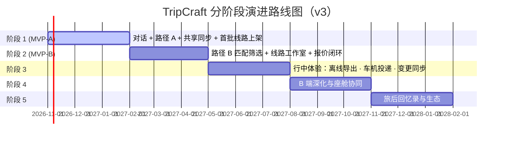

# DLV-01 · 路线图与 MVP 交付边界

## 1. 分阶段实施策略与 MVP 定义

依据产品基线 v3（[PRD-01](../product/PRD-01-vision-positioning.md)），并以待确认决策 **D8** 取代上一版的 D2（"共用核心 + B 端白标最小闭环先行"）：

- **核心逻辑**：产品主线是"对话 → 需求画像 → 双路径 → 多人共享与多端同步"。路径 A（AI 自主规划自驾）不依赖旅行社供给，可以先上线并获客；路径 B（旅行社线路匹配）需要先有供给，所以**阶段 1 同时做两件事：上线 C 端主线（路径 A），并在首个区域签约旅行社、完成线路上架**；阶段 2 在供给达到门槛的区域开放路径 B。
- **为什么不是 B 端先行**：上一版 MVP 以 B 端白标交付为起点，那是"平台不接触终端游客"时的合理选择。新基线下 C 端账号与对话是产品主体，B 端的价值（被匹配、被咨询）依赖 C 端流量，因此两边需要同时启动。

---

## 2. 阶段详细交付范围与标准矩阵

### 阶段 1：对话 + 路径 A + 共享同步 + 首批线路上架（MVP-A）
- **目标用户**：首个区域的种子组织者 (R-C01) 与同行成员 (R-C02)；3–5 家试点持证地接社的定制师 (R-B02) 与管理员 (R-B01)。
- **包含功能**：
  - 对话与模型：`F-M15-01`, `F-M15-03`, `F-M15-04`
  - 澄清与需求画像：`F-M03-01`, `F-M03-02`, `F-M03-03`, `F-M03-04`, `F-M03-05`, `F-M03-06`
  - 路径 A 自主规划：`F-M16-01`, `F-M16-02`, `F-M16-03`
  - 账号与多端：`F-M01-01`, `F-M01-02`, `F-M01-03`, `F-M01-04`
  - 行程工作区：`F-M02-01`, `F-M02-02`, `F-M02-03`, `F-M02-04`
  - 共享与同步：`F-M04-01`, `F-M04-02`, `F-M06-01`, `F-M06-02`
  - 地图与路线：`F-M05-01`, `F-M05-02`
  - 内容与长辈模式：`F-M09-02`, `F-M09-03`
  - 供给冷启动（仅旅行社可见）：`F-M18-01`, `F-M18-02`
  - 资质与合规：`F-M13-01`, `F-M13-02`, `F-M13-03`, `F-M13-04`
- **退出标准 (Definition of Done)**：
  - 种子用户在首个区域完成"对话 → 画像 → 路径 A 方案 → 邀请同行人"的完整流程；
  - 路径 A 草案的事实字段 100% 可追溯到图商；`check-br025` 通过；
  - 同一账号在手机与电脑之间同步行程；离线修改恢复联网后按 ADR-002 合并，冲突有提示；
  - 3–5 家地接社通过资质审核，完成线路导入与上架（数量门槛待定）。
- **前置假设**：`A-13`（用户接受对话式需求收集）、`A-11`（AI 生成 POI 准确）、`A-09`（图商成本可控）、`A-10`（机构接受资质审核）、`A-12`（用户愿意使用账号与同步）。
- **关键风险**：对话追问劝退用户；走廊检索的图商调用成本；旅行社导入意愿。
- **所需能力类型**：全栈 Web / 移动端研发、LLM 编排与校验管线、地图服务集成、旅行社 BD。
- **★ 本阶段明确不做什么 (Non-Goals)**：
  - 不对旅客开放路径 B（线路只上架、不匹配）；
  - 不做自带模型 API；
  - 不做单文件离线导出与车机投递；
  - 不做路线动画；
  - 不做站内交易，不经手团款。

---

### 阶段 2：路径 B 匹配与筛选 + 线路工作室 + 报价闭环（MVP-B）
- **目标用户**：首个区域中希望找旅行社的旅客 (R-C01)、试点旅行社 (R-B01/R-B02)、成交旅客 (R-B04)、平台运营 (R-P01)。
- **包含功能**：
  - 路径 B 匹配与筛选：`F-M17-01`, `F-M17-02`, `F-M17-03`, `F-M17-04`, `F-M17-05`, `F-M17-06`, `F-M17-07`
  - 线路工作室：`F-M18-03`, `F-M18-04`, `F-M18-05`, `F-M18-06`
  - 白标交付与订阅：`F-M11-01`, `F-M11-02`, `F-M11-03`, `F-M12-01`
  - 分享与提醒：`F-M08-02`, `F-M14-01`
  - 自带模型 API：`F-M15-02`
  - 体验增强：`F-M16-04`, `F-M02-05`, `F-M04-03`, `F-M04-04`, `F-M04-05`
- **退出标准**：
  - 🔴 **前置门槛：OI-021 律师意见已出具**，且按意见完成整改，方可对公众开放路径 B；
  - 首个区域对旅客开放路径 B；匹配结果可复现，每个匹配度可展开分项；
  - 跑通"筛选 → 调整 → 咨询 → 报价版本 → 成交 → 白标路书进入行程空间"闭环；
  - 匹配度分段与咨询率的关系可被统计（A-15 开始积累数据）。
- **前置假设**：`A-14`（旅行社接受匹配与价格筛选）、`A-15`（匹配度说得准）、`A-17`（旅行社愿意付费）、`A-18`（AI 路书提升咨询）。
- **★ 本阶段明确不做什么**：
  - 不做站内交易与资金托管（D6）；
  - 不做付费推广位；
  - 不做"把我的方案发给多家旅行社报价"（[docs/16 §16.9](../16-planning-paths-and-route-matching.md#169-两条路径的互通)）；
  - 不做高频并发打字协同（OT/CRDT）。

---

### 阶段 3：行中体验——离线导出、车机投递、变更同步
- **目标用户**：自驾团队 (R-C01/R-C02)、长辈 (R-C03)、随团司导 (R-B03)。
- **包含功能**：
  - 离线单文件与打印：`F-M08-01`, `F-M08-03`
  - 车机深链投递：`F-M07-01`
  - 点对点补丁分发：`F-M06-03`
  - 沿途补给推荐：`F-M05-03`
  - 突发变更触达：`F-M14-02`
  - 足迹打卡：`F-M10-01`
  - 行程皮肤（会员）：`F-M09-01`
  - 旅行社数据看板：`F-M18-07`
- **退出标准**：导出的单文件 HTML 在飞行模式下完整可读；断网环境下领队可扫码分发 `TripPatch` 并合并成功。
- **前置假设**：`A-08`（同步模型弱网可用）、`A-05` / `A-06`（车机深链能力）。
- **★ 本阶段明确不做什么**：不做车机原生 APK；不读取车辆 SOC。

---

### 阶段 4：B 端深化与座舱协同
- **目标用户**：规模化地接社、车队调度员、智能汽车车主。
- **包含功能**：
  - 私有特许资源库：`F-M11-04`
  - 车队与随团人员调度：`F-M11-05`
  - 按单加量结算：`F-M12-02`
  - 离线路网与底图包：`F-M05-04`
  - 实时成员信标：`F-M06-04`
  - 车载投屏与副驾屏协同：`F-M07-02`, `F-M07-03`
- **退出标准**：机构私有资源库可被定制师复用；主流车载投屏系统上横屏联动可用，驾驶状态安全锁有效。
- **★ 本阶段明确不做什么**：绝不接入车辆 CAN 总线；绝不承诺干预 NOA。

---

### 阶段 5：旅后回忆录与生态扩展
- **目标用户**：完成行程的旅客、生态合作伙伴。
- **包含功能**：
  - 照片 EXIF 时序匹配：`F-M10-02`
  - AI 回忆录与短视频：`F-M10-03`
  - C 端增值结算：`F-M12-03`
- **退出标准**：旅后回忆录主动生成率（目标待定）。
- **★ 本阶段明确不做什么**：不自建短视频社区。

---

## 3. 与上一版路线图的差异

| 项目 | 上一版（2026-10-08） | 本版（v3） |
| :--- | :--- | :--- |
| 阶段 1 主线 | 共用核心 + B 端白标最小闭环 | C 端对话 + 路径 A + 共享同步；同时完成首批线路上架 |
| 多端同步 | 阶段 2 | 阶段 1 |
| 旅行社线路匹配 | 明确不做（"不做公域旅游电商撮合"） | 阶段 2，以 OI-021 律师意见为前置门槛 |
| 单文件离线导出、车机投递 | 阶段 1 | 阶段 3 |
| 白标交付与 SaaS 订阅 | 阶段 1 | 阶段 2（成交后的交付环节） |
| 自带模型 API | 未规划 | 阶段 2 |

---

## 4. v3 优先级调整记录

以下既有功能的优先级或阶段在 v3 中调整（新增功能见 [PRD-04](../product/PRD-04-functional-architecture.md)）：

| 功能 | 调整 | 原因 |
| :--- | :--- | :--- |
| `F-M01-04` 设备与多端漫游 | P1 / 阶段 2 → **P0 / 阶段 1** | 多端同步是产品基线的支柱 3 |
| `F-M06-02` 服务端增量日志同步 | P1 / 阶段 2 → **P0 / 阶段 1** | 同上 |
| `F-M04-02` 结构化提名 | P1 / 阶段 2 → **P0 / 阶段 1** | 多人共享是产品基线的支柱 3 |
| `F-M07-01` 车机深链投递 | P0 / 阶段 1 → **P1 / 阶段 3** | 车机投递降为支撑能力 |
| `F-M08-01` 单文件 HTML | P0 / 阶段 1 → **P1 / 阶段 3** | 离线快照降为支撑能力 |
| `F-M08-02` 只读分享链接 | P0 / 阶段 1 → **P0 / 阶段 2** | 与白标交付同期 |
| `F-M09-01` 行程皮肤（会员） | P0 / 阶段 1 → **P1 / 阶段 3** | 非主线 |
| `F-M11-01` / `F-M11-02` / `F-M11-03` 白标交付 | P0 / 阶段 1 → **P0 / 阶段 2** | 白标交付是成交之后的环节 |
| `F-M12-01` 机构 SaaS 订阅 | P0 / 阶段 1 → **P0 / 阶段 2** | 阶段 1 试点期不收费 |
| `F-M14-01` 关键行程提醒 | P0 / 阶段 1 → **P0 / 阶段 2** | 非 MVP-A 必需 |
| `F-M05-03`、`F-M06-03`、`F-M10-01`、`F-M14-02` | 阶段 2 → **阶段 3** | 归入行中体验阶段 |
| `F-M11-04`、`F-M11-05`、`F-M12-02` | 阶段 3 → **阶段 4** | 归入 B 端深化阶段 |
