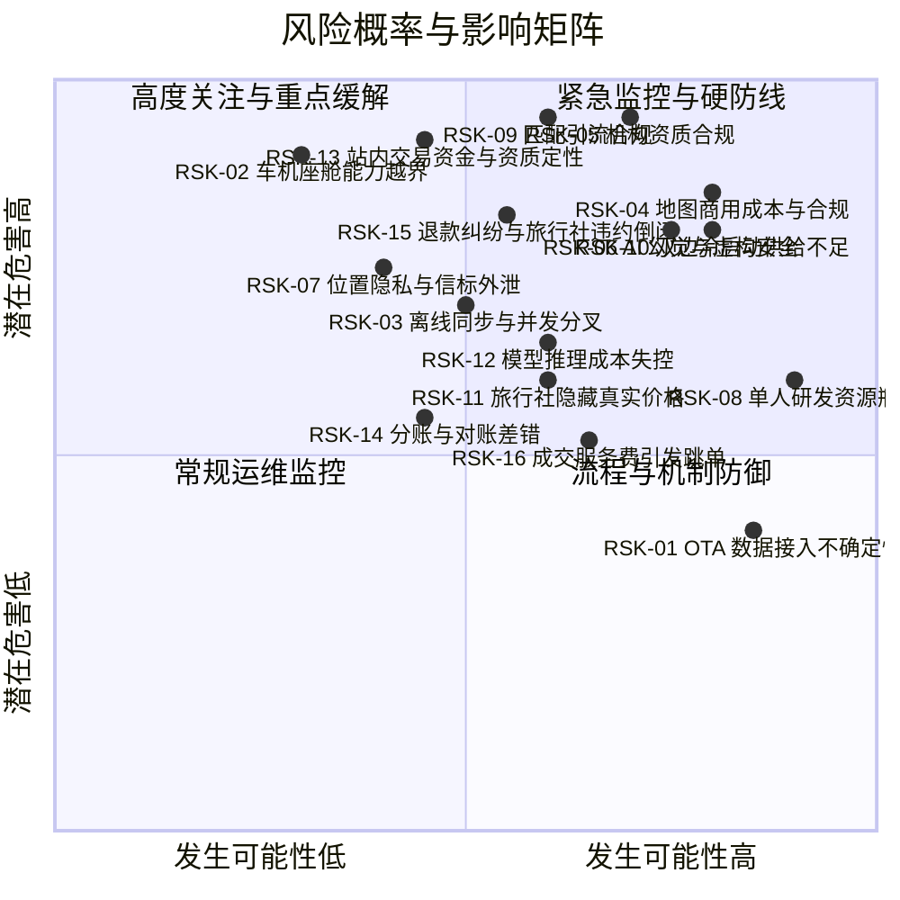

# DLV-02 · 项目风险登记册 (Risk Register)

## 1. 风险全景概览

本风险登记册汇总系统演进中的核心业务、技术、法律与资源风险，与 [假设台账 ASSUMPTIONS.md](../ASSUMPTIONS.md) 及 [架构决策 ADR](../architecture/ARC-09-adr-index.md) 互相闭环追溯。

---

## 2. 核心风险条目清单

| 风险 ID | 风险类别 | 风险情景与危害描述 | 可能性 | 影响度 | 核心缓解与应对措施 | 关联假设 / ADR |
| :--- | :--- | :--- | :---: | :---: | :--- | :--- |
| **RSK-01** | 商业依赖 | **OTA 数据接入不确定性**：主流 OTA 平台未开放公开返佣 API 或封禁外链，导致 CPS 变现通道受阻。 | **H** | **M** | 将 OTA 外链定位为辅助参考；商业主线是旅行社工作室订阅与线索包（PRD-05）。 | [A-01](../ASSUMPTIONS.md), [PRD-05](../product/PRD-05-business-model.md) |
| **RSK-02** | 合规宣称 | **车机路径能力边界越界**：宣传或设计中夸大 NOA 接管、SOC 读取或原生车机适配，引发虚假宣传与用户安全责任。 | **L** | **H** | 严格以 [docs/ERRATA.md](../ERRATA.md) 为准绳；在 README 与 PRD 显著位置声明“深链投递 + 投屏镜像”边界，禁止越权承诺。 | [ERRATA](../ERRATA.md), [PRD-01](../product/PRD-01-vision-positioning.md) |
| **RSK-03** | 技术复杂 | **离线同步与版本分叉失控**：长周期离线导致团队成员版本严重分叉，自动合并破坏已商定的行程秩序。 | **M** | **H** | 坚决不使用不可控的无中心纯数学 CRDT；采用服务端权威日志；离线以增量 TripPatch 二维码点对点分发，坚持领队拍板。 | [A-08](../ASSUMPTIONS.md), [ADR-002](../architecture/adr/ADR-002-sync-conflict-model.md) |
| **RSK-04** | 法律与成本 | **地图商业授权与合规风险**：图商商业授权资费过高，或开发不慎将算路密集 polyline 内联落库导致侵权封禁。 | **H** | **H** | 封装 S-GEO 适配层隔离图商；设置本地 POI 缓存减少请求；CI 持续运行 `check-br025.mjs` 强制拦截违规密集点串。 | [A-09](../ASSUMPTIONS.md), [ADR-005](../architecture/adr/ADR-005-map-navigation-abstraction.md) |
| **RSK-05** | 法律红线 | **机构无证经营连带法律风险**：无旅行社资质的“黑车队/野领队”利用平台组合排程并向游客收款，平台被认定提供便利连带查处。 | **H** | **H** | 协作层绝不提供收款能力 (R1)；严格执行 S-OPS 入驻资质审核，对无资质机构仅开放交通路况模版，限制生成全包旅行产品。 | [A-10](../ASSUMPTIONS.md), [ARC-06](../architecture/ARC-06-multitenancy-whitelabel.md) |
| **RSK-06** | 安全与AI | **AI 幻觉推荐危险未开发野景点**：大模型生成虚构路线或推荐高危无人区野景点，导致自驾游客被困甚至伤亡。 | **H** | **H** | 建立四级确定性防护管线：大模型仅做草案提取；所有景点必须经由合规图商官方 POI 强核验；扫描黑名单；未核验项标“同行者提议”。 | [A-11](../ASSUMPTIONS.md), [ADR-008](../architecture/adr/ADR-008-ai-generation-guardrails.md) |
| **RSK-07** | 隐私合规 | **实时位置信标泄露与跟踪滥用**：车队信标遭恶意监听或未授权访问，侵犯旅客行动轨迹隐私。 | **M** | **H** | 实时经纬度采用独立通信信令通道，绝不写入永久 DSL；提供硬性常驻“隐身模式”开关；非行驶状态实施 500m 网格模糊化。 | [ARC-03](../architecture/ARC-03-offline-sync.md), [ARC-07](../architecture/ARC-07-security-privacy-compliance.md) |
| **RSK-08** | 资源限制 | **单人/小团队开发资源瓶颈**：多端形态庞大（手机、车机、iPad、Web），单人精力分散导致全线延期。 | **H** | **M** | 严格实施 DLV-01 v3 的阶段裁剪：阶段 1 只做对话、路径 A、共享同步与首批线路上架；路径 B 在阶段 2；离线导出、车机、回忆录推迟至阶段 3~5。 | [DLV-01](DLV-01-roadmap-mvp.md), [ADR-001](../architecture/adr/ADR-001-client-framework.md) |
| **RSK-09** | 法律红线 | **匹配引流的合规边界**：做线路匹配后平台很可能被认定为在线旅游平台经营者；若审核不严为无证主体引流，或排序、广告、个人信息提供不合规，将面临处罚。 | **M** | **H** | 只上架持证旅行社线路；付费不入匹配度、推广标注「广告」；咨询时用户确认信息发送范围；**OI-021 律师意见出具前不对公众开放路径 B**。 | [ADR-010](../architecture/adr/ADR-010-route-matching-scoring.md), [docs/17 §17.10](../17-agency-route-studio.md#1710-合规要点全部待执业律师核验) |
| **RSK-10** | 商业冷启动 | **双边冷启动供给不足**：路径 B 开放时线路太少，空结果多，用户形成「没东西」的印象。 | **H** | **H** | 按区域点燃：阶段 1 先签约并上架；路径 B 按区域达到门槛后才开放；空结果时提供路径 A 入口并统计供给缺口。 | [PRD-05 §4](../product/PRD-05-business-model.md#4-获客与冷启动策略-gtm--pilot-plan), [A-14](../ASSUMPTIONS.md) |
| **RSK-11** | 商业信任 | **旅行社隐藏真实价格或不愿上架**：担心被比价、被平台截流（docs/13 §13.3.3 的原始担忧）。 | **M** | **M** | 价格展示粒度由旅行社选择；成本价永不展示；客户归属六条规则写入入驻协议。 | [docs/17 §17.8](../17-agency-route-studio.md#178-客户归属与旅行社的顾虑), [A-14](../ASSUMPTIONS.md) |
| **RSK-12** | 成本与安全 | **模型推理成本失控 / 自带 Key 泄露**：C 端对话成为主入口后推理成本随用户量线性增长；自带 Key 若被上传或打印到日志会造成用户损失。 | **M** | **M** | 追问 ≤ 3 轮；平台模型设免费额度；自带 Key 只存设备、服务端无字段、CI 扫描日志。 | [ADR-009](../architecture/adr/ADR-009-llm-provider-byok.md), [A-16](../ASSUMPTIONS.md) |
| **RSK-13** | 法律红线 | **站内交易的资金与资质定性（D6）**：做站内交易时，若团款先进入平台账户再结算给旅行社（俗称「二清」），或平台被认定向旅客收取旅游费用，可能构成未经许可变相从事支付业务或经营旅行社业务；电子合同工具与按成交收费的定性也待律师确认。 | **M** | **H** | 任何阶段都不做平台自行代收代付（方案 D）；站内交易只考虑「电子合同 + 核实成交、不经手资金」（方案 B）或持牌支付机构分账（方案 C），平台账户只收服务费；律师意见（OI-025，与 OI-021 同一次咨询）出具前不开发 `F-M12-04`；方案 C 上线前由律师与持牌机构共同审查资金路径。 | [D6 决策材料](../product/DEC-D6-onsite-transaction.md#41-平台的法律身份与资质), [docs/03 §3.7.1](../03-b2b-agency-operations.md#371--首要合规约束平台不经手游客资金) |
| **RSK-14** | 资金与运营 | **分账失败、退款冲正与对账差错（方案 C）**：旅行社账户冻结或注销导致分账失败、钱滞留在持牌机构；部分退款、定金加尾款多笔支付让对账对不上；服务费发票开错对象。小团队的运营与财务能力跟不上。 | **M** | **M** | 先做方案 B，把签约与计费流程跑顺；方案 C 只在一个区域、少数旅行社试点；每日自动对账并生成差错工单；分账失败时不得把钱转入平台账户「代管」；支付不可用时降级为站外付款（方案 B）；开票口径由税务师确认。 | [D6 决策材料](../product/DEC-D6-onsite-transaction.md#47-工程与运营成本), [RSK-08 资源瓶颈](#2-核心风险条目清单) |
| **RSK-15** | 资金与纠纷 | **退款纠纷与旅行社违约、倒闭**：出团前取消、未成团、旅行社违约或倒闭时旅客要求退款；在平台上签约或付款之后，旅客更倾向找平台追责，客服与声誉承压；平台未尽核验义务时可能承担连带责任。 | **M** | **H** | 资质核验与定期复核（`F-M13-01`）；合同与报价版本留痕；明示平台不是合同当事人，不使用「平台担保」等表述；公示投诉渠道并协助维权；方案 C 优先考虑分段或延迟结算，退款路径写进协议；是否对旅客作出先行赔付承诺由业主另行决定。 | [D6 决策材料](../product/DEC-D6-onsite-transaction.md#42-资金与退款出了事谁担责), [docs/17 §17.2](../17-agency-route-studio.md#172-入驻前提) |
| **RSK-16** | 商业信任 | **成交服务费引发跳单与价格失真**：收取成交服务费后，旅行社把客户引到站外签约付款，或抬高报价转嫁费用（docs/13 §13.3.3 的原始担忧）。 | **M** | **M** | 设上限；只对平台带来的成交收费；费率与逐单明细对旅行社公开；旅客价格不加价；服务费与是否在站内签约都不影响匹配度；开始收费前先免费试行一个季度，测出不收费时的站内签约率；按 A-20 监测站内签约率与同线路报价变化，触发退出条件即停收成交服务费。 | [A-20](../ASSUMPTIONS.md), [A-14](../ASSUMPTIONS.md), [D6 决策材料](../product/DEC-D6-onsite-transaction.md#72-分步走与退出条件) |

---

## 3. 风险审查与动态跟踪机制

1. **双周合规巡检**：定期更新文旅部无证经营查处新案例与图商商用条款变更。
2. **假设台账联动**：每当完成 3–5 家机构试点访谈，立即在 [docs/ASSUMPTIONS.md](../ASSUMPTIONS.md) 中核销对应假设，并在本册调整风险等级。
3. **D6 相关风险**（RSK-13 ~ RSK-16）：D6 定案前每季度复核一次；定案后按所选方案调整可能性与缓解措施（未选方案 C 时，RSK-14 不适用）。
