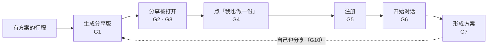
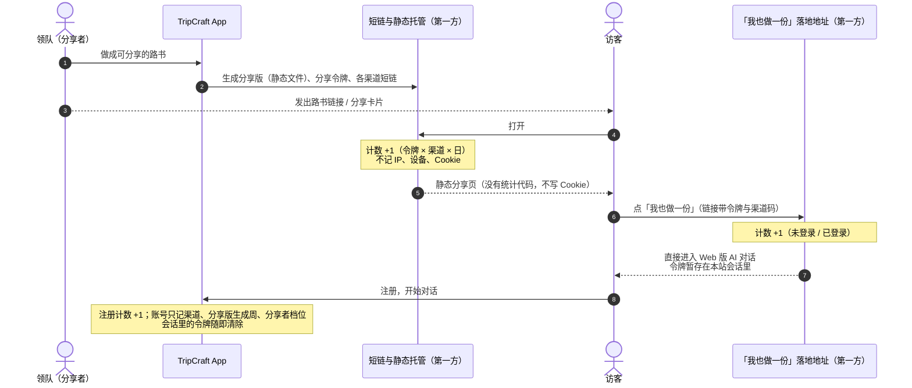
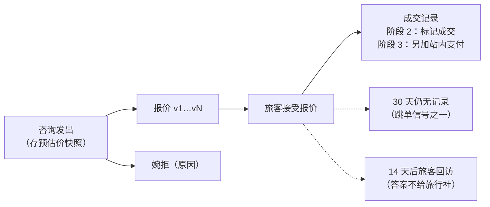

# DLV-04 · 假设验证的指标与数据收集方案（A-19 · A-20）

> **一句话**：阶段 2 一上线，就用平台自己的统计（第一方统计）开始积累两条假设的验证数据——[A-19](../ASSUMPTIONS.md)（免费的可分享个性化路书能不能持续带来新用户）与 [A-20](../ASSUMPTIONS.md)（成交服务费会不会把客户推到站外、会不会抬高报价）。默认不收集个人信息。文中所有阈值都是**建议值，待业主确认**；所有法规引用**需律师确认**（[docs/07 §7.0](../07-legal-and-compliance.md#70-先声明本章不是法律意见)）。

---

## 0. 先说清楚

### 0.1 这份文档管什么

| 管 | 不管 |
| :--- | :--- |
| 两条假设拆成哪些指标、每个指标怎么算；要记录哪些数据、为什么要记；隐私与合规怎么做；建议的通过 / 淘汰标准；阶段 2 上线前的准备清单 | 不填写证据与结论（按 [ASSUMPTIONS](../ASSUMPTIONS.md) 的维护规则由业主填写）；不决定 D6（站内交易）；不定服务费的费率与上限（待询价 / 待验证）；不写其他假设的口径——A-13 画像完成率、A-15 匹配度校准等指标（[docs/16 §16.11](../16-planning-paths-and-route-matching.md#1611-指标与验收)、[PRD-05 §5](../product/PRD-05-business-model.md#5-指标体系建议北极星与核心运营指标)）共用同一套统计能力（`F-M13-05`），口径另行补充 |

### 0.2 一页摘要

| 假设 | 要回答的问题 | 核心指标 | 什么时候开始收 | 建议的判定（详见 [§5](#5-通过--淘汰标准建议待业主确认)） |
| :--- | :--- | :--- | :--- | :--- |
| **A-19** | 分享出去的路书，会不会让看到的人也来做一份，而且能持续下去？ | 分享获客占比（G9）、每 100 个分享版带来的新用户方案数（G8）、二代分享率（G10） | 阶段 2 上线当天（分享卡片、路书链接）；路线动画阶段 3 起 | **通过**：上线第 3 周起连续 8 周，G9 ≥ 30% 且不下降，二代分享率不低于其他新用户的一半。**淘汰**：样本足够后 G9 < 10%、来源自报也 < 10%，且两轮改版后仍 < 10% |
| **A-20** | 收了成交服务费以后，旅行社会不会把客户拉到站外成交、会不会把价格抬上去？ | 接受报价后 30 天无成交记录率（T6）、平台记录缺失率（T7）、站内支付占比（T15）、报价/预估比（T10）、上架参考价变化（T12） | 阶段 2 上线当天收「没有服务费时」的基线；D6 决定前做访谈；阶段 3 按 [§3.6](#36-阶段-3-的对照设计以-d6-为前提) 分两步对照 | **访谈**：过半接受、且至少 2 家愿签试点意向，才开发 `F-M12-04`。**收费后 ≥ 12 周**：跳单类指标变化 ≤ 10 个百分点、价格相对上涨 < 实际费率的一半 → 通过；变化 > 20 个百分点或价格相对上涨 ≥ 实际费率 → 淘汰 |

### 0.3 四条原则

| 原则 | 做法 | 为什么 | 不这样做会怎样 |
| :--- | :--- | :--- | :--- |
| **① 能用业务记录算的，不另外埋点** | 分享版、咨询、报价、成交这些记录本来就要存，指标尽量从它们算；只补业务记录里没有的几样：打开与点击的计数、新账号的来源、几个里程碑日期、成交回访 | 少收一样数据，就少一样要告知、保管和删除的东西（《个人信息保护法》第六条：最小必要） | 全量行为埋点：数据多到没人看，隐私政策越写越长，泄露面越来越大 |
| **② 默认不收集个人信息** | 分享来源只用分享令牌归因，不带分享者身份，新账号上连令牌都不存；分享页不写 Cookie、不放统计代码；导出的单文件路书不埋点；对外只出汇总 | [铁律 4 数据主权本地化](../00-overview-and-glossary.md#铁律-4--数据主权本地化-local-data-sovereignty)；行程本身就是行踪轨迹，属于敏感个人信息（[docs/07 §7.4.1](../07-legal-and-compliance.md#741--最重要的一点行踪轨迹是敏感个人信息)） | 统计库变成「谁带来了谁、谁要去哪」的关系图，比业务库还敏感 |
| **③ 只观察，不处罚** | 疑似站外成交、报价变化的信号只做汇总评估，用来判断 A-20 和调整计费方式；不处罚旅客，不进匹配度，不自动处罚旅行社 | `F-M12-04` 验收标准 5；[ADR-010](../architecture/adr/ADR-010-route-matching-scoring.md) 规定匹配度只反映适合程度；一旦用来处罚，旅行社会学着不在平台上留痕 | 信号本身失真，A-20 再也测不准；旅客被连带惩罚 |
| **④ 只用第一方统计** | 计数、存储、看板都在平台自己的服务器上；不引入第三方统计 SDK；短链服务自建 | 第三方统计 SDK 会按设备记录访客，触发 [docs/07 §7.4.6](../07-legal-and-compliance.md#746--第三方-sdk-告知义务本项目会触发) 的告知义务；分享页和导出文件里本来就不能有外部请求（[铁律 1](../00-overview-and-glossary.md#铁律-1--零构建交付-zero-build-delivery)） | 访客在不知情的情况下被第三方记录；分享页多了外部请求，弱网下变慢甚至打不开 |

---

## 1. 本文用到的几个词

| 词 | 意思 |
| :--- | :--- |
| **分享版** | 领队点「做成可分享的路书」后生成的只读静态产物（[S-C10](../product/PRD-03-scenarios.md#s-c10-用-ai-做一份可分享的个性化路书传播与获客)）。路书链接、分享卡片上的二维码、路线动画片尾的二维码都指向它 |
| **分享令牌** | 生成分享版时随机生成、专门用于归因的编号，和打开分享页的链接地址分开：单凭它打不开分享页，也查不到是谁分享的 |
| **渠道码** | 访客从哪种分享形态来：`card`（分享卡片 / 海报上的二维码）、`link`（路书链接）、`video`（路线动画片尾的二维码，阶段 3 起） |
| **形成方案** | 路径 A 草案保存进行程空间，或路径 B 向旅行社发出至少 1 条咨询，取先发生的那个。比 [PRD-05 §5](../product/PRD-05-business-model.md#5-指标体系建议北极星与核心运营指标) 北极星指标里的「确定方案」宽（那个要求有同行人加入或报价被接受），两个都报 |
| **成交记录** | 阶段 2：旅行社（或旅客）在平台上标记成交（[§17.7](../17-agency-route-studio.md#177-按需调整与报价闭环)）；阶段 3 起另加站内支付（以 D6 为前提）。成交回访的答案不算成交记录，也不会替任何一方标记成交 |
| **预估价快照** | 旅客发出咨询时，线路详情页按旅行社自己的价格规则算出、显示给旅客的预估价（`F-M18-05`），随咨询一起存下 |
| **上架参考价** | 平台按每条线路自己的价格规则，算一个固定配置的价格（2 位成人、默认选项；有淡旺季日历的分别算）。价格规则每生效一次就重算一次，用来看同一线路上架价的变化 |
| **汇总** | 只有计数、比例、中位数，看不出某一个人或某一单 |

---

## 2. A-19：分享能不能持续带来新用户

### 2.1 要回答的三个问题

1. **分享的人多不多**：有方案的行程里，有多少被做成路书并真正发了出去（G1–G3）。
2. **看的人会不会跟着做**：打开 → 点「我也做一份」→ 注册 → 开始对话 → 形成方案，每一步留下多少人（G4–G7）。
3. **能不能持续**：分享带来的新用户在全部新用户里占多少、会不会随时间下降、他们自己会不会再分享（G8–G10）。

### 2.2 漏斗

### 2.3 指标定义

| 编号 | 指标 | 分子 | 分母 | 时间窗口 | 说明 |
| :--- | :--- | :--- | :--- | :--- | :--- |
| G1 | 分享版生成率 | 其中生成过分享版的行程 | 有方案可分享的行程：路径 A 方案已保存进行程空间，或自己整理的行程（[S-C10](../product/PRD-03-scenarios.md#s-c10-用-ai-做一份可分享的个性化路书传播与获客) 的前提；不含旅行社白标路书） | 方案保存后 14 天内 | 「做成可分享的路书」这个入口有没有人用 |
| G2 | 发出率 | 生成后 30 天内至少被打开过 1 次的分享版 | 生成的分享版 | 生成后 30 天 | 分享面板的按钮点了不代表真的发出去了；「被打开过」是能观察到的最接近「发出去了」的信号（分享者自己打开也会计入，偏高） |
| G3 | 每个分享版的打开数 | 打开次数 | 被打开过的分享版 | 生成后 30 天 | 报中位数与分布，看是不是少数几份分享撑起了大部分打开 |
| G4 | 「我也做一份」点击率 | 点击数 | 打开数 | 同一自然周 | 两个都是汇总计数，比值只是近似（同一个人打开多次会拉低它），只作参考 |
| G5 | 注册率 | 带分享来源注册的新账号 | 未登录访客的点击数 | 点击后的同一次访问 | 已登录的老用户点了不算新用户，单独计数（老用户回流） |
| G6 | 开始对话率 | 注册后 7 天内开始对话的新账号 | 带分享来源的新账号 | 注册后 7 天 | — |
| G7 | 形成方案率 | 注册后 30 天内形成方案的新账号 | 带分享来源的新账号 | 注册后 30 天 | 另报「确定方案」口径 |
| **G8** ★ | 分享产出 | 来自第 W 周生成的分享版、在分享版生成后 30 天内注册、且注册后 30 天内形成方案的新账号 | 第 W 周生成的分享版数 ÷ 100 | 分享版生成后 60 天 | 每 100 个分享版带来几个形成方案的新用户；不设门槛，用来比较渠道和改版效果 |
| **G9** ★ | 分享获客占比 | 第 W 周注册、带分享来源、30 天内形成方案的新账号 | 第 W 周注册、30 天内形成方案的全部新账号 | 注册后 30 天 | 「分享是不是主要获客渠道」直接看它。归因会漏记（[§2.7](#27-盲区会漏记和多记什么)），所以它偏低，要和来源自报对照 |
| **G10** ★ | 二代分享率 | 分享带来、已形成方案的新用户中，30 天内自己也有分享版被打开过的 | 分享带来、已形成方案的新用户 | 形成方案后 30 天 | 与「非分享来源新用户」的同一比例对照，看分享链条能不能自己续下去 |

### 2.4 拆分维度与排除

| 维度 | 取值 | 说明 |
| :--- | :--- | :--- |
| 渠道 | 分享卡片 `card` / 路书链接 `link` / 路线动画 `video` | 阶段 2 只有前两个；路线动画随 `F-M09-04` 在阶段 3 加入。导出的单文件路书与打印版不带渠道码，从那里来的访问算「来源不明」 |
| 分享者档位 | 免费 / 会员 | 会员随 `F-M12-03` 在阶段 3 上线，阶段 2 全部是免费 |
| 角标 | 带 / 去掉 | 「用 TripCraft 制作」角标链到「我也做一份」（[docs/09 §9.0.3](../09-visual-design-system.md#903-免费与会员)）；去掉角标的分享版没有入口，G4 以后单列，不混进免费与会员的对比 |
| 方案来源 | 路径 A / 自己整理的行程 | 看哪类方案更常被分享 |
| 访问口令 | 有 / 无 | 加口令的分享本来就是私密的，转化低属于正常 |
| 访客状态 | 未登录 / 已登录 | 已登录的是老用户回流，单独看 |
| 周 | 自然周 | 按周出数；分母不足 100 时用滚动 4 周（[§5.1](#51-判定的规矩)） |

**不计入**：

- **旅行社白标路书及其分享**：以旅行社品牌包为准，没有 TripCraft 角标与「我也做一份」入口（`F-M09-01` 验收标准 6）；生成时按租户标记直接排除，不发分享令牌、不计数。
- 只在行程成员之间可见的分享（例如内容安全审核没通过的）。
- 旅行社员工账号、平台内部与测试账号。
- 已知爬虫与聊天软件生成链接卡片时的预抓取：按 User-Agent 规则表过滤，规则表随版本维护，看板显示被过滤的请求数。

### 2.5 要记录的数据

访客看到的分享页**不记录任何东西**；导出的单文件路书与打印版**不埋点**（DSL 的 `telemetry` 保持默认关闭，[docs/04 §4.14](../04-dsl-specification-v1.md#414-telemetry--埋点默认全关)）。下面的计数都发生在平台自己的服务器上，或者是登录用户自己账号上的记录。

| 事件 | 触发时机 | 记在哪 | 字段，以及为什么要 | 不记什么 |
| :--- | :--- | :--- | :--- | :--- |
| `share_created` 分享版生成 | 领队点「做成可分享的路书」且生成成功（S-C10 第 1 步） | 业务记录（托管本来就要存），统计只取右列字段 | `share_token`：把之后的打开、点击、注册对回这个分享版 `created_week`：按生成周算 G8 `plan_origin`（路径 A / 自己整理）：看哪类方案更常被分享 `sharer_tier`（免费 / 会员）、`badge`（带 / 去掉）：免费与会员拆分 `passcode`（有 / 无）：私密分享单列 `sharer_acq`（分享者自己是否经分享而来：是 / 否 / 不明）：算 G10，而不需要分享者账号 | 统计里不出现分享者账号、行程目的地与日期、同行人 |
| `share_action` 分享动作 | 在分享面板里复制链接、保存分享卡片、导出路线动画（阶段 3） | 汇总计数（渠道 × 档位 × 日） | `channel`、`sharer_tier`、`date`：各渠道被用了多少次 | 不记谁点的、发给了谁 |
| `share_open` 分享打开 | 平台自建短链被解析、通过爬虫过滤（服务端） | 汇总计数（令牌 × 渠道 × 日），90 天后并成「渠道 × 日」 | `share_token`：G2、G3 `channel`：渠道拆分 `date` | 不记 IP、设备、Cookie、来源页 |
| `make_mine_click` 点「我也做一份」 | 平台的落地地址收到请求（服务端；链接里带分享令牌与渠道码） | 汇总计数（令牌 × 渠道 × 访客状态 × 日），90 天后同上 | `share_token`、`channel` `visitor_state`（未登录 / 已登录）：G5 只用未登录的点击做分母 | 同上 |
| `make_mine_signup` 带来源注册 | 新账号创建时，本站会话里有落地时暂存的分享令牌 | ① 汇总计数（令牌 × 渠道 × 日） ② 新账号上的来源字段 | 计数按令牌：看每份分享带来几个注册 账号上只记 `acq_channel`、`acq_share_week`（那份分享版的生成周）、`acq_sharer_tier`：算 G6–G10 | ★ **新账号上不存分享令牌**：平台查不出「谁带来了谁」；令牌计完数就从会话里清掉 |
| `source_self_report` 来源自报（可跳过） | 注册完成后一屏：「你是怎么知道 TripCraft 的？」 | 账号字段 | `self_source`（朋友发的路书 / 朋友推荐 / 应用商店 / 社交平台上的内容 / 其他 / 跳过）：估计归因漏掉了多少，判定 A-19 前必看 | 不收自由填写的文字 |
| 里程碑 `first_dialog` · `profile_confirmed` · `plan_formed` | 第一次发出需求描述 / 第一次确认需求画像 / 第一次形成方案 | 账号字段（只记第一次） | 日期（精确到日）：G6、G7 `plan_formed` 另记 `plan_kind`（A / B）：看分享来的用户走哪条路径 | 不记对话内容、画像内容、目的地与日期。同一组里程碑也用于 A-13 画像完成率，不重复收集 |

### 2.6 归因怎么做（不带分享者身份）

1. **生成**：平台为分享版随机生成分享令牌，并为每个渠道签发各自的短链（同一份分享版、同一个令牌、不同的渠道码）。白标分享不发令牌。
2. **分享页**：分享版是自包含的静态文件（[docs/15 §15.10.2](../15-multi-device-and-collaboration.md#15102-三条不变量) 不变量 I-2），里面没有统计代码，不写 Cookie，也不在本地存储里写任何访客标识。「我也做一份」是一个普通链接，指向平台自己的落地地址，带上分享令牌与渠道码；实现上可以为每个渠道生成一份只差这一个链接的静态副本，页面里不需要运行任何代码。
3. **打开计数**在短链服务端完成：命中一次 +1，不记 IP 与设备；计数失败不影响跳转（[铁律 3](../00-overview-and-glossary.md#铁律-3--降级不可耻白屏才是罪-degrade-never-blank)）。短链服务自建，不用第三方短链平台（第三方会在中间记录访客）。
4. **点击**：落地地址计数 +1，然后直接进入 Web 版的 AI 对话，不要求先装 App。分享令牌暂存在本站的会话存储里（关掉标签页就清除，不是跨站标识）。
5. **注册**（[S-C01](../product/PRD-03-scenarios.md#s-c01-ai-对话说清需求形成需求画像) 需要登录）：注册计数 +1；新账号记下渠道、分享版生成周、分享者档位；会话里的令牌随即清除。
6. **之后**：「开始对话」「形成方案」都是账号自己的里程碑，在业务库里按来源渠道算成汇总，统计库只收汇总结果。

**分享者看不到什么**：分享面板不显示「谁打开了」「打开了几次」「已查看」——分享层不做已读（[docs/15 §15.10.4](../15-multi-device-and-collaboration.md#15104-分享链路的降级铁律-3-在这里落在哪)），这些计数只用于汇总统计。

### 2.7 盲区：会漏记和多记什么

| 情况 | 影响 | 怎么处理 |
| :--- | :--- | :--- |
| 访客没在网页里注册，而是去应用商店装 App 后注册 | 漏记（来源变成不明） | 「我也做一份」默认进 Web 版对话，不强制装 App；**不做**靠设备指纹或剪贴板的「延迟深链」归因；用来源自报估计漏记规模 |
| 换了设备或浏览器才注册 | 漏记 | 同上 |
| 看了分享，过几天自己搜「TripCraft」来注册 | 漏记 | 来源自报 |
| 分享版被存成文件转发、截图转发 | 打开与点击都漏记 | 接受；单文件不埋点是铁律 1 的要求 |
| 短链不可用时用直链兜底（[§15.10.4](../15-multi-device-and-collaboration.md#15104-分享链路的降级铁律-3-在这里落在哪)） | 打开漏记；点击仍会记上（链接里带着令牌） | G4 只作参考 |
| 同一个人多次打开、分享者自己预览 | 打开多记，G4 偏低 | 判定只用以新账号为单位的 G8、G9、G10 |
| 聊天软件预抓取、爬虫 | 打开多记 | User-Agent 过滤，看板显示过滤量 |

**所以 G9 是下限。** 判定「淘汰」之前必须先对照来源自报（[§5.2](#52-a-19)）。

---

## 3. A-20：成交服务费会不会把客户推到站外、会不会抬价

### 3.1 分阶段要回答什么

服务费要到阶段 3、并以 D6（平台是否经手团款）为前提才有（[PRD-01 §9](../product/PRD-01-vision-positioning.md#9-待业主确认的决策)）。阶段 2 先收「没有服务费时」的基线。

| 时段 | 有没有服务费 | 要回答 | 数据 |
| :--- | :--- | :--- | :--- |
| D6 决定前（阶段 2 期间） | 没有 | 旅行社对费率、上限、公开明细怎么看？ | 试点旅行社访谈（[§3.7](#37-试点旅行社访谈提纲)） |
| 阶段 2 | 没有 | 没有服务费时，咨询 → 报价 → 接受 → 成交确认的转化与时长、报价/预估比、上架价是什么样（基线） | [§3.4](#34-要记录的数据) 的业务记录与成交回访 |
| 阶段 3 第一步 | 有站内支付、暂不收费 | 不收费时，有多少成交愿意走站内支付 | 同上，加站内支付记录 |
| 阶段 3 第二步 | 分批收费 | 收费后，跳单与抬价的信号变了多少（与基线比、与同期未收费组比） | 同上 |
| 如果 D6 决定不做站内交易 | — | A-20 不适用；基线数据继续用于 A-14、A-17 和日常观察 | — |

### 3.2 阶段 2 基线漏斗

### 3.3 指标定义

| 编号 | 指标 | 分子 | 分母 | 时间窗口 | 用途 |
| :--- | :--- | :--- | :--- | :--- | :--- |
| T1 | 报价率 | 至少收到 1 个报价版本的咨询 | 发出的咨询 | 咨询后 7 天 | 基线 |
| T2 | 首次报价时长 | 咨询到第一个报价版本的小时数（中位数） | — | — | 基线；与 [§17.7](../17-agency-route-studio.md#177-按需调整与报价闭环) 展示给旅客的平均响应时长同一来源 |
| T3 | 婉拒率 | 被婉拒的咨询（附原因分布） | 发出的咨询 | 咨询后 7 天 | 基线；原因回流匹配 |
| T4 | 接受率 | 有报价被接受的咨询 | 收到报价的咨询 | 首个报价后 30 天 | 基线 |
| T5 | 成交确认率 | 接受后有成交记录的咨询 | 有报价被接受的咨询 | 接受后 30 / 60 / 90 天 | 基线 |
| **T6** ★ | 接受后无记录率 | 接受后 30 天内没有任何成交记录 | 有报价被接受的咨询 | 接受后 30 天 | 跳单信号 ①（等于 1 − T5 的 30 天值） |
| **T7** ★ | 平台记录缺失率 | 旅客回访答「定了」、但接受后 30 天内平台上仍没有成交记录 | 旅客回访答「定了」 | 接受后第 14 天发问，第 30 天对照 | 跳单信号 ②：唯一不依赖旅行社自报的信号 |
| T8 | 回访回答率 | 回答了的回访（含「不想说」） | 发出的回访 | 发问后 14 天 | 数据质量：低于 30% 时 T7 只作参考 |
| T9 | 提前留联系方式率 | 首个报价之前旅客就同意发送联系方式的咨询 | 发出的咨询 | — | 跳单的前兆信号 ③：沟通更早转到平台外 |
| **T10** ★ | 报价/预估比 | 被接受的报价总额 ÷ 同一咨询的预估价快照（中位数与分布） | — | 只算预估价可算的咨询（标「需咨询」的不算） | 抬价信号 ① |
| T11 | 报价轮次 | 接受前的报价版本数；相邻版本的总额变化 | — | — | 辅助：看议价过程 |
| **T12** ★ | 上架参考价变化 | 每条线路的上架参考价相对基期的变化（取中位数，按月）。阶段 2 看月度变化；阶段 3 的基期是服务费公告前最后一个生效的价格版本 | — | 价格规则每次生效时重算 | 抬价信号 ②：同一线路上架价的变化 |
| T13 | 「分项明细」占比 | 选「分项明细」展示档位（[§17.5.1](../17-agency-route-studio.md#1751-价格展示粒度由旅行社选择)）的在售线路 | 在售线路 | 月末 | 透明度信号（与 A-14 共用） |
| T14 | 下架率 | 当月下架的线路（附原因） | 月初在售线路 | 按月 | 供给信号 |
| **T15** ★ | 站内支付占比（阶段 3） | 经站内支付的成交 | 全部有成交记录的咨询 | 接受后 30 天 | 跳单信号 ④，阶段 3 的主信号 |
| T16 | 实际费率（阶段 3） | 服务费 ÷ 团款（逐单，取中位数） | — | — | 判断价格变化时的参照（有上限时，大单的实际费率更低） |

**拆分维度**：区域（线路所属区域）；价格展示档位；价位段（按预估价分段）；距出发时间（30 天内 / 30–90 天 / 90 天以上）；有无 AI 路书（与 A-18 共用，可选）；阶段 3 起：试验组 / 对照组、收费前 / 收费后。**旅行社**只在平台内部用作对照，不出现在给任何旅行社的报表里（[§17.8](../17-agency-route-studio.md#178-客户归属与旅行社的顾虑) 规则 4）。

### 3.4 要记录的数据

这些几乎都是 `F-M18-02`、`F-M18-05`、`F-M18-06` 本来就要存的业务记录。**新增的只有三样**：预估价快照随咨询存下（[S-B08](../product/PRD-03-scenarios.md#s-b08-回复咨询与透明报价) 第 1 步已经展示预估价，确认存下即可）、上架参考价的计算、成交回访。

| 事件 | 触发时机 | 统计用的字段，以及为什么要 | 不进统计 |
| :--- | :--- | :--- | :--- |
| `inquiry_sent` 咨询发出 | 旅客确认发送范围并发出咨询（`F-M18-06`） | `listing_id`、`agency_id`、`region`：分组与对照 `display_tier`：透明度拆分 `estimate_total`（预估价快照，「需咨询」时为空）：T10 `lead_time_bucket`（距出发分段）：成交需要的时间不同 `sent_week` | 旅客账号、姓名、联系方式、确切出行日期、同行人构成与年龄、健康信息、留言原文 |
| `contact_shared` 同意发送联系方式 | 旅客在咨询里同意把联系方式发给该旅行社 | `before_first_quote`（是 / 否）：T9 | 联系方式本身 |
| `quote_issued` 报价版本 | 定制师保存一个报价版本（只增不改） | `version_no` `hours_since_inquiry`（只记间隔，不记时刻）：T1、T2 `total_amount`：T10、T11 | 分项明细原文（统计只用总额） |
| `inquiry_declined` 婉拒 | 定制师婉拒并选择原因 | `reason_code`：T3 | 补充说明文字 |
| `quote_accepted` 接受报价 | 旅客接受某一版报价 | `version_no`、`days_since_inquiry`：T4 | — |
| `deal_marked` 标记成交 | 旅行社或旅客在平台上标记成交 | `marked_by`（旅行社 / 旅客）、`days_since_accept`：T5、T6 | 合同与付款凭证（不在平台上） |
| `outcome_check` 成交回访 | 报价被接受 14 天后，旅客端这条咨询的页面出现一次性问题，可跳过 | `answer`（定了 / 没定 / 还在谈 / 不想说）、`days_since_accept`：T7、T8 | 答案不给旅行社看；不发短信、不打电话 |
| `listing_price_version` 上架价格版本 | 线路价格规则通过审核生效 | `ref_price`（上架参考价）、`display_tier`、`effective_week`：T12、T13 `change_reason`（可选：成本变化 / 季节 / 产品调整 / 其他）：解释变化 | — |
| `listing_status` 上下架 | 线路下架或重新上架 | `status`、`reason_code`、`week`：T14 | — |
| `fee_terms`（阶段 3） 服务费条款 | 旅行社签署或变更服务费条款 | `terms_version`、`effective_date`、`group`（试验组 / 对照组）：确定谁从哪天开始收费 | — |
| `onplatform_payment`（阶段 3） 站内支付 | 团款经持牌支付机构分账完成 | `amount`、`fee_amount`、`days_since_accept`：T15、T16 | 支付账户信息 |

**统计副本**：每天从业务库抽一份去标识化的咨询级副本——咨询编号换成随机编号（对照表只留在业务库）、去掉全部旅客字段、时刻换成间隔或周。只用于分布与对照分析，保存期限见 [§4.3](#43-保存多久)。

### 3.5 怎样发现站外成交与报价变化

| 信号 | 能说明什么 | 不能说明什么 |
| :--- | :--- | :--- |
| T6 接受后 30 天无记录 | 接受了报价，却没有在平台上留下成交 | 可能只是还没签、旅客改了主意、旅行社忘了标记；阶段 2 本来就是站外签约 |
| T7 平台记录缺失率 | 旅客自己说定了，平台上却没有记录——最接近「站外成交」的信号 | 回答率低时有偏差；旅客可能记错 |
| T9 提前留联系方式 | 沟通更早转到了平台外 | 很多旅客本来就喜欢电话沟通 |
| T15 站内支付占比 | 成交了但没走站内支付 | 阶段 3 才有；站内支付本身可能不好用（所以要有不收费的第一步） |
| T10 报价/预估比 | 报价相对旅行社自己公开的价格规则是不是高了 | 预估价本来就可能漏算满房等现实约束，旅客也可能中途改需求，所以只看组间与前后的差异，不看单笔 |
| T12 上架参考价 | 旅行社是不是把公开价格整体调高了 | 成本与季节也会推高价格，所以要和同期对照组比 |
| T13 / T14 档位与下架 | 收费后是不是更不愿意透明，甚至退出 | 也受其他因素影响，要结合访谈 |

**用这些信号时的五条规矩**：

1. **只看汇总**：所有信号按区域、档位、组别汇总，不生成「某位旅客跳单」的名单，也不把信号挂到旅客账号上。
2. **不处罚旅客**：信号不影响旅客的账号、功能、匹配结果和任何咨询；成交回访的答案不给旅行社（`F-M12-04` 验收标准 5）。
3. **不进匹配度**：任何信号都不进入匹配度计算（[ADR-010](../architecture/adr/ADR-010-route-matching-scoring.md)：匹配度只反映适合程度，与付费、服务费无关）。
4. **不自动处罚旅行社**：单家旅行社的异常只由平台运营回访了解原因。是否在合作协议里约定「平台带来的成交须走站内支付」，属于 D6 的配套设计，须先听律师意见——《中华人民共和国电子商务法》第三十五条规定平台不得对平台内经营者与其他经营者的交易等进行不合理限制或者附加不合理条件（适用性需律师确认）。
5. **规则公开**：统计用途写进旅行社入驻协议；服务费规则按 [§3.6](#36-阶段-3-的对照设计以-d6-为前提) 第 3 条公示。

### 3.6 阶段 3 的对照设计（以 D6 为前提）

1. **第一步 · 只开站内支付、不收费**：至少 6 周（建议）。得到不收费时的站内支付占比（T15 基线），把「站内支付好不好用」和「服务费」两件事分开。
2. **第二步 · 分批开服务费**：按区域或签约批次分成两组，先开的是试验组，晚开（至少 12 周，建议）的是对照组；对照组的旅行社事先知情。比较两组变化之差（同期对照），可以扣掉季节与市场的共同影响。
3. **提前公示**：费率、上限与生效日期写进合作协议与平台规则，生效前公示。《中华人民共和国电子商务法》第三十三条、第三十四条对公示平台服务协议与交易规则、修改前公开征求意见并至少在实施前七日公示有规定；市场监管总局、国家网信办 2025 年 12 月公布、2026 年 2 月 1 日起施行的《网络交易平台规则监督管理办法》对规则公示、征求意见与过渡期另有规定。具体期限需律师按现行文本确认（电子商务法 2026 年已有修订草案公开征求意见，条序可能调整）。
4. **只能一次全开时**：只做收费前后对比，要扣除季节因素，可信度更低，更依赖访谈与回访。
5. **观察期**：收费后至少 12 周（建议）；跨进阶段 4 也没关系，A-20 的结论不卡阶段 3 的退出。

### 3.7 试点旅行社访谈提纲

**怎么访**

- **对象**：首个区域全部试点旅行社的负责人（R-B01）和一位常回复咨询的定制师（R-B02）；如果约得到，再加 2–3 家非试点旅行社，避免只听合作伙伴的声音。
- **时间**：阶段 2 期间、D6 决定之前；每家 45–60 分钟。
- **规矩**：
  - 开场讲清楚：服务费还没定，这次是听意见；不承诺任何费率与条件。
  - 我们不先报数字，先让对方说。需要给参照时，用业主事先拟定的候选方案（费率与上限待询价 / 待验证，本文不写数字）。
  - 多问做过的事，少问假设的事：「上一单是怎么收款的」好过「如果……你会不会……」。
  - 匿名记录：笔记用机构代号；录音须对方同意；不向其他旅行社透露任何一家的说法。
  - 不评判：对方说会把客户拉到站外，照实记下——这正是要验证的。

**提纲**

一、现状（约 10 分钟）

1. 现在的客户主要从哪里来？各渠道大概各占多少？（请对方估计，不追问精确数字）
2. 给哪些渠道付过佣金或服务费？按什么方式收（比例、固定、按线索）？有没有上限？（只记对方的说法，未核实前不写进文档当事实）
3. 一单从客户问价到签约付款，通常走几步、用多久？定金和尾款怎么收？
4. 什么情况下会调整报价？最近一次调价是因为什么？

二、对站内交易的看法（约 10 分钟）

5. 如果平台提供站内支付（经持牌支付机构分账，平台不设资金池），对您有什么好处、有什么麻烦？
6. 现在从平台来的客户，在哪里签约付款？为什么？
7. 平台知道您的成交信息，您有什么顾虑？

三、成交服务费的接受度（约 15 分钟）

8. 如果平台对经站内成交的订单收服务费，您觉得按什么方式收合理：团款比例、每单固定、比例加上限，还是别的？为什么？
9. 依次问四个问题，请对方各给一个数：费率低到多少，会让您怀疑平台的服务不靠谱？多少算划算？多少开始觉得贵、但还能接受？多少贵到不会走站内成交？
10. 上限设在多少，才让您对大单放心？
11. 平台提供哪些服务，这笔费才收得值（例如咨询质量、报价工具、电子合同、对账、纠纷处理）？
12. 这笔费用您打算怎么消化：自己承担、调整报价，还是看情况？（照实记录）

四、对公开明细的顾虑（约 10 分钟）

13. 服务费的费率与上限会写进合作协议和平台规则，平台规则按法律要求要对外公示；每一单扣了多少，在工作室里逐单可查。哪一部分让您有顾虑？
14. 您担心旅客知道平台收服务费以后，会要您打折，或者提出到站外交易吗？
15. 您最担心同行看到什么？平台承诺不向任何旅行社提供其他旅行社的价格与咨询数据（[§17.8](../17-agency-route-studio.md#178-客户归属与旅行社的顾虑) 规则 4），这条能不能打消顾虑？
16. 收了服务费以后，您还愿意在线路详情里用「分项明细」展示价格吗？

五、行为意向（约 5 分钟）

17. 如果收服务费，从平台来的客户，您会建议他们到站外签约吗？什么情况下会？
18. 什么样的规则，会让您愿意把平台带来的成交都放在站内？

六、收尾（约 5 分钟）

19. 愿意参加阶段 3 的服务费试点吗？愿意的话，能否签一份不具约束力的试点意向？
20. 平台会用咨询与报价的状态、时间与金额做汇总统计，并在旅客接受报价后问一句「定了没有」（答案不给旅行社看）。您能接受吗？有什么顾虑？

**记录模板**（每家一份）

| 项目 | 内容 |
| :--- | :--- |
| 机构代号 / 访谈日期 / 访谈人 / 受访角色 | |
| 现有渠道与付费方式（对方原话摘要） | |
| 偏好的计费方式与理由 | |
| 第 9 题四个数（怀疑 / 划算 / 贵但能接受 / 不会走站内） | |
| 可接受的上限 | |
| 对公开明细的顾虑（原话） | |
| 会不会站外成交、会不会调价（原话） | |
| 归类 | 接受 / 有条件接受（条件：……）/ 不接受 |
| 是否愿签试点意向 | 是 / 否 / 再说 |

> ⚠️ 访谈结论只用于两件事：判断要不要开发 `F-M12-04`、给业主拟定试点的候选费率区间。它不是「旅行社接受服务费」的证据——真正的检验是阶段 3 的行为数据。

---

## 4. 隐私与合规

### 4.1 每样数据怎么处理

| 数据 | 是不是个人信息 | 在哪里告知 | 要不要同意 | 去标识化与汇总 |
| :--- | :--- | :--- | :--- | :--- |
| 按渠道的打开、点击、注册汇总（不含 IP、设备、Cookie） | 不是（汇总计数） | 分享页页脚一句（[§6.2](#62-文案) C1）+ 隐私政策 | 不需要 | 本身就是汇总 |
| 按分享令牌的计数（每份分享版被打开、被点「我也做一份」、带来注册的次数） | 对访客不是；对分享者，经托管记录能对应到人，按去标识化的个人信息对待 | 隐私政策（写给分享者：只计次数，不记打开的人是谁，也不显示给你） | 随隐私政策同意 | 统计库里没有分享者账号；90 天后去掉令牌这一维 |
| 短链与托管服务的访问日志（含 IP） | 是 | 隐私政策「安全日志」 | 不需要单独同意：为履行法定义务所必需（《个人信息保护法》第十三条第一款第（三）项，需律师确认） | 只用于安全，不进统计 |
| 新账号的来源字段（渠道、分享版生成周、分享者档位） | 是（挂在账号上） | 注册页一句（C2）+ 隐私政策「我们自己收集的信息」 | 随隐私政策同意；设置里可随时关闭（第十五条：撤回同意） | 只出汇总 |
| 来源自报 | 是 | 问题本身 | 自愿作答，可跳过 | 只出汇总 |
| 里程碑日期（开始对话、确认画像、形成方案） | 是 | 隐私政策 | 随隐私政策同意 | 只出汇总 |
| 咨询、报价、成交的业务记录 | 是（与旅客账号关联） | 隐私政策 + 旅行社入驻协议 | 提供服务所必需（第十三条第一款第（二）项，需律师确认） | 统计副本去掉全部旅客字段 |
| 咨询级统计副本 | 是（去标识化后仍是个人信息） | 同上 | 同上 | 随机编号、时刻改间隔或周、无旅客字段 |
| 成交回访答案 | 是 | 问题旁的说明（C4） | 自愿作答，可跳过 | 不给旅行社；统计只用答案与天数 |
| 上架价格版本、线路状态 | 不是（旅行社的经营信息） | 旅行社入驻协议 | — | 不向其他旅行社提供 |
| 服务费条款、站内支付记录（阶段 3） | 支付记录含个人信息 | 隐私政策 + 支付服务协议 | 履行合同所必需 | 统计只用金额与天数 |

**统计里一律不用**：姓名、手机号、证件号、行程的目的地与日期（行踪轨迹）、同行人构成与年龄、健康信息、不满十四周岁未成年人的信息、对话与留言原文、提名理由、照片、IP 与设备标识、精确位置。所以统计不需要为敏感个人信息另取单独同意（《个人信息保护法》第二十八条、第二十九条）；也不因统计向旅行社提供任何旅客的个人信息（第二十三条）。

### 4.2 哪些需要同意、在哪里告知

- **分享页的访客**：不收集个人信息，不需要同意；页脚一句话告知。
- **新账号的来源**：隐私政策写明，经分享来的新用户在注册页再看到一句提示；可以在「设置 → 隐私」随时关闭，关闭后清除来源字段、以后不再统计。**本方案默认不做单独勾选**——字段只有三个、不含分享者身份、不是敏感个人信息、可随时关闭；是否需要单独勾选，需律师确认（第十三条、第十四条）。
- **来源自报、成交回访**：自愿作答，问题旁写明用途；跳过不影响任何功能。
- **里程碑日期**：属于产品运行与汇总统计，隐私政策写明。
- **旅行社**：入驻协议写明统计用途与边界（与 [§17.8](../17-agency-route-studio.md#178-客户归属与旅行社的顾虑) 的六条规则写在同一份协议里）；阶段 3 的服务费条款另签。

### 4.3 保存多久

《个人信息保护法》第十九条要求保存期限为实现处理目的所必要的最短时间。以下期限均为建议：

| 数据 | 保存期限（建议） | 到期怎么办 | 为什么是这个期限 |
| :--- | :--- | :--- | :--- |
| 按令牌的打开 / 点击 / 注册计数 | 90 天 | 并成「渠道 × 日」汇总，删掉令牌这一维 | G2–G8 的窗口最长 60 天，留 30 天复核 |
| 按渠道的日汇总、看板汇总表 | 长期 | — | 不含个人信息 |
| 短链与托管服务的访问日志 | 按法定要求：《中华人民共和国网络安全法》规定网络日志留存不少于六个月（修正前为第二十一条第（三）项；2025 年修正、2026 年 1 月 1 日起施行的文本条序有调整，需律师确认） | 到期删除 | 只用于安全，不进统计 |
| 新账号来源字段、来源自报、里程碑日期 | 账号存续期间 | 用户关闭来源统计或注销账号时删除 | 跟着账号走 |
| 咨询级统计副本 | 24 个月 | 只留汇总表 | 覆盖阶段 2 基线 + 阶段 3 对照 + 一年后的同季对比 |
| 成交回访答案 | 24 个月或 A-20 有结论后，取先到者 | 删除，汇总保留 | 同上 |
| 咨询、报价、成交的业务记录 | 按 [ARC-07 §1](../architecture/ARC-07-security-privacy-compliance.md#1-数据资产安全分级体系-data-classification)（按合同与税务要求） | — | 不是为统计而存 |

### 4.4 去标识化与汇总

1. **分开存放**：统计库和业务库分开；统计库里没有账号编号、姓名、联系方式。
2. **A-19 只存汇总**：新用户的转化在业务库里按渠道算好，统计库只收汇总结果。
3. **A-20 的咨询级副本**：咨询编号换成随机编号，对照表只留在业务库；时刻换成间隔小时数或周；出行日期只记「距出发」分段；不含任何旅客字段。
4. **小格子不显示**：看板和导出表里少于 10 的格子显示「<10」，防止从很小的数推出某一个人或某一单。
5. **只出汇总**：看板与导出只有汇总；排查数据问题需要看明细时，由授权人员在业务环境里查看并留痕。
6. **权限**：看板只对平台运营与业主开放，访问留痕；旅行社只在自己的看板（`F-M18-07`，阶段 3）里看到本社汇总，看不到回访答案与其他旅行社的数据。

> 📌 去标识化后的数据**仍然是个人信息**（《个人信息保护法》第七十三条区分「去标识化」与「匿名化」，第四条只把匿名化处理后的信息排除在个人信息之外），所以统计副本照样要保管、限期删除；只有看不出具体的人、也无法复原的汇总，才不再是个人信息。工程上可参考推荐性国家标准 GB/T 35273-2020《信息安全技术 个人信息安全规范》与 GB/T 37964-2019《信息安全技术 个人信息去标识化指南》。

### 4.5 不引入第三方统计 SDK

- **默认不引入**：App、Web、分享页、导出文件都不放第三方统计 SDK；短链服务自建；二维码在本地生成；静态托管与 CDN 自带的访客统计功能不开启（它们按访客记录）。
- **如确需引入**（例如以后要统计应用商店渠道），先按 [docs/07 §7.4.6](../07-legal-and-compliance.md#746--第三方-sdk-告知义务本项目会触发) 做四件事：
  1. 列入「清单一」：SDK 名称、开发者、用途、收集的信息类型；
  2. 更新隐私政策，用户同意之前不初始化 SDK；
  3. 只在 App 内使用，永远不进分享页和导出文件（铁律 1）；
  4. 在合同里约定它不得把我们用户的数据用于自己的目的。
- 分享面板如果接入微信等平台的分享 SDK，那是分享功能用的第三方 SDK，同样列入清单一；本方案的统计不依赖它的回调。

### 4.6 与设计铁律的对照

| 铁律 | 本方案怎么守 |
| :--- | :--- |
| [1 零构建交付](../00-overview-and-glossary.md#铁律-1--零构建交付-zero-build-delivery) | 导出的单文件路书与分享版不含统计代码、不发任何请求；构建时做产物扫描（[§6.1](#61-工程) E3） |
| [3 降级不可耻](../00-overview-and-glossary.md#铁律-3--降级不可耻白屏才是罪-degrade-never-blank) | 计数服务挂了，短链照常跳转、「我也做一份」照常进入对话，只是少记数 |
| [4 数据主权本地化](../00-overview-and-glossary.md#铁律-4--数据主权本地化-local-data-sovereignty) | 统计里没有身份、证件、照片、行踪轨迹；访客端不写任何标识；新账号上不存分享令牌 |
| [5 无后端可运行](../00-overview-and-glossary.md#铁律-5--无后端可运行-backendless-by-default) | 统计不在路书渲染链路上；分享页不依赖统计服务（不变量 I-2） |
| [8 拒绝静默失败](../00-overview-and-glossary.md#铁律-8--拒绝静默失败-never-fail-silently) | 计数失败写服务端错误日志，看板标出缺数的时段，不悄悄丢数据 |
| [9 一切可存证](../00-overview-and-glossary.md#铁律-9--一切可存证-everything-attestable) | 指标口径有版本号，看板标出口径变化点；报价版本只增不改（已有） |

### 4.7 需律师确认的点

以下各点并入 OI-021 的同一次律师咨询（问题清单见 [§17.10](../17-agency-route-studio.md#1710-合规要点全部待执业律师核验)）：

1. 新账号来源字段与里程碑日期：在隐私政策中告知、可随时关闭，是否足够，还是需要单独勾选（《中华人民共和国个人信息保护法》第十三条、第十四条、第十五条、第十七条）。
2. 短链与托管服务访问日志的留存口径与条款序号（《中华人民共和国网络安全法》2025 年修正文本中关于网络日志留存不少于六个月的规定）。
3. 咨询级统计副本作为去标识化信息的保管要求与 24 个月的期限（《个人信息保护法》第十九条、第五十一条、第七十三条）。
4. 在入驻协议中约定平台使用咨询与报价的状态、时间、金额做汇总统计，以及成交回访的告知文案，是否充分。
5. 阶段 3：服务费规则的公示期限与过渡期（《中华人民共和国电子商务法》第三十三条、第三十四条；《网络交易平台规则监督管理办法》）；协议中能否约定平台带来的成交须走站内支付（《电子商务法》第三十五条）。
6. 平台在路径 B 中是否属于电子商务平台经营者或在线旅游平台经营者（与 OI-021 的核心问题相同）。

---

## 5. 通过 / 淘汰标准（建议，待业主确认）

### 5.1 判定的规矩

1. **分三档**：通过 / 继续观察（或调整）/ 淘汰。「通过」的意思是没有看到值得改方案的问题，不是证明完全没有影响。
2. **样本不够不下结论**：比例的分母少于 100 时只报数量。最坏情况下（比例在 50% 附近），n 个样本的 95% 置信区间半宽约为 0.98 ÷ √n：n = 100 时约 ±10 个百分点，n = 400 时约 ±5 个百分点。两组各约 100 个样本相比时，差值的半宽约 ±14 个百分点——所以 10 个百分点以内的变化分不出是不是噪声，20 个百分点以上基本可以认定是真变化。
3. **周数据分母不够时**，用滚动 4 周合计。
4. **先查数据质量再判定**：爬虫过滤是否正常、计数与业务库抽查是否一致、来源不明的占比、回访回答率。
5. **阈值是决策参数，不是调研结论**：下面没有一个数字来自调研或行业数据，业主可以改。
6. **判定结果由业主**写入 ASSUMPTIONS 的「状态」与「证据链接」列。

### 5.2 A-19

| 档 | 条件 |
| :--- | :--- |
| **通过**（三条都满足） | 阶段 2 上线第 3 周起，连续 8 周：① G9 分享获客占比每周（或滚动 4 周）≥ 30%；② 后 4 周「分享带来、已形成方案的新用户」合计不少于前 4 周；③ G10 二代分享率不低于非分享来源新用户同一比例的一半 |
| **淘汰**（三条都满足） | 样本足够（§5.1）之后：① G9 连续 8 周 < 10%；② 来源自报里选「朋友发的路书」的比例也 < 10%（排除归因漏记）；③ 分享卡片、分享页与「我也做一份」入口至少改版两轮（每轮观察 ≥ 4 周）后仍 < 10% |
| **继续观察** | 其余情况；每 4 周复盘一次，阶段 3 开始时做一次正式判定 |

**为什么这样定**：

- **30%**：A-19 说的是「主要获客渠道」，分享带来的新用户至少要占到近三分之一才称得上主要；取整数便于判断。
- **10%**：低于十分之一，分享只是锦上添花，撑不起 C 端获客的主策略。
- **从第 3 周起、看 8 周**：上线初期团队和种子用户的分享会集中出现，不代表能持续。
- **二代分享率的一半**：分享来的人自己也分享，链条才续得下去；一半是宽松的下限。

**淘汰之后**：C 端获客另找渠道（另立假设）；可分享的个性化路书仍作为免费功能保留（D9），但不再把它当作增长的主引擎；同步修改 PRD-05 的获客策略。

### 5.3 A-20

**第一关 · 访谈（D6 决定前）**

| 档 | 条件 |
| :--- | :--- |
| **通过** | 过半受访旅行社对业主拟定的费率与上限表示接受，或有条件接受且条件可以满足；并且至少 2 家愿意签署阶段 3 的试点意向 |
| **淘汰** | 过半明确拒绝任何形式的成交服务费，或过半表示会因此把客户引到站外成交 |
| **调整** | 其余情况：调整费率、上限或计费方式后再访一轮 |

**第二关 · 阶段 3 行为（收费后 ≥ 12 周，与收费前基线和同期对照组比）**

下表的「上升」「下降」「上涨」都指：试验组收费前后的变化，减去对照组同一时段的变化（只能一次全开、没有对照组时，就用收费前后的变化，结论打折扣）。T6、T7 的「收费前」是阶段 2 基线加阶段 3 第一步；T15 的「收费前」是阶段 3 第一步。

| 档 | 条件 |
| :--- | :--- |
| **通过**（全部满足） | ① 跳单：T6、T7 上升都不超过 10 个百分点，T15 下降不超过 10 个百分点；② 抬价：T10 的中位数与 T12 的中位变化，上涨都小于实际费率（T16）的一半；③ 透明度与供给：T13 下降不超过 10 个百分点，T14 不明显高于对照组 |
| **淘汰**（任一出现，且回访或访谈确认与服务费有关） | ① T6、T7 上升超过 20 个百分点，或 T15 下降超过 20 个百分点；② T10 或 T12 的上涨达到或超过实际费率（相当于把服务费全部转嫁给旅客） |
| **调整** | 其余情况：降低费率或上限、改计费方式，再观察 12 周 |
| **样本** | 每组被接受的报价少于 100 单时，比例类指标只报数量，延长观察，期间以回访与访谈为主 |

**为什么这样定**：

- **10 / 20 个百分点**：见 §5.1，每组约 100 单时，±14 个百分点以内可能只是噪声。
- **实际费率的一半**：旅行社如果把服务费全部转嫁给旅客，报价大约会上涨一个实际费率；上涨不到一半，说明大部分没有转嫁。
- **至少 2 家愿签意向**：访谈里说「可以接受」成本很低，愿意签字才说明不只是客气话。

**淘汰之后**：不开发或停用 `F-M12-04`，阶段 3 起继续订阅 + 线索包（A-17）；同步修改 PRD-05 与 PRD-01 D7 中阶段 3 的部分。

---

## 6. 阶段 2 上线前的准备清单

### 6.1 工程

| # | 要做的事 | 完成的标志 | 归属功能 |
| :---: | :--- | :--- | :--- |
| E1 | 分享版生成分享令牌（与链接地址分开），按渠道签发短链；白标分享不发令牌 | 托管记录里能看到令牌与各渠道短链 | `F-M08-02`、`F-M09-01` |
| E2 | 短链服务端计数（令牌 × 渠道 × 日），不记 IP 与设备；爬虫与链接预览过滤规则表 | 故障注入：计数服务停掉时跳转照常；看板能看到被过滤的请求数 | `F-M08-02`、`F-M13-05` |
| E3 | 产物扫描：分享版与导出文件中出现网络请求代码、外部资源地址、Cookie 写入或统计代码时构建失败（与 BR-025、不变量 I-1 同一种做法） | 门禁通过；打开时抓包，除页面文件本身外没有任何请求 | `F-M08-02`、`F-M13-05` |
| E4 | 「我也做一份」落地：计数（区分未登录 / 已登录），直接进入 Web 版对话，令牌暂存本站会话存储 | 不装 App 也能开始对话 | `F-M15-01`、`F-M13-05` |
| E5 | 注册时写入来源字段（渠道、分享版生成周、分享者档位），计数后清除令牌；设置里的「来源统计」开关 | 关闭开关后来源字段被清除 | `F-M01-01`、`F-M13-05` |
| E6 | 账号里程碑：第一次发出需求、第一次确认画像、第一次形成方案，只记日期 | 抽查 10 个测试账号 | `F-M15-01`、`F-M03-05`、`F-M13-05` |
| E7 | 咨询随单存下预估价快照；报价版本金额、婉拒原因、接受与成交标记、联系方式的发送时间都有记录 | 抽 10 单核对 | `F-M18-05`、`F-M18-06` |
| E8 | 上架参考价：价格规则每次生效时按固定配置重算并记录 | 改一次价格规则，能看到新的参考价 | `F-M18-02` |
| E9 | 成交回访：接受报价 14 天后在旅客端出现一次，可跳过；答案不进旅行社工作室 | 用旅行社账号查不到答案（权限测试） | `F-M18-06`、`F-M13-05` |
| E10 | 统计库：A-19 只收汇总；A-20 咨询级副本去标识化；到期自动删除；小格子显示「<10」 | 删除任务有日志 | `F-M13-05` |
| E11 | 指标口径版本号；看板标出口径变化点 | — | `F-M13-05` |

### 6.2 文案

| # | 位置 | 建议文案 |
| :---: | :--- | :--- |
| C1 | 分享页页脚（小字，挨着「用 TripCraft 制作」角标） | 「本页不使用 Cookie，也不记录你是谁；我们只统计页面被打开的次数。」后接隐私政策链接 |
| C2 | 经分享来的新用户的注册页 | 「你是通过一份分享的路书来到这里的。我们会记下这个来源（不包括是谁分享的），用来改进分享功能，可以在设置里关闭。」 |
| C3 | 注册后的来源自报 | 「你是怎么知道 TripCraft 的？」朋友发的路书 / 朋友推荐 / 应用商店 / 社交平台上的内容 / 其他；「跳过」 |
| C4 | 成交回访（旅客端咨询页） | 「你和「{旅行社名}」的这次出行定下来了吗？」定了 / 没定 / 还在谈 / 不想说；小字：「你的回答只用于统计，不会告诉旅行社，也不会影响你在 TripCraft 的任何使用。」 |
| C5 | 设置 → 隐私 | 「来源统计：记录我是从哪种分享来到 TripCraft 的（不包括是谁分享的）」开关 |
| C6 | 分享面板 | 不出现「已查看」「已送达」「被打开 N 次」一类字样（[§15.10.4](../15-multi-device-and-collaboration.md#15104-分享链路的降级铁律-3-在这里落在哪)） |

### 6.3 隐私政策与协议

| # | 文件 | 要写的内容 |
| :---: | :--- | :--- |
| L1 | 隐私政策「我们自己收集的信息」（[docs/07 §7.4.6](../07-legal-and-compliance.md#746--第三方-sdk-告知义务本项目会触发) 的清单二） | 来源字段、来源自报、里程碑日期、成交回访答案：用途、保存期限、怎么关闭与删除；对分享者写明：每份分享版被打开、被点「我也做一份」的次数会被计数，不记录打开的人是谁、不显示给分享者，90 天后只留按渠道的汇总；写明分享页与导出文件不收集任何信息、统计只用汇总 |
| L2 | 隐私政策「第三方 SDK」（清单一） | 写明统计不使用第三方 SDK；分享功能用到的第三方 SDK（如有）照常列入 |
| L3 | 隐私政策「安全日志」 | 访问日志记什么、只用于安全、保存多久 |
| L4 | 旅行社入驻协议 | 平台用咨询与报价的状态、时间与金额做汇总统计，用于评估平台规则与计费设计；不向其他旅行社提供；回访答案不提供给旅行社；与 §17.8 的六条规则写在同一份协议里 |
| L5 | 律师咨询清单 | [§4.7](#47-需律师确认的点) 各点并入 OI-021 的同一次咨询 |

### 6.4 看板

| # | 看板 | 内容 | 谁能看 |
| :---: | :--- | :--- | :--- |
| D1 | A-19 分享获客 | 按周、按渠道的漏斗（G1–G7）；G8–G10 的周趋势；来源自报与归因的对照；数据质量（被过滤的请求数、来源不明占比、口径版本）；未满 30 / 60 天的批次标「未成熟」 | 平台运营、业主 |
| D2 | A-20 成交基线 | 按周、按区域与展示档位的漏斗（T1–T6）；T2 中位时长；T7 与回答率 T8；T9；T10、T11 的分布；T12–T14 的月度变化。阶段 3 起：试验组与对照组并排、收费前后分界线、T15、T16 | 平台运营、业主 |
| D3 | 指标说明页 | 每个指标的定义、窗口、排除规则、口径版本，与本文 §2.3、§3.3 一致 | 平台运营、业主 |
| D4 | 上线核对 | 上线第一周用测试数据与业务库逐项核对，偏差写进说明页 | — |

旅行社自己的数据看板是 `F-M18-07`（阶段 3），只含本社汇总。

### 6.5 阶段 3 之前再补

| # | 要做的事 |
| :---: | :--- |
| S1 | D6 决定与律师意见（站内交易、服务费规则公示、协议约定的边界） |
| S2 | 分组方案与时间表（§3.6），对照组的旅行社知情 |
| S3 | 站内支付记录（金额、服务费、天数）接入统计（T15、T16） |
| S4 | 路线动画（`F-M09-04`）片尾二维码带 `video` 渠道码；会员档位（`F-M12-03`）接入拆分 |
| S5 | 第一轮访谈完成，结论由业主写进 ASSUMPTIONS |

---

## 7. 待业主决定

以下都已按最稳妥的默认值写进本文，业主确认或改动即可：

| # | 事项 | 本文默认 | 另一种做法 |
| :---: | :--- | :--- | :--- |
| 1 | §5 的全部阈值 | 按建议值执行 | 业主改数 |
| 2 | 新增 `F-M13-05`「第一方统计与指标看板」 | 新增，P0 / 阶段 2（阶段 2 退出标准依赖它） | 不新增，把统计拆到各现有功能下（容易在排期里被挤掉） |
| 3 | 新账号来源统计 | 隐私政策告知 + 注册页提示 + 可随时关闭，不做单独勾选（需律师确认） | 注册时单独勾选：更保守，但数据会少很多 |
| 4 | 分享者能否看到打开次数 | 不显示（[§15.10.4](../15-multi-device-and-collaboration.md#15104-分享链路的降级铁律-3-在这里落在哪)） | 显示总次数：会被理解为「对方已看」 |
| 5 | 导出单文件路书里的角标链接 | 不带任何参数 | 带一个所有文件都相同的固定渠道码（不含令牌），能统计单文件带来的访问 |
| 6 | 阶段 3 先开站内支付、再分批开服务费 | 这样做（[§3.6](#36-阶段-3-的对照设计以-d6-为前提)） | 一次全开：收入早一些，但 A-20 几乎测不准 |
| 7 | 单家旅行社出现跳单迹象 | 只回访、不自动处罚；协议是否约定站内支付，等 D6 与律师意见 | — |
| 8 | 成交回访的范围 | 阶段 2 每一单被接受的报价都问一次（量小） | 量大后改为随机抽样 |
| 9 | 保存期限 | 计数 90 天、统计副本与回访答案 24 个月 | 业主改 |
| 10 | 访谈由谁来做 | 业主或 BD；尽量加 2–3 家非试点旅行社 | — |
