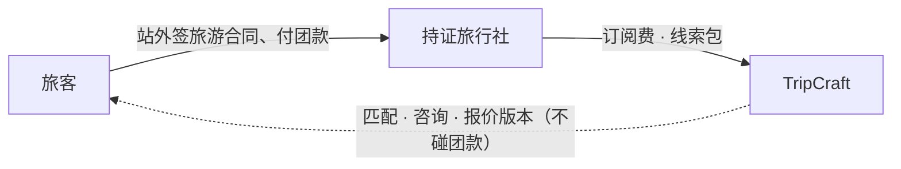
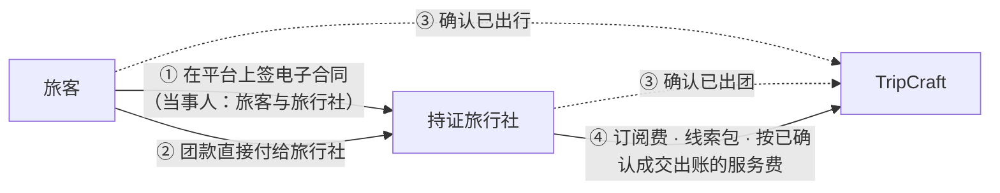
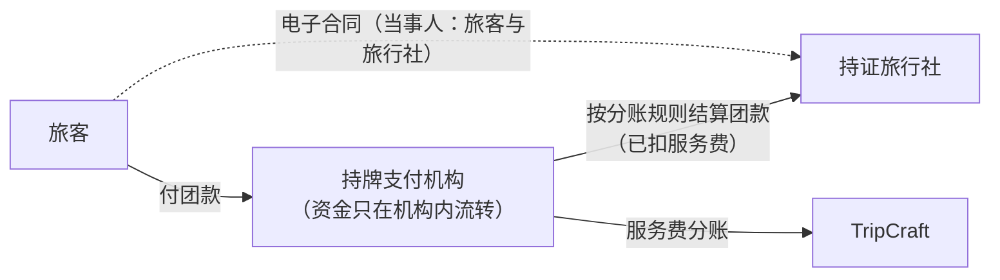

# D6 决策材料 · 平台是否在后续阶段代收团款（站内交易）

> **写给谁**：业主。本文回答 [PRD-01 §9](PRD-01-vision-positioning.md#9-待业主确认的决策) 的待决事项 **D6**：平台要不要在阶段 3 起做「站内交易」。D6 要在阶段 3 开工前定下，它也是旅行社成交服务费（D7、`F-M12-04`、[A-20](../ASSUMPTIONS.md)）的前提。
>
> **改了什么、没改什么**：只新增本文，并在 ARC-05、ARC-07、docs/03 §3.7.1 各加一句指引。**现行约束一条都没改**：阶段 1–2 站外签约付款、平台不经手团款、不设资金池，仍以 [docs/03 §3.7.1](../03-b2b-agency-operations.md#371--首要合规约束平台不经手游客资金) 与 [PRD-01 §5](PRD-01-vision-positioning.md#5-能力边界规范-scope--boundaries) 为准。
>
> ⚠️ **本文不是法律意见**（立场同 [docs/07 §7.0](../07-legal-and-compliance.md#70-先声明本章不是法律意见)）。§5 的法规要点由工程侧根据公开文本整理，每条都标了核对情况；**执业律师核验前，不得用于对外材料、合同或宣传**。没有来源的费率、成本、比例一律写「待询价」或「待验证」。
>
> **方案 A–D 是 D6 的四个选项，与产品里的「路径 A / 路径 B」无关。**

---

## 0. 一页结论

**推荐**：阶段 1–2 维持现状（方案 A）。**阶段 3 先做方案 B**：在平台上签电子合同，出团后由旅客与旅行社确认，团款仍由旅客直接付给旅行社，平台按已确认的成交向旅行社收成交服务费。B 稳定运行两个季度（建议值）、拿到 A-20 的真实数据后，**再评估要不要试点方案 C**（持牌支付机构分账）。**方案 D（平台自己代收代付）任何阶段都不做。**

**为什么**：

1. **B 不碰钱，平台的身份基本不变。** 团款仍是旅客付给旅行社，合同当事人仍是旅客与旅行社，平台只多了签约工具和成交确认。被认定为「经营旅行社业务」或「变相从事支付业务」的风险，B 与 A 是同一量级（仍须律师确认，见 [§6](#6-律师问题清单建议与-oi-021-同一次咨询)）。
2. **核实成交不一定要经手资金。** D7 写「阶段 1–2 不收成交佣金」，理由是不经手资金就无法核实成交。B 把这两件事拆开：合同金额、签约时间、出行确认都在平台上留痕，可以据此出账；核实不到的只是「钱有没有真的付」。
3. **C 的好处要等数据证明值不值。** C 能核实到付款、在分账时自动扣服务费，还能给旅客「钱先放在持牌机构」的保障。代价是支付接入、旅行社开通收款资格、退款、分账失败、每日对账和客服，对小团队是最重的一档（[RSK-08](../delivery/DLV-02-risk-register.md#2-核心风险条目清单)）；旅行社的现金流压力和「平台知道我的成交价」的顾虑（[docs/13 §13.3.3](../13-agency-partnership-design.md#1333-三条不越线)）也最重。
4. **D 不可行。** 团款先进平台自己的账户再转给旅行社，就是未经许可变相从事支付业务（业内俗称「二清」），还可能被认定为向旅客收取旅游费用、经营旅行社业务；资金池、退款和旅行社倒闭的风险全落在平台身上（[§4.1](#41-平台的法律身份与资质)、[§5](#5-相关法规要点整理待律师核验)）。

**前提**（任一不满足，阶段 3 就继续 A，只收订阅与线索包）：

- **律师意见**：§6 的问题并入 OI-021 的同一次咨询，阶段 3 开工前拿到书面意见，结论支持 B。
- **A-20 访谈**：试点旅行社能接受「费率公开、设上限、只对平台带来的成交收费」。
- **有真实数据**：路径 B 已对公众开放，有「咨询 → 报价 → 成交」的数据。

**现在需要你拍板的只有三件**（完整清单见 [§9](#9-待你决定的问题)）：同不同意这条路线；同不同意把 D6 的律师问题并进 OI-021 一起问；同不同意阶段 2 期间先向电子合同服务商和持牌支付机构询价（只询价、不签约）。

---

## 1. D6 问的是什么

### 1.1 现行口径（本文不改）

| 位置 | 现行约束 |
| :--- | :--- |
| [PRD-01 §5](PRD-01-vision-positioning.md#5-能力边界规范-scope--boundaries)「交易与支付」 | 阶段 1–2 旅行社与旅客站外签约付款，平台只收对旅行社的技术服务费；不代收团款、不设资金池 |
| [PRD-01 §6](PRD-01-vision-positioning.md#6-明确非目标-non-goals) 非目标 2 | 阶段 1–2 不经手团款；站内交易是待决事项，不是默认方向 |
| [PRD-01 §9](PRD-01-vision-positioning.md#9-待业主确认的决策) D6 默认值 | 阶段 1–2 不做；阶段 3 前重新评估。若做，须通过持牌支付机构分账、平台不设资金池，并同步修订 ARC-05 / ARC-07 的资金条款 |
| [docs/03 §3.7.1](../03-b2b-agency-operations.md#371--首要合规约束平台不经手游客资金) | 不向游客收款、不代收代付团款、不承诺「预订成功」、不成为交易主体；「资金流向决定了法律身份」 |
| [ARC-05 §3](../architecture/ARC-05-backend-integrations.md#3-外部系统集成矩阵-external-integrations)「第三方支付网关」 | 只用于机构订阅与加量包；严禁建立旅游团费资金池 |
| [ARC-07 §4](../architecture/ARC-07-security-privacy-compliance.md#4-合规审查与法律护栏对照清单)「支付与资金托管」 | 仅结算平台技术服务费，绝不介入旅游团费的资金清算 |
| [docs/17 §17.7](../17-agency-route-studio.md#177-按需调整与报价闭环) | 阶段 1–2 合同与付款在平台外完成，由旅行社或旅客标记成交 |

### 1.2 D6 牵动的东西

- **收入**：D7 已定「主要收入在旅行社一侧、旅客无感」；阶段 3 起若 D6 决定站内交易，加收对旅行社公开的成交服务费（[PRD-05 §1](PRD-05-business-model.md#1-收入来源体系-revenue-streams)、[`F-M12-04`](PRD-04-functional-architecture.md#f-m12-04-成交服务费结算以-d6-为前提)）。
- **旅行社的信任**：抽成会让旅行社藏价格、把客户拉到站外成交（[docs/13 §13.3.3](../13-agency-partnership-design.md#1333-三条不越线)），这条担心是否成立由 [A-20](../ASSUMPTIONS.md) 验证。
- **法律身份**：收了谁的钱、和谁签合同，决定平台是技术服务方还是旅游经营者（[docs/07 §7.1.1](../07-legal-and-compliance.md#711-边界线与法律后果的对应) 边界线 2、3）。

### 1.3 把 D6 拆成两个问题

D6 的原问法是「要不要代收团款」。拆成两问更好判断：

1. **平台要不要核实成交？** 为了能按成交收服务费，也为了知道匹配到底带来了多少生意。
2. **团款要不要走一条由平台安排的通道？** 为了核实付款，并在出团前给旅客一层资金保障。

方案 B 只回答第 1 问；方案 C 同时回答两问；方案 D 用不合法的方式回答第 2 问。

---

## 2. 四个方案长什么样

### 2.1 方案 A · 维持现状

旅客在平台上咨询、比较报价版本，接受报价后**在站外**与旅行社签合同、付款；旅行社在工作室标记成交（[`F-M18-06`](PRD-04-functional-architecture.md#f-m18-06-咨询收件箱与报价版本)）。平台只收订阅费与线索包，不收成交服务费。

### 2.2 方案 B · 不经手资金，但能核实成交

旅客接受报价后，在平台上与旅行社**签电子合同**：合同当事人是旅客与旅行社，平台只提供签约工具，签名与存证由电子合同服务商完成。团款仍由旅客**直接付给旅行社**（走旅行社自己的收款渠道）。出团后由双方在平台上确认出行。平台每月按「已确认的成交」向旅行社出账，收成交服务费。

### 2.3 方案 C · 持牌支付机构分账 / 担保交易

旅客签完电子合同后，**付款进入持牌支付机构**。机构按事先约定的规则，把团款结算到旅行社的银行账户，同时把服务费那一份分给平台，这叫「分账」。平台不开任何归集团款的账户，不设资金池。常见的有三种形态；能不能做、钱能在机构里放多久，取决于持牌机构的产品和监管要求（§6 第 8 问与 [§6.7](#67-询价时问持牌支付机构与电子合同服务商不是法律问题)）：

| 形态 | 做法 | 旅客保障 | 旅行社现金流 |
| :--- | :--- | :--- | :--- |
| C1 即时分账 | 付款后按机构的常规结算周期结算给旅行社 | 弱：与站外付款接近，但有付款记录 | 基本不受影响 |
| C2 担保 / 延迟结算 | 出团或行程结束后才结算给旅行社 | 强：出团前取消、旅行社倒闭时，钱还在机构里 | 压力最大：旅行社要先垫付酒店和车辆 |
| C3 分段结算 | 定金即时结算，尾款出团后结算 | 中 | 中 |

### 2.4 方案 D · 平台自行代收代付（不可行）

旅客把团款付进平台自己的账户，平台扣掉服务费后再转给旅行社。看上去最省事、最好收费，**但它正是 [docs/03 §3.7.1](../03-b2b-agency-operations.md#371--首要合规约束平台不经手游客资金) 说的「这条线不能碰」**。理由见 §4.1 与 §5，这里只列结论：

- 没有支付业务许可，「先收后付」属于**变相从事支付业务**（《非银行支付机构监督管理条例》第六条、第四十七条）；情节严重的还有刑事风险（《刑法》第二百二十五条）。
- 平台向旅客收取旅游费用，很可能被认定为**未经许可经营旅行社业务**（《旅游法》第二十八条、第九十五条）。
- 平台账户里沉淀的就是**资金池**：退款、旅行社违约或倒闭的损失首先由平台承担；平台自己出问题，旅客的钱也跟着出问题。
- 自己申请支付业务许可不现实：注册资本最低 1 亿元且须为实缴货币资本（条例第八条），还要经中国人民银行批准。

---

## 3. 并排比较（一张表）

| 维度 | A 维持现状 | B 电子合同 + 核实成交 | C 持牌机构分账 | D 平台代收代付 |
| :--- | :--- | :--- | :--- | :--- |
| 团款经过谁 | 旅客 → 旅行社（站外） | 旅客 → 旅行社（站外） | 旅客 → 持牌机构 → 旅行社 | 旅客 → 平台账户 → 旅行社 |
| 法律身份风险 | 低（做匹配带来的平台义务属 OI-021） | 低，比 A 多两个待律师确认点 | 中：资金路径设计不当会被认定为「二清」 | 高：变相从事支付业务，并可能被认定经营旅行社业务，**不可行** |
| 出团前取消、旅行社违约或倒闭 | 旅客找旅行社；平台协助维权，核验不到位时可能担责 | 同 A，合同留痕让证据更全 | 钱还没结算时可原路退回；旅客更会找平台 | 平台直接承担 |
| 能否核实成交 | 不能，只有旅行社自报 | 能核实在平台签的合同与双方确认 | 能核实付款与退款 | 能 |
| 能否收成交服务费 | 不收 | 能：按已确认成交月结，要催收 | 能：分账时自动扣 | — |
| 旅客信任与转化 | 靠资质公示；付款门槛在站外 | 合同标准、留痕，信任更好 | 资金保障最强，也更容易把问题算到平台头上 | — |
| 旅行社接受度 | 最高 | 中：有成交费就有跳单动机 | 较低：现金流、手续费、开通手续，顾虑最重 | — |
| 税务与发票 | 简单 | 简单，多一类服务费发票 | 设计正确时能对上，须税务师确认 | 对不上 |
| 工程与运营成本 | 低 | 中 | 高 | 最高（还要牌照） |
| 外部合作方 | 订阅收款通道 | + 电子合同服务商 | + 持牌支付机构 | 支付业务许可（不现实） |
| 建议 | 阶段 1–2 | **阶段 3 先做** | 看 B 的数据再评估试点 | 不做 |

---

## 4. 逐项展开

### 4.1 平台的法律身份与资质

这里要回答两个问题：会不会被认定为**经营旅行社业务**；做匹配之后，作为**在线旅游平台经营者**要尽哪些义务。另外还有一条支付红线。

**① 会不会被认定为经营旅行社业务**

判断看实际行为，不看页面上怎么写（[docs/07 §7.1.1](../07-legal-and-compliance.md#711-边界线与法律后果的对应)）：招徕、组织、接待旅游者并收取费用，就是旅行社业务，须取得旅行社业务经营许可（《旅游法》第二十八条；通过网络经营的，第四十八条要求取得许可并在网站显著位置标明）。未经许可经营的处罚见《旅游法》第九十五条、《旅行社条例》第四十六条（[docs/13 §13.5.4](../13-agency-partnership-design.md#1354--一个必须先回答的问题他有资质吗)）。

| 方案 | 判断（均待律师确认） |
| :--- | :--- |
| A | 平台不与旅客签合同、不收团款，只做信息展示、匹配与沟通工具，与现行设计一致。做匹配后的平台角色是 OI-021 的问题，不是 D6 新增的 |
| B | 与 A 基本相同，新增两个待确认点：平台提供合同模板和签约工具，会不会被视为参与订立合同（格式条款由谁提供、谁负责）；按成交比例向旅行社收费，会不会被视为「代理销售」或「委托招徕」的报酬 |
| C | 合同仍在旅客与旅行社之间，钱由持牌机构收付，平台收的是向旅行社收取的服务费，设计正确时不应构成。但「付款页显示的收款方是谁」「钱先到谁的账户」「退款由谁发起」都会影响定性 |
| D | 平台向旅客收取团款，几乎必然被视为向旅游者收取费用；没有旅行社业务经营许可就是无证经营 |

**② 在线旅游平台经营者的义务（A 起就有，B / C 更实）**

做匹配之后，平台就要承担《在线旅游经营服务管理暂行规定》对平台经营者的要求（OI-021）：核验登记平台内经营者的身份、许可等信息并定期更新（第十一条）；记录、保存平台内经营者的服务、合同履行和投诉处理信息（第十九条）；公示投诉渠道、协助旅游者维权，并「鼓励」先行赔付（第二十一条）；知道或者应当知道平台内经营者侵害旅游者权益而未及时采取必要措施的，依法承担连带责任（第二十八条第一款）。《电子商务法》第二十七条、第三十一条、第三十八条有相近要求。

B / C 让平台掌握合同与成交信息（C 还有付款信息），「知道或者应当知道」的范围随之变大，记录、保存、协助维权的责任也更实。这不是不做的理由，但运营上要配齐。

另外，按该规定第十六条，提供包价旅游服务的经营者要与旅游者签合同，并在全国旅游监管服务平台填报合同信息。这个义务在旅行社；B / C 的签约工具能否、是否需要协助填报，列入 §6。

**③ 支付红线**

《非银行支付机构监督管理条例》第六条：未经依法批准，任何单位和个人不得从事或者变相从事支付业务。平台「先把客户的钱收进自己的账户，再结算给平台内商户」的做法，在支付监管的整治中被称为「二清」，按无证经营支付业务处理（§5）。**D 正落在这条线上；C 必须让钱只在持牌机构里流转、直接结算到旅行社的账户**，平台账户只收服务费。

**④ 可能需要的其他许可**

为第三方经营者提供在线交易处理的平台，可能需要相应的增值电信业务经营许可。B / C 更相关；A 做匹配与咨询是否也涉及，一并问律师（§6 第 7 问）。

### 4.2 资金与退款：出了事谁担责

| 情形 | 法律上怎么处理（要点，待律师确认） | A / B | C | D |
| :--- | :--- | :--- | :--- | :--- |
| 出团前旅客自己取消 | 按合同的退改约定；行程结束前旅游者解除合同的，组团社扣除必要的费用后将余款退还旅游者（《旅游法》第六十五条） | 旅客向旅行社要退款，平台手里没有钱；平台协助维权（投诉渠道、沟通记录）。B 有电子合同和报价版本留痕，证据更全 | 还没结算的，经持牌机构原路退回：扣多少由旅行社按合同提出，旅客不认可就走协商与投诉。已结算的，要旅行社出钱退，能否从其后续结算中扣回取决于机构产品。服务费随退款冲回 | 平台直接退款，先垫付再向旅行社追偿 |
| 未成团，旅行社取消 | 境内旅游至少提前七日通知；因未达约定人数解除合同的，退还已收取的全部费用（第六十三条） | 旅行社退款 | 未结算部分全额原路退回；已结算部分同上 | 平台退款 |
| 旅行社违约（降低标准、甩团等） | 旅行社承担违约责任（第七十条）；经查证属实的，文旅部门可使用旅行社的质量保证金（《旅行社条例》第十五条）；平台知道或者应当知道而未采取必要措施的，承担连带责任（《在线旅游经营服务管理暂行规定》第二十八条第一款） | 平台的责任主要在「核验到位、发现后及时处置」；B 多了合同证据 | 可按规则暂停尚未结算的款项，保护旅客；但平台会被拉进「谁对谁错」的判断，角色边界待律师确认（§6 第 10 问） | 平台是收款人，首当其冲 |
| 旅行社倒闭或失联 | 因解散、破产等原因造成旅游者预交旅游费用损失的，可使用质量保证金（《旅游法》第三十一条、《旅行社条例》第十五条）；平台不能提供其真实名称、地址和有效联系方式的，消费者可以向平台要求赔偿（《消费者权益保护法》第四十四条） | 钱已在旅行社手里，兜底靠质量保证金；平台没有钱可退但声誉受损；核验不到位时可能担责 | **C2 / C3 的价值就在这里**：尚未结算的部分还在持牌机构，可以退回；已结算部分同 A / B | 平台承担；平台自身出问题时，旅客的钱也受影响 |
| 不可抗力（封路、灾害等） | 合同解除的，组团社扣除已向地接社或者履行辅助人支付且不可退还的费用后，将余款退还旅游者（第六十七条） | 旅行社退款 | 经持牌机构退款 | 平台退款 |
| 分账失败（只有 C） | — | — | 旅行社账户冻结、注销或信息填错，钱滞留在持牌机构，平台要重试、换账户或人工处理。**不能先把钱转到平台账户「代为保管」**，那就变成了 D | — |

**一句话**：A / B 下平台手里没有钱，出事时平台的压力是「协助维权」和「当初核验有没有到位」；C 下平台能在钱还没结算时挡住一部分损失，但会更多地被旅客当成责任方；D 下平台就是责任方。

### 4.3 能否核实成交、能否收成交服务费

| | A 维持现状 | B 电子合同 + 核实成交 | C 持牌机构分账 |
| :--- | :--- | :--- | :--- |
| 能核实什么 | 只有旅行社标记的「成交」与抽样回访（[PRD-05 §4](PRD-05-business-model.md#4-获客与冷启动策略-gtm--pilot-plan)） | 在平台上签的合同：金额、签约时间、出行日期；双方的出行确认 | 付款、退款、实际结算金额 |
| 核实不到什么 | 几乎全部 | 钱有没有真的付；站外改价或补签；完全不在平台上签的成交 | 完全不在平台上付款的成交 |
| 服务费怎么收 | 不收：按自报收会激励瞒报，[PRD-05 §1](PRD-05-business-model.md#1-收入来源体系-revenue-streams) 已列为不采用 | 每月按已确认的成交出账，旅行社付款；有账期、坏账与催收。收不上来只能限制该旅行社的部分工作室功能，**不能影响旅客**（与 `F-M12-04` 验收标准 5「不以此处罚旅客」同一原则） | 分账时自动扣除，退款时自动冲回，不用催收 |
| 对 `F-M12-04` | 不开发 | 验收标准 1（经持牌机构分账扣除）要改成「按已确认的成交出账」；标准 2–5 照用 | 按现文实现 |
| 对 A-20 | 只能访谈 | 有行为数据：已接受报价中在平台上签约的比例、开始收费前后的变化、同线路报价是否上升 | 数据最全：站内付款比例、退款率、报价变化 |

跳单在 B、C 下都会有。C 比 B 多给了旅客一个在站内付款的理由（资金保障），也多给了旅行社一个绕开的理由（现金流与手续费）。哪股力量更大，只能看数据。

### 4.4 对旅客信任与转化的影响

- **A**：旅客靠资质公示（[docs/17 §17.2](../17-agency-route-studio.md#172-入驻前提)）判断旅行社是否可信，然后把钱付给一家刚在网上认识的旅行社。这一步是信任门槛，会流失多少人目前没有数据，待验证。
- **B**：电子合同格式统一，报价版本和合同对得上，合同存进行程空间，同行的家人也能看到，「说好的」有据可查。付款仍在站外，门槛降低了，但没消失。
- **C**：「钱先放在持牌机构，出团后才给旅行社」（C2 / C3）是最强的保障感。但旅客会自然地把平台当成「收了我钱的那一方」，投诉、客服和舆情压力都会上升。页面不能写「平台担保」（[docs/00 §0.3](../00-overview-and-glossary.md#03-三条责任边界线tripcraft-不是清单) 列出的错误表述），除非平台真的作出担保（§6 第 11 问）。
- **「旅客无感」在 A、B、C 下都成立**：旅客付的就是旅行社的报价，平台不另加价（D7）；C 的支付手续费由谁承担写进协议，不转嫁给旅客。

### 4.5 对旅行社接受度的影响

[docs/13 §13.3.3](../13-agency-partnership-design.md#1333-三条不越线) 的原判断是「要抽佣，还是要真数据」：一旦平台既知道价格又知道谁在买，旅行社就会藏价格、藏关系。D7 定了阶段 3 起（以 D6 为前提）加收成交服务费，这条风险就要用设计来应对，是否应对得住由 A-20 验证。

- **A**：只有订阅与线索费，接受度最高；订阅值不值仍待 [A-17](../ASSUMPTIONS.md) 验证。
- **B**：
  - 愿意用的理由：签约工具省事；合同规范，纠纷有据；如能做到，还能协助完成合同信息填报；只有确认出行的旅客能评价（[docs/17 §17.5.2](../17-agency-route-studio.md#1752-其他透明度要素)），成交与评价对得上。
  - 不愿意的理由：成交服务费本身；平台掌握了成交价与成交量。
  - 跳单方式：报价被接受后，让旅客在站外签纸质合同。
- **C**：在 B 的基础上再加几条顾虑：
  - 钱晚到（C2 / C3），而旅行社要先垫付酒店和车辆；
  - 支付手续费（费率待询价）；
  - 开通手续：在持牌机构开通收款资格，要交营业执照、法定代表人身份、结算账户等资料；
  - 团款金额大，个人付款可能碰到单笔或单日限额（以机构与银行的规定为准）；
  - 平台虽然不碰成本价，但同时掌握成交价与资金路径，「你随时可以把我一脚踢开」的顾虑最重。

不管选 B 还是 C，都用同一组办法应对，写进入驻协议（细节见 [§7.3](#73-若选-b-或-c成交服务费怎么收)）：设上限；**只对平台带来的成交收费**；费率与逐单明细公开；服务费多少、是否在站内签约都不进入匹配度（[ADR-010](../architecture/adr/ADR-010-route-matching-scoring.md)）；成交数据只用于计费与对账；不强制站内签约。

### 4.6 税务与发票

| | A | B | C | D |
| :--- | :--- | :--- | :--- | :--- |
| 团款发票 | 旅行社开给旅客 | 同 A | 同 A：金额是旅客付的全款，由旅行社开 | 旅客会向平台要发票，谁开都对不上 |
| 平台的发票 | 订阅、线索包的技术服务费，开给旅行社 | 同 A，再加成交服务费（按月账单开给旅行社） | 同 B：服务费虽是在分账里扣的，发票仍开给旅行社，不开给旅客 | 平台收全款，可能被视为全额收入的主体 |
| 合同、资金、发票三条线 | 对得上 | 对得上 | 设计正确时对得上：旅游合同在旅客与旅行社之间，钱经持牌机构到旅行社，旅行社开票；服务协议在旅行社与平台之间，服务费分账到平台，平台开票 | 对不上 |
| 待税务师确认 | — | 服务费的定性与适用税目 | 支付手续费的发票由谁开给谁；旅游服务差额计税的口径 | — |

另有两点三个方案都要问清楚（§6 第 20、21 问）：

- **增值税**：《增值税法》自 2026 年 1 月 1 日起施行。原「营改增」政策下，旅游服务可以选择差额计税（财税〔2016〕36 号附件二）；新法施行后的衔接口径以税务机关现行规定为准，须税务师确认。
- **涉税信息报送**：《互联网平台企业涉税信息报送规定》要求平台企业按季度向税务机关报送平台内经营者的身份信息和收入信息。本平台是否属于适用范围、A / B / C 下各报什么，须税务师确认。C 下平台天然掌握收入数据，B 掌握合同金额，A 只有旅行社自报。

### 4.7 工程与运营成本

人力与费用都待测算，下表只比较要做的事。

| 工作 | A | B | C |
| :--- | :--- | :--- | :--- |
| 签约 | — | 接入电子合同服务商：模板、签署、存证、下载；合同状态（拟定 → 已签 → 已出团 → 已完成 / 已解除） | 同 B |
| 计费 | 订阅（`F-M12-01`） | 服务费规则（费率、上限、只计平台带来的成交、例外）；月度账单、开票、催收 | 分账规则；服务费随分账扣除、随退款冲回 |
| 资金 | — | — | 下单、付款、分账、退款（全额 / 部分 / 定金加尾款多笔）、超时未付自动关闭订单 |
| 旅行社开通 | 资质审核（已有，`F-M13-01`） | 同 A | 再加：在持牌机构开通收款与分账资格 |
| 对账 | — | 月度账单核对 | 每天把持牌机构的对账文件与平台订单逐笔核对；差错工单 |
| 异常处理 | — | 合同解除后服务费冲回；账单争议 | 分账失败重试与人工处理；拒付（持卡人要求撤销付款）；配合机构防范刷单套现 |
| 降级（铁律 3） | — | 电子签约不可用时，回到站外签约 + 成交标记 | 支付不可用时，回到 B：站外付款 + 电子合同 + 确认 |
| 客服 | 咨询与报价 | 再加合同与账单 | 再加付款、退款、到账，旅客与旅行社两头都要服务 |
| 数据安全 | 现有分级 | 合同里的证件信息存在电子合同服务商一侧，平台只存合同编号、金额、状态与文件摘要 | 再加支付记录，不存卡号与支付账户信息 |
| 量级 | 低 | 中 | 高 |

D 在 C 的基础上还要支付业务许可、资本金、备付金管理和合规团队，不在考虑范围内。

### 4.8 需要哪些外部合作方

| 方案 | 合作方 | 用途 |
| :--- | :--- | :--- |
| A | 订阅收款的支付通道、电子发票服务 | 平台向旅行社收订阅费、开票（ARC-05 已有） |
| B | 再加：电子合同 / 电子签名服务商；律师（合同模板）；税务顾问 | 签约与存证；模板合规；服务费开票 |
| C | 再加：持牌支付机构（分账、担保类产品）及其合作银行 | 收付团款、分账、退款、对账 |
| D | 支付业务许可（自行申请或收购） | 不现实 |

---

## 5. 相关法规（要点整理，待律师核验）

> **核对说明**：本次整理时无法直接打开政府网站上的原文，只能用公开转载文本的检索结果交叉核对。因此「核对情况」分三档：**已检索核对**（文号、日期、条号与要点已和公开转载文本对上，适用仍待律师核验）；**按通行文本整理**（条号与要点按通行文本整理，本次没能逐字核对）；**需律师确认**。docs/07 §7.11 已核验过来源的，注明出处。

| 法规（全称） | 文号 · 公布与施行 | 与 D6 相关的要点 | 主要影响 | 核对情况 |
| :--- | :--- | :--- | :--- | :--- |
| 《非银行支付机构监督管理条例》 | 国务院令第 768 号；2023-12-09 公布，2024-05-01 施行 | 第六条：设立非银行支付机构须经中国人民银行批准、取得支付业务许可；未经依法批准，任何单位和个人不得从事或者变相从事支付业务。第八条：注册资本最低限额 1 亿元，且须为实缴货币资本。第四十七条：未经批准从事或者变相从事支付业务的，由中国人民银行予以取缔、没收违法所得；违法所得 50 万元以上的，处违法所得 1 倍以上 5 倍以下罚款；没有违法所得或不足 50 万元的，单处或并处 50 万元以上 200 万元以下罚款；对法定代表人、主要负责人和直接责任人员给予警告，并处 10 万元以上 50 万元以下罚款。条例对用户备付金另有专门规定（不得挪用、占用、借用等，条号需律师确认） | D 不可行的直接依据；C 必须由持牌机构完成收付 | 第六、八、四十七条已检索核对；备付金条号需律师确认 |
| 《非银行支付机构监督管理条例实施细则》 | 中国人民银行令〔2024〕第 4 号；2024-07-09 公布并施行 | 细化条例的许可、业务规则与处罚；支付业务分为储值账户运营、支付交易处理两类（分类所在条文需律师确认） | C 的产品形态要落在持牌机构获准的业务类型内 | 文号与日期已检索核对 |
| 《中国人民银行办公厅关于进一步加强无证经营支付业务整治工作的通知》 | 银办发〔2017〕217 号 | 重点排查持证机构为无证机构提供支付清算服务。业界据此把「平台先把客户资金归集到自有账户，再结算给平台内商户」的做法称为「二清」，属无证经营支付业务的整治对象（「二清」不是文件原文用语） | D 的典型形态；C 设计时要避开 | 文号与主旨已检索核对；原文需律师确认 |
| 《刑法》第二百二十五条；《最高人民法院 最高人民检察院关于办理非法从事资金支付结算业务、非法买卖外汇刑事案件适用法律若干问题的解释》 | 刑法 1997 年修订后历经修正；司法解释为法释〔2019〕1 号，2019-02-01 施行 | 非法从事资金支付结算业务、情节严重的，可能构成非法经营罪 | D 的刑事风险底线 | 按通行文本整理；适用需律师确认 |
| 《旅游法》 | 2013-04-25 通过，2013-10-01 施行；2016-11-07、2018-10-26 两次修正 | 第二十八条：设立旅行社，招徕、组织、接待旅游者，须取得旅游主管部门许可。第三十一条：旅行社按规定交纳旅游服务质量保证金，用于旅游者权益损害赔偿等。第四十八条：通过网络经营旅行社业务的，须依法取得许可，并在网站主页显著位置标明许可证信息。第五十七、五十八条：旅行社组织旅游须订立合同；包价旅游合同采用书面形式。第六十三条：未达约定人数不能出团的处理与全额退款。第六十五条：行程结束前旅游者解除合同的，扣除必要的费用后退还余款。第六十七条：不可抗力等情形的处理与退款。第七十条：旅行社违约责任。第九十五条：未经许可经营旅行社业务的，责令改正、没收违法所得，并处 1 万元以上 10 万元以下罚款；违法所得 10 万元以上的，并处违法所得 1 倍以上 5 倍以下罚款；对有关责任人员处 2 千元以上 2 万元以下罚款 | 平台身份（A–D）；退款规则（§4.2） | 第九十五条来源已核验（[docs/07 §7.11](../07-legal-and-compliance.md#711--引注核验表强制) 第 6 项）；其余按通行文本整理 |
| 《旅行社条例》 | 国务院令第 550 号；2009-02-20 公布，2009-05-01 施行；2016、2017、2020 年修订 | 第二条：旅行社是从事招徕、组织、接待旅游者等活动，为旅游者提供相关旅游服务的企业法人。第十三条：质量保证金（经营国内和入境旅游业务的存入 20 万元，经营出境旅游业务的增存 120 万元，或提交相应额度的银行担保；缴存方式以现行规定为准）。第十五条：旅行社违约侵害旅游者权益经查证属实，或因解散、破产等原因造成旅游者预交旅游费用损失的，可以使用质量保证金。第四十六条：未取得许可经营的，违法所得 10 万元以上的处 1 倍以上 5 倍以下罚款，不足 10 万元或没有违法所得的处 10 万元以上 50 万元以下罚款 | 旅行社倒闭时旅客的兜底途径；平台身份 | 第十三、十五条与修订情况已检索核对；第四十六条来源已核验（docs/07 §7.11 第 6 项）；第二条按通行文本整理 |
| 《在线旅游经营服务管理暂行规定》 | 文化和旅游部令第 4 号；2020-10-01 施行 | 第十一条：平台经营者对平台内经营者的身份、地址、联系方式、行政许可、质量标准等级、信用等级等信息进行真实性核验、登记，建立登记档案并定期核验更新。第十六条：提供包价旅游服务的，依法与旅游者签订合同，并在全国旅游监管服务平台填报合同有关信息。第十九条：平台经营者记录、保存平台内经营者服务情况、合同履行和投诉处理等信息。第二十一条：首页显著位置公示投诉渠道；平台内经营者与旅游者发生纠纷的，平台经营者积极协助维权；鼓励先行赔付。第二十八条第一款：平台经营者知道或者应当知道平台内经营者不符合保障旅游者人身、财产安全要求或有其他侵害行为，未及时采取必要措施的，依法与其承担连带责任 | 平台义务（A 起即适用，OI-021）；B / C 的合同填报与纠纷处理 | 第十一、十六、十九、二十一条与第二十八条第一款已检索核对；第二十八条第二款原文未取得 |
| 《电子商务法》 | 2018-08-31 通过，2019-01-01 施行 | 第九条：平台经营者定义。第十四条：经营者应依法出具发票等购货凭证或服务单据。第二十七条：平台核验登记平台内经营者的身份、行政许可等信息。第三十一条：商品和服务信息、交易信息保存不少于三年。第三十二至三十四条：制定并持续公示平台服务协议和交易规则；修改须公开征求意见，并至少在实施前七日公示。第三十五条：不得利用服务协议、交易规则和技术手段对平台内经营者进行不合理限制、附加不合理条件，或收取不合理费用。第三十八条：知道或者应当知道而未采取必要措施的连带责任；对关系消费者生命健康的服务，未尽资质审核或安全保障义务的相应责任。第五十三条：当事人可约定采用电子支付，电子支付服务提供者应遵守国家规定。第五十八条：可协议设立消费者权益保证金；先行赔偿与追偿适用《消费者权益保护法》 | 服务费的公示与合理性（B / C）；平台责任（A–D） | 按通行文本整理 |
| 《消费者权益保护法》 | 1993-10-31 通过，1994-01-01 施行；2009、2013 年修正（2013 年修正 2014-03-15 施行） | 第四十四条：网络交易平台不能提供销售者或服务者的真实名称、地址和有效联系方式的，消费者可以向平台要求赔偿；平台作出更有利于消费者承诺的，应当履行；平台赔偿后有权追偿；明知或应知而未采取必要措施的，承担连带责任。第五十三条：以预收款方式提供服务，未按约定提供的，应按消费者要求履行约定或退回预付款 | 退款与平台兜底（§4.2） | 按通行文本整理 |
| 《消费者权益保护法实施条例》 | 国务院令第 778 号；2024-03-15 公布，2024-07-01 施行 | 对预收款、平台经营者义务等作了细化；具体条款及对包价旅游的适用需律师确认 | 退款规则 | 文号与日期已检索核对；条款未取得原文 |
| 《个人信息保护法》 | 2021-08-20 通过，2021-11-01 施行 | 第二十三条：向其他处理者提供个人信息，须告知接收方情况并取得单独同意。第二十八条：金融账户、行踪轨迹等属于敏感个人信息。第二十九条：处理敏感个人信息须取得单独同意。第五十五条：处理敏感个人信息、向他人提供个人信息前，须做个人信息保护影响评估 | B 的合同证件信息；C 的支付信息 | 按通行文本整理（第十三、十四条的分工见 [docs/07 §7.4.5](../07-legal-and-compliance.md#745--pipl-条文映射2026-10-07-核查版)） |
| 《民法典》 | 2020-05-28 通过，2021-01-01 施行 | 第四百六十九条：书面形式包括可以有形地表现所载内容的数据电文。第四百九十一条第二款：通过互联网提交订单成功时合同成立（另有约定除外）。第四百九十六至四百九十八条：格式条款的提示说明义务与解释规则。第九百六十一条起：中介合同（向委托人报告订立合同的机会或提供媒介服务，委托人支付报酬） | B 的电子合同；成交服务费的定性 | 按通行文本整理 |
| 《电子签名法》 | 2004-08-28 通过，2005-04-01 施行；2015、2019 年修正 | 第十三条：可靠的电子签名应具备的条件。第十四条：可靠的电子签名与手写签名或盖章具有同等法律效力 | B 的电子合同 | 按通行文本整理 |
| 《明码标价和禁止价格欺诈规定》 | 国家市场监督管理总局令第 56 号；2022-07-01 施行 | 不得在标价之外加价，不得收取未标明的费用 | 旅客价格不加价（D7） | 要点按通行文本整理；条号需核对 |
| 《反不正当竞争法》 | 现行文本（条号以现行文本为准） | 向中间人支付佣金、接受佣金的，双方都应如实入账 | 成交服务费的定性与入账 | 需律师确认 |
| 《增值税法》 | 2024-12-25 通过，2026-01-01 施行 | 平台服务费、旅游服务团款的计税；原「营改增」政策中旅游服务差额计税（财税〔2016〕36 号附件二）的衔接 | §4.6 | 需税务师确认 |
| 《互联网平台企业涉税信息报送规定》 | 国务院令第 810 号；2025-06-20 公布并施行 | 平台企业按季度向主管税务机关报送平台内经营者和从业人员的身份信息与收入信息 | 是否适用；A / B / C 各报什么 | 文号、日期与报送要求已检索核对；适用需税务师确认 |
| 《电信条例》及电信业务分类目录（增值电信业务） | — | 为第三方经营者提供在线交易处理的平台，可能需要相应的增值电信业务经营许可 | B / C（A 是否涉及一并问） | 需律师确认 |

---

## 6. 律师问题清单（建议与 OI-021 同一次咨询）

这份清单可以直接带去问律师。建议与 OI-021（匹配引流）、OI-016 / OI-017（「提供便利」与协作层责任）**同一次咨询**：它们问的都是「平台的法律身份」，分开问既贵又容易前后不一。登记为 [OI-025](../00-overview-and-glossary.md#07-未决事项登记册-open-issues-register)。

请律师同时逐条核验 [§5](#5-相关法规要点整理待律师核验) 的法规表，结果回填 [docs/07 §7.11 引注核验表](../07-legal-and-compliance.md#711--引注核验表强制)。每个问题后面的方括号是它影响的方案。

### 6.1 平台的身份与资质

1. 【A，OI-021 已列】做线路匹配、提供咨询与报价工具后，平台是否构成《在线旅游经营服务管理暂行规定》所称的平台经营者？第十一、十九、二十一、二十八条的义务具体怎么履行？
2. 【B】平台提供电子合同工具与合同模板（合同当事人为旅客与旅行社），并按已确认成交的金额比例向旅行社收取服务费：平台是否可能被认定为经营旅行社业务、代理销售包价旅游产品或受托招徕？是否构成《民法典》上的中介？需要什么资质？
3. 【B】合同模板由平台提供时，格式条款的提示说明义务与责任由谁承担？平台要在模板和页面上写明什么，才能清楚表明自己不是合同当事人？
4. 【C】旅客经持牌支付机构付款，按规则分账给旅行社，平台从分账中取得服务费，平台不开立任何归集团款的账户：在什么设计下不构成「变相从事支付业务」（条例第六条、第四十七条）或「二清」？请逐项说明这些要素的影响：付款页显示的收款方；资金先到谁的账户；分账指令由谁发起；平台能否发起退款、能否暂停结算；平台在机构中是商户还是服务商。
5. 【C】C 是否会让平台被认定为「向旅游者收取旅游费用」，从而需要旅行社业务经营许可（《旅游法》第二十八条、第四十八条）？
6. 【D】请确认 D 不可行的结论及依据（含行政与刑事风险），用于对内统一口径。
7. 【A / B / C】平台为旅行社与旅客提供在线签约、交易处理，是否需要增值电信业务经营许可（如在线数据处理与交易处理业务）？A 阶段只做匹配与咨询是否也涉及？

### 6.2 资金与退款

8. 【C】担保或延迟结算（C2、C3）：团款在持牌机构停留的期限有没有监管上限？能否覆盖「签约到出团」的全部时间（可能长达数月）？
9. 【A / B / C】出团前取消、未成团、旅行社违约、旅行社倒闭或失联时，平台在三种方案下各承担什么责任？《消费者权益保护法》第四十四条、《电子商务法》第三十八条、《在线旅游经营服务管理暂行规定》第二十八条的适用边界在哪里？
10. 【C】平台能否、是否应当在退款纠纷中决定退款金额（例如「必要的费用」怎么算）？平台按规则暂停尚未结算的款项，会不会被视为承担了担保责任？
11. 【A / B / C】平台若自愿对旅客作出「先行赔付」承诺（该规定第二十一条为「鼓励」），要承担什么义务、要准备多少资金、有什么后果？不承诺时，页面上能怎么说、不能怎么说？

### 6.3 合同与电子签约

12. 【B / C】包价旅游合同用电子签名签署，是否满足《旅游法》第五十八条的书面形式要求（结合《民法典》第四百六十九条、《电子签名法》第十三、十四条）？对电子签名服务商有什么资质要求？
13. 【B / C】《在线旅游经营服务管理暂行规定》第十六条的合同信息填报由谁做？平台的签约工具能否、是否需要代旅行社填报？
14. 【B / C】主管部门发布过的旅游合同示范文本能否作为平台模板的基础？现行版本是哪一版？平台对模板内容的合法性负什么责任？

### 6.4 收费与公示

15. 【B / C】按成交金额比例收服务费、设上限、只对平台带来的成交收取，是否符合《电子商务法》第三十五条「不得收取不合理费用」？费率写进协议、工作室逐单可查、修改至少提前七日公示（第三十四条），是否足够？
16. 【B / C】旅客看不到平台向旅行社收的服务费（「旅客无感」），在明码标价或告知方面有没有风险？支付手续费由平台或旅行社承担、不转嫁旅客，需要怎么写？
17. 【B / C】成交服务费在合同里应当定性为技术服务费、中介报酬还是佣金？《反不正当竞争法》关于佣金如实入账的规定对双方有什么要求？

### 6.5 个人信息

18. 【B】电子合同含旅客身份证件信息：平台、电子签名服务商、旅行社各是什么角色（委托处理、共同处理还是各自处理）？是否需要单独同意（《个人信息保护法》第二十三、二十九条）和个人信息保护影响评估（第五十五条）？
19. 【C】平台从持牌机构接收哪些支付数据是合规且必要的？金融账户属于敏感个人信息（第二十八条）。

### 6.6 同时问税务师

20. 【A / B / C】平台与旅行社各自怎么计税、开票：平台的服务费发票开给谁；C 中「旅行社向旅客开团款发票、平台向旅行社开服务费发票」是否正确；《增值税法》施行（2026-01-01）后旅游服务差额计税的口径。
21. 【A / B / C】《互联网平台企业涉税信息报送规定》是否适用于本平台？三种方案下各要报送什么？

### 6.7 询价时问持牌支付机构与电子合同服务商（不是法律问题）

- **持牌支付机构**（建议问 2–3 家）：有没有面向平台的分账或担保类产品，是否接受旅游类商户；分账比例有没有上限；结算周期多长，延迟结算最长多久；已结算后怎么退款，能否从后续结算中扣回；手续费多少（待询价），由谁承担；旅行社开通收款资格要交哪些材料、要多久；单笔与单日限额（团款金额较大）；对账文件的格式与时点；风控要求与冻结规则；对平台自身有什么资质要求。
- **电子合同服务商**（建议问 2–3 家）：资质；签署、存证与出证能力；是否支持旅游合同模板，能否对接全国旅游监管服务平台；证件信息存在哪里，平台能拿到哪些字段；价格（待询价）。

---

## 7. 建议：怎么走、什么时候停

### 7.1 推荐与前提

推荐「**阶段 1–2 维持 A → 阶段 3 先做 B → 看数据再评估 C → 永不做 D**」，前提见 [§0](#0-一页结论)。这条路线的好处是每一步都能退回上一步：B 的电子合同在 C 里照样要用，不是白做；C 出问题可以退回 B，B 出问题可以退回 A。

### 7.2 分步走与退出条件

阈值（下表的 N、X 等）现在定不了，建议阶段 2 的数据出来后由你定，本文不预设数字。

| 步骤 | 时间 | 做什么 | 进入下一步的条件 | 退出或回退的条件 |
| :--- | :--- | :--- | :--- | :--- |
| **第 0 步**：维持 A，做准备 | 现在至阶段 2 结束 | 律师咨询（§6 并入 OI-021）；A-20 访谈（费率形态、上限、计费时点、是否只对平台带来的成交收费）；向电子合同服务商与持牌支付机构询价（只询价不签约）；统计「报价被接受 → 标记成交」这一段的转化 | ① 律师书面意见支持 B；② 访谈中多数试点旅行社可以接受（比例你定）；③ 路径 B 已对公众开放，并有成交数据 | 任一条件不满足：阶段 3 继续 A（订阅 + 线索包），阶段 4 再评估 |
| **第 1 步**：做 B | 阶段 3 | 上线电子合同与出行确认；**先免费试行一个季度**，测出不收费时的站内签约率，之后开始按已确认成交收服务费 | B 稳定运行满两个季度，并且：① 站内成交量达到门槛（你定）；② 有证据表明旅客在意付款保障，例如报价被接受后没签约的旅客，回访原因集中在「不放心把钱付给旅行社」；③ 有旅行社愿意试点分账；④ 律师确认 C 的资金路径，持牌机构完成产品与合规审查；⑤ 客服与对账能力到位 | 任一触发即停收成交服务费、回到 A，电子合同保留为免费工具：① 已接受报价中站内签约的比例连续 N 个月低于 X%；② 价格真实性受损：旅行社改选更粗的价格展示档位，或同线路报价明显上升（A-14 / A-20 的监测）；③ 因服务费退出的旅行社超过约定比例；④ 服务费逾期持续高于约定比例；⑤ 律师意见或监管口径变化 |
| **第 2 步**：试点 C | B 运行两个季度后评估，最早阶段 4 | 一个区域、少数自愿的旅行社；C1 / C2 / C3 只选一种；B 保留为随时可回退的路径 | 试点达到约定指标，再决定是否扩大 | 任一触发即回退到 B，在途订单按原路径完成：① 分账失败或对账差错连续超过阈值；② 退款纠纷或投诉明显上升；③ 试点旅行社退出；④ 持牌机构风控收紧（冻结、限额）；⑤ 支付与运营成本连续 N 个月高于服务费收入；⑥ 监管变化 |
| **方案 D** | 任何阶段 | 不做 | — | — |

**为什么先免费一个季度**：直接开始收费，就分不清站内签约率低是因为「旅客和旅行社本来就不习惯在线签」，还是因为「旅行社在躲服务费」。先测出不收费时的签约率，再开始收费，前后一比，就是 A-20 最直接的证据。

### 7.3 若选 B 或 C：成交服务费怎么收

1. **只对平台带来的成交收费**：这笔成交的咨询是从路径 B 发起的；旅行社用工作室服务自有客户（白标交付）的，不收。
2. **费率 + 单笔上限**，或**按成交量分档的订阅**。后者是 B 的一种变体，更接近 [docs/13 §13.9.2](../13-agency-partnership-design.md#1392-计费单位四个选项只有一个是对的)「订阅不惩罚多试」的思路。两种形态都拿去访谈，数值待 A-20，不先定。
3. **计费时点**：B 建议「出团后」计入当月账单，减少取消后的冲回；C 在分账时扣，出团前退款自动冲回。
4. **公开**：写进入驻协议与平台规则；工作室逐单可查；修改至少提前七日公示（《电子商务法》第三十四条）。
5. **不影响匹配度**：服务费费率、是否在站内签约，都不进入匹配度（[ADR-010](../architecture/adr/ADR-010-route-matching-scoring.md)）。
6. **旅客无感**：旅客价格就是旅行社报价；支付手续费不转嫁旅客。
7. **数据只用于计费与对账**：成交金额不用于画像和营销，不向其他旅行社提供（[docs/03 §3.7.3](../03-b2b-agency-operations.md#373-结算的数据边界)、[docs/17 §17.8](../17-agency-route-studio.md#178-客户归属与旅行社的顾虑) 规则 4）。
8. **不强制站内签约**：强制只会把跳单从「偶尔」变成「必然」。

### 7.4 另一个合理选择：停在 A

如果你更看重旅行社的信任（docs/13 §13.3.3 的原判断：要抽佣，还是要真数据），也可以停在 A：不收成交服务费，收入只来自订阅与线索包（A-17）。代价是收入不随成交增长，D7 里的成交服务费不做。B 的电子合同仍可作为免费工具上线，方便旅客与旅行社，但不据此收费。

---

## 8. 如果采用 B 或 C：届时要改的约束

**现在不改**，等 D6 定了再改。下面列出届时要改的位置与改法，「选 C 时再加」一栏是在 B 的改法之上追加的内容。

### 8.1 docs/03 §3.7 与 §3.8

| 位置 | 现在写的 | 选 B 时改为 | 选 C 时再加 |
| :--- | :--- | :--- | :--- |
| [§3.7.1](../03-b2b-agency-operations.md#371--首要合规约束平台不经手游客资金)「绝不做 / 可以做」表 | 绝不做：向游客收款、代收代付团款、承诺「预订成功」、成为交易主体 | 四条「绝不做」全部保留；「可以做」新增：提供电子合同工具（合同当事人为旅客与旅行社）；按已确认的成交向旅行社收取公开、设上限的服务费 | 「向游客收款」改为「以平台名义或平台账户向游客收款」；「可以做」新增：旅客经持牌支付机构向旅行社付款，平台只从分账中取得服务费，平台账户只收服务费 |
| §3.7.1 资金流向图 | 游客 → 旅行社；旅行社 → TripCraft（SaaS 费） | 加一条：旅行社 → TripCraft（按已确认成交的服务费） | 改为：游客 → 持牌支付机构 → 旅行社；持牌支付机构 → TripCraft（服务费分账） |
| §3.7.1「资金流向决定了法律身份」一段 | 一旦向游客收款，就成了旅游经营者；这条线不能碰 | 原文保留 | 原文保留，补一句：C 的前提是钱从旅客到旅行社只经过持牌机构、不经过平台账户，资金路径须经律师与持牌机构审查 |
| [§3.7.2](../03-b2b-agency-operations.md#372-三条收入线) 三条收入线 | SaaS 订阅、定制服务费、CPS 佣金 | 新增「成交服务费」：按已确认的成交、月结、旅行社付 | 计费方式改为「分账时扣除」 |
| [§3.7.3](../03-b2b-agency-operations.md#373-结算的数据边界) 结算的数据边界 | 结算只需要租户 ID、路书 ID、跳转与成交计数；不持有游客买了什么、花了多少 | 改为：成交服务费需要合同编号与成交金额；只用于计费、对账与 A-20 评估，不用于画像和营销，不向其他旅行社提供 | 再加：支付记录只存订单号、金额、状态与机构流水号，不存卡号与支付账户信息 |
| [§3.8](../03-b2b-agency-operations.md#38-后端边界声明) / §3.8.1 后端边界 | 结算后端挂了只是无法出账，不影响已发出的路书 | 电子签约不可用时，退回站外签约 + 成交标记 | 支付不可用时退回 B（站外付款 + 电子合同）；已发出的路书仍不受影响 |

### 8.2 ARC-05

| 位置 | 现在写的 | 选 B 时改为 | 选 C 时再加 |
| :--- | :--- | :--- | :--- |
| [§1](../architecture/ARC-05-backend-integrations.md#1-后端逻辑模块清单-logical-service-modules) S-CATALOG | 咨询与报价版本；事件「报价被接受」 | 新增能力：签电子合同、确认出行；新增事件：合同已签、出行已确认 | — |
| §1 S-BILLING | 机构订阅、加量包与用量清算；上游依赖「外部支付服务」 | 新增：成交服务费计费、月度出账、开票与催收 | 新增：下单、分账、退款、每日对账；新增事件：付款成功、分账失败、退款完成、对账差错。是否拆成独立的支付模块，在届时新增的 ADR 里定 |
| §2 领域事件图 | 报价被接受 → 生成白标路书 | 加：合同已签 / 出行已确认 → S-BILLING 计入待出账 | 加：付款成功 → S-CATALOG 更新订单；分账失败 / 对账差错 → S-OPS 生成工单 |
| [§3](../architecture/ARC-05-backend-integrations.md#3-外部系统集成矩阵-external-integrations)「第三方支付网关」行 | 只用于机构订阅与加量包；严禁建立旅游团费资金池，仅结算平台技术软件服务费 | 不变 | 改为「持牌支付机构」：订阅收款 + 团款分账。约束改为：团款只在持牌机构内流转，直接结算到旅行社的结算账户；平台账户只接收服务费分账；不设资金池、不做先收后付；付款页标明收款方为旅行社；不存卡号与支付账户信息 |
| §3 新增一行 | — | 「电子合同 / 电子签名服务商」：旅客与旅行社签署包价旅游合同，平台不是合同当事人；合同中的证件信息不进平台主库，平台只存合同编号、金额、状态与文件摘要 | — |
| §5 后台任务 | — | 新增：月度服务费出账 | 新增：每日对账、分账失败重试 |

### 8.3 ARC-07

| 位置 | 现在写的 | 选 B 时改为 | 选 C 时再加 |
| :--- | :--- | :--- | :--- |
| [§1](../architecture/ARC-07-security-privacy-compliance.md#1-数据资产安全分级体系-data-classification)「实名证件与订单号」 | 本地优先，严禁明文入云端库 | 补充：电子合同中的证件信息由电子合同服务商保存，平台不落库 | — |
| §1「支付与交易数据」 | 机构 SaaS 订阅订单号、支付流水 | 加：成交服务费账单（合同编号、成交金额、计费明细） | 加：旅客团款支付记录（订单号、金额、状态、机构流水号，不含卡号与支付账户信息）；保存期限按税务与支付监管要求，待律师、税务师确认 |
| §1 新增「电子合同」 | — | 存于电子合同服务商，平台只存元数据；仅旅客与该旅行社可见；平台访问留痕 | — |
| [§2](../architecture/ARC-07-security-privacy-compliance.md#2-威胁建模与滥用防护清单-threat--abuse-matrix) 威胁表 | — | 新增「伪造成交或篡改合同」：签署由服务商完成，文件摘要存证，双方确认 | 新增「刷单套现与洗钱」：持牌机构风控 + 平台异常交易监测，配合可疑交易报告；新增「分账规则被篡改」：规则在服务端固化，改动双人复核、审计留痕 |
| [§4](../architecture/ARC-07-security-privacy-compliance.md#4-合规审查与法律护栏对照清单)「旅行社经营边界」 | 平台不自营线路、不组团；只为持证旅行社引流；阶段 1–2 不经手团款 | 改为：不与旅客签合同（电子合同当事人为旅客与旅行社）；任何阶段都不经手团款 | 改为：团款经持牌支付机构直接结算给旅行社，平台不经手 |
| §4「支付与资金托管」 | 法规写作「中国人民银行非银行支付机构监管条例」；仅支持公对公技术软件服务费结算，绝不介入旅游团费第三方资金清算 | 法规名改为全称《非银行支付机构监督管理条例》；约束不变 | 改为：团款由持牌机构收付与分账；平台不设资金池、不开立归集账户，平台账户只收服务费；资金路径须经律师与持牌机构审查 |
| §4 新增三行 | — | 「电子合同」：《电子签名法》、《民法典》合同编、《在线旅游经营服务管理暂行规定》第十六条；「平台收费」：《电子商务法》第三十三至三十五条；「涉税信息报送」：《互联网平台企业涉税信息报送规定》。核验状态均为「需执业律师 / 税务师确认」 | — |

### 8.4 其他要同步的文档

- **PRD-01**：§5「交易与支付」行、§6 非目标 2、§9 D6（改为已决定）与 D7（「若 D6 决定站内交易」改为「若 D6 选定 B 或 C」）。
- **PRD-05**：§1 收入表「成交服务费」行（「经持牌支付机构分账」改为「按已确认的成交出账或经分账扣除」）、「不采用」表第一行、§2 定价图、§8 第 3 条。
- **PRD-04**：`F-M12-04`（验收标准 1、阶段与优先级）；`F-M18-06`（「标记成交」改为电子合同签署与出行确认）。
- **PRD-03**：S-B05 异常 3；S-B08 主流程第 4 步（「双方在平台外签约付款」）。
- **docs/17**：§17.7 状态图与「阶段 1–2 合同与付款在平台外完成」一行；§17.11 第 17-8 项。
- **docs/13**：§13.3.3 的 2026-10-22 补注。
- **docs/00**：§0.3 边界线 2、3 的正确表述，补上「请在平台上与旅行社签订电子合同」「经持牌支付机构向旅行社付款」等正确说法。
- **docs/07**：§7.1.1 第 3 行；§7.11 引注核验表回填律师意见。
- **ARC-01**（支付网关「仅订阅」）、**ARC-02**（新增实体：电子合同、成交确认、服务费账单；选 C 再加支付单、分账、退款、对账差错）、**ARC-10**（`F-M12-04` 的实现机制）。
- **DLV-01**：阶段 3 的「不做什么」与 `F-M12-04` 的前提；**DLV-02**：RSK-13 ~ RSK-16 的缓解措施；**DLV-03**：S-B05 行。
- **ASSUMPTIONS**：A-17、A-20 的验证方式；建议新增一条「旅客愿意在平台上签约或付款」的假设。
- **新增 ADR**（选 C 时）：记录资金路径与支付接入的决策，编号届时分配。

---

## 9. 待你决定的问题

每一条都附了本文建议的默认做法；你不回复时，按默认做法推进，且不改任何现行约束。

1. **路线**：是否同意「阶段 1–2 维持 A → 阶段 3 先做 B → 看数据评估 C → 不做 D」？
   *默认：同意。若更看重旅行社信任，可选 [§7.4](#74-另一个合理选择停在-a) 停在 A。*
2. **律师咨询**：是否把 §6 并入 OI-021 的同一次咨询？咨询费用待询价。
   *默认：并入。*
3. **询价**：阶段 2 期间是否先向 2–3 家电子合同服务商、2–3 家持牌支付机构询价（只询价、不签约）？
   *默认：是。*
4. **B 上线后何时开始收费**：先免费试行一个季度、测出不收费时的签约率，还是一上线就收？
   *默认：先免费一个季度（§7.2）。*
5. **收费范围**：是否只对路径 B 带来的成交收费，旅行社自有客户不收？
   *默认：是。*
6. **费率形态**：「成交金额比例 + 单笔上限」与「按成交量分档的订阅」选哪种？
   *默认：两种都拿去 A-20 访谈，数值不先定。*
7. **计费时点**：签约时、出团后，还是行程结束确认后？
   *默认：出团后。*
8. **是否强制站内签约**？
   *默认：不强制。*
9. **先行赔付**：平台是否对旅客作出先行赔付承诺？
   *默认：B 阶段不作；评估 C 时再议，且须先有律师意见（§6 第 11 问）。*
10. **退出阈值**：§7.2 的 N、X 等阈值何时定？
    *默认：阶段 2 的数据出来后再定。*
11. **新增假设**：是否在 ASSUMPTIONS 登记「旅客愿意在平台上签约或付款」？
    *默认：建议登记，由维护 ASSUMPTIONS 的改动在合并时统一处理；本次未改 ASSUMPTIONS。*
12. **D7 与 F-M12-04 的措辞**：若采纳 B，D7、PRD-05、`F-M12-04` 里「以 D6 决定站内交易为前提」要改为「以 D6 选定 B 或 C 为前提」。是否在 D6 定案后另开一次修改统一处理？
    *默认：是（§8.4 已列出要改的位置）。*
