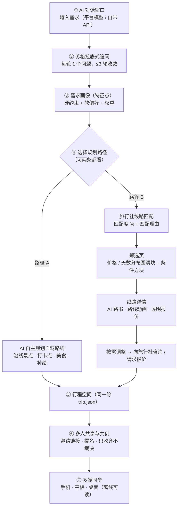

# PRD-01 · 愿景、定位与能力边界（产品基线 v3）

## 0. 文档地位与口径优先级

本文件是 TripCraft **产品口径的唯一基准**。项目设计周期较长，早期文档对产品形态有过三次不同的表述（单文件路书引擎 → 多端 App + 离线快照双轮 → 本基线）。当仓库内文档之间出现冲突时，按以下优先级裁决：

| 优先级 | 文档 | 说明 |
| :---: | :--- | :--- |
| 1 | **本文件 PRD-01** | 产品是什么、给谁用、边界在哪 |
| 2 | PRD-02 ~ PRD-05 | 用户、场景、功能、商业模式（须与本文件一致） |
| 3 | ARC-01 ~ ARC-10、ADR-001 ~ ADR-010 | 系统架构与技术决策 |
| 4 | DLV-01 ~ DLV-03 | 路线图、风险、追溯矩阵 |
| 5 | 执行全书 `docs/00` ~ `docs/17` | 专项设计与工程细节；与上层冲突时以上层为准，章首横幅会注明 |
| 6 | [`WHITEPAPER.md`](../WHITEPAPER.md)、根目录历史任务书 | 历史背景，不作为现行口径 |

> 📌 **为什么要写这一节**：过去几轮修订都是"在旧文档上追加新结论"，结果是同一个问题在不同文件里有不同答案（例如"做不做 C 端账号"在 [`docs/03 §3.2.2`](../03-b2b-agency-operations.md#322--关键设计决策游客没有账号) 是"不做"，在 [`docs/15`](../15-multi-device-and-collaboration.md) 是"做"）。没有优先级，读者只能凭运气判断哪一份是现行的。

---

## 1. 产品定位

- **一句话定位**：**多端同步、多人共享的 AI 旅行规划 App**——用对话说清需求，AI 帮你规划自驾路线，或为你匹配最合适的旅行社线路。
- **C 端价值**：像使用 ChatGPT / Claude 一样输入想法（平台默认模型，或换用自己喜欢的模型 API），系统通过追问帮你把需求想清楚，再给出两种方案：**AI 自主规划的自驾路线**，或**按匹配度排序的旅行社线路**。方案进入行程空间后，同行的家人朋友可以一起看、一起提意见，手机、平板、电脑实时同步。
- **B 端价值**：旅游仍然高度依赖本地资源，这些资源不在小红书等社区攻略里。TripCraft 给旅行社一套**线路工作室**：上传线路即可被匹配给合适的旅客；AI 把线路生成为可交互的路书与路线动画；价格与包含项透明列出，并能按客户需求调整线路与报价——取代"发一份 PDF 文字行程"的传统沟通方式。

---

## 2. 核心使用流程

两条路径的产出都落到**同一种数据**——符合 [`spec/trip.schema.json`](../../spec/trip.schema.json) 的行程 DSL，因此后续的共享、同步、离线、导出能力对两条路径完全通用。完整交互设计见 [第 16 章 · 双路径规划与旅行社线路匹配](../16-planning-paths-and-route-matching.md)。

---

## 3. 产品构成：三大支柱、一条 B 端线、四项支撑能力

| 层次 | 能力 | 一句话 | 设计依据 |
| :--- | :--- | :--- | :--- |
| **支柱 1** | AI 对话入口 | 对话框即入口；可选平台模型或自带 API；追问引导需求收敛 | [docs/08](../08-socratic-interaction-design.md) · [ADR-009](../architecture/adr/ADR-009-llm-provider-byok.md) |
| **支柱 2** | 双路径规划 | 路径 A：AI 自主规划自驾；路径 B：旅行社线路匹配 + 筛选 | [docs/16](../16-planning-paths-and-route-matching.md) · [ADR-010](../architecture/adr/ADR-010-route-matching-scoring.md) |
| **支柱 3** | 多端同步 + 多人共享 | 统一账号、行程空间、邀请共创、跨设备同步 | [docs/15](../15-multi-device-and-collaboration.md) · [ARC-03](../architecture/ARC-03-offline-sync.md) |
| **B 端线** | 旅行社线路工作室 | 线路上架 → 被匹配；AI 路书与路线动画；透明报价与按需调整 | [docs/17](../17-agency-route-studio.md) · [docs/13](../13-agency-partnership-design.md) |
| 支撑 | 离线可读与单文件导出 | 无信号区域可读；给不装 App 的长辈发单文件 | [docs/01](../01-resilience-and-failover.md) · [ADR-006](../architecture/adr/ADR-006-snapshot-delivery-format.md) |
| 支撑 | 车机投递 | 全天途经点一键交给车机导航 | [docs/02](../02-cockpit-protocol.md) |
| 支撑 | 白标交付 | 旅行社把成交后的路书以自有品牌交给客户 | [docs/03](../03-b2b-agency-operations.md) |
| 支撑 | 旅后回忆录 | 照片与足迹整理 | [docs/06](../06-memory-journal-engine.md) |

> 📌 **支撑能力不是被砍掉，而是不再承担主叙事。** 上一版基线把"零依赖单文件离线快照"称为"一等交付形态"，展示站也以"座舱 + 离线交付"收尾。按本基线，这些能力保留并继续按原设计实现，但排期与对外表述都让位于三大支柱（见 [DLV-01](../delivery/DLV-01-roadmap-mvp.md)）。

---

## 4. 行业痛点与破局点

| 场景阶段 | 现有替代方案 | 真实体验缺陷 | TripCraft 破局点 |
| :--- | :--- | :--- | :--- |
| **说清需求** | 在攻略社区搜索、在通用 AI 里写长提示词 | 用户自己也没想清楚；通用 AI 不追问，直接给一份看似完整的方案 | 追问式对话把模糊需求收敛为可计算的需求画像（[docs/08](../08-socratic-interaction-design.md)） |
| **自己规划自驾** | 小红书笔记 + 地图 App 逐个搜索 + Excel | 沿线有什么值得停、哪家好吃要自己拼；AI 方案常编造景点 | 路径 A 沿路线走廊检索真实 POI，事实来自图商，模型只做编排（[ADR-008](../architecture/adr/ADR-008-ai-generation-guardrails.md)） |
| **找旅行社** | 搜索引擎、朋友推荐、OTA 跟团页 | 线路信息不透明、价格不可比、不知道哪条适合自己家 | 路径 B 按需求画像给出匹配度与理由；价格/天数分布图帮助理解行情（[docs/16](../16-planning-paths-and-route-matching.md)） |
| **与旅行社沟通** | 微信聊天 + PDF 文字行程 | 想改一天、换个酒店就要来回问；报价改了不知道改在哪 | 线路详情页直接调整选项看到预估价；报价按版本留痕（[docs/17](../17-agency-route-studio.md)） |
| **一群人商量** | 微信群接龙 | 意见散落在聊天记录里；长辈不会用新 App | 行程空间：邀请链接加入、结构化提名、只收齐不裁决（[docs/15](../15-multi-device-and-collaboration.md)） |
| **旅行社获客与交付** | 朋友圈、OTA 抽佣渠道、PDF 行程单 | 好线路展示不出来，客户信任度低 | 线路被精准匹配给需求相符的旅客；AI 路书与路线动画呈现线路实力 |

---

## 5. 能力边界规范 (Scope & Boundaries)

遵循 [docs/ERRATA.md](../ERRATA.md) 与 [docs/00-overview-and-glossary.md §0.3](../00-overview-and-glossary.md#03-三条责任边界线tripcraft-不是清单)，界定系统能力边界：

| 业务/技术领域 | 我们做（In Scope） | 我们不做（Out of Scope） | 依赖第三方/外部条件 | 对应依据 |
| :--- | :--- | :--- | :--- | :--- |
| **AI 对话与模型** | 平台默认模型；允许用户自带模型 API（BYOK）；所有模型输出统一经过校验管线 | 不训练自有基础大模型；不把用户自带的 Key 上传到平台服务器 | 平台默认模型须为可合规对公众提供服务的模型 | [ADR-009](../architecture/adr/ADR-009-llm-provider-byok.md) ｜ OI-022 |
| **路线规划（路径 A）** | 编排沿线景点、打卡点、美食与补给；估算车程 | 不编造 POI；不提供逐转向导航 | 图商 POI 检索与算路服务 | [ADR-008](../architecture/adr/ADR-008-ai-generation-guardrails.md) ｜ [ADR-005](../architecture/adr/ADR-005-map-navigation-abstraction.md) |
| **线路匹配（路径 B）** | 展示**持证**旅行社上架的线路、计算匹配度并给出理由、把咨询转交旅行社 | 不展示无资质主体的线路；付费不影响匹配度；不做"资质挂靠"撮合 | 旅行社资质由平台审核 | [ADR-010](../architecture/adr/ADR-010-route-matching-scoring.md) ｜ [docs/13 §13.5.4](../13-agency-partnership-design.md#1354--一个必须先回答的问题他有资质吗) ｜ OI-021 |
| **旅游业务** | 线路信息展示、匹配、咨询与报价沟通工具 | 平台不自营线路、不组团、不与旅客签旅游合同 | 线下履约与旅游合同由持牌旅行社承担 | [07 §7.1.1](../07-legal-and-compliance.md#711-边界线与法律后果的对应) |
| **交易与支付** | 阶段 1–2：旅行社与旅客站外签约付款；平台只收取对旅行社的技术服务费 | 阶段 1–2 不代收团款、不设资金池 | 是否在后续阶段做站内交易为待决事项 D6 | [docs/03 §3.7.1](../03-b2b-agency-operations.md#371--首要合规约束平台不经手游客资金) |
| **多人协作** | 邀请加入、结构化提名、偏好对齐、冲突可视化 | 不做强制多数投票裁决 | 团队内部协商 | [15 §15.5](../15-multi-device-and-collaboration.md#155--协作层的设计原则只负责收齐不负责裁决) |
| **多端同步** | 统一账号下手机 / 平板 / 桌面同步；离线可读、恢复联网后合并 | 不做高频并发打字协同（OT/CRDT 文档编辑） | 云端同步服务 | [ADR-002](../architecture/adr/ADR-002-sync-conflict-model.md) |
| **导航引导** | 节点规划、节奏建议、深链投递经纬度 | 不自研导航引擎、不提供逐转向语音导航 | 系统已安装的高德/百度地图 App | [ERRATA](../ERRATA.md#24-智能座舱交付能力边界更正) |
| **智能驾驶 (NOA)** | 标注道路类型与通行注意事项 | 不接入 CAN 总线、不触发或干预 NOA | 车机系统原生算法 | [02 §2.1](../02-cockpit-protocol.md#21-先做一次必要的纠偏) |
| **能耗与 SOC** | 沿途补能点预警与距离测算 | 不读取车辆实时 SOC | 用户手动填报 | [02 §2.6](../02-cockpit-protocol.md#26-关于读取车辆状态必须明确说不) |
| **离线容灾** | 已同步行程断网可读；可导出零依赖单文件 | 不在断网时重新规划全新路线 | 浏览器/App 本地存储 | [01 §1.1](../01-resilience-and-failover.md) ｜ [ADR-006](../architecture/adr/ADR-006-snapshot-delivery-format.md) |

---

## 6. 明确非目标 (Non-Goals)

1. **不做旅行社**：平台不自营线路、不组团、不与旅客签旅游合同。匹配的终点是"把旅客交给持证旅行社"。
2. **阶段 1–2 不经手团款**：资金流向决定法律身份（[docs/03 §3.7.1](../03-b2b-agency-operations.md#371--首要合规约束平台不经手游客资金)）；是否在后续阶段做站内交易是待决事项 D6，不是默认方向。
3. **不训练自有基础大模型**：模型能力外购或由用户自带；平台的投入放在需求收敛、校验管线、匹配与真实供给上。
4. **不抓取第三方社区内容**：不爬取小红书、马蜂窝等平台的笔记作为数据源；可以提供跳转链接。
5. **不自研地图导航底座**：坐标与算路调用持牌图商服务，严守 BR-025。
6. **现阶段不做车机原生 App、不承诺控制车辆**：车机能力止于深链投递与手机投屏。

---

## 7. 成功度量标准

与 [PRD-05 商业模式](PRD-05-business-model.md#5-指标体系建议北极星与核心运营指标) 对齐（全部为 `Proposed`，以试点数据校准）：

- **C 端**：对话 → 形成需求画像的完成率；路径 A 方案采纳率；路径 B 线路咨询率；行程空间的邀请加入率；多端同步活跃设备数。
- **B 端**：上架线路数与信息完整度；线路被匹配曝光数；咨询 → 报价 → 成交转化（旅行社自报 + 抽样回访）；AI 路书 / 路线动画生成使用率。

---

## 8. 本次基线变更（2026-10-17）：被取代的旧口径

业主在 2026-10-17 明确："设计目标是多端同步、多人共享的旅游 App"，主场景是"AI 对话 → 追问 → 特征提取 → 两种匹配方式"，商业化方向是"面向旅行社的线路上架、AI 路书与透明沟通"。以下旧口径因此被取代：

| # | 旧口径 | 出处 | 新口径 | 遗留风险 / 后续动作 |
| :---: | :--- | :--- | :--- | :--- |
| 1 | 单文件离线快照是"一等交付形态"，与 App 双轮驱动 | 上一版 PRD-01、ADR-006、根 README | App 本体 = 对话 + 双路径 + 多端多人；快照降为支撑能力 | ADR-006 结论不变，只调整优先级 |
| 2 | 不做 C 端账号、不接触终端游客 | [docs/03 §3.2.2](../03-b2b-agency-operations.md#322--关键设计决策游客没有账号)、[docs/13 §13.3.3](../13-agency-partnership-design.md#1333-三条不越线) 第 2 条 | C 端账号是产品主体；旅行社交付给**自有客户**的白标路书仍可免登查看 | 旅行社对"平台接触客户"的顾虑 → [docs/17](../17-agency-route-studio.md) 的客户归属规则 |
| 3 | 不做旅行社之间的比价 / 撮合 | [docs/13 §13.3.3](../13-agency-partnership-design.md#1333-三条不越线) 第 3 条、上一版 PRD-01 §5 | 做线路匹配与筛选，价格是筛选维度之一 | 旅行社可能因此隐藏真实价格 → 价格展示粒度由旅行社选择（[docs/17](../17-agency-route-studio.md)）；A-14 待验证 |
| 4 | "我们不是一家消费级 AI 公司"，C 端只是漏斗 | [docs/13 §13.8.6](../13-agency-partnership-design.md#1386--但这个选择有代价它意味着我们不是一家消费级-ai-公司) | C 端 AI 对话是产品入口 | [§13.8.5](../13-agency-partnership-design.md#1385--ai-生成行程是入场券不是差异) 的判断仍然成立：**AI 生成本身不是差异**。差异放在多人共享、真实的本地旅行社供给、价格与线路透明度上 |
| 5 | 平台统一调用自有 LLM | [ARC-05](../architecture/ARC-05-backend-integrations.md) | 支持用户自带模型 API | [ADR-009](../architecture/adr/ADR-009-llm-provider-byok.md)；OI-022 |
| 6 | MVP = "共用核心 + B 端白标最小闭环" | 上一版 DLV-01（决策 D2） | MVP = C 端对话 + 路径 A + 共享同步，同时完成首批旅行社线路上架（冷启动供给）；路径 B 在阶段 2 上线 | 见 [DLV-01](../delivery/DLV-01-roadmap-mvp.md)；D2 改由 D8 承接 |
| 7 | "不构成客源对接/引流"是合规防火墙 | [docs/13 §13.5.4](../13-agency-partnership-design.md#1354--一个必须先回答的问题他有资质吗) | 平台**只为持证旅行社**引流，并承担在线旅游平台经营者的审核与公示义务 | 🔴 OI-021：须执业律师出具意见，与 OI-016/OI-017 同一次咨询 |

---

## 9. 待业主确认的决策

| 编号 | 决策 | 本文件采用的默认值 | 影响范围 |
| :--- | :--- | :--- | :--- |
| **D5** | 平台默认模型选型与自带 API 支持范围 | 默认模型选用可合规对公众提供服务的国内模型；自带 API 支持 OpenAI 兼容接口与 Anthropic 接口 | ADR-009、ARC-05、成本 |
| **D6** | 平台是否在后续阶段代收团款（站内交易） | 阶段 1–2 不做；阶段 3 前重新评估 | 法律身份、PRD-05 收入结构 |
| **D7** | 路径 B 的收费方式（线索费 / 上架订阅 / 成交佣金） | 上架订阅 + 线索包为主，不收成交佣金（不经手资金时无法核实成交） | PRD-05、docs/17 |
| **D8** | MVP 切分 | 见 DLV-01 v3：阶段 1 = 对话 + 路径 A + 共享同步 + 首批线路上架；阶段 2 = 路径 B 匹配与筛选、AI 路书与透明报价 | DLV-01、团队配置 |
| **D9** | C 端是否收费 | 基础免费；平台模型调用设免费额度，超额可订阅或改用自带 API。会员权益另含按路线生成的行程皮肤（[docs/09 §9.0](../09-visual-design-system.md#90-两层app-外观与行程皮肤)），并评估「单趟解锁」 | PRD-05、A-16、A-07 |
| **D10** | 产品 UI 的视觉体系：[docs/09](../09-visual-design-system.md) 的五主题 + 液态玻璃，还是演示站使用的 Unify GTM 暖纸风格 | ✅ **已决定（2026-10-22）**：两者都不直接采用，而是统一的 App 外观——[SHOWCASE §4.1](../SHOWCASE-web-design.md#41-共用外壳与应用视窗) 的方案（暖白 · 品牌橙，地图浮层用玻璃），与目的地无关；docs/09 的主题与流派改为会员功能「行程皮肤」，只作用于行程页与产出物（docs/09 §9.0）。Unify GTM 只约束演示站的营销页面 | docs/09、ARC-10 §5、docs/04 §4.6、`.agents/rules/`、`.agents/skills/frontend-design-system` |
