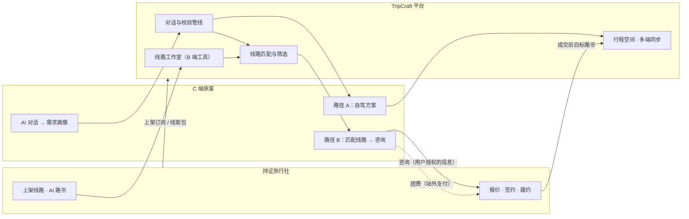

# PRD-02 · 用户与客户模型（C 端与 B 端）

## 1. 客户细分体系 (Customer Segments)

TripCraft 是一个双边产品：**C 端旅客**通过 AI 对话规划行程或寻找旅行社线路；**B 端旅行社**上架线路、被匹配、用 AI 工具把线路呈现得透明可信。

| 细分群体 | 场景描述 | 主要路径 | 现有替代方案 | 核心痛点 | JTBD 目标宣言 | 付费意愿假设 | 优先级 |
| :--- | :--- | :--- | :--- | :--- | :--- | :--- | :--- |
| **C 端：家庭自驾组织者** | 带长辈、孩子的家庭或亲友自驾（4–10 人） | 路径 A 为主，B 为辅 | 小红书攻略 + 地图 App + 微信群 + Excel | 规划耗时；长辈体力与孩子作息难兼顾；意见散落在群聊里 | 当我们多代同行时，我想说清楚家里的情况就得到一份不累的方案，并让全家一起看、一起改 | 基础免费；平台模型超额或高级功能可能付费（[A-16](../ASSUMPTIONS.md)） | **首批** |
| **C 端：想省心找旅行社的家庭** | 不想自己开车或不熟悉目的地，希望交给靠谱的本地旅行社 | 路径 B 为主 | 搜索引擎、OTA 跟团页、朋友推荐 | 线路信息不透明、价格不可比、不知道哪条适合自己家；沟通靠 PDF 来回 | 当我想把行程交给专业的人时，我想快速找到适合我家的线路，看清价格和包含什么，并按需调整 | 对平台不直接付费，向旅行社支付团费 | **首批** |
| **C 端：小团 / 情侣自驾** | 2–4 人年轻自驾群体 | 路径 A | 小红书攻略 + 收藏夹 | 信息碎片化；AI 方案常编造景点 | 当我们探索新路线时，我想快速得到一份真实可行的路书，路上随时能看 | 免费为主 | 次批 |
| **C 端：独行自驾者** | 个人长途自驾、摄影 | 路径 A | 两步路等专业轨迹工具 | 缺少人文编排与补给提示 | 当我独自穿越时，我想要可靠的离线行程与补给预警 | 待验证 | 远期 |
| **B 端：精品地接社**（供给方） | 西北、川西、滇藏等区域的本地地接社（5–30 人） | 线路工作室 | Word/PDF 行程单、朋友圈、OTA 渠道 | 好线路被看见的机会少；客户信任度低；按客户需求改线路与报价成本高 | 当我有一条好线路时，我想让需要它的客人找到它、看懂它、信任它，并能快速按他的要求报价 | 上架订阅 + 线索包（[A-03](../ASSUMPTIONS.md)、[A-17](../ASSUMPTIONS.md)） | **首批** |
| **B 端：包车车队** | 考斯特 / 商务车车队、专职司机 | 线路工作室（需持证）或路书工具（自有客户） | 微信报价 + 口头行程 | 无法展示服务细节；路况变化通知不及时 | 当客人问我"路上怎么安排"时，我想给他一份看得懂、能调整的方案 | 同上 | 次批 |
| **B 端：独立定制师 / 领队** | 自由定制师、俱乐部领队 | 路书工具（服务自有客户）；无资质不可上架 | 个人微信直发文档 | 资质合规风险（[docs/13 §13.5.4](../13-agency-partnership-design.md#1354--一个必须先回答的问题他有资质吗)） | 当我为熟客定制时，我想在合规框架内快速交付专业方案 | 待验证 | 次批 |

> ⚠️ 以上频次、规模与付费意愿均为待调研的假设，不得作为事实对外引用（[ASSUMPTIONS.md](../ASSUMPTIONS.md)）。

## 2. 角色矩阵 (Role Matrix)

| 角色 ID | 角色名称 | 分类 | 主要使用端 | 核心任务 | 权限与访问范围概述 |
| :--- | :--- | :--- | :--- | :--- | :--- |
| **R-C01** | 组织者 / 领队 | C 端 | C-MOBILE, C-WEB | 与 AI 对话形成需求画像；选择路径 A 或 B；发起行程空间并邀请同行人；向旅行社咨询 | 行程所有者（Owner），全字段编辑与成员邀请权 |
| **R-C02** | 同行成员 | C 端 | C-MOBILE | 加入行程空间、提名想去的地点并附理由、查看今日行程 | 成员权限，可提名与撤销自己的意见 |
| **R-C03** | 长辈 / 低数字素养成员 | C 端 | C-MOBILE, C-SNAPSHOT | 用大字模式查看今日安排；不装 App 时通过单文件或链接查看 | 只读，免登录访问分享版 |
| **R-C04** | 独行自驾者 | C 端 | C-MOBILE, C-CABIN | 单人路线规划、车机投递、记录足迹 | 个人工作区完全控制权 |
| **R-B01** | 机构管理员 | B 端 | C-CONSOLE | 提交资质、管理席位、配置品牌、管理订阅 | 租户超级管理员，掌管财务与组织 |
| **R-B02** | 计调 / 定制师 | B 端 | C-CONSOLE | 上架线路、生成 AI 路书与路线动画、回复咨询与报价、为客户制作路书 | 创作者权限，管理所分配线路与路书 |
| **R-B03** | 导游 / 随团司机 | B 端 | C-MOBILE | 行中执行、查阅脱敏名单、发布路况变更 | 执行者权限，仅查看脱敏名单 |
| **R-B04** | 成交旅客 / 机构客户 | 混合 | C-MOBILE, C-SNAPSHOT | 通过匹配咨询成交，或作为旅行社自有客户接收白标路书 | 对该路书只读；有 TripCraft 账号时路书进入其行程空间 |
| **R-P01** | 平台运营与风控 | 平台 | C-CONSOLE (Ops) | 资质审核、线路内容审核、匹配规则维护、违规处置 | 平台管理员，抽检与下架 |
| **R-O01** | 车厂 / 生态伙伴 | 生态 | 开放标准接口 | 远期互联协议对齐 | 仅限公开协议的标准交互 |

## 3. 代表人物卡 (Persona Cards)

> ⚠️ **声明**：以下人物卡均为**虚构代表人物**，基于文档逻辑推演，非真实用户访谈实录，待实地调研核验（[A-13](../ASSUMPTIONS.md)、[A-03](../ASSUMPTIONS.md)）。

### 人物卡 1 · C 端家庭自驾组织者（路径 A，虚构）
- **姓名/称呼**：周海（36 岁，互联网产品经理）
- **典型场景**：暑期带父母、妻子和 6 岁双胞胎，自驾青海湖 + 河西走廊。
- **痛点**：父亲膝盖不好不能多走路；母亲想去塔尔寺；妻子想拍茶卡盐湖但怕人多；孩子要午睡。以前手工排 Excel 熬了三个晚上。
- **价值兑现**：周海在对话框里说"暑假带爸妈和两个孩子去青海甘肃，8 天，别太累"。AI 追问了两轮（长辈能不能上 3,500 米以上、孩子几点午睡），生成需求画像。他选择"AI 帮我规划自驾"，得到一份每天车程不超过 4 小时、景点都经过核验的草案，然后把行程空间链接发到家庭群，母亲在里面提名了塔尔寺。

### 人物卡 2 · C 端想找旅行社的家庭（路径 B，虚构）
- **姓名/称呼**：陈敏（42 岁，中学教师）
- **典型场景**：带 70 岁的父母和 10 岁的女儿去敦煌，自己不想开长途。
- **痛点**：在网上搜到的线路要么是 30 人大团，要么是一份 PDF 加一个总价；问了三家旅行社，每家报价方式都不一样，没法比较；想把住宿升级一档，又得重新问一遍。
- **价值兑现**：陈敏在对话里说了家里的情况，选择"看旅行社线路"。筛选页显示 18 条匹配线路，价格分布图告诉她人均 ¥6,000 左右是主流。她勾选"适合长辈""私家团"，打开匹配度 91% 的一条，在详情页把酒店升级一档，看到预估价变化，然后发起咨询。旅行社在当天给出正式报价，报价单上清楚列出每一项。

### 人物卡 3 · B 端地接社定制师（虚构）
- **姓名/称呼**：林娜（29 岁，成都某川藏地接社定制师）
- **典型场景**：社里有一条打磨多年的川西 8 日线路，以前只在老客户里转介绍。
- **痛点**：客户问"这条线适合老人吗""能不能多住一晚"，每次都要在微信里解释、重新算价、重做 PDF；新客户不信任，觉得小社不可靠。
- **价值兑现**：林娜把原来的 Word 行程单导入线路工作室，AI 抽取成逐日行程，她逐项确认后补上价格规则和可调选项（"加一晚 +¥600/人"），生成了路线动画。线路上架后被匹配给需求相符的家庭；客户在详情页自己调整选项看预估价，再发来咨询，她在工作台一键生成报价版本。

## 4. 价值流与关系模型

### 关系边界与数据归属说明
1. **平台不是旅行社**：平台不自营线路、不组团、不与旅客签旅游合同；阶段 1–2 不经手团款（[PRD-01 §6](PRD-01-vision-positioning.md#6-明确非目标-non-goals)）。
2. **只为持证旅行社引流**：未通过资质审核的主体不能上架线路、不会出现在匹配结果中（[docs/17 §17.2](../17-agency-route-studio.md#172-入驻前提)）。
3. **客户归属**：咨询发起后，沟通记录只对旅客与该旅行社可见；成交后的客户关系属于旅行社，平台不在其线路页与白标路书中推送竞品（[docs/17 §17.8](../17-agency-route-studio.md#178-客户归属与旅行社的顾虑)）。
4. **旅客的数据**：需求画像属于旅客；发起咨询时由旅客确认发送给旅行社的范围。
5. **旅行社的数据**：特许私有资源与成本价不对任何第三方可见，不进入公共模型语料（[docs/00 铁律 4](../00-overview-and-glossary.md#铁律-4--数据主权本地化-local-data-sovereignty)）。
