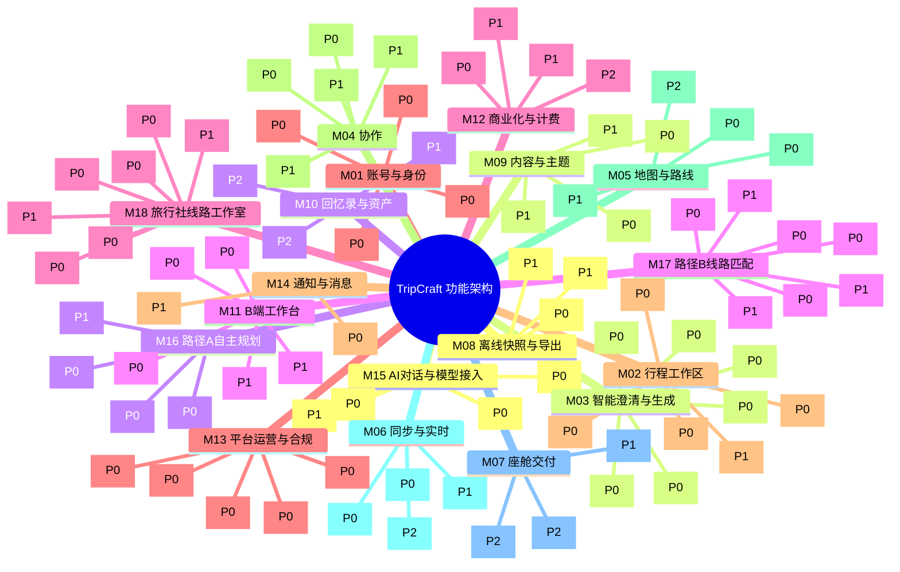

# PRD-04 · 功能架构与功能规格

## 1. 功能全景脑图 (Functional Mindmap)

> v3 新增模块 M15（AI 对话与模型接入）、M16（路径 A）、M17（路径 B）、M18（旅行社线路工作室），并按产品基线调整了部分既有功能的优先级。调整明细见 [DLV-01 §4](../delivery/DLV-01-roadmap-mvp.md#4-v3-优先级调整记录)。

## 2. 优先级与阶段定义

- **P0（必需，阶段 1–2）**：产品基线的主线闭环——对话与需求画像、路径 A、多人共享与多端同步、首批线路上架（阶段 1）；路径 B 匹配与筛选、AI 路书、咨询与报价、白标交付（阶段 2）。
- **P1（次要，阶段 2–3）**：体验增强与行中能力——自带模型 API、筛选增强、协作增强、离线单文件、车机投递、路线动画。
- **P2（探索，阶段 4–5）**：座舱深度协同、旅后回忆录与生态连接。

---

## 3. 模块功能清单与 P0 功能卡

> 模块按产品基线的主线排列：先列 v3 新增的 M15–M18，再列既有的 M01–M14。

### M15 AI 对话与模型接入 (S-AI)
- **目标**：提供类似通用大模型聊天的对话入口；支持平台默认模型与用户自带模型 API；所有模型输出进入统一校验管线。
- **涉及角色**：R-C01, R-B02
- **设计依据**：[docs/16 §16.2](../16-planning-paths-and-route-matching.md#162-对话入口与模型选择)、[ADR-009](../architecture/adr/ADR-009-llm-provider-byok.md)

| 功能 ID | 名称 | 端分类 | 优先级 | 阶段 | 设计/实现状态 | 来源 |
| :--- | :--- | :--- | :--- | :--- | :--- | :--- |
| **F-M15-01** | 对话界面与模型选择器 | C/B 共用 | P0 | 阶段 1 | 草案 / 无 | [docs/16 §16.2.1](../16-planning-paths-and-route-matching.md#1621-界面形态) |
| **F-M15-02** | 自带模型 API（BYOK）接入与能力检测 | C/B 共用 | P1 | 阶段 2 | 草案 / 无 | [docs/16 §16.2.2](../16-planning-paths-and-route-matching.md#1622-自带模型-apibyok) |
| **F-M15-03** | 平台模型额度计量与提示 | C/B 共用 | P0 | 阶段 1 | 草案 / 无 | [ADR-009](../architecture/adr/ADR-009-llm-provider-byok.md) |
| **F-M15-04** | 模型请求发送前的隐私脱敏 | C/B 共用 | P0 | 阶段 1 | 草案 / 无 | [docs/16 §16.2.2](../16-planning-paths-and-route-matching.md#1622-自带模型-apibyok) |

#### F-M15-01 对话界面与模型选择器
- **优先级/阶段**：P0 / 阶段 1 ｜ **端**：C-MOBILE, C-WEB ｜ **模块**：M15
- **用户故事**：作为用户，我想像用聊天机器人一样直接说出旅行想法，并能看到当前用的是哪个模型。
- **验收标准**：
  1. Given 用户打开 App，When 进入首页，Then 看到对话输入框、零输入药丸与附件入口；输入框左侧显示当前模型与剩余额度。
  2. Given 用户上传攻略截图或 PDF，When 发送，Then 内容作为素材进入追问流程（[§8.3.3](../08-socratic-interaction-design.md#833--模式-c--素材投喂readme-未覆盖)）。
  3. Given 当前模型调用失败，When 返回错误，Then 显示失败原因与可选操作，不静默切换模型。
- **依赖**：F-M01-01 ｜ **设计/实现状态**：草案 / 无

#### F-M15-02 自带模型 API（BYOK）接入与能力检测
- **优先级/阶段**：P1 / 阶段 2 ｜ **端**：C-MOBILE, C-WEB ｜ **模块**：M15
- **用户故事**：作为已有模型订阅的用户，我想用自己的 API 来对话和规划。
- **验收标准**：
  1. Given 用户添加 OpenAI 兼容或 Anthropic 接口的 Key，When 保存，Then 执行能力检测，并展示“是否支持行程生成”的结论。
  2. Given Key 已保存，When 检查服务端存储与日志，Then 不存在该 Key 的任何副本（Key 仅存于设备加密存储）。
  3. Given 自带模型的服务商在境外，When 首次使用，Then 告知对话内容将发送至该服务商。
- **依赖**：F-M15-01, F-M15-04 ｜ **设计/实现状态**：草案 / 无

#### F-M15-03 平台模型额度计量与提示
- **优先级/阶段**：P0 / 阶段 1 ｜ **端**：S-AI 后端, C-MOBILE ｜ **模块**：M15
- **用户故事**：作为平台，我想对平台模型的调用设置额度，以便控制推理成本；作为用户，我想知道还剩多少额度。
- **验收标准**：
  1. Given 用户使用平台模型，When 每次调用完成，Then 按调用计量扣减额度，并在输入框旁更新剩余次数。
  2. Given 额度用完，When 用户继续发送，Then 提示“可订阅，或添加自己的 API”；已形成的画像与行程不受影响。
- **依赖**：F-M15-01 ｜ **设计/实现状态**：草案 / 无

#### F-M15-04 模型请求发送前的隐私脱敏
- **优先级/阶段**：P0 / 阶段 1 ｜ **端**：C-MOBILE, C-WEB ｜ **模块**：M15
- **用户故事**：作为用户，我不希望家人的姓名、证件号和手机号被发送给任何模型服务商。
- **验收标准**：
  1. Given 用户输入包含姓名、身份证号或手机号，When 向任何模型发起请求，Then 这些内容在客户端被替换为占位符（“一位长辈”“成员 A”）。
  2. Given 模型返回的内容包含占位符，When 在界面展示，Then 在本地还原为原文，原文不离开设备。
- **依赖**：无 ｜ **设计/实现状态**：草案 / 无

---

### M16 路径 A · AI 自主规划自驾 (S-GENERATE + S-GEO)
- **目标**：根据需求画像规划自驾路线，检索沿线景点、打卡点、美食与补给；模型只负责编排与撰写建议，事实来自图商。
- **涉及角色**：R-C01
- **设计依据**：[docs/16 §16.5](../16-planning-paths-and-route-matching.md#165-路径-a--ai-自主规划自驾路线)、[ADR-008](../architecture/adr/ADR-008-ai-generation-guardrails.md)

| 功能 ID | 名称 | 端分类 | 优先级 | 阶段 | 设计/实现状态 | 来源 |
| :--- | :--- | :--- | :--- | :--- | :--- | :--- |
| **F-M16-01** | 骨架生成与分段车程校验 | C 端 | P0 | 阶段 1 | 草案 / 无 | [docs/16 §16.5.1](../16-planning-paths-and-route-matching.md#1651-输入--算法--输出--失败态) |
| **F-M16-02** | 沿线走廊检索（景点 / 打卡点 / 美食 / 补给） | C 端 | P0 | 阶段 1 | 草案 / 无 | [docs/16 §16.5.1](../16-planning-paths-and-route-matching.md#1651-输入--算法--输出--失败态) |
| **F-M16-03** | 每日编排与约束求解 | C 端 | P0 | 阶段 1 | 草案 / 无 | [docs/16 §16.5.1](../16-planning-paths-and-route-matching.md#1651-输入--算法--输出--失败态) |
| **F-M16-04** | 节点备选与“换一个” | C 端 | P1 | 阶段 2 | 草案 / 无 | [docs/16 §16.5.1](../16-planning-paths-and-route-matching.md#1651-输入--算法--输出--失败态) |

#### F-M16-01 骨架生成与分段车程校验
- **优先级/阶段**：P0 / 阶段 1 ｜ **端**：S-GENERATE, S-GEO ｜ **模块**：M16
- **用户故事**：作为自驾用户，我想先得到一个每天开车时间合理的整体路线，再看每天停哪。
- **验收标准**：
  1. Given 已确认的画像，When 生成骨架，Then 产出 2–3 个候选过夜城镇序列，每段车程经图商测算，超过日车程上限的候选被剔除。
  2. Given 所有候选都违反约束，When 返回结果，Then 指出是哪条约束卡住，并给出至少两种放宽选项，不输出违反约束的骨架。
- **依赖**：F-M03-05, F-M05-02 ｜ **设计/实现状态**：草案 / 无

#### F-M16-02 沿线走廊检索（景点 / 打卡点 / 美食 / 补给）
- **优先级/阶段**：P0 / 阶段 1 ｜ **端**：S-GEO ｜ **模块**：M16
- **用户故事**：作为自驾用户，我想知道沿途绕一点路就能到的好地方和好吃的。
- **验收标准**：
  1. Given 一段骨架路线，When 检索走廊，Then 返回绕行 ≤ 30 分钟（可配置）范围内的景区、观景打卡点、餐饮与补给点，均带图商 POI ID。
  2. Given 走廊检索使用了算路几何，When 检查写入行程 DSL 的数据，Then 不包含算路折线（[BR-025](../07-legal-and-compliance.md#781--br-025地图数据不得落库oi-003-收敛后的新增规则)）。
  3. Given 模型为餐饮节点撰写推荐语，When 写入 DSL，Then 店名、坐标、评分来自图商，推荐语写入 `advice`。
- **依赖**：F-M16-01, F-M05-01 ｜ **设计/实现状态**：草案 / 无

#### F-M16-03 每日编排与约束求解
- **优先级/阶段**：P0 / 阶段 1 ｜ **端**：S-GENERATE ｜ **模块**：M16
- **用户故事**：作为带老人孩子的组织者，我想每天的安排不累、吃饭和午休时间合理。
- **验收标准**：
  1. Given 候选 POI 与画像，When 编排一天，Then 车程 + 游览 + 餐点窗口 + 儿童午休不超过当天时间预算；按出行日期校验开放时间。
  2. Given 某 POI 开放信息缺失，When 编入行程，Then 标记 `tentative` 并说明原因。
  3. Given 编排完成，When 输出草案，Then 通过 `trip.schema.json` 校验与 BR 规则校验后才展示给用户。
- **依赖**：F-M16-02, F-M02-04 ｜ **设计/实现状态**：草案 / 无

---

### M17 路径 B · 旅行社线路匹配与筛选 (S-MATCH)
- **目标**：按需求画像为持证旅行社线路计算匹配度并解释；提供带分布图的范围滑块与条件方块的筛选页。
- **涉及角色**：R-C01, R-P01
- **设计依据**：[docs/16 §16.6–§16.7](../16-planning-paths-and-route-matching.md#167--筛选页设计)、[ADR-010](../architecture/adr/ADR-010-route-matching-scoring.md)

| 功能 ID | 名称 | 端分类 | 优先级 | 阶段 | 设计/实现状态 | 来源 |
| :--- | :--- | :--- | :--- | :--- | :--- | :--- |
| **F-M17-01** | 资格判定与匹配度评分 | C 端 | P0 | 阶段 2 | 草案 / 无 | [ADR-010](../architecture/adr/ADR-010-route-matching-scoring.md) |
| **F-M17-02** | 匹配理由与维度分项展示 | C 端 | P0 | 阶段 2 | 草案 / 无 | [docs/16 §16.6.2](../16-planning-paths-and-route-matching.md#1662-匹配度的构成) |
| **F-M17-03** | 带分布图的价格 / 天数范围滑块 | C 端 | P0 | 阶段 2 | 草案 / 无 | [docs/16 §16.7.2](../16-planning-paths-and-route-matching.md#1672-带分布图的范围滑块) |
| **F-M17-04** | 条件方块与分面计数 | C 端 | P0 | 阶段 2 | 草案 / 无 | [docs/16 §16.7.3](../16-planning-paths-and-route-matching.md#1673-条件方块) |
| **F-M17-05** | 空结果的单项放宽建议 | C 端 | P1 | 阶段 2 | 草案 / 无 | [docs/16 §16.7.5](../16-planning-paths-and-route-matching.md#1675-结果为空时) |
| **F-M17-06** | 线路对比（最多 3 条） | C 端 | P1 | 阶段 2 | 草案 / 无 | [docs/16 §16.7.6](../16-planning-paths-and-route-matching.md#1676-结果卡排序与对比) |
| **F-M17-07** | 对话与筛选双向联动 | C 端 | P1 | 阶段 2 | 草案 / 无 | [docs/16 §16.7.4](../16-planning-paths-and-route-matching.md#1674-与对话的双向联动) |

#### F-M17-01 资格判定与匹配度评分
- **优先级/阶段**：P0 / 阶段 2 ｜ **端**：S-MATCH ｜ **模块**：M17
- **用户故事**：作为用户，我想只看到真正适合我家的持证旅行社线路，并按合适程度排序。
- **验收标准**：
  1. Given 画像含海拔上限 3,000 米，When 匹配，Then 最高海拔超过 3,000 米的线路不出现在结果与“接近但不满足”分区中。
  2. Given 线路只在预算上超出 ≤ 15%，When 匹配，Then 进入“接近但不满足”分区并写明“比预算高 X%”。
  3. Given 同一画像、同一线路集合、同一规则版本，When 重复计算，Then 结果完全一致；规则版本号随结果保存。
  4. Given 某线路购买了推广，When 计算匹配度，Then 匹配度不变；推广只出现在标注“广告”的位置。
- **依赖**：F-M03-05, F-M18-02, F-M13-01 ｜ **设计/实现状态**：草案 / 无

#### F-M17-02 匹配理由与维度分项展示
- **优先级/阶段**：P0 / 阶段 2 ｜ **端**：C-MOBILE, C-WEB ｜ **模块**：M17
- **用户故事**：作为用户，我想知道一条线路为什么是 91%，差在哪里。
- **验收标准**：
  1. Given 一条匹配结果，When 展示结果卡，Then 显示 3 条最强匹配理由与 1 条最大差距。
  2. Given 用户点开匹配度，When 展示分项，Then 列出各维度得分与权重；线路未提供的维度标“旅行社未提供”且不计入。
  3. Given 计算结果为 1.0，When 展示，Then 显示 99%。
- **依赖**：F-M17-01 ｜ **设计/实现状态**：草案 / 无

#### F-M17-03 带分布图的价格 / 天数范围滑块
- **优先级/阶段**：P0 / 阶段 2 ｜ **端**：C-MOBILE, C-WEB ｜ **模块**：M17
- **用户故事**：作为用户，我想像在找房平台上那样，拖动价格和天数的范围，并看到行情分布。
- **验收标准**：
  1. Given 筛选页加载，When 渲染价格滑块，Then 上方显示通过其他筛选条件的线路价格柱状分布（20–30 箱，P95 以上合并），并标出“你的预算”与“市场中位”。
  2. Given 用户拖动把手，When 范围变化，Then 范围内的柱即时着色，结果数与列表在 150 ms 防抖后更新。
  3. Given 用户切换“人均 / 全家总价”，When 重新渲染，Then 全家总价按旅行社价格规则与同行人员构成计算；无法计算的线路不参与总价分布并标“需咨询”。
  4. Given 键盘用户聚焦把手，When 按左右键，Then 把手步进且读屏软件读出当前数值。
- **依赖**：F-M17-01 ｜ **设计/实现状态**：草案 / 无

#### F-M17-04 条件方块与分面计数
- **优先级/阶段**：P0 / 阶段 2 ｜ **端**：C-MOBILE, C-WEB ｜ **模块**：M17
- **用户故事**：作为用户，我想点选人数、出行方式、住宿档次等条件，并在点之前就知道会剩下多少条。
- **验收标准**：
  1. Given 筛选页加载，When 渲染方块，Then 每个方块显示选中后的结果数；结果数为 0 的方块置灰并说明原因。
  2. Given 画像中有长者，When 首次进入，Then “适合长辈”方块默认选中并带“来自你的需求”标记。
  3. Given 同组多选、跨组多选，When 计算结果，Then 组内为“或”、组间为“且”。
  4. Given 用户修改筛选条件，When 检查需求画像，Then 画像未被改写；页顶提示筛选与需求的差异并提供“以此更新需求”。
- **依赖**：F-M17-01 ｜ **设计/实现状态**：草案 / 无

---

### M18 旅行社线路工作室 (S-CATALOG)
- **目标**：让持证旅行社上架线路并被匹配；用 AI 生成路书与路线动画；提供透明报价与按需调整的咨询闭环。
- **涉及角色**：R-B01, R-B02, R-C01, R-B04
- **设计依据**：[docs/17](../17-agency-route-studio.md)

| 功能 ID | 名称 | 端分类 | 优先级 | 阶段 | 设计/实现状态 | 来源 |
| :--- | :--- | :--- | :--- | :--- | :--- | :--- |
| **F-M18-01** | 现有行程单导入与 AI 抽取 | B 端 | P0 | 阶段 1 | 草案 / 无 | [docs/17 §17.3](../17-agency-route-studio.md#173-线路上架三种录入方式) |
| **F-M18-02** | 上架信封：价格规则、可调选项、包含项与团期 | B 端 | P0 | 阶段 1 | 草案 / 无 | [docs/17 §17.4](../17-agency-route-studio.md#174-上架线路包含什么) |
| **F-M18-03** | AI 交互路书生成 | B 端 | P0 | 阶段 2 | 草案 / 无 | [docs/17 §17.6](../17-agency-route-studio.md#176-ai-路书与路线动画) |
| **F-M18-04** | 路线动画生成 | B 端 | P1 | 阶段 2 | 草案 / 无 | [docs/17 §17.6.2](../17-agency-route-studio.md#1762-路线动画输入--算法--输出--失败态) |
| **F-M18-05** | 线路详情自助调整与预估价 | C 端 | P0 | 阶段 2 | 草案 / 无 | [docs/17 §17.7](../17-agency-route-studio.md#177-按需调整与报价闭环) |
| **F-M18-06** | 咨询收件箱与报价版本 | C/B 共用 | P0 | 阶段 2 | 草案 / 无 | [docs/17 §17.7](../17-agency-route-studio.md#177-按需调整与报价闭环) |
| **F-M18-07** | 线路数据看板 | B 端 | P1 | 阶段 3 | 草案 / 无 | [docs/17 §17.9](../17-agency-route-studio.md#179-旅行社工作台) |

#### F-M18-01 现有行程单导入与 AI 抽取
- **优先级/阶段**：P0 / 阶段 1 ｜ **端**：C-CONSOLE ｜ **模块**：M18
- **用户故事**：作为定制师，我想把社里现成的 Word / PDF 行程单导入，而不是从头录入。
- **验收标准**：
  1. Given 上传 Word / PDF / Excel 行程单，When 抽取完成，Then 生成行程 DSL 草稿，逐字段显示置信度，低置信度字段高亮，原文件与抽取结果并排显示。
  2. Given 草稿存在未确认字段，When 定制师尝试提交上架，Then 阻断并定位到未确认字段；不提供“一键全部接受”。
  3. Given 抽取出的地点，When 确认时，Then 经图商核验；未核验的标待定。
- **依赖**：F-M13-01, F-M05-01 ｜ **设计/实现状态**：草案 / 无

#### F-M18-02 上架信封：价格规则、可调选项、包含项与团期
- **优先级/阶段**：P0 / 阶段 1 ｜ **端**：C-CONSOLE ｜ **模块**：M18
- **用户故事**：作为定制师，我想把价格规则和可选项一次填好，让客人自己就能看到调整后的大致价格。
- **验收标准**：
  1. Given 填写价格规则，When 保存，Then 至少包含成人价；可选填长者 / 儿童 / 婴幼儿价、淡旺季日历、成团人数阶梯与单房差。
  2. Given 勾选“适合长辈”等人群标签，When 未填写说明，Then 不允许提交。
  3. Given 选择价格展示档位（起价 / 区间 / 分项明细），When 选择“起价”，Then 必须填写起价条件。
  4. Given 线路信息不完整，When 查看工作台，Then 显示完整度与“补全后可出现在哪些筛选里”。
- **依赖**：F-M18-01 ｜ **设计/实现状态**：草案 / 契约已定义（[`listing.schema.json`](../../spec/listing.schema.json)，OI-024）

#### F-M18-03 AI 交互路书生成
- **优先级/阶段**：P0 / 阶段 2 ｜ **端**：C-CONSOLE ｜ **模块**：M18
- **用户故事**：作为定制师，我想把线路一键生成为客人看得懂的交互路书，而不是一页文字。
- **验收标准**：
  1. Given 已确认的行程 DSL，When 生成路书，Then 产出逐日安排、地图与景点卡片（复用 [第 10 章](../10-roadbook-reading-design.md)）；AI 撰写的文字带“AI 生成”标识。
  2. Given 线路没有实拍素材，When 生成路书，Then 不使用 AI 生成的景点图片。
  3. Given 定制师修改了 AI 撰写的文字，When 发布，Then 该段标识改为“旅行社编辑”。
- **依赖**：F-M18-02, F-M09-02 ｜ **设计/实现状态**：草案 / 无

#### F-M18-05 线路详情自助调整与预估价
- **优先级/阶段**：P0 / 阶段 2 ｜ **端**：C-MOBILE, C-WEB ｜ **模块**：M18
- **用户故事**：作为旅客，我想在线路详情页直接改人数、升级酒店、加一天，马上看到大概多少钱。
- **验收标准**：
  1. Given 线路配置了可调选项，When 用户调整，Then 按旅行社价格规则即时计算并显示“预估价”，标注以旅行社报价为准。
  2. Given 选项之间存在互斥或依赖，When 用户选择冲突组合，Then 阻止并说明原因。
  3. Given 价格规则无法覆盖用户的组合（如缺儿童价），When 计算，Then 显示“需咨询”，不按成人价代算。
- **依赖**：F-M18-02 ｜ **设计/实现状态**：草案 / 无

#### F-M18-06 咨询收件箱与报价版本
- **优先级/阶段**：P0 / 阶段 2 ｜ **端**：C-CONSOLE, C-MOBILE ｜ **模块**：M18
- **用户故事**：作为定制师，我想在一个地方看到客人的需求和调整，快速给出报价；作为旅客，我想看清每一版报价改了什么。
- **验收标准**：
  1. Given 旅客发起咨询，When 确认发送范围，Then 仅发送其勾选的画像字段与调整项；联系方式在旅客同意前不发送。
  2. Given 定制师生成报价，When 保存，Then 形成不可修改的版本；新版本自动列出与上一版的项目与金额差异。
  3. Given 定制师婉拒，When 提交，Then 必须选择原因；原因进入匹配反馈统计。
  4. Given 报价被接受并标记成交，When 完成，Then 成交线路以白标路书进入旅客的行程空间。
- **依赖**：F-M18-05, F-M11-03 ｜ **设计/实现状态**：草案 / 无

---

### M01 账号与身份 (S-IDENTITY)
- **目标**：支撑 C 端组织者与 B 端机构员工登录认证，保障游客免登录访问。
- **涉及角色**：R-C01, R-B01, R-B02, R-B03, R-B04

| 功能 ID | 名称 | 端分类 | 优先级 | 阶段 | 设计/实现状态 | 来源 |
| :--- | :--- | :--- | :--- | :--- | :--- | :--- |
| **F-M01-01** | 手机号/验证码与第三方登录 | C/B 共用 | P0 | 阶段 1 | 草案 / 无 | [PRD-02](PRD-02-personas-segments.md) |
| **F-M01-02** | 行程临时成员加入与昵称口令识别 | C 端 | P0 | 阶段 1 | 草案 / 无 | [docs/15 §15.9](../15-multi-device-and-collaboration.md#159--与-b-端白标的关系这个形态反而加固了第-13-章) |
| **F-M01-03** | 机构账号与多角色身份管理 | B 端 | P0 | 阶段 1 | 草案 / 无 | [docs/03 §3.2](../03-b2b-agency-operations.md#32-角色模型与权限矩阵) |
| **F-M01-04** | 设备绑定与多端会话漫游 | C/B 共用 | P0 | 阶段 1 | 草案 / 无 | [docs/15 §15.4](../15-multi-device-and-collaboration.md#154-多端协同设备矩阵手机--车机--ipad--桌面) |

#### F-M01-01 手机号/验证码与第三方登录
- **优先级/阶段**：P0 / 阶段 1 ｜ **端**：C-MOBILE, C-WEB, C-CONSOLE ｜ **模块**：M01
- **用户故事**：作为组织者或定制师，我想用手机验证码或微信快速登录，以便安全管理我的行程资产。
- **验收标准**：
  1. Given 未注册手机号，When 输入正确短信验证码，Then 自动创建账号并跳转至工作区首页。
  2. Given 微信授权登录，When 首次授权，Then 自动绑定当前设备并下发短期 Access Token。
- **依赖**：无 ｜ **设计/实现状态**：草案 / 无

#### F-M01-02 行程临时成员加入与昵称口令识别
- **优先级/阶段**：P0 / 阶段 1 ｜ **端**：C-MOBILE, C-SNAPSHOT ｜ **模块**：M01
- **用户故事**：作为同行旅客或机构客户，我想点击链接直接进入行程，以便无需注册账号即可协同或查看。
- **验收标准**：
  1. Given 收到受邀链接包含有效 `link_token`，When 在浏览器或端内打开，Then 免登直接进入当前行程视图。
  2. Given 首次进入协同空间，When 成员输入群内代号（如“姑姑”），Then 仅在当前行程内绑定该代号，不建立全局平台画像。
- **依赖**：F-M01-01 ｜ **设计/实现状态**：草案 / 无

#### F-M01-03 机构账号与多角色身份管理
- **优先级/阶段**：P0 / 阶段 1 ｜ **端**：C-CONSOLE ｜ **模块**：M01
- **用户故事**：作为机构管理员，我想为本社计调与司导分配不同角色席位，以便明确业务权限分工。
- **验收标准**：
  1. Given 租户管理员，When 邀请新计调加入，Then 计调获得创建与编辑路书权限，无法查看租户结算账单。
  2. Given 随团司导，When 被指派行程任务，Then 仅可查看指派路书的脱敏旅客名单与行程日程。
- **依赖**：F-M01-01 ｜ **设计/实现状态**：草案 / 无

#### F-M01-04 设备绑定与多端会话漫游
- **优先级/阶段**：P0 / 阶段 1 ｜ **端**：C-MOBILE, C-TABLET, C-WEB ｜ **模块**：M01
- **用户故事**：作为用户，我想在手机上开始的对话和行程，打开平板或电脑时能接着看、接着改，以便在合适的设备上做合适的事。
- **验收标准**：
  1. Given 用户在手机上确认了需求画像，When 在电脑上用同一账号登录，Then 30 秒内看到同一份画像与行程（在线时）。
  2. Given 某设备离线期间修改了行程，When 恢复联网，Then 修改按 [ADR-002](../architecture/adr/ADR-002-sync-conflict-model.md) 合并；冲突时提示用户，不静默覆盖。
  3. Given 用户在设置中移除某台设备，When 该设备下次联网，Then 本地登录态失效；自带模型 Key 不随账号同步，不受影响。
- **依赖**：F-M01-01, F-M06-01 ｜ **设计/实现状态**：草案 / 无

---

### M02 行程工作区 (S-WORKSPACE)
- **目标**：管理行程元数据、每日日程（Days）与节点（Nodes）的结构化组织与版本。
- **涉及角色**：R-C01, R-B02

| 功能 ID | 名称 | 端分类 | 优先级 | 阶段 | 设计/实现状态 | 来源 |
| :--- | :--- | :--- | :--- | :--- | :--- | :--- |
| **F-M02-01** | 创建与初始化行程 | C/B 共用 | P0 | 阶段 1 | 草案 / 无 | [spec/trip.schema.json](../../spec/trip.schema.json) |
| **F-M02-02** | 行程日与节点管理 | C/B 共用 | P0 | 阶段 1 | 草案 / 无 | [spec/node.schema.json](../../spec/node.schema.json) |
| **F-M02-03** | 行程草案版本保存与回溯 | C/B 共用 | P0 | 阶段 1 | 草案 / 无 | [docs/04 §4.1](../04-dsl-specification-v1.md) |
| **F-M02-04** | 待定项 (tentative) 标记与管理 | C/B 共用 | P0 | 阶段 1 | 草案 / 无 | [docs/08 §8.7](../08-socratic-interaction-design.md#87--模糊输入的处理设计) |
| **F-M02-05** | 多方案对比与沙盘推演 | C/B 共用 | P1 | 阶段 2 | 草案 / 无 | [docs/15 §15.4](../15-multi-device-and-collaboration.md#154-多端协同设备矩阵手机--车机--ipad--桌面) |

#### F-M02-01 创建与初始化行程
- **优先级/阶段**：P0 / 阶段 1 ｜ **端**：C-MOBILE, C-CONSOLE ｜ **模块**：M02
- **用户故事**：作为用户，我想输入行程标题、起止日期与出发地，以便建立符合规范的行程真相源。
- **验收标准**：
  1. Given 用户输入有效标题与日期区间，When 提交创建，Then 生成符合 `trip.schema.json` 的空行程对象并分配全局唯一 `tripId`。
  2. Given 日期格式不符合 ISO-8601，When 校验时，Then 阻断提交并提示有效日期格式。
- **依赖**：F-M01-01 ｜ **设计/实现状态**：草案 / 无

#### F-M02-02 行程日与节点管理
- **优先级/阶段**：P0 / 阶段 1 ｜ **端**：C-MOBILE, C-CONSOLE ｜ **模块**：M02
- **用户故事**：作为创作者，我想在具体某天添加、排序或删除景点/餐饮/酒店节点，以便灵活排程。
- **验收标准**：
  1. Given 某日节点列表，When 用户上下拖拽节点，Then 自动重算节点的 `seq` 序号与相邻预计车程。
  2. Given 添加新节点，When 填写地点与建议耗时，Then 校验 `time.planned` 不与前序节点发生时间倒挂。
- **依赖**：F-M02-01 ｜ **设计/实现状态**：草案 / 无

#### F-M02-03 行程草案版本保存与回溯
- **优先级/阶段**：P0 / 阶段 1 ｜ **端**：C-MOBILE, C-CONSOLE ｜ **模块**：M02
- **用户故事**：作为创作者，我想保存草案快照并在改错时回退，以便保护排程劳动成果。
- **验收标准**：
  1. Given 用户进行关键编辑，When 触发保存，Then 本地自动递增保存草案快照历史（最近 10 版）。
  2. Given 用户点击历史回溯，When 确认载入历史版本，Then 将工作区当前状态原子性替换为所选版本。
- **依赖**：F-M02-01 ｜ **设计/实现状态**：草案 / 无

#### F-M02-04 待定项 (tentative) 标记与管理
- **优先级/阶段**：P0 / 阶段 1 ｜ **端**：C-MOBILE, C-CONSOLE ｜ **模块**：M02
- **用户故事**：作为用户，我想将尚未确定门票或酒店的节点标为待定，以便在成稿中保留探索弹性而不阻塞流程。
- **验收标准**：
  1. Given 未锁定具体酒店的住宿节点，When 勾选待定，Then 节点写入 `tentative: true` 及 `tentativeReason`。
  2. Given 导出或预览路书，When 遇到待定节点，Then 节点展示柔性虚线样式，不作为硬性日程催促。
- **依赖**：F-M02-02 ｜ **设计/实现状态**：草案 / 无

---

### M03 智能澄清与生成 (S-GENERATE)
- **目标**：自然语言倾倒意图识别，苏格拉底反问对齐约束，自动化产出合规 DSL。
- **涉及角色**：R-C01, R-B02

| 功能 ID | 名称 | 端分类 | 优先级 | 阶段 | 设计/实现状态 | 来源 |
| :--- | :--- | :--- | :--- | :--- | :--- | :--- |
| **F-M03-01** | 自由倾倒意向解析 | C/B 共用 | P0 | 阶段 1 | 草案 / 无 | [docs/08 §8.1](../08-socratic-interaction-design.md) |
| **F-M03-02** | 苏格拉底渐进式反问与偏好收敛 | C/B 共用 | P0 | 阶段 1 | 草案 / 无 | [docs/08 §8.3](../08-socratic-interaction-design.md) |
| **F-M03-03** | 行程 DSL 初稿生成与回显确认 | C/B 共用 | P0 | 阶段 1 | 草案 / 无 | [docs/08 §8.5](../08-socratic-interaction-design.md) |
| **F-M03-04** | 规则与合规自动前置校验 | C/B 共用 | P0 | 阶段 1 | 草案 / 无 | [docs/07 §7.1.2](../07-legal-and-compliance.md#712-措辞白名单--黑名单编译器强制) |
| **F-M03-05** | 需求画像（特征点）结构化与来源标注 | C 端 | P0 | 阶段 1 | 草案 / 无 | [docs/16 §16.3](../16-planning-paths-and-route-matching.md#163-需求画像特征点的提取) |
| **F-M03-06** | 规划路径选择与推荐 | C 端 | P0 | 阶段 1 | 草案 / 无 | [docs/16 §16.4](../16-planning-paths-and-route-matching.md#164-路径选择) |

#### F-M03-01 自由倾倒意向解析
- **优先级/阶段**：P0 / 阶段 1 ｜ **端**：C-MOBILE, C-CONSOLE ｜ **模块**：M03
- **用户故事**：作为组织者，我想直接粘贴长段聊天记录或口头想法，以便系统自动提取关键自驾要素。
- **验收标准**：
  1. Given 包含天数、成员和意向地点的非结构化文本，When 引擎解析，Then 结构化提取 `party`、`destinations` 与可用天数。
  2. Given 文本未提及出发日期，When 解析完成，Then 预设为“近期周末”并标记待用户澄清。
- **依赖**：无 ｜ **设计/实现状态**：草案 / 无

#### F-M03-02 苏格拉底渐进式反问与偏好收敛
- **优先级/阶段**：P0 / 阶段 1 ｜ **端**：C-MOBILE, C-CONSOLE ｜ **模块**：M03
- **用户故事**：作为用户，我想回答针对性的选择题而非写作文，以便快速敲定高原耐受度与作息偏好。
- **验收标准**：
  1. Given 检测到高海拔目的地，When 发起反问，Then 单次仅展示 1 组互斥选项（如“最高海拔上限：3000m / 3800m / 无限制”）。
  2. Given 反问轮次达到 3 轮，When 用户回答完毕，Then 立即收敛至方案生成，不再发起新反问。
- **依赖**：F-M03-01 ｜ **设计/实现状态**：草案 / 无

#### F-M03-03 行程 DSL 初稿生成与回显确认
- **优先级/阶段**：P0 / 阶段 1 ｜ **端**：C-MOBILE, C-CONSOLE ｜ **模块**：M03
- **用户故事**：作为用户，我想在生成前核对关键约束回显，以便确认 AI 没有理解偏差。
- **验收标准**：
  1. Given 解析完成的约束清单，When 生成前回显，Then 用户可一键修正关键参数后确认生成。
  2. Given 用户点击生成，When 求解成功，Then 输出合法的 `trip.json` 骨架并注入工作区。
- **依赖**：F-M03-02 ｜ **设计/实现状态**：草案 / 无

#### F-M03-04 规则与合规自动前置校验
- **优先级/阶段**：P0 / 阶段 1 ｜ **端**：C/B 引擎 ｜ **模块**：M03
- **用户故事**：作为平台，我想在路书生成即刻拦截涉密区域与违规表述，以便杜绝法律风险。
- **验收标准**：
  1. Given 生成文本命中禁用词库（如“绝对安全”“官方指定”），When 执行校验，Then 阻断落库并自动改写为合规推荐词。
  2. Given 涉及未核验野景点，When 校验时，Then 强制注入“同行者提议 · 未核验”标识。
- **依赖**：F-M03-03 ｜ **设计/实现状态**：草案 / 无

#### F-M03-05 需求画像（特征点）结构化与来源标注
- **优先级/阶段**：P0 / 阶段 1 ｜ **端**：C-MOBILE, C-WEB ｜ **模块**：M03
- **用户故事**：作为用户，我想看到系统从对话里理解出的需求清单，并能改掉它猜错的地方，以便后面的规划和匹配是按我的真实情况来的。
- **验收标准**：
  1. Given 追问收敛，When 生成需求画像，Then 画像覆盖 [docs/16 §16.3.1](../16-planning-paths-and-route-matching.md#1631-特征点清单) 的特征点，每个字段标注来源 `stated` / `inferred` / `default`。
  2. Given 画像中存在 `inferred` 字段，When 展示回显卡，Then 该字段带“推断 · 请确认”标记，用户可点击直接修改。
  3. Given 同一份已确认的画像，When 再次调用路径 A 或路径 B，Then 不重新读取对话原文，结果只取决于画像。
- **依赖**：F-M03-02 ｜ **设计/实现状态**：草案 / 契约已定义（[`profile.schema.json`](../../spec/profile.schema.json)，OI-024）

#### F-M03-06 规划路径选择与推荐
- **优先级/阶段**：P0 / 阶段 1 ｜ **端**：C-MOBILE, C-WEB ｜ **模块**：M03
- **用户故事**：作为用户，我想在说清需求后选择"自己开车由 AI 规划"或"看旅行社线路"，也可以两样都看。
- **验收标准**：
  1. Given 画像已确认，When 展示回显卡，Then 同时显示路径 A 与路径 B 两个入口，路径 B 入口上显示当前匹配线路数。
  2. Given 画像中提到“跟团”“包车”“省心”，When 展示入口，Then 高亮推荐路径 B，路径 A 仍可点击。
  3. Given 路径 B 匹配数为 0，When 展示入口，Then 显示“暂无匹配线路”，并记录该画像的区域与日期到供给缺口统计。
- **依赖**：F-M03-05, F-M17-01 ｜ **设计/实现状态**：草案 / 无

---

### M04 协作 (S-COLLAB)
- **目标**：去中心化收齐同行人意见，遵循“只收齐不裁决”原则。
- **涉及角色**：R-C01, R-C02, R-C03

| 功能 ID | 名称 | 端分类 | 优先级 | 阶段 | 设计/实现状态 | 来源 |
| :--- | :--- | :--- | :--- | :--- | :--- | :--- |
| **F-M04-01** | 邀请成员与空间共享 | C 端 | P0 | 阶段 1 | 草案 / 无 | [docs/15 §15.5](../15-multi-device-and-collaboration.md#155--协作层的设计原则只负责收齐不负责裁决) |
| **F-M04-02** | 景点提名与结构化理由收集 | C 端 | P0 | 阶段 1 | 草案 / 无 | [docs/15 §15.5.2](../15-multi-device-and-collaboration.md#1552--提名界面三个入口一个必填字段) |
| **F-M04-03** | 沉默成员可见与零输入表达 | C 端 | P1 | 阶段 2 | 草案 / 无 | [docs/15 §15.5.1](../15-multi-device-and-collaboration.md#1551-四条具体设计) |
| **F-M04-04** | 冲突检测与分头行动建议 | C 端 | P1 | 阶段 2 | 草案 / 无 | [docs/15 §15.5.4](../15-multi-device-and-collaboration.md#1554--接缝清单在哪里变成-88-的冲突) |
| **F-M04-05** | 领队决策与补丁合并确认 | C 端 | P1 | 阶段 2 | 草案 / 无 | [docs/01 §1.6.5](../01-resilience-and-failover.md#165-输出是补丁不是新路书) |

#### F-M04-01 邀请成员与空间共享
- **优先级/阶段**：P0 / 阶段 1 ｜ **端**：C-MOBILE, C-WEB ｜ **模块**：M04
- **用户故事**：作为组织者，我想生成一个专属群邀请链接，以便同行亲友一键加入协同空间。
- **验收标准**：
  1. Given 组织者点击分享，When 生成链接，Then 携带受控 `tripId` 与带时效的邀请签名。
  2. Given 成员通过链接进入，When 查看空间，Then 可见已排日程全貌与成员状态。
- **依赖**：F-M01-02 ｜ **设计/实现状态**：草案 / 无

#### F-M04-02 景点提名与结构化理由收集
- **优先级/阶段**：P0 / 阶段 1 ｜ **端**：C-MOBILE, C-WEB ｜ **模块**：M04
- **用户故事**：作为同行成员，我想在行程空间里提一个想去的地方并说明理由，以便组织者在定方案时考虑我的想法。
- **验收标准**：
  1. Given 成员在行程空间中，When 提名一个地点，Then 必须选择或填写理由（[§15.5.2](../15-multi-device-and-collaboration.md#1552--提名界面三个入口一个必填字段)），地点经图商检索确认。
  2. Given 提名已提交，When 其他成员查看，Then 提名以“同行者提议”样式呈现，与事实和系统建议可区分。
  3. Given 提名被组织者采纳，When 写入行程，Then 节点保留提名人代号与理由；未采纳的提名保留在提名清单中，不自动删除。
- **依赖**：F-M04-01, F-M05-01 ｜ **设计/实现状态**：草案 / 无

---

### M05 地图与路线 (S-GEO)
- **目标**：标准化 POI 检索与经纬度对齐，提供耗时估算，保障地图商用合规。
- **涉及角色**：R-C01, R-B02

| 功能 ID | 名称 | 端分类 | 优先级 | 阶段 | 设计/实现状态 | 来源 |
| :--- | :--- | :--- | :--- | :--- | :--- | :--- |
| **F-M05-01** | POI 检索与经纬度合规对齐 | C/B 共用 | P0 | 阶段 1 | 草案 / 无 | [ADR-005](../architecture/adr/ADR-005-map-navigation-abstraction.md) |
| **F-M05-02** | 路线规划与耗时测算 | C/B 共用 | P0 | 阶段 1 | 草案 / 无 | [docs/01 §1.3](../01-resilience-and-failover.md) |
| **F-M05-03** | 沿途补给与服务区推荐 | C/B 共用 | P1 | 阶段 3 | 草案 / 无 | [docs/02 §2.6](../02-cockpit-protocol.md#26-关于读取车辆状态必须明确说不) |
| **F-M05-04** | 离线路网与简易底图包支持 | C 端 | P2 | 阶段 4 | 草案 / 无 | [docs/01 §1.1](../01-resilience-and-failover.md) |

#### F-M05-01 POI 检索与经纬度合规对齐
- **优先级/阶段**：P0 / 阶段 1 ｜ **端**：S-GEO 后端 ｜ **模块**：M05
- **用户故事**：作为创作者，我想在搜索景点时获得合规的经纬度与标准地名，以便准确排程。
- **验收标准**：
  1. Given 检索关键词“塔尔寺”，When 调取服务商适配层，Then 返回 GCJ-02 坐标及准确 POI ID，不直接在客户端暴露 Master Key。
  2. Given 坐标落库，When 写入节点，Then 仅保留离散经纬度点（≤2个坐标），不写入高密度 polyline（BR-025）。
- **依赖**：ADR-005 ｜ **设计/实现状态**：草案 / 无

#### F-M05-02 路线规划与耗时测算
- **优先级/阶段**：P0 / 阶段 1 ｜ **端**：S-GEO 后端 ｜ **模块**：M05
- **用户故事**：作为系统，我想测算相邻节点间的自驾里程与预计耗时，以便合理排布全天游玩节奏。
- **验收标准**：
  1. Given 两个有序 POI 节点，When 计算驾车距离，Then 返回公里数与预计分钟数，并自动附加 15% 山区冗余缓冲时间。
  2. Given 跨天单程车程超过 6 小时，When 输出方案时，Then 触发中途强制休息提示。
- **依赖**：F-M05-01 ｜ **设计/实现状态**：草案 / 无

---

### M06 同步与实时 (S-SYNC)
- **目标**：实现本地优先存储，支持在线操作日志增量同步与断网点对点补丁。
- **涉及角色**：R-C01, R-C02, R-B03

| 功能 ID | 名称 | 端分类 | 优先级 | 阶段 | 设计/实现状态 | 来源 |
| :--- | :--- | :--- | :--- | :--- | :--- | :--- |
| **F-M06-01** | 本地优先存储与离线读写 | C/B 共用 | P0 | 阶段 1 | 草案 / 无 | [ADR-002](../architecture/adr/ADR-002-sync-conflict-model.md) |
| **F-M06-02** | 服务端增量操作日志同步 | C/B 共用 | P0 | 阶段 1 | 草案 / 无 | [spec/patch.schema.json](../../spec/patch.schema.json) |
| **F-M06-03** | 二维码/短链点对点 Patch 分发 | C 端 | P1 | 阶段 3 | 草案 / 无 | [docs/15 §15.6.1](../15-multi-device-and-collaboration.md#1561--而点对点同步这块拼图书里已经有一块现成的) |
| **F-M06-04** | 实时成员信标与位置脱敏共享 | C 端 | P2 | 阶段 4 | 草案 / 无 | [docs/02 §2.4](../02-cockpit-protocol.md#24-cockpitbridge-适配器架构) |

#### F-M06-01 本地优先存储与离线读写
- **优先级/阶段**：P0 / 阶段 1 ｜ **端**：C-MOBILE, C-SNAPSHOT ｜ **模块**：M06
- **用户故事**：作为自驾用户，我想在无网环境下照常查看和记录备忘，以便应用在无人区始终可用。
- **验收标准**：
  1. Given 网络完全断开，When 用户打开行程，Then 瞬间从本地 IndexedDB 载入完整路书与地图矢量缓存。
  2. Given 离线新增备忘，When 写入本地，Then 数据标注为 `local_draft`，待网络恢复后异步排队上传。
- **依赖**：无 ｜ **设计/实现状态**：草案 / 无

#### F-M06-02 服务端增量操作日志同步
- **优先级/阶段**：P0 / 阶段 1 ｜ **端**：C-MOBILE, C-TABLET, C-WEB ｜ **模块**：M06
- **用户故事**：作为行程空间的成员，我想看到别人刚做的修改，也希望我在离线时做的修改联网后能同步出去。
- **验收标准**：
  1. Given 两名成员同时在线，When 一人修改某日节点，Then 另一人的设备在 5 秒内收到变更（指标占位）。
  2. Given 设备离线期间产生操作，When 恢复联网，Then 按服务端权威版本号排队提交；被拒绝的操作提示用户，不静默丢弃（[ADR-002](../architecture/adr/ADR-002-sync-conflict-model.md)）。
  3. Given 同步失败，When 用户查看行程，Then 显示“本设备有未同步的修改”，并可查看差异（[§1.9.4](../01-resilience-and-failover.md#194--第四类失效同步失败2026-10-08-增补)）。
- **依赖**：F-M06-01, F-M01-04 ｜ **设计/实现状态**：草案 / 无

---

### M07 座舱交付 (C-CABIN)
- **目标**：实现系统深链途经点批量投递与手机车载镜像适配，恪守能力边界。
- **涉及角色**：R-C01, R-B03, R-O01

| 功能 ID | 名称 | 端分类 | 优先级 | 阶段 | 设计/实现状态 | 来源 |
| :--- | :--- | :--- | :--- | :--- | :--- | :--- |
| **F-M07-01** | 高德/百度系统深链途经点批量投递 | C/B 共用 | P1 | 阶段 3 | 草案 / 无 | [docs/02 §2.1](../02-cockpit-protocol.md), [ERRATA](../ERRATA.md) |
| **F-M07-02** | 手机车载互联投屏与镜像适配 | C 端 | P2 | 阶段 4 | 草案 / 无 | [docs/12 §12.1](../12-oem-partnership-design.md) |
| **F-M07-03** | 车机专属分屏与副驾屏协同 | C 端 | P2 | 阶段 4 | 草案 / 无 | [docs/10 §10.3](../10-roadbook-reading-design.md) |

#### F-M07-01 高德/百度系统深链途经点批量投递
- **优先级/阶段**：P1 / 阶段 3 ｜ **端**：C-MOBILE, C-CABIN ｜ **模块**：M07
- **用户故事**：作为驾驶员，我想将全天途经点一键发到车机导航，以便无需手动逐个输入。
- **验收标准**：
  1. Given 某日包含 4 个途经点，When 点击“投递导航”，Then 构造高德/百度 URI Schema，调起原生导航并预填起点与途经点序列。
  2. Given 宿主设备未安装对应地图，When 调起失败，Then 优雅降级提示复制地址或显示二维码。
- **依赖**：F-M05-01 ｜ **设计/实现状态**：草案 / 无

---

### M08 离线快照与导出 (S-EXPORT)
- **目标**：支撑能力（[PRD-01 §3](PRD-01-vision-positioning.md#3-产品构成三大支柱一条-b-端线四项支撑能力)）：只读分享链接供群外与长辈查看；零依赖单文件 HTML 供离线与不装 App 的场景。
- **涉及角色**：R-C01, R-B02, R-C03

| 功能 ID | 名称 | 端分类 | 优先级 | 阶段 | 设计/实现状态 | 来源 |
| :--- | :--- | :--- | :--- | :--- | :--- | :--- |
| **F-M08-01** | 单文件 HTML 离线交付包编译 | C/B 共用 | P1 | 阶段 3 | 草案 / 无 | [docs/05 §5.1](../05-compiler-pipeline.md), [ADR-006](../architecture/adr/ADR-006-snapshot-delivery-format.md) |
| **F-M08-02** | 静态只读分享短链与快照托管 | C/B 共用 | P0 | 阶段 2 | 草案 / 无 | [docs/15 §15.10.2](../15-multi-device-and-collaboration.md#15102-三条不变量) |
| **F-M08-03** | PDF / 长图海报打印导出 | C/B 共用 | P1 | 阶段 3 | 草案 / 无 | [docs/05 §5.4](../05-compiler-pipeline.md) |

#### F-M08-01 单文件 HTML 离线交付包编译
- **优先级/阶段**：P1 / 阶段 3 ｜ **端**：S-EXPORT, CLI ｜ **模块**：M08
- **用户故事**：作为定制师或领队，我想导出独立 HTML 文件，以便发给长辈或在断网环境下双击即开。
- **验收标准**：
  1. Given 完整行程 DSL，When 编译器打包，Then 输出单一 `.html` 文件，所有样式、脚本与离线数据内联打包（≤2MB）。
  2. Given 在飞行模式下双击该 HTML，When 在任意现代浏览器打开，Then 界面完整渲染，无外链缺失导致的报错。
- **依赖**：ADR-006 ｜ **设计/实现状态**：草案 / 无

#### F-M08-02 静态只读分享短链与快照托管
- **优先级/阶段**：P0 / 阶段 2 ｜ **端**：S-EXPORT ｜ **模块**：M08
- **用户故事**：作为用户，我想生成微信分享链接，以便群外好友与长辈无需安装软件秒开。
- **验收标准**：
  1. Given 生成分享版，When 用户生成短链，Then 自动剥离个人证件与私密备注（脱敏）。
  2. Given 协作服务端下线销毁，When 访问已托管的静态快照链接，Then 快照依然长期稳定可读（不变量 I-2）。
- **依赖**：F-M08-01 ｜ **设计/实现状态**：草案 / 无

---

### M09 内容与主题 (S-CONTENT)
- **目标**：提供高质量路书视觉呈现，支持长辈关怀模式与文化展卡。
- **涉及角色**：R-C01, R-C03, R-B04

| 功能 ID | 名称 | 端分类 | 优先级 | 阶段 | 设计/实现状态 | 来源 |
| :--- | :--- | :--- | :--- | :--- | :--- | :--- |
| **F-M09-01** | 行程皮肤：按路线自动生成（免费一套；深度定制见 F-M12-03） | C/B 共用 | P1 | 阶段 2 | 草案 / 无 | [docs/09 §9.0](../09-visual-design-system.md#90-两层app-外观与行程皮肤) |
| **F-M09-02** | POI 展卡与文化背书信息渲染 | C/B 共用 | P0 | 阶段 1 | 草案 / 无 | [docs/10 §10.2](../10-roadbook-reading-design.md) |
| **F-M09-03** | 长辈关怀大字版与高对比度渲染 | C 端 | P0 | 阶段 1 | 草案 / 无 | [docs/15 §15.2](../15-multi-device-and-collaboration.md#152-破除假想的四堵墙多端-app-如何兼顾全场景与-b-端白标) |
| **F-M09-04** | 可分享的路线动画短视频（C 端） | C 端 | P1 | 阶段 3 | 草案 / 无 | [docs/09 §9.0.3](../09-visual-design-system.md#903-免费与会员) |

#### F-M09-01 行程皮肤：按路线自动生成（免费一套；深度定制见 F-M12-03）
- **优先级/阶段**：P1 / 阶段 2 ｜ **端**：渲染引擎（行程页、路书阅读、分享卡片、单文件导出） ｜ **模块**：M09
- **用户故事**：作为领队，我想让 AI 给这趟行程做一份带着这条路线样子的路书（封面、配色），以便发到家庭群和朋友圈——全家看到的、分享出去的、导出保存的都有这趟旅行自己的样子。
- **验收标准**：
  1. Given 行程形成方案，When 首次生成分享版或打开行程页，Then 按途经地区与地点类别归类到主题族并按季节微调（置信度低时给两个候选，无法归类时用冰川银），结果写入行程 `theme`（`detection.mode = "auto"`），同步到全部成员的设备；免费用户与会员都有。
  2. Given 已设皮肤的行程，When 打开对话、旅行社线路的筛选与详情、咨询与报价、设置等页面，Then 外观不变；只有行程页、路书阅读、分享卡片、路线动画、导出与回忆录换皮肤。
  3. Given 生成的皮肤令牌，When 渲染，Then 正文对比度 ≥ 4.5:1（长辈模式 ≥ 7:1），不通过则回退到该主题族的安全底色；长辈模式、高对比或减少透明度开启时回到默认外观；警告、价格、匹配度与合规提示的颜色不随皮肤变化。
  4. Given 弱网或单文件导出，When 渲染皮肤，Then 纯 CSS 变量即时生效，封面与纹样为内联矢量图，无外部字体或图片依赖。
  5. Given 免费用户的分享页与导出，When 查看，Then 带自动生成的皮肤、「用 TripCraft 制作」角标与不可去除的 AI 生成标识；手动换主题、换版式、重新生成、去角标属会员（F-M12-03）；Given 会员到期，Then 已做的定制保留、不能再改。
  6. Given 旅行社交付的白标路书，When 查看或分享，Then 以旅行社品牌包为准，用户皮肤不覆盖，也不出现 TripCraft 角标与「我也做一份」入口；旅行社可在品牌色之内选用官方版式（B 端）。
- **依赖**：F-M08-02（分享链接）；F-M08-01（阶段 3 导出时内联皮肤） ｜ **设计/实现状态**：草案 / 无

#### F-M09-02 POI 展卡与文化背书信息渲染
- **优先级/阶段**：P0 / 阶段 1 ｜ **端**：渲染引擎 ｜ **模块**：M09
- **用户故事**：作为旅客，我想看到沿途景点的深度历史文化小贴士，以便丰富游玩内涵。
- **验收标准**：
  1. Given 具有 `culturalNotes` 的节点，When 展开展卡，Then 结构化展示背景、必看亮点与防坑避坑提示。
  2. Given 展卡内容，When 渲染时，Then 区分展示“官方事实”与“推荐建议”，字体样式明确区隔。
- **依赖**：F-M02-02 ｜ **设计/实现状态**：草案 / 无

#### F-M09-03 长辈关怀大字版与高对比度渲染
- **优先级/阶段**：P0 / 阶段 1 ｜ **端**：C-SNAPSHOT, C-MOBILE ｜ **模块**：M09
- **用户故事**：作为长辈，我想一眼看清今日集合与酒店信息，以便不费力看手机。
- **验收标准**：
  1. Given 激活长辈模式，When 页面呈现，Then 基准字号 ≥ 18px，触控区域高度 ≥ 48px，色彩对比度符合 WCAG AA 级。
  2. Given 关键电话号码，When 点击，Then 触发一键拨号交互。
- **依赖**：无 ｜ **设计/实现状态**：草案 / 无

#### F-M09-04 可分享的路线动画短视频（C 端）
- **优先级/阶段**：P1 / 阶段 3 ｜ **端**：C-MOBILE, C-WEB（在设备上渲染） ｜ **模块**：M09
- **用户故事**：作为领队，我想把这趟路线做成一段十几秒的动画短视频发到朋友圈，以便亲友一眼看懂我们要去哪、怎么走。
- **验收标准**：
  1. Given 行程方案，When 点击「生成路线动画」，Then 复用旅行社路线动画（F-M18-04）的引擎，在设备上渲染 9:16 与 16:9 两种画幅：路线按天推进，途经点按类别图形出现，配色取自这趟行程的皮肤。
  2. Given 免费用户，When 导出，Then 为标清并带「用 TripCraft 制作」角标；会员可导出高清、去角标、选更多模板（F-M12-03）。
  3. Given 任意导出，When 生成文件，Then 带 AI 生成的显式标识与文件元数据隐式标识（[docs/17 §17.6.3](../17-agency-route-studio.md#1763-ai-生成内容的标识)）；底图用示意矢量底图并标「示意」（地图服务商的瓦片导出为视频须先确认授权，A-09）；不含成员个人信息与精确住址。
  4. Given 配乐，When 选择，Then 只来自授权曲库；没有授权曲库时静音导出。
- **依赖**：F-M18-04, F-M09-01 ｜ **设计/实现状态**：草案 / 无

---

### M10 回忆录与资产 (S-MEDIA)
- **目标**：管理旅中打卡足迹，行后本地匹配照片并生成纪念资产。
- **涉及角色**：R-C01, R-C02

| 功能 ID | 名称 | 端分类 | 优先级 | 阶段 | 设计/实现状态 | 来源 |
| :--- | :--- | :--- | :--- | :--- | :--- | :--- |
| **F-M10-01** | 旅程足迹与节点打卡记录 | C 端 | P1 | 阶段 3 | 草案 / 无 | [docs/06 §6.1](../06-memory-journal-engine.md) |
| **F-M10-02** | 本地照片自动按时间地点匹配 | C 端 | P2 | 阶段 5 | 草案 / 无 | [docs/06 §6.3](../06-memory-journal-engine.md) |
| **F-M10-03** | AI 旅后图文回忆录与视频生成 | C 端 | P2 | 阶段 5 | 草案 / 无 | [docs/06 §6.5](../06-memory-journal-engine.md) |

---

### M11 B 端工作台 (S-TENANT)
- **目标**：为旅行社与车队提供品牌白标配置、模板库管理与客户专属交付。
- **涉及角色**：R-B01, R-B02, R-B03, R-B04

| 功能 ID | 名称 | 端分类 | 优先级 | 阶段 | 设计/实现状态 | 来源 |
| :--- | :--- | :--- | :--- | :--- | :--- | :--- |
| **F-M11-01** | 机构品牌资产配置与白标定制 | B 端 | P0 | 阶段 2 | 草案 / 无 | [spec/brand.schema.json](../../spec/brand.schema.json) |
| **F-M11-02** | 定制师路书制作与模板复用 | B 端 | P0 | 阶段 2 | 草案 / 无 | [docs/03 §3.3](../03-b2b-agency-operations.md) |
| **F-M11-03** | 客户交付卡与服务链接分发 | B 端 | P0 | 阶段 2 | 草案 / 无 | [docs/03 §3.6](../03-b2b-agency-operations.md#36-访问控制与分享版) |
| **F-M11-04** | 私有特许资源库管理 | B 端 | P1 | 阶段 4 | 草案 / 无 | [docs/13 §13.2](../13-agency-partnership-design.md) |
| **F-M11-05** | 车队与随团人员指派调度 | B 端 | P1 | 阶段 4 | 草案 / 无 | [docs/03 §3.2.3](../03-b2b-agency-operations.md#323-权限矩阵) |

#### F-M11-01 机构品牌资产配置与白标定制
- **优先级/阶段**：P0 / 阶段 2 ｜ **端**：C-CONSOLE ｜ **模块**：M11
- **用户故事**：作为机构管理员，我想上传企业 Logo、客服热线与专属配色，以便所有交付路书均展示本社品牌。
- **验收标准**：
  1. Given 上传企业品牌物料，When 校验通过，Then 保存符合 `brand.schema.json` 规范的品牌配置。
  2. Given 导出路书，When 渲染产物，Then 页头、封面及分享摘要均自动展示该机构白标铭牌。
- **依赖**：F-M01-03 ｜ **设计/实现状态**：草案 / 无

#### F-M11-02 定制师路书制作与模板复用
- **优先级/阶段**：P0 / 阶段 2 ｜ **端**：C-CONSOLE ｜ **模块**：M11
- **用户故事**：作为定制师，我想从企业经典模板一键复制建立新路书，以便在 20 分钟内完成高品质出单。
- **验收标准**：
  1. Given 预设线路模板，When 点击复用，Then 完整克隆全部日与节点至新工作区，并自动关联新客户信息。
  2. Given 修改特定日程，When 保存，Then 不影响原母版线路。
- **依赖**：F-M02-01 ｜ **设计/实现状态**：草案 / 无

#### F-M11-03 客户交付卡与服务链接分发
- **优先级/阶段**：P0 / 阶段 2 ｜ **端**：C-CONSOLE ｜ **模块**：M11
- **用户故事**：作为定制师，我想一键复制尊享交付链接发给客户微信，以便客户免登体验数字化服务。
- **验收标准**：
  1. Given 完成审核的路书，When 生成交付链接，Then 附带客户专属服务卡片（含司导电话与紧急管家拨号）。
  2. Given 客户打开链接，When 阅览时，Then 界面无任何与旅行无关的公域推广导流。
- **依赖**：F-M08-02, F-M11-01 ｜ **设计/实现状态**：草案 / 无

---

### M12 商业化与计费 (S-BILLING)
- **目标**：管理机构 SaaS 订阅、按单计费加量包与用量核算。
- **涉及角色**：R-B01, R-P01

| 功能 ID | 名称 | 端分类 | 优先级 | 阶段 | 设计/实现状态 | 来源 |
| :--- | :--- | :--- | :--- | :--- | :--- | :--- |
| **F-M12-01** | 机构基础 SaaS 订阅与配额管理 | B 端 | P0 | 阶段 2 | 草案 / 无 | [PRD-05](PRD-05-business-model.md), [A-03](../ASSUMPTIONS.md) |
| **F-M12-02** | 按单加量包与增值功能结算 | B 端 | P1 | 阶段 4 | 草案 / 无 | [docs/13 §13.9.2](../13-agency-partnership-design.md#1392-计费单位四个选项只有一个是对的) |
| **F-M12-03** | C 端会员：个性化服务与单趟解锁（功能不设付费墙，D9） | C 端 | P1 | 阶段 3 | 草案 / 无 | [A-07](../ASSUMPTIONS.md) |
| **F-M12-04** | 成交服务费结算（旅客无感、对旅行社公开，以 D6 为前提） | B 端 | P2 | 阶段 3 | 草案 / 无 | [PRD-05 §1](PRD-05-business-model.md#1-收入来源体系-revenue-streams), [A-20](../ASSUMPTIONS.md) |

#### F-M12-01 机构基础 SaaS 订阅与配额管理
- **优先级/阶段**：P0 / 阶段 2 ｜ **端**：C-CONSOLE ｜ **模块**：M12
- **用户故事**：作为机构管理员，我想按月订阅基础版 SaaS 并查看当月路书制作额度，以便控制运营成本。
- **验收标准**：
  1. Given 基础版月度订阅生效，When 计调创建路书，Then 扣减当月配额并展示剩余可用次数。
  2. Given 配额耗尽，When 创建新路书，Then 提示购买按单加量包，不阻断已有在途行程的客户查看。
- **依赖**：F-M01-03 ｜ **设计/实现状态**：草案 / 无

#### F-M12-03 C 端会员：个性化服务与单趟解锁
- **优先级/阶段**：P1 / 阶段 3 ｜ **端**：C-MOBILE, C-WEB ｜ **模块**：M12
- **用户故事**：作为领队，我想为一次重要的出行（比如爸妈的结婚纪念旅行）做一份更有纪念意义的路书，以便分享和留念。
- **验收标准**：
  1. Given 免费用户，When 使用任何功能（对话、两条路径、共享同步、可分享的个性化路书、离线导出、车机投递、长辈模式、回忆录），Then 不出现付费墙；平台模型额度用完时提示改用自带 API 或开通会员，已形成的需求画像与行程不受影响。
  2. Given 会员，When 编辑可分享的路书，Then 可手动换主题与版式、配多套皮肤、重新生成，选择纪念日主题版式与扉页寄语，去掉或替换角标、自定义短链名、用自己的照片和文案做分享卡；路线动画可导出高清无角标（F-M09-04）；回忆录可生成按皮肤排版的画册与高清 PDF。
  3. Given 免费用户编辑分享路书，When 点到会员项，Then 先在这趟行程上看到预览，再决定是否开通（A-07）。
  4. Given 单趟解锁，When 购买，Then 只对这一趟行程生效，行程结束后定制保留（是否上线以 A-07 的验证为准）。
  5. Given 会员到期，When 查看已定制的行程，Then 定制保留、不能再改；之后新生成的分享与导出恢复角标；AI 生成标识任何时候都不能去掉。
- **依赖**：F-M09-01, F-M09-04, F-M10-03 ｜ **设计/实现状态**：草案 / 无

#### F-M12-04 成交服务费结算（以 D6 为前提）
- **优先级/阶段**：P2 / 阶段 3（D6 决定站内交易后才开发） ｜ **端**：C-CONSOLE, S-BILLING ｜ **模块**：M12
- **用户故事**：作为平台运营，我想在旅客经平台成交时向旅行社收取一笔公开的服务费，以便收入随成交增长，而旅客不需要为此多付钱。
- **验收标准**：
  1. Given 旅客经站内交易（D6）支付团款，When 分账，Then 通过持牌支付机构的分账服务，按合作协议的费率与上限扣除服务费，平台不设资金池（[docs/03 §3.7.1](../03-b2b-agency-operations.md#371--首要合规约束平台不经手游客资金)）。
  2. Given 服务费规则，When 旅行社签约与查看工作室，Then 费率、上限与逐单明细都可见；规则变更提前公示。
  3. Given 旅客看到的价格，When 报价与支付，Then 就是旅行社的报价，平台不另外加价，也不在旅客价格里藏费用。
  4. Given 匹配与排序，When 计算匹配度，Then 与服务费费率无关（ADR-010）。
  5. Given 疑似站外成交（咨询、报价后在站外签约），When 统计，Then 只用于评估 A-20 与调整计费方式，不以此处罚旅客（信号与对照设计见 [DLV-04 §3.5–§3.6](../delivery/DLV-04-metrics-and-data-collection.md#35-怎样发现站外成交与报价变化)）。
- **依赖**：F-M18-06 ｜ **设计/实现状态**：草案 / 无

---

### M13 平台运营与合规 (S-OPS)
- **目标**：机构资质审核风控、文案敏感词过滤及违规紧急熔断下架；用第一方统计验证商业假设，统计不越过隐私边界（[DLV-04](../delivery/DLV-04-metrics-and-data-collection.md)）。
- **涉及角色**：R-P01

| 功能 ID | 名称 | 端分类 | 优先级 | 阶段 | 设计/实现状态 | 来源 |
| :--- | :--- | :--- | :--- | :--- | :--- | :--- |
| **F-M13-01** | 机构旅行社资质审核与存证 | 平台 | P0 | 阶段 1 | 草案 / 无 | [docs/13 §13.5.4](../13-agency-partnership-design.md#1354--一个必须先回答的问题他有资质吗) |
| **F-M13-02** | 敏感词与合规黑名单过滤 | 平台 | P0 | 阶段 1 | 草案 / 无 | [docs/07 §7.1.2](../07-legal-and-compliance.md#712-措辞白名单--黑名单编译器强制) |
| **F-M13-03** | 租户违规处置与路书紧急熔断 | 平台 | P0 | 阶段 1 | 草案 / 无 | [docs/15 §15.8](../15-multi-device-and-collaboration.md#158--这给法律面增加了三样东西) |
| **F-M13-04** | 线路内容审核与上架准入 | 平台 | P0 | 阶段 1 | 草案 / 无 | [docs/17 §17.2](../17-agency-route-studio.md#172-入驻前提) |
| **F-M13-05** | 第一方统计与指标看板（不引入第三方统计） | 平台 | P0 | 阶段 2 | 草案 / 无 | [DLV-04](../delivery/DLV-04-metrics-and-data-collection.md) |

#### F-M13-01 机构旅行社资质审核与存证
- **优先级/阶段**：P0 / 阶段 1 ｜ **端**：C-CONSOLE (Ops) ｜ **模块**：M13
- **用户故事**：作为平台合规人员，我想核验机构资质真实性并留存证据，以便满足文旅监管合规要求。
- **验收标准**：
  1. Given 机构上传经营许可证原件，When 审核人员核准，Then 机构状态变更为“已认证”并留存加密操作日志。
  2. Given 未认证机构，When 尝试发布全包定制路书，Then 系统予以阻断并提示补充资质。
- **依赖**：无 ｜ **设计/实现状态**：草案 / 无

#### F-M13-02 敏感词与合规黑名单过滤
- **优先级/阶段**：P0 / 阶段 1 ｜ **端**：引擎底层 ｜ **模块**：M13
- **用户故事**：作为系统，我想在保存和导出路书时自动过滤高危违禁词，以便从源头杜绝虚假承诺。
- **验收标准**：
  1. Given 路书文案包含“保证无风险”“绝对安全”等词，When 执行保存，Then 标红拦截并强制修改（BR-015）。
  2. Given 未核验的民间自创危险越野线路，When 命中黑名单地名，Then 拒绝公开分发。
- **依赖**：无 ｜ **设计/实现状态**：草案 / 无

#### F-M13-03 租户违规处置与路书紧急熔断
- **优先级/阶段**：P0 / 阶段 1 ｜ **端**：C-CONSOLE (Ops) ｜ **模块**：M13
- **用户故事**：作为平台管理员，我想在发生严重客诉或违法行为时紧急下线特定路书，以便控制平台连带责任。
- **验收标准**：
  1. Given 违规路书 ID，When 管理员执行“熔断”，Then 云端托管短链立即失效并呈现合规下架公告。
  2. Given 冻结操作，When 完成后，Then 全量保留历史快照与审计证据链供监管备查。
- **依赖**：F-M13-01 ｜ **设计/实现状态**：草案 / 无

#### F-M13-04 线路内容审核与上架准入
- **优先级/阶段**：P0 / 阶段 1 ｜ **端**：C-CONSOLE (Ops) ｜ **模块**：M13
- **用户故事**：作为平台合规人员，我想确保只有持证旅行社的、信息完整且如实的线路参与匹配。
- **验收标准**：
  1. Given 线路提交上架，When 所属机构资质未认证或已过期，Then 自动驳回。
  2. Given 线路进入审核，When 检查，Then 核对包含 / 不包含清单完整、素材标注实拍或示意、无 BR-015 违禁表述；驳回须写明原因。
  3. Given 在售线路被投诉信息不符，When 核实成立，Then 通知旅行社限期更正，逾期自动下架并保留审计记录。
- **依赖**：F-M13-01, F-M13-02 ｜ **设计/实现状态**：草案 / 无

#### F-M13-05 第一方统计与指标看板（不引入第三方统计）
- **优先级/阶段**：P0 / 阶段 2 ｜ **端**：S-OPS 后端, C-CONSOLE (Ops) ｜ **模块**：M13
- **用户故事**：作为业主与平台运营，我想从阶段 2 上线第一天起就看到分享获客与咨询成交的真实数据，以便验证 A-19、A-20 等假设；同时不让统计变成另一条收集个人信息的渠道。
- **验收标准**：
  1. Given 分享版（路书链接、分享卡片）与导出的单文件路书，When 构建产物，Then 不含统计代码、外部请求与任何访客标识，`telemetry` 保持关闭（[docs/04 §4.14](../04-dsl-specification-v1.md#414-telemetry--埋点默认全关)）；分享打开与「我也做一份」点击只在平台自建的短链与落地地址的服务端计数，不写 Cookie、不做设备指纹。
  2. Given 访客从分享页点「我也做一份」并注册，When 记录来源，Then 新账号上只记渠道、分享版生成周与分享者档位，不记分享者身份，也不存分享令牌；用户在设置里关闭来源统计后，这些字段被清除。
  3. Given 看板与导出的统计表，When 查询，Then 只有汇总，少于 10 的格子显示「<10」；统计数据不含姓名、联系方式、证件、行程地点与日期、同行人构成与健康信息。
  4. Given 旅客接受报价 14 天后，When 平台询问是否成交，Then 旅客可以跳过；答案不提供给旅行社，不影响旅客的账号、匹配结果与咨询。
  5. Given 疑似站外成交或报价变化的信号，When 统计，Then 只做汇总评估（A-20），不进入匹配度（ADR-010），不处罚旅客，不自动处罚旅行社。
  6. Given 统计数据到达保存期限，When 定时任务运行，Then 按 [DLV-04 §4.3](../delivery/DLV-04-metrics-and-data-collection.md#43-保存多久) 删除或并成汇总，并留删除日志。
  7. Given 指标口径或过滤规则变更，When 发布，Then 记录口径版本与生效日期，看板标出变化点。
- **依赖**：F-M08-02, F-M18-06, F-M01-01 ｜ **设计/实现状态**：草案 / 无

---

### M14 通知与消息 (S-NOTIFY)
- **目标**：行中日程节点临近通知与突发变更触达。
- **涉及角色**：R-C01, R-C02, R-B03

| 功能 ID | 名称 | 端分类 | 优先级 | 阶段 | 设计/实现状态 | 来源 |
| :--- | :--- | :--- | :--- | :--- | :--- | :--- |
| **F-M14-01** | 关键行程提醒与系统消息下发 | C/B 共用 | P0 | 阶段 2 | 草案 / 无 | [docs/01 §1.9](../01-resilience-and-failover.md) |
| **F-M14-02** | 紧急突发变更短信/推送触达 | C/B 共用 | P1 | 阶段 3 | 草案 / 无 | [spec/patch.schema.json](../../spec/patch.schema.json) |

#### F-M14-01 关键行程提醒与系统消息下发
- **优先级/阶段**：P0 / 阶段 2 ｜ **端**：C-MOBILE ｜ **模块**：M14
- **用户故事**：作为同行旅客，我想在集合时间前 30 分钟收到提醒，以便全团守时出发。
- **验收标准**：
  1. Given 当天已设定首发集合时间，When 到达出发前 30 分钟，Then 手机端下发轻量本地系统通知。
  2. Given 用户关闭系统推送权限，When 在应用内激活时，Then 页面顶部常驻今日待办小横幅。
- **依赖**：无 ｜ **设计/实现状态**：草案 / 无

---

## 4. 横切需求与约束 (Cross-Cutting Requirements)

1. **离线可用性**：已同步到设备的行程与已导出的单文件 HTML，必须满足断网无白屏可用（[docs/00 铁律 3](../00-overview-and-glossary.md#铁律-3--降级不可耻白屏才是罪-degrade-never-blank)）。
2. **细粒度权限控制**：机构客户与长辈默认只读；随团司导仅具有路况报备与脱敏名单查阅权；机构管理员掌握财务与席位。
3. **无障碍设计 (A11y)**：提供长辈大字关怀模式（字号 ≥ 18px，触控区域 ≥ 48px，WCAG 2.1 AA 级对比度）；筛选页滑块与方块支持键盘与读屏（[docs/16 §16.7.8](../16-planning-paths-and-route-matching.md#1678-无障碍)）。
4. **国际化支持**：现阶段严格聚焦中国大陆市场及境内合规地图（GCJ-02），多语言与境外离线地图**暂不做**，标为远期演进项。
5. **模型无关的质量底线**：无论使用平台模型还是自带模型，需求画像与行程草案写入前都必须通过服务端校验（[ADR-009](../architecture/adr/ADR-009-llm-provider-byok.md)）。
6. **匹配的公正性**：付费推广不进入匹配度计算；匹配结果可复现、可分项解释（[ADR-010](../architecture/adr/ADR-010-route-matching-scoring.md)）。
7. **个人信息向旅行社提供**：仅在旅客发起咨询并确认发送范围后发生（[docs/16 §16.8](../16-planning-paths-and-route-matching.md#168-线路详情与按需调整)）。
8. **统计不越过隐私边界**：只用第一方统计，不引入第三方统计 SDK；分享页与导出文件不含统计代码；统计只出汇总；疑似站外成交等信号不处罚旅客、不进匹配度（F-M13-05、[DLV-04](../delivery/DLV-04-metrics-and-data-collection.md)）。
