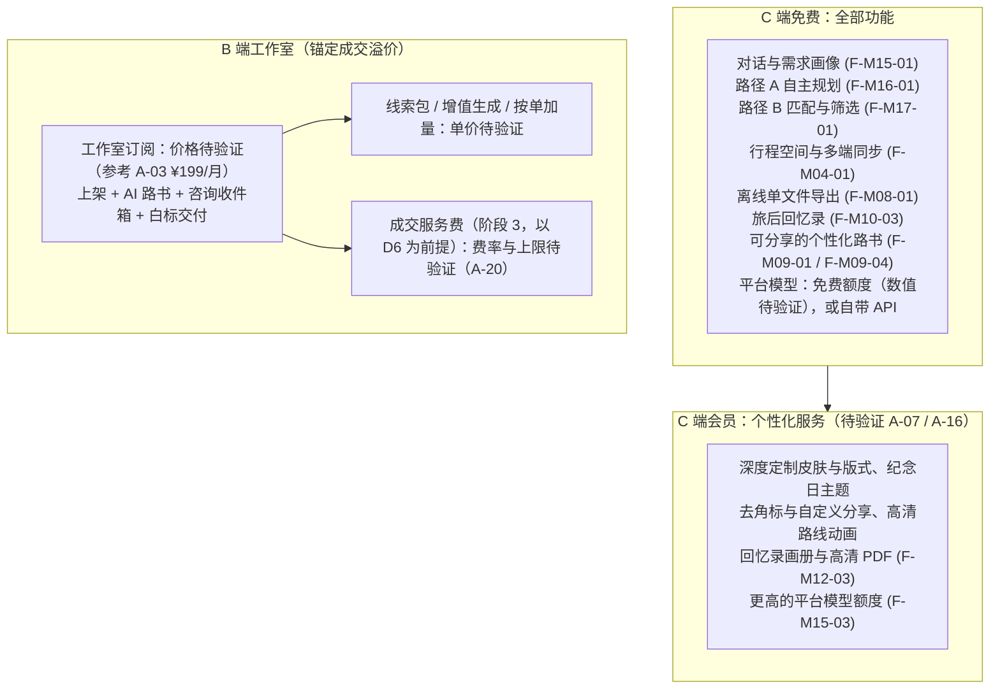
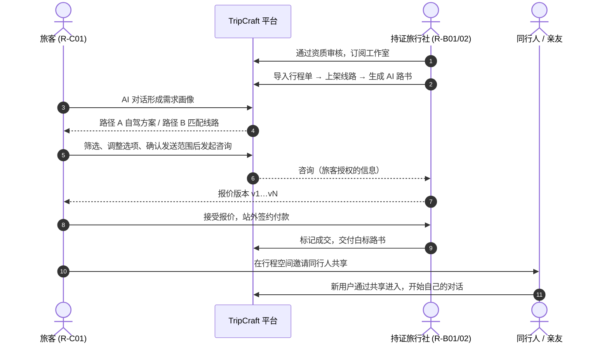

# PRD-05 · 商业模式与商业化设计

## 1. 收入来源体系 (Revenue Streams)

TripCraft 是双边产品：C 端提供需求与流量，B 端（持证旅行社）提供本地供给并付费。**主要收入放在与旅行社合作的一侧，旅客无感**（D7）；C 端**免费版使用全部功能**（保证粘性），可分享的个性化路书是获客入口，会员只提供更多个性化服务，另对平台模型的超额使用收费（D9）。

| 收入来源分类 | 具体收费项 | 付费主体 | 对应功能 ID | 成熟度 | 关联假设与依据 |
| :--- | :--- | :--- | :--- | :--- | :--- |
| **B 端：工作室订阅** | 线路上架、AI 交互路书、咨询收件箱、白标交付；含一定数量的有效咨询 | 旅行社 | `F-M12-01`, `F-M18-02`, `F-M18-03`, `F-M18-06` | 假设 | [A-03](../ASSUMPTIONS.md)、[A-17](../ASSUMPTIONS.md) |
| **B 端：线索包** | 超出订阅包含量的有效咨询（按旅客确认发送的咨询计） | 旅行社 | `F-M18-06` | 假设 | [A-17](../ASSUMPTIONS.md) |
| **B 端：增值生成** | 路线动画、分享卡片批量生成、自定义域名白标 | 旅行社 | `F-M18-04`, `F-M11-01` | 假设 | [A-04](../ASSUMPTIONS.md) |
| **B 端：按单加量包** | 为自有客户制作白标路书超出配额 | 旅行社 | `F-M12-02`, `F-M11-02` | 假设 | [A-03](../ASSUMPTIONS.md) ｜ [docs/13 §13.9.2](../13-agency-partnership-design.md#1392-计费单位四个选项只有一个是对的) |
| **B 端：成交服务费**（阶段 3 起，以 D6 为前提） | 旅客经站内交易成交时，按团款比例向旅行社收取服务费，设上限；经持牌支付机构分账，平台不设资金池；费率写进合作协议、在工作室逐单可查，旅客价格不加价 | 旅行社 | `F-M12-04` | 待决（D6） | [A-20](../ASSUMPTIONS.md) |
| **C 端：免费（全部功能）** | 对话与需求画像、路径 A、路径 B、行程空间与多端同步、离线单文件导出、旅后回忆录；**AI 生成的可分享个性化路书**（自动生成的一套皮肤、分享卡片、标清路线动画，带「用 TripCraft 制作」角标）（平台模型免费额度内，或自带 API 不限） | — | `F-M15-01`, `F-M16-01`, `F-M17-01`, `F-M04-01`, `F-M08-01`, `F-M08-02`, `F-M09-01`, `F-M09-04`, `F-M10-03` | 无需验证 | 获客、粘性与口碑的前提；分享获客待验证 [A-19](../ASSUMPTIONS.md) |
| **C 端：会员（个性化服务）** | 手动定制行程皮肤与版式（[docs/09 §9.0.3](../09-visual-design-system.md#903-免费与会员)）、纪念日主题与扉页、去角标与自定义分享、高清无角标路线动画、回忆录画册与高清 PDF（实体画册按单收费）；附带更高的平台模型额度；按月订阅之外评估「单趟解锁」 | C 端用户 | `F-M12-03`, `F-M15-03` | 待验证 | [A-07](../ASSUMPTIONS.md)、[A-16](../ASSUMPTIONS.md) |
| **生态：外链分销** | 景点预约、酒店等第三方平台外链佣金 | 第三方平台 | `F-M05-01` | 假设 | [A-01](../ASSUMPTIONS.md)、[A-02](../ASSUMPTIONS.md) |

**不采用的收入方式**：

| 方式 | 不采用的理由 |
| :--- | :--- |
| 阶段 1–2 收成交佣金 | 平台不经手团款，无法核实成交金额；按自报收佣会激励旅行社瞒报。阶段 3 起以 D6 为前提改收成交服务费（D7） |
| 向旅客隐性加价或不公示的抽成 | 「旅客无感」指旅客不额外付费，不是不公示：在旅客价格之外加价或收取未标明的费用违反《明码标价和禁止价格欺诈规定》；电子商务法要求平台公示交易规则、不得向平台内经营者收取不合理费用；平台在团款里加价还可能被认定为经营旅行社业务（[docs/00 §0.3](../00-overview-and-glossary.md#03-三条责任边界线tripcraft-不是清单)） |
| 付费提升匹配度 | 匹配度是信任核心，付费不得影响它（[ADR-010](../architecture/adr/ADR-010-route-matching-scoring.md)）；远期如做推广位，必须单独标注"广告" |
| 向旅行社出售旅客数据 | 违背 [docs/17 §17.8](../17-agency-route-studio.md#178-客户归属与旅行社的顾虑) 与个人信息保护要求 |

---

## 2. 定价结构与功能分界 (Pricing Structure)

依据决策 D4，沿用仓库已有的假设数字，其余数字一律标为"待验证"，不编造数字：

### 功能分界原则
- **C 端免费分界**（D9，2026-10-22）：**免费版使用全部功能**；AI 生成的可分享个性化路书也免费，因为它是获客入口——凡是让一次出行规划得出、走得通、留得下的能力（对话、两条路径、共享与同步、离线导出、车机投递、长辈模式、回忆录）都不设付费墙；会员只卖「更像这趟旅行、更像这家人」的个性化服务。平台模型是算力，不是功能：免费额度用完后可改用自带 API 继续使用全部功能。
- **B 端付费分界**：凡是让旅行社"被看见、被信任、成交"的能力（上架、AI 路书、咨询、白标）归入订阅；生成量大的能力（动画、批量卡片）按量计费。
- **「旅客无感、对旅行社公开」**（D7，2026-10-22）：平台的主要收入放在旅行社一侧——旅客看到的就是旅行社的报价，平台不另外加价、不在旅客价格里藏费用；向旅行社收的每一笔费用（订阅、线索、成交服务费）都写进合作协议与平台规则、在工作室可查；任何费用都不影响匹配度（ADR-010）。成交服务费会放大 [docs/13 §13.3.3](../13-agency-partnership-design.md#1333-三条不越线) 的风险（旅行社藏价格、把客户拉到站外），所以设上限，并由 [A-20](../ASSUMPTIONS.md) 验证。

---

## 3. 价值流与闭环机制

---

## 4. 获客与冷启动策略 (GTM & Pilot Plan)

双边产品的冷启动难点是**路径 B 需要先有供给**。策略是"按区域同时点燃两边"：

1. **选一个区域做透**：首个区域建议为河西走廊 / 甘青环线（母本《西行计划》的实战区域，样例数据与线路经验最多）。
2. **先签供给（阶段 1）**：在该区域签 3–5 家持证地接社，用"导入现有行程单"把他们已有的线路上架（[docs/13 §13.5](../13-agency-partnership-design.md#135--冷启动第一批怎么签) 的单点突破脚本仍然适用）。阶段 1 线路上架但不对旅客开放匹配，先积累数量与完整度。
3. **C 端先靠路径 A（阶段 1）**：路径 A 不依赖供给，任何区域都能用；它负责获客与验证对话与规划质量。
4. **路径 B 按区域开放（阶段 2）**：一个区域的在售线路达到可用数量（门槛待定）后，对该区域的画像开放路径 B。
5. **用空结果数据指导签约**：路径 B 的空结果按区域、日期、人群统计（[docs/16 §16.4](../16-planning-paths-and-route-matching.md#164-路径选择)），决定下一批签哪里的旅行社。

**试点成功标准（指标占位）**：
- 试点旅行社从导入到线路上架的平均耗时；上架线路的完整度；
- 路径 A 方案保存率与行程空间邀请加入率；
- 路径 B 开放后，咨询 → 报价的响应时长与咨询 → 成交转化（旅行社自报 + 抽样回访）。

---

## 5. 指标体系（建议北极星与核心运营指标）

> 标注：全部目标值均为 **`Proposed`（建议值）**，需依据试点实测校准。

### 建议北极星指标 (North Star Metric)
- **`Proposed` 核心指标**：**月度确定方案数**——当月满足以下任一条件的行程数：① 路径 A 方案被保存且至少 1 名同行人加入行程空间；② 路径 B 报价被旅客接受。
- **为什么**：它同时反映 C 端（方案有用、有人共享）与 B 端（成交）的价值；单看对话数或曝光数会奖励"热闹但没结果"。

### 核心指标分解表

| 维度 | 指标名称 | 定义与统计方式 | 业务意义 |
| :--- | :--- | :--- | :--- |
| **C 端** | 画像完成率 | 开始对话的会话中，形成并确认画像的比例 | 追问是否劝退用户 |
| | 路径 A 保存率 | 生成的草案被保存进行程空间的比例 | 规划质量 |
| | 共享率 | 行程空间中有 ≥ 1 名同行人加入的比例 | 多人共享主张是否成立 |
| | 多端活跃 | 同一账号在 ≥ 2 台设备上活跃的比例 | 多端同步主张是否成立（[A-12](../ASSUMPTIONS.md)） |
| | 路径 B 咨询率 | 进入筛选页的会话中发起咨询的比例 | 匹配与筛选是否有用 |
| **B 端** | 在售线路数与完整度 | 按区域统计 | 供给是否足以支撑路径 B |
| | 咨询响应时长 | 咨询 → 首个报价的中位时长 | 旅客体验与旅行社投入度 |
| | 咨询成交率 | 报价被接受的咨询占比 | 匹配质量与旅行社价值 |
| | 续费率 | 工作室订阅到期续费比例 | B 端商业模式的最终验证 |
| **平台** | 匹配度校准 | 匹配度分段与咨询率是否单调 | 匹配度是否"说得准"（[A-15](../ASSUMPTIONS.md)） |
| | 空结果率 | 路径 B 筛选后无结果的会话比例（按区域） | 供给缺口 |

---

## 6. 单位经济模型骨架 (Unit Economics Framework)

### 变量与参数定义
- **$ARPU_{B}$**：平均每家旅行社月度收入（工作室订阅 + 线索包 + 增值，待测算）。
- **$CAC_{B}$**：旅行社获客成本（地面 BD 为主，待测算）。
- **$Churn_{B}$**：旅行社月度流失率（待测算）。
- **$LTV_{B}$**：$LTV = \frac{ARPU \times GrossMargin}{Churn}$。
- **$Cost_{conv}$**：每次形成需求画像 + 一次规划的平台模型与图商调用成本（待测算）；**$r_{BYOK}$**：使用自带 API 的会话占比（这部分不产生平台推理成本）。

### 成本驱动结构 (Cost Drivers)

| 成本要素 | 成本性质 | 驱动因子 | 敏感性与控制手段 |
| :--- | :--- | :--- | :--- |
| **AI 模型推理** | 可变成本 | 对话轮次、路径 A 编排的 Token 数、AI 路书与行程单抽取 | **高**（C 端成为主入口后）。追问 ≤ 3 轮；平台模型设免费额度；自带 API 分流（[ADR-009](../architecture/adr/ADR-009-llm-provider-byok.md)） |
| **地图 / 路线 API** | 可变成本 | 路径 A 走廊检索与算路次数、POI 核验 | **极高**。走廊采样点数可配置；POI 检索结果按条款允许的范围缓存（[ADR-005](../architecture/adr/ADR-005-map-navigation-abstraction.md)、[A-09](../ASSUMPTIONS.md)） |
| **对象存储与 CDN** | 可变成本 | 路线动画视频、素材、分享链接 | **中等**。动画保存镜头脚本，视频按需渲染 |
| **同步与实时** | 半固定成本 | 在线设备数、操作日志量 | **中等**。服务端权威日志 + 增量（[ADR-002](../architecture/adr/ADR-002-sync-conflict-model.md)） |
| **人工审核与客服** | 半固定成本 | 资质审核、线路审核、咨询纠纷 | **中等**。资质 OCR 与规则预审 |

### 敏感性与利润测算表
- **测算结论**：**待测算**（完成首个区域试点、拿到真实模型与图商账单后回填）。

---

## 7. 行业竞争格局 (Competitive Landscape)

复用 [docs/13 §13.8](../13-agency-partnership-design.md#138--市场与竞争格局为什么这件事还没被做掉) 的事实分析，并补充产品基线 v3 下的对照：

| 参与方类型 | 典型代表 | 核心优势 | TripCraft 的差异 |
| :--- | :--- | :--- | :--- |
| **OTA 及其 AI 助手** | 携程、飞猪、同程及其 AI 行程助手（[§13.8.5](../13-agency-partnership-design.md#1385--ai-生成行程是入场券不是差异)） | 流量、交易闭环、海量 POI | 我们不比"生成"——AI 生成是入场券。差异在：**多人共享的行程空间**、**本地持证地接社的真实供给**、**价格与线路的透明度** |
| **通用大模型** | 各类通用对话助手 | 对话能力强 | 不追问、不核验、不能多人协作、没有本地旅行社供给；且 TripCraft 允许用户继续使用自己喜欢的模型（BYOK） |
| **内容与社区平台** | 小红书、马蜂窝、抖音 | 海量 UGC，种草能力强 | 强于灵感，弱于可执行的方案与可信的本地服务 |
| **旅行社 SaaS** | 路书科技、指南猫（[§13.8.3](../13-agency-partnership-design.md#1383--但没有人在做是不准确的)） | 十年 B 端积累 | 它们服务旅行社的内部效率；TripCraft 同时连接需求侧，把线路匹配给合适的旅客 |
| **地图导航** | 高德、百度 | 图资与导航 | 不做导航；在其之上做规划、共享与匹配 |

> ⚠️ 上表的差异论述是**待验证的判断**（[A-13](../ASSUMPTIONS.md)、[A-14](../ASSUMPTIONS.md)），不是已验证的结论。

---

## 8. 法律红线与经营风险管控

1. **旅行社资质红线**：只有持证旅行社可以上架与被匹配；平台不为无证主体引流（[docs/13 §13.5.4](../13-agency-partnership-design.md#1354--一个必须先回答的问题他有资质吗)）。
2. **平台角色**：做匹配后，平台很可能被认定为在线旅游平台经营者，承担资质审核、信息公示等义务；匹配引流的合规边界须律师出具意见（OI-021，与 OI-016 / OI-017 同一次咨询）。
3. **资金**：阶段 1–2 不经手团款；站内交易须经 D6 决策与律师意见。
4. **算法与广告**：付费不影响匹配度；推广位标注"广告"；提供非个性化排序（OI-021）。
5. **AI 生成内容**：显式与隐式标识；不生成景点照片（OI-023）。
6. **自带模型**：Key 不出设备；境外服务商的数据出境告知（OI-022）。
7. **OTA 外链与价格不确定性**（[A-01](../ASSUMPTIONS.md)）：不承诺 OTA 数据直连，外链均标注第三方平台跳转。
