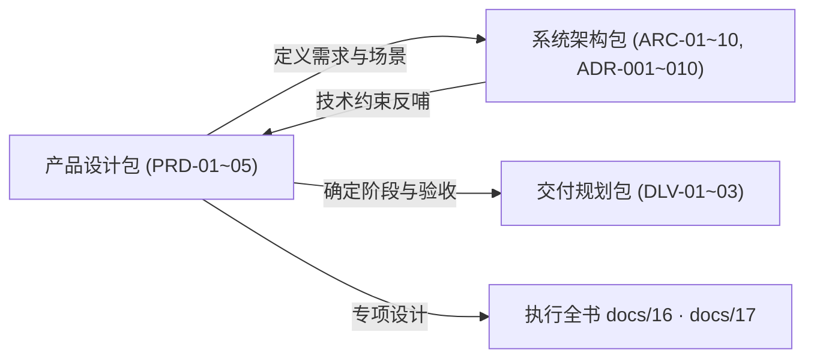

# TripCraft · 产品需求设计包 (Product Specification Package)

> 本目录归档 TripCraft 产品需求与业务架构设计文档（PRD-01 ~ PRD-05）。设计状态：`Draft v3（按 2026-10-17 产品基线修订，待 owner 评审）`。
>
> **口径优先级**：[PRD-01](PRD-01-vision-positioning.md) 是全仓库产品口径的唯一基准；其余文档与之冲突时以 PRD-01 为准（见 [PRD-01 §0](PRD-01-vision-positioning.md#0-文档地位与口径优先级)）。

---

## 1. 文档导航与索引

| 编号 | 文档标题 | 文件名 | 核心职责与关键输出 |
| :--- | :--- | :--- | :--- |
| **PRD-01** | 愿景、定位与能力边界（产品基线 v3） | [`PRD-01-vision-positioning.md`](PRD-01-vision-positioning.md) | 一句话定位、核心流程（对话 → 画像 → 双路径 → 共享同步）、三大支柱与 B 端线、能力边界、被取代的旧口径、待决策事项 D5–D9 |
| **PRD-02** | 用户与客户模型 | [`PRD-02-personas-segments.md`](PRD-02-personas-segments.md) | C 端与旅行社细分、10 个角色、3 张虚构人物卡、双边价值流与客户归属 |
| **PRD-03** | 业务与使用场景 | [`PRD-03-scenarios.md`](PRD-03-scenarios.md) | 20 个端到端场景：主线 S-C01 / S-C08 / S-C09 / S-C02、旅行社主线 S-B06 ~ S-B08、治理 S-P02，以及支撑场景 |
| **PRD-04** | 功能架构与功能规格 | [`PRD-04-functional-architecture.md`](PRD-04-functional-architecture.md) | M01–M18 共 76 项功能、P0~P2 优先级、全部 P0 功能验收卡（Given/When/Then） |
| **PRD-05** | 商业模式与商业化设计 | [`PRD-05-business-model.md`](PRD-05-business-model.md) | 收入来源（旅行社为主）、定价分界、双边冷启动策略、北极星指标、单位经济骨架、竞争对照 |

---

## 2. 与系统架构及交付层的关联

- **专项设计**：对话入口、双路径与筛选页见 [第 16 章](../16-planning-paths-and-route-matching.md)；旅行社线路工作室见 [第 17 章](../17-agency-route-studio.md)。
- **架构承接**：PRD-04 各模块对应 [`ARC-05`](../architecture/ARC-05-backend-integrations.md) 的后端逻辑模块 (`S-*`) 与客户端载体 (`C-*`)。
- **交付落地**：全部 P0 功能纳入 [`DLV-01`](../delivery/DLV-01-roadmap-mvp.md) 阶段 1 或阶段 2，由 [`DLV-03`](../delivery/DLV-03-traceability-matrix.md) 追溯矩阵闭环验证。
